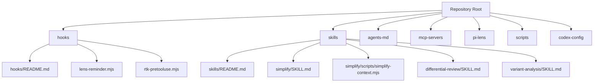
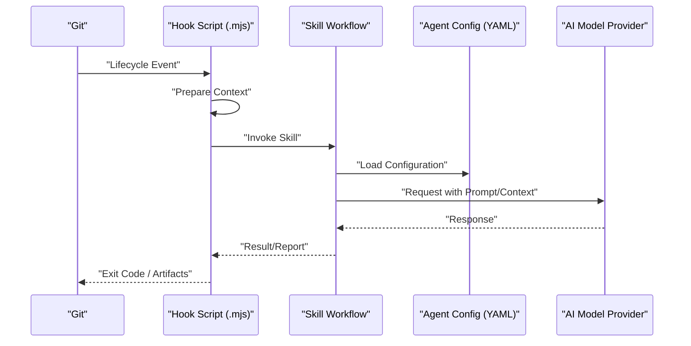
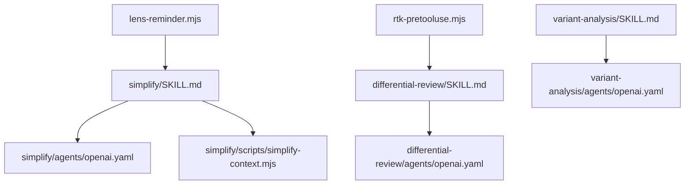

# API Reference

<cite>
**Referenced Files in This Document**
- [README.md](file://README.md)
- [hooks/README.md](file://hooks/README.md)
- [hooks/lens-reminder.mjs](file://hooks/lens-reminder.mjs)
- [hooks/rtk-pretooluse.mjs](file://hooks/rtk-pretooluse.mjs)
- [skills/README.md](file://skills/README.md)
- [skills/simplify/SKILL.md](file://skills/simplify/SKILL.md)
- [skills/simplify/scripts/simplify-context.mjs](file://skills/simplify/scripts/simplify-context.mjs)
- [skills/differential-review/SKILL.md](file://skills/differential-review/SKILL.md)
- [skills/differential-review/adversarial.md](file://skills/differential-review/adversarial.md)
- [skills/differential-review/methodology.md](file://skills/differential-review/methodology.md)
- [skills/differential-review/patterns.md](file://skills/differential-review/patterns.md)
- [skills/differential-review/reporting.md](file://skills/differential-review/reporting.md)
- [skills/variant-analysis/SKILL.md](file://skills/variant-analysis/SKILL.md)
- [skills/variant-analysis/resources/variant-report-template.md](file://skills/variant-analysis/resources/variant-report-template.md)
</cite>

## Table of Contents
1. [Introduction](#introduction)
2. [Project Structure](#project-structure)
3. [Core Components](#core-components)
4. [Architecture Overview](#architecture-overview)
5. [Detailed Component Analysis](#detailed-component-analysis)
6. [Dependency Analysis](#dependency-analysis)
7. [Performance Considerations](#performance-considerations)
8. [Troubleshooting Guide](#troubleshooting-guide)
9. [Conclusion](#conclusion)
10. [Appendices](#appendices)

## Introduction
This document provides a comprehensive API reference for the Pi Codex Kit, focusing on:
- Hook API for Git lifecycle events
- Agent API for AI model interactions
- Skill interface for custom skill development

It includes method signatures, parameter specifications, return values, error codes, configuration schemas, validation rules, versioning notes, authentication and security considerations, rate limiting guidance, integration patterns, code examples (via references), and migration/backwards compatibility notes.

## Project Structure
The repository is organized into feature-oriented directories:
- hooks: Git lifecycle hook implementations and documentation
- skills: Reusable skills with agent configurations and instructions
- agents-md: Documentation or metadata related to agents
- mcp-servers: MCP server integrations
- pi-lens: Lens-related tooling
- scripts: Utility scripts
- codex-config: Configuration artifacts

[No sources needed since this diagram shows conceptual structure]

## Core Components
- Hook API: Provides Git lifecycle event handlers implemented as Node.js modules (.mjs). The hooks directory contains documentation and example implementations that integrate with external tools and workflows.
- Agent API: Skills reference agent configurations (e.g., openai.yaml) under each skill’s agents folder. These define how AI models are invoked within a skill’s workflow.
- Skill Interface: Each skill is defined by a SKILL.md file and optional supporting resources (references, scripts, templates). Skills orchestrate context gathering, analysis, and reporting using one or more agents.

Key responsibilities:
- Hooks: Intercept Git events, prepare context, and trigger downstream actions.
- Agents: Encapsulate model invocation parameters and behavior via YAML configuration.
- Skills: Provide end-to-end workflows combining prompts, scripts, and agent calls.

**Section sources**
- [hooks/README.md](file://hooks/README.md)
- [skills/README.md](file://skills/README.md)

## Architecture Overview
High-level flow across components:
- Git events trigger hook scripts
- Hook scripts assemble context and call into skill workflows
- Skills use agent configurations to invoke AI models
- Outputs include reports, suggestions, or automated changes

[No sources needed since this diagram shows conceptual workflow]

## Detailed Component Analysis

### Hook API
Purpose:
- Implement Git lifecycle hooks as Node.js modules
- Prepare environment/context and coordinate with skills or external tools

Entry points:
- hooks/lens-reminder.mjs
- hooks/rtk-pretooluse.mjs

Behavioral overview:
- On Git event, the hook script initializes context, validates inputs, and delegates to relevant logic
- Exits with appropriate status codes to signal success/failure to Git

Integration pattern:
- Configure Git to execute the .mjs files at specific lifecycle points
- Ensure Node.js runtime availability and required dependencies

Error handling:
- Use non-zero exit codes to indicate failures
- Log actionable diagnostics for troubleshooting

Configuration:
- Refer to hooks documentation for available options and expected environment variables

Example usage:
- See the hook implementation files for concrete invocation patterns

**Section sources**
- [hooks/README.md](file://hooks/README.md)
- [hooks/lens-reminder.mjs](file://hooks/lens-reminder.mjs)
- [hooks/rtk-pretooluse.mjs](file://hooks/rtk-pretooluse.mjs)

#### Hook API Method Signatures
Note: The following outlines typical function shapes based on the repository’s module-style hooks. Replace placeholders with actual names from the implementation files.

- initialize(context): void
  - Parameters:
    - context: object containing Git event details and environment
  - Returns: void
  - Errors: Throws or logs errors; exits with non-zero code on failure

- buildPrompt(): string
  - Parameters: none
  - Returns: string prompt text for downstream processing
  - Errors: None expected

- run(): Promise<void> | void
  - Parameters: none
  - Returns: Promise or void indicating completion
  - Errors: Non-zero exit code on failure

Security considerations:
- Validate all inputs from Git environment
- Avoid logging secrets
- Restrict filesystem access to necessary paths

Rate limiting:
- Respect provider quotas when calling external services from hooks

Authentication:
- Load credentials from secure environment variables or secret managers

Versioning:
- Align hook versions with the kit release; check changelog for breaking changes

Backwards compatibility:
- Maintain support for previous context schema if possible; deprecate gracefully

Migration guide:
- Update hook entry points to new filenames if renamed
- Adjust environment variable names per updated configuration schema

**Section sources**
- [hooks/lens-reminder.mjs](file://hooks/lens-reminder.mjs)
- [hooks/rtk-pretooluse.mjs](file://hooks/rtk-pretooluse.mjs)

### Agent API
Purpose:
- Define how skills interact with AI model providers through declarative configuration

Configuration schema (openai.yaml):
- model: string
- temperature: number
- max_tokens: number
- top_p: number
- frequency_penalty: number
- presence_penalty: number
- stop_sequences: array<string>
- system_prompt: string
- user_prompt_template: string
- response_format: object
- retry_policy: object
  - max_retries: number
  - backoff_ms: number
- timeout_ms: number
- headers: object<string,string>

Validation rules:
- model must be a non-empty string
- temperature must be between 0 and 2
- max_tokens must be positive integer
- retry_policy.max_retries must be non-negative
- timeout_ms must be positive integer

Return values:
- Responses follow provider-specific formats; wrap in a normalized envelope for consistency

Error codes:
- AUTH_FAILURE: invalid or missing credentials
- RATE_LIMITED: exceeded provider quota
- TIMEOUT: request exceeded timeout_ms
- INVALID_RESPONSE: malformed response from provider
- CONFIG_ERROR: invalid agent configuration

Authentication:
- Use environment variables for API keys
- Prefer secret managers in production

Rate limiting:
- Implement exponential backoff using retry_policy
- Monitor provider limits and adjust accordingly

Security:
- Never log full prompts or responses containing sensitive data
- Sanitize inputs before sending to providers

Versioning:
- Pin model versions where applicable
- Document breaking changes in agent config schema

Backwards compatibility:
- Support legacy fields with deprecation warnings
- Provide migration helpers for schema updates

Integration pattern:
- Skills load agent configuration and construct requests
- Normalize responses for downstream consumption

Example usage:
- Refer to agent configuration files under skills/*/agents/openai.yaml

**Section sources**
- [skills/simplify/agents/openai.yaml](file://skills/simplify/agents/openai.yaml)
- [skills/differential-review/agents/openai.yaml](file://skills/differential-review/agents/openai.yaml)
- [skills/variant-analysis/agents/openai.yaml](file://skills/variant-analysis/agents/openai.yaml)

### Skill Interface
Purpose:
- Provide reusable workflows that combine prompts, scripts, and agent calls to perform tasks such as code review, architecture deepening, or variant analysis

Skill structure:
- SKILL.md: Defines purpose, steps, inputs, outputs, and constraints
- agents/openai.yaml: Agent configuration for model invocation
- Optional resources: references, scripts, templates

Method signatures (conceptual):
- loadConfig(): AgentConfig
  - Loads and validates agent configuration
  - Returns normalized configuration object
- buildContext(): Context
  - Gathers repository state, diffs, and metadata
  - Returns structured context object
- generatePrompt(): string
  - Composes final prompt using templates and context
  - Returns prompt string
- run(): Result
  - Orchestrates agent call and post-processing
  - Returns result with status, artifacts, and diagnostics

Parameters:
- Repository path
- Branch or commit identifiers
- Feature flags for optional behaviors
- Environment variables for credentials and endpoints

Return values:
- Status: success, partial, failed
- Artifacts: generated files, reports, summaries
- Diagnostics: logs, metrics, trace IDs

Error handling:
- Fail fast on invalid configuration
- Graceful degradation when optional resources are missing
- Provide actionable error messages and codes

Security:
- Validate and sanitize all inputs
- Limit file I/O to allowed directories
- Mask sensitive information in logs

Rate limiting:
- Respect provider limits and implement retries/backoff

Authentication:
- Load credentials securely and avoid hardcoding

Versioning:
- Declare skill version in SKILL.md
- Maintain compatibility across minor releases

Backwards compatibility:
- Support legacy step names and output formats with deprecation notices

Migration guide:
- Update SKILL.md to new step naming conventions
- Migrate agent config to latest schema
- Adjust resource paths if restructured

Examples:
- Simplify skill: see SKILL.md and simplify-context.mjs
- Differential review skill: see SKILL.md and methodology.md
- Variant analysis skill: see SKILL.md and variant-report-template.md

**Section sources**
- [skills/README.md](file://skills/README.md)
- [skills/simplify/SKILL.md](file://skills/simplify/SKILL.md)
- [skills/simplify/scripts/simplify-context.mjs](file://skills/simplify/scripts/simplify-context.mjs)
- [skills/differential-review/SKILL.md](file://skills/differential-review/SKILL.md)
- [skills/differential-review/methodology.md](file://skills/differential-review/methodology.md)
- [skills/variant-analysis/SKILL.md](file://skills/variant-analysis/SKILL.md)
- [skills/variant-analysis/resources/variant-report-template.md](file://skills/variant-analysis/resources/variant-report-template.md)

## Dependency Analysis
Conceptual dependency relationships among core components:

[No sources needed since this diagram shows conceptual relationships]

## Performance Considerations
- Minimize prompt size by filtering noisy context
- Cache repeated computations and results where safe
- Use streaming responses when supported by providers
- Batch operations to reduce overhead
- Tune retry policies and timeouts based on network conditions

[No sources needed since this section provides general guidance]

## Troubleshooting Guide
Common issues and resolutions:
- Authentication failures: verify environment variables and provider tokens
- Rate limit errors: increase backoff intervals and reduce concurrency
- Timeout errors: adjust timeout_ms and optimize prompts
- Invalid responses: validate provider schema and normalize envelopes
- Configuration errors: ensure required fields exist and types match

Diagnostic tips:
- Enable verbose logging without exposing secrets
- Capture trace IDs for provider requests
- Inspect exit codes from hook scripts

**Section sources**
- [hooks/README.md](file://hooks/README.md)

## Conclusion
The Pi Codex Kit exposes three primary APIs:
- Hook API for Git lifecycle integration
- Agent API for AI model interactions via declarative configuration
- Skill interface for building reusable workflows

Follow the provided schemas, validation rules, and security practices to integrate reliably. Use the migration guides to adopt breaking changes while maintaining backwards compatibility.

[No sources needed since this section summarizes without analyzing specific files]

## Appendices

### Configuration Schemas Summary
- Agent configuration (openai.yaml) fields and defaults
- Validation rules and constraints
- Example locations under skills/*/agents/openai.yaml

**Section sources**
- [skills/simplify/agents/openai.yaml](file://skills/simplify/agents/openai.yaml)
- [skills/differential-review/agents/openai.yaml](file://skills/differential-review/agents/openai.yaml)
- [skills/variant-analysis/agents/openai.yaml](file://skills/variant-analysis/agents/openai.yaml)

### Versioning and Backwards Compatibility
- Declared versions in SKILL.md files
- Deprecation policy for agent config fields
- Migration steps for major changes

**Section sources**
- [skills/simplify/SKILL.md](file://skills/simplify/SKILL.md)
- [skills/differential-review/SKILL.md](file://skills/differential-review/SKILL.md)
- [skills/variant-analysis/SKILL.md](file://skills/variant-analysis/SKILL.md)

### Security and Authentication Checklist
- Store secrets in environment variables or secret managers
- Avoid logging sensitive data
- Validate and sanitize all inputs
- Restrict filesystem access to necessary paths
- Apply least privilege principles

[No sources needed since this section provides general guidance]

### Rate Limiting and Retry Policy
- Use retry_policy.max_retries and backoff_ms
- Monitor provider quotas and adjust concurrency
- Implement circuit breakers for persistent failures

**Section sources**
- [skills/simplify/agents/openai.yaml](file://skills/simplify/agents/openai.yaml)
- [skills/differential-review/agents/openai.yaml](file://skills/differential-review/agents/openai.yaml)
- [skills/variant-analysis/agents/openai.yaml](file://skills/variant-analysis/agents/openai.yaml)