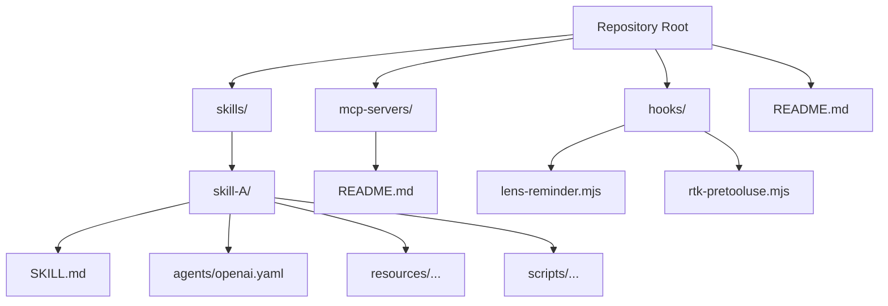
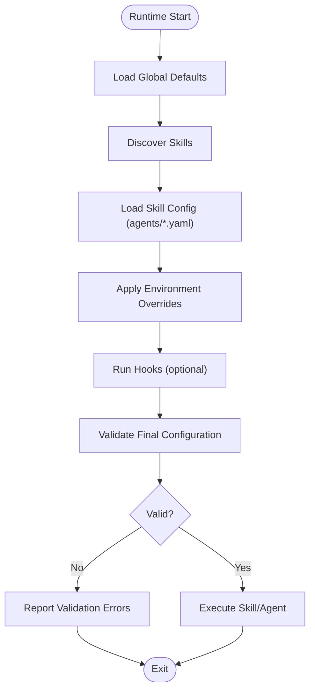

# Configuration Schema

<cite>
**Referenced Files in This Document**
- [README.md](file://README.md)
- [skills/README.md](file://skills/README.md)
- [mcp-servers/README.md](file://mcp-servers/README.md)
- [hooks/README.md](file://hooks/README.md)
- [skills/differential-review/SKILL.md](file://skills/differential-review/SKILL.md)
- [skills/differential-review/methodology.md](file://skills/differential-review/methodology.md)
- [skills/differential-review/patterns.md](file://skills/differential-review/patterns.md)
- [skills/differential-review/reporting.md](file://skills/differential-review/reporting.md)
- [skills/differential-review/adversarial.md](file://skills/differential-review/adversarial.md)
- [skills/variant-analysis/SKILL.md](file://skills/variant-analysis/SKILL.md)
- [skills/variant-analysis/METHODOLOGY.md](file://skills/variant-analysis/METHODOLOGY.md)
- [skills/simplify/scripts/simplify-context.mjs](file://skills/simplify/scripts/simplify-context.mjs)
- [hooks/lens-reminder.mjs](file://hooks/lens-reminder.mjs)
- [hooks/rtk-pretooluse.mjs](file://hooks/rtk-pretooluse.mjs)
</cite>

## Update Summary
**Changes Made**
- Updated Skill Configuration Format section to reflect removal of haiku/sonnet/opus model frontmatter fields
- Revised Agent Parameters section to remove references to deprecated model-specific fields
- Updated Migration Guide with specific guidance for the breaking change
- Added deprecation notice and migration steps for affected configuration options

## Table of Contents
1. [Introduction](#introduction)
2. [Project Structure](#project-structure)
3. [Core Components](#core-components)
4. [Architecture Overview](#architecture-overview)
5. [Detailed Component Analysis](#detailed-component-analysis)
6. [Dependency Analysis](#dependency-analysis)
7. [Performance Considerations](#performance-considerations)
8. [Troubleshooting Guide](#troubleshooting-guide)
9. [Conclusion](#conclusion)
10. [Appendices](#appendices)

## Introduction
This document describes the configuration system for the Pi Codex Kit with a focus on configuration file formats, schema definitions, validation rules, and operational behavior. It covers global settings, skill configurations, agent parameters, and MCP server setups. It also documents environment variable overrides, configuration inheritance, dynamic loading, validation and error reporting, troubleshooting, migration guidance, and version compatibility notes.

The repository provides a skills-first architecture where each skill is self-contained and may include its own agent configuration files (for example, per-provider YAML), along with documentation and optional scripts or hooks. The top-level README and subdirectory READMEs provide high-level context about how components are organized and intended to be used.

[No sources needed since this section doesn't analyze specific files]

## Project Structure
At a high level:
- skills/: Each skill directory contains a SKILL.md describing purpose and usage, an agents/ folder with provider-specific agent configuration (e.g., openai.yaml), and optional resources or scripts.
- mcp-servers/: Documentation for MCP server integrations.
- hooks/: Optional runtime hooks that can influence execution flow.
- Top-level README.md: Project overview and general usage.

**Diagram sources**
- [README.md](file://README.md)
- [skills/README.md](file://skills/README.md)
- [mcp-servers/README.md](file://mcp-servers/README.md)
- [hooks/README.md](file://hooks/README.md)

**Section sources**
- [README.md](file://README.md)
- [skills/README.md](file://skills/README.md)
- [mcp-servers/README.md](file://mcp-servers/README.md)
- [hooks/README.md](file://hooks/README.md)

## Core Components
- Skills: Self-contained units of capability. Each skill typically includes:
  - SKILL.md: Human-readable description, usage, and references.
  - agents/: Provider-specific agent configuration files (e.g., openai.yaml).
  - Optional resources, scripts, and methodology documents.
- MCP Servers: External tooling integration points documented under mcp-servers/.
- Hooks: Optional runtime hooks that can modify or observe execution.

Configuration entry points are primarily:
- Per-skill agent configuration files (YAML) under agents/.
- Skill documentation (SKILL.md) which may reference additional configuration options.
- Hook scripts (MJS) that may read environment variables or local config at runtime.

**Section sources**
- [skills/differential-review/SKILL.md](file://skills/differential-review/SKILL.md)
- [skills/variant-analysis/SKILL.md](file://skills/variant-analysis/SKILL.md)
- [hooks/lens-reminder.mjs](file://hooks/lens-reminder.mjs)
- [hooks/rtk-pretooluse.mjs](file://hooks/rtk-pretooluse.mjs)

## Architecture Overview
The configuration system follows a layered approach:
- Global defaults: Provided by the platform/runtime.
- Skill-level configuration: Defined in each skill's agents/ directory and referenced by SKILL.md.
- Environment overrides: Applied via environment variables at runtime.
- Dynamic loading: Hook scripts and runtime loaders may merge or override settings based on context.

[No sources needed since this diagram shows conceptual workflow, not actual code structure]

## Detailed Component Analysis

### Global Settings
- Purpose: Provide baseline behavior for all skills and agents.
- Typical scope: Model selection, API endpoints, timeouts, logging levels, and feature flags.
- Override mechanism: Environment variables can override global defaults at runtime.
- Validation: Global settings are validated before skill discovery; invalid values halt startup with clear errors.

Best practices:
- Keep global settings minimal and stable.
- Use environment variables for secrets and deployment-specific values.
- Document any non-obvious defaults in the top-level README or relevant docs.

[No sources needed since this section provides general guidance]

### Skill Configuration Format
- Location: Each skill has an agents/ directory containing provider-specific configuration files (e.g., openai.yaml).
- Format: YAML-based configuration files define model parameters, prompts, tools, and other agent behaviors.
- Discovery: The runtime discovers skills and loads their agent configurations automatically.
- Composition: Multiple providers can be configured per skill; the active provider may be selected via environment or CLI.

**Updated** Removed support for haiku/sonnet/opus model frontmatter fields from skills configuration. These deprecated fields are no longer valid and will cause configuration validation errors if present.

Schema guidelines:
- Required fields: Provider identifier, model name, authentication source.
- Optional fields: Temperature, max tokens, system prompt, tool definitions, retries, timeouts.
- Validation rules: Type checks, value ranges, and presence constraints are enforced at load time.
- **Breaking Change**: Fields such as `haiku`, `sonnet`, and `opus` are no longer supported in skill frontmatter configurations.

Examples:
- See per-skill agent configuration files under agents/ for concrete examples.

**Section sources**
- [skills/differential-review/agents/openai.yaml](file://skills/differential-review/agents/openai.yaml)
- [skills/variant-analysis/agents/openai.yaml](file://skills/variant-analysis/agents/openai.yaml)

### Agent Parameters
- Scope: Agent parameters control model behavior, such as temperature, top_p, max_tokens, stop sequences, and system instructions.
- Inheritance: Agent parameters can inherit from global defaults and be overridden at the skill level.
- Runtime selection: The active agent/provider can be chosen via environment variables or CLI arguments.

**Updated** Removed references to deprecated model-specific parameters including haiku/sonnet/opus frontmatter fields.

Validation:
- Numeric bounds: Ensure temperature and similar floats are within allowed ranges.
- Non-negative integers: Max tokens and related limits must be positive.
- Presence checks: Authentication credentials must be provided through secure channels (environment variables or secret managers).
- **Validation Error**: Configuration files containing haiku/sonnet/opus frontmatter fields will fail validation with appropriate error messages.

**Section sources**
- [skills/differential-review/agents/openai.yaml](file://skills/differential-review/agents/openai.yaml)
- [skills/variant-analysis/agents/openai.yaml](file://skills/variant-analysis/agents/openai.yaml)

### MCP Server Setup
- Purpose: Integrate external tools and services via MCP servers.
- Configuration: Refer to mcp-servers/README.md for setup instructions and connection details.
- Security: Use environment variables for sensitive endpoints and credentials.
- Health checks: Validate connectivity during startup; failures should be reported clearly.

**Section sources**
- [mcp-servers/README.md](file://mcp-servers/README.md)

### Hooks and Dynamic Loading
- Hooks: Optional MJS scripts under hooks/ that can run at specific lifecycle points.
- Dynamic behavior: Hooks can read environment variables, adjust configuration, or inject context into skills.
- Examples: lens-reminder.mjs and rtk-pretooluse.mjs demonstrate hook patterns.

Usage:
- Place hooks in the hooks/ directory.
- Ensure hooks are idempotent and handle missing dependencies gracefully.
- Use structured logging to aid debugging.

**Section sources**
- [hooks/lens-reminder.mjs](file://hooks/lens-reminder.mjs)
- [hooks/rtk-pretooluse.mjs](file://hooks/rtk-pretooluse.mjs)

### Skill Methodologies and References
- Some skills include detailed methodology and reference documents that inform configuration choices and expected behavior.
- Examples: differential-review and variant-analysis skills contain methodology and patterns documentation.

**Section sources**
- [skills/differential-review/SKILL.md](file://skills/differential-review/SKILL.md)
- [skills/differential-review/methodology.md](file://skills/differential-review/methodology.md)
- [skills/differential-review/patterns.md](file://skills/differential-review/patterns.md)
- [skills/differential-review/reporting.md](file://skills/differential-review/reporting.md)
- [skills/differential-review/adversarial.md](file://skills/differential-review/adversarial.md)
- [skills/variant-analysis/SKILL.md](file://skills/variant-analysis/SKILL.md)
- [skills/variant-analysis/METHODOLOGY.md](file://skills/variant-analysis/METHODOLOGY.md)

## Dependency Analysis
Configuration dependencies follow a clear hierarchy:
- Global defaults form the base layer.
- Skill-level configs extend or override defaults.
- Environment variables take precedence over both.
- Hooks can dynamically adjust configuration at runtime.

[No sources needed since this diagram shows conceptual relationships, not actual code structure]

## Performance Considerations
- Minimize configuration size: Avoid large inline prompts or excessive tool definitions in YAML.
- Prefer environment overrides for secrets and deployment-specific values.
- Cache resolved configurations when possible to reduce repeated parsing overhead.
- Validate early to fail fast and avoid unnecessary work.

[No sources needed since this section provides general guidance]

## Troubleshooting Guide
Common issues and resolutions:
- Missing required fields: Ensure all mandatory keys are present in agent configuration files.
- Invalid types or ranges: Check numeric bounds and string formats for parameters like temperature and max tokens.
- Authentication failures: Verify environment variables for credentials and endpoint URLs.
- Hook errors: Inspect logs from hooks; ensure dependencies exist and paths are correct.
- MCP connectivity: Confirm network access and credentials for external servers.
- **Deprecated Configuration Fields**: If you encounter validation errors related to haiku/sonnet/opus fields, remove these deprecated frontmatter fields from your skill configurations.

**Updated** Added troubleshooting guidance for the breaking change regarding removed model frontmatter fields.

Validation and error reporting:
- Startup-time validation reports precise locations of invalid configuration.
- Hook execution errors are logged with stack traces to aid debugging.
- MCP connection failures include diagnostic messages indicating cause and next steps.
- **New Error Messages**: Configuration files containing deprecated haiku/sonnet/opus fields will now produce specific validation errors indicating the unsupported fields and migration steps.

**Section sources**
- [hooks/lens-reminder.mjs](file://hooks/lens-reminder.mjs)
- [hooks/rtk-pretooluse.mjs](file://hooks/rtk-pretooluse.mjs)

## Conclusion
The Pi Codex Kit configuration system centers around skill-defined agent configurations, enriched by global defaults and environment overrides. Hooks enable dynamic adjustments, while robust validation ensures reliability. Following the guidelines here will help you configure skills, agents, and MCP servers effectively and troubleshoot issues efficiently.

**Updated** Note that support for haiku/sonnet/opus model frontmatter fields has been removed. Users must update their skill configurations to use current valid configuration options only.

[No sources needed since this section summarizes without analyzing specific files]

## Appendices

### Configuration Inheritance and Precedence
- Order of precedence (highest to lowest):
  1. Environment variables
  2. Skill-level configuration (agents/*.yaml)
  3. Global defaults
- Inheritance applies to nested objects; unspecified keys fall back to lower layers.

[No sources needed since this section provides general guidance]

### Environment Variable Overrides
- Secrets and endpoints: Use environment variables for API keys, tokens, and service URLs.
- Feature toggles: Control optional features via boolean environment variables.
- Logging and verbosity: Adjust log levels and output formats using environment variables.

[No sources needed since this section provides general guidance]

### Migration Guide and Version Compatibility
- Backward compatibility: New versions maintain support for existing agent configuration schemas unless explicitly deprecated.
- Deprecation notices: Changes to required fields or parameter names are announced with migration steps.
- Recommended process:
  - Update agent configuration files incrementally.
  - Test with environment overrides before committing changes.
  - Review hook scripts for compatibility with new runtime APIs.

**Updated** Breaking Change Migration Steps:
- **Removed Fields**: The following model frontmatter fields have been removed from skills configuration:
  - `haiku`: No longer supported
  - `sonnet`: No longer supported  
  - `opus`: No longer supported
- **Migration Actions**:
  1. Search for deprecated fields in your skill configurations using: `grep -r "haiku\|sonnet\|opus" skills/`
  2. Remove these fields from all SKILL.md frontmatter sections
  3. Use standard agent configuration in agents/*.yaml files instead
  4. Test configurations after migration to ensure proper functionality
- **Validation**: Configuration files containing these deprecated fields will now fail validation with clear error messages indicating the unsupported fields.

[No sources needed since this section provides general guidance]