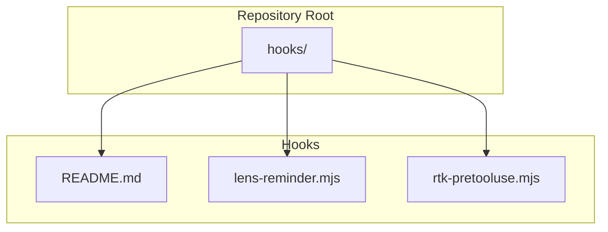
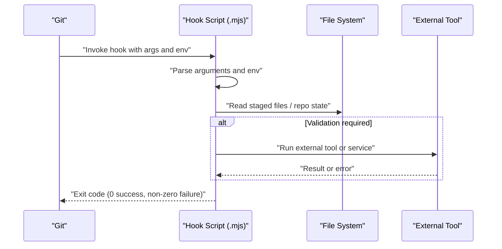
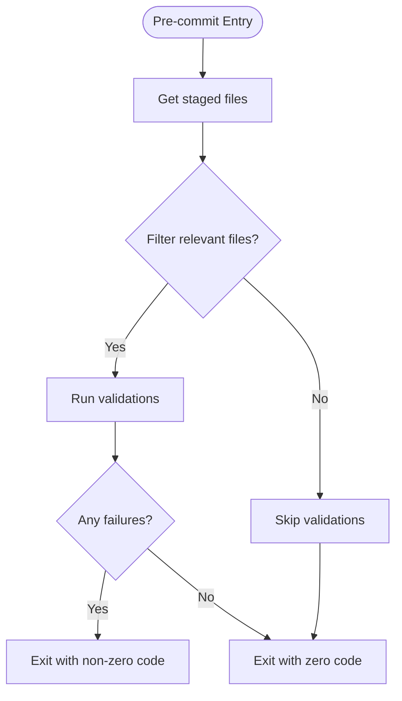
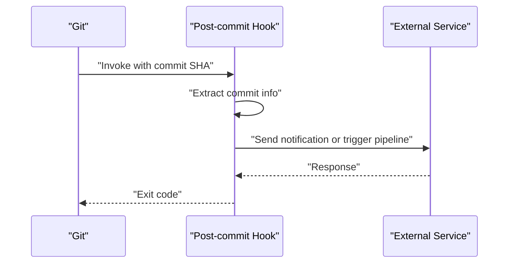
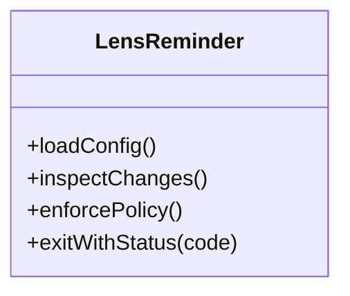
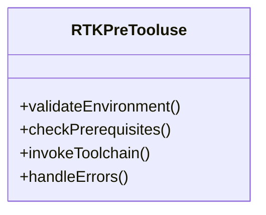
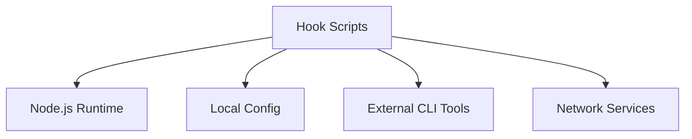

# Hook API

<cite>
**Referenced Files in This Document**
- [hooks/README.md](file://hooks/README.md)
- [hooks/lens-reminder.mjs](file://hooks/lens-reminder.mjs)
- [hooks/rtk-pretooluse.mjs](file://hooks/rtk-pretooluse.mjs)
</cite>

## Table of Contents
1. [Introduction](#introduction)
2. [Project Structure](#project-structure)
3. [Core Components](#core-components)
4. [Architecture Overview](#architecture-overview)
5. [Detailed Component Analysis](#detailed-component-analysis)
6. [Dependency Analysis](#dependency-analysis)
7. [Performance Considerations](#performance-considerations)
8. [Troubleshooting Guide](#troubleshooting-guide)
9. [Conclusion](#conclusion)
10. [Appendices](#appendices)

## Introduction
This document provides detailed API documentation for the Pi Codex Kit Git hook system. It explains how hooks are structured, how they receive parameters and environment context, and how to implement custom hooks using the lens-reminder and rtk-pretooluse patterns. It also covers configuration options, error handling strategies, debugging techniques, performance considerations, security implications, and best practices.

## Project Structure
The Git hook implementation is located under the hooks directory. The key files include:
- A README describing the hook system and usage
- Example hook implementations demonstrating common patterns

**Diagram sources**
- [hooks/README.md](file://hooks/README.md)
- [hooks/lens-reminder.mjs](file://hooks/lens-reminder.mjs)
- [hooks/rtk-pretooluse.mjs](file://hooks/rtk-pretooluse.mjs)

**Section sources**
- [hooks/README.md](file://hooks/README.md)
- [hooks/lens-reminder.mjs](file://hooks/lens-reminder.mjs)
- [hooks/rtk-pretooluse.mjs](file://hooks/rtk-pretooluse.mjs)

## Core Components
This section outlines the core components of the hook system and their responsibilities:
- Hook entry points: Each .mjs file represents a hook that can be invoked by Git at specific lifecycle events.
- Parameter passing: Hooks receive arguments from Git (for example, pre-commit receives no arguments; post-commit receives the commit SHA).
- Execution context: Hooks run in a Node.js environment with access to the repository’s working tree and standard environment variables provided by Git.
- Configuration: Hook behavior can be influenced by local configuration files or environment variables.
- Error handling: Non-zero exit codes signal failure to Git, preventing the operation from completing.

Key responsibilities:
- Validate changes before committing (pre-commit)
- Process artifacts after committing (post-commit)
- Integrate with external tools via child processes or HTTP requests

**Section sources**
- [hooks/README.md](file://hooks/README.md)
- [hooks/lens-reminder.mjs](file://hooks/lens-reminder.mjs)
- [hooks/rtk-pretooluse.mjs](file://hooks/rtk-pretooluse.mjs)

## Architecture Overview
The hook architecture follows a simple pattern:
- Git invokes a hook script at a specific lifecycle event
- The script parses arguments and environment variables
- The script performs validation or processing logic
- The script exits with a status code indicating success or failure

[No sources needed since this diagram shows conceptual workflow, not actual code structure]

## Detailed Component Analysis

### Pre-commit Hook Pattern (Validation)
Pre-commit hooks typically validate staged changes before allowing a commit. Common tasks include linting, formatting checks, and policy enforcement.

Implementation guidance:
- Read the list of staged files from Git’s index
- Run linters or validators on relevant files
- Fail fast if any rule is violated
- Provide clear error messages to guide developers

[No sources needed since this diagram shows conceptual workflow, not actual code structure]

**Section sources**
- [hooks/README.md](file://hooks/README.md)

### Post-commit Hook Pattern (Processing)
Post-commit hooks execute after a commit is created. They are suitable for notifications, artifact generation, or integration with CI systems.

Implementation guidance:
- Retrieve the commit SHA from arguments
- Fetch metadata such as author, message, and changed files
- Trigger downstream processes (e.g., build, deploy, notify)
- Handle errors gracefully without blocking future commits

[No sources needed since this diagram shows conceptual workflow, not actual code structure]

**Section sources**
- [hooks/README.md](file://hooks/README.md)

### Lens Reminder Hook (lens-reminder.mjs)
The lens-reminder hook demonstrates a reminder-style check that can enforce policies or prompt actions based on repository state.

Key aspects:
- Reads configuration or rules from local files
- Inspects staged or committed content
- Provides actionable feedback to developers
- Exits with appropriate status codes

**Diagram sources**
- [hooks/lens-reminder.mjs](file://hooks/lens-reminder.mjs)

**Section sources**
- [hooks/lens-reminder.mjs](file://hooks/lens-reminder.mjs)

### RTK Pre-tooluse Hook (rtk-pretooluse.mjs)
The rtk-pretooluse hook illustrates a pre-execution guard that prepares or validates prerequisites before running a toolchain.

Key aspects:
- Validates environment setup and dependencies
- Ensures required inputs exist and are correct
- Integrates with external tooling via subprocesses or APIs
- Fails early when prerequisites are missing

**Diagram sources**
- [hooks/rtk-pretooluse.mjs](file://hooks/rtk-pretooluse.mjs)

**Section sources**
- [hooks/rtk-pretooluse.mjs](file://hooks/rtk-pretooluse.mjs)

## Dependency Analysis
Hooks may depend on:
- Node.js runtime and ES modules support
- Local configuration files (YAML, JSON, or JS)
- External CLI tools invoked via child processes
- Network services for remote validation or notifications

[No sources needed since this diagram shows conceptual relationships, not actual code structure]

**Section sources**
- [hooks/README.md](file://hooks/README.md)
- [hooks/lens-reminder.mjs](file://hooks/lens-reminder.mjs)
- [hooks/rtk-pretooluse.mjs](file://hooks/rtk-pretooluse.mjs)

## Performance Considerations
- Keep hooks fast and deterministic to avoid slowing down developer workflows
- Avoid unnecessary network calls; cache results when possible
- Limit file scanning to only staged or relevant files
- Use incremental checks instead of full repository scans
- Parallelize independent tasks within the hook where safe

[No sources needed since this section provides general guidance]

## Troubleshooting Guide
Common issues and resolutions:
- Hook fails silently: Ensure proper logging and capture stderr/stdout
- Environment mismatch: Verify Node.js version and module resolution paths
- Permission errors: Confirm read/write permissions for required directories
- External tool failures: Implement retries and fallbacks with informative messages
- Debugging tips:
  - Enable verbose logging locally
  - Test hooks against small diffs first
  - Use temporary output files for inspection

**Section sources**
- [hooks/README.md](file://hooks/README.md)

## Conclusion
The Pi Codex Kit’s Git hook system provides a flexible foundation for enforcing quality and integrating development workflows. By following the patterns demonstrated in lens-reminder and rtk-pretooluse, teams can implement robust pre-commit and post-commit hooks that enhance productivity and maintainability.

[No sources needed since this section summarizes without analyzing specific files]

## Appendices

### Hook Lifecycle Events
- Pre-commit: Runs before a commit is finalized; ideal for validation
- Post-commit: Runs after a commit is created; ideal for notifications and processing

[No sources needed since this section provides general guidance]

### Parameter Passing Mechanisms
- Arguments: Passed by Git depending on the hook type (e.g., commit SHA for post-commit)
- Environment variables: Provided by Git (e.g., repository path, user info)
- File system access: Hooks can read staged files and repository metadata

[No sources needed since this section provides general guidance]

### Execution Context
- Node.js environment with ES modules
- Access to repository working tree
- Ability to spawn child processes and make network requests

[No sources needed since this section provides general guidance]

### Configuration Options
- Local config files in repository root or hooks directory
- Environment variables for toggling features and endpoints
- Command-line flags passed by Git (hook-specific)

[No sources needed since this section provides general guidance]

### Error Handling Strategies
- Exit with non-zero codes to fail the operation
- Provide clear, actionable error messages
- Log details to stderr for debugging
- Gracefully handle partial failures without blocking subsequent steps

[No sources needed since this section provides general guidance]

### Security Implications
- Validate all inputs and sanitize outputs
- Avoid executing untrusted commands
- Restrict network access to known endpoints
- Store secrets securely and never log sensitive data

[No sources needed since this section provides general guidance]

### Best Practices
- Keep hooks modular and testable
- Prefer deterministic behavior over flaky integrations
- Document hook expectations and configuration clearly
- Provide templates and examples for common scenarios

[No sources needed since this section provides general guidance]

### Code Templates for Common Scenarios
- Pre-commit validation template:
  - Steps: get staged files, filter by extension, run linter, aggregate results, exit with status
- Post-commit processing template:
  - Steps: parse commit SHA, fetch metadata, call external service, handle response, exit with status
- Integration with external tools:
  - Steps: invoke CLI via child process, capture output, parse results, report failures

[No sources needed since this section provides general guidance]