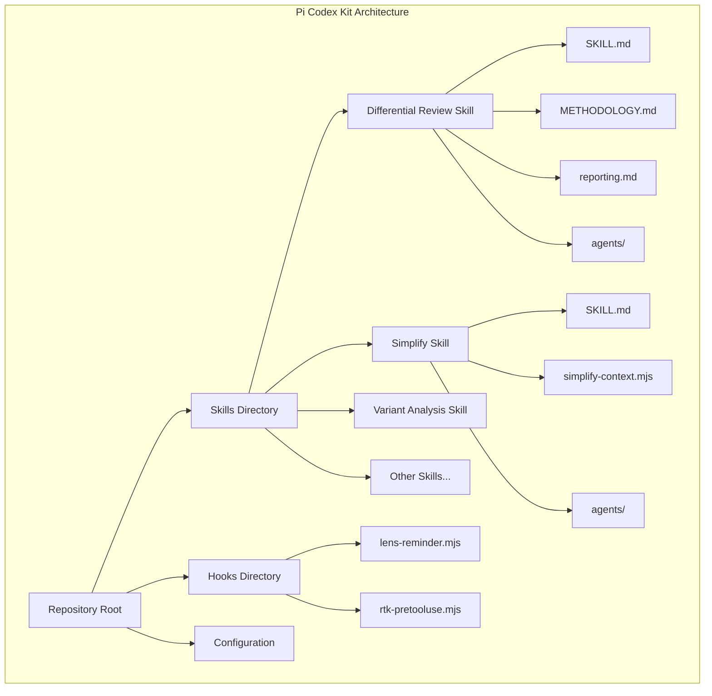
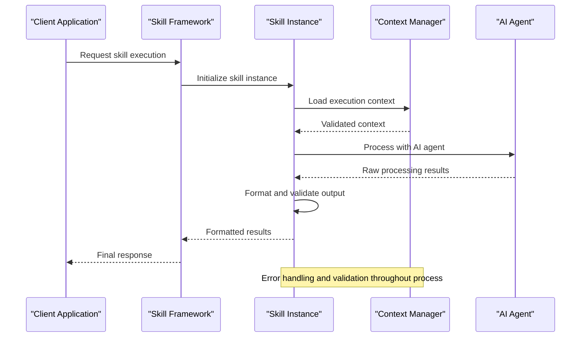
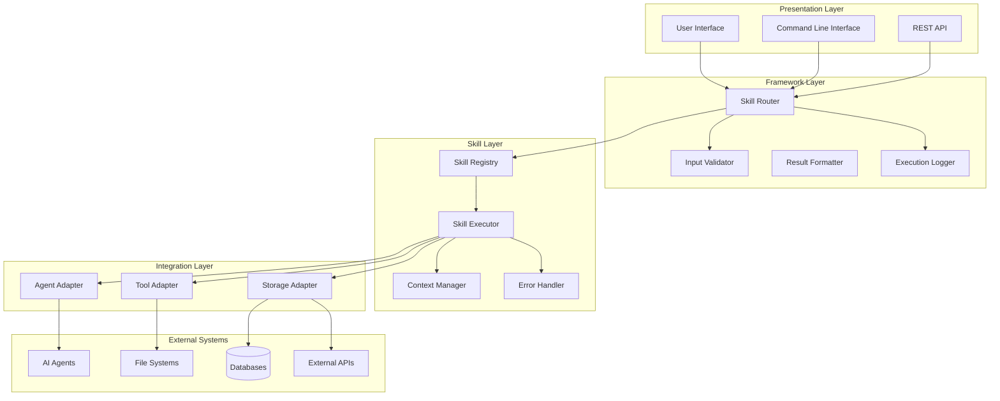
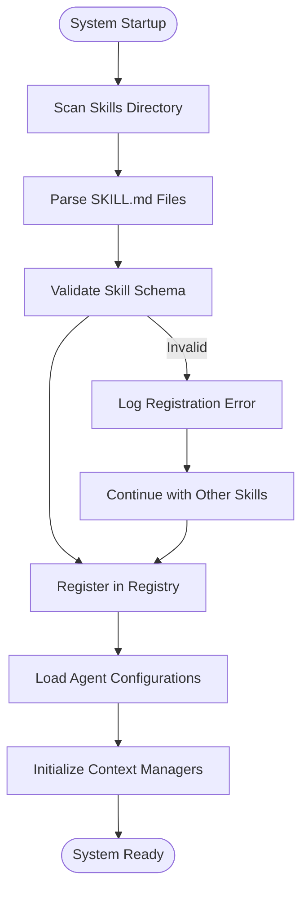
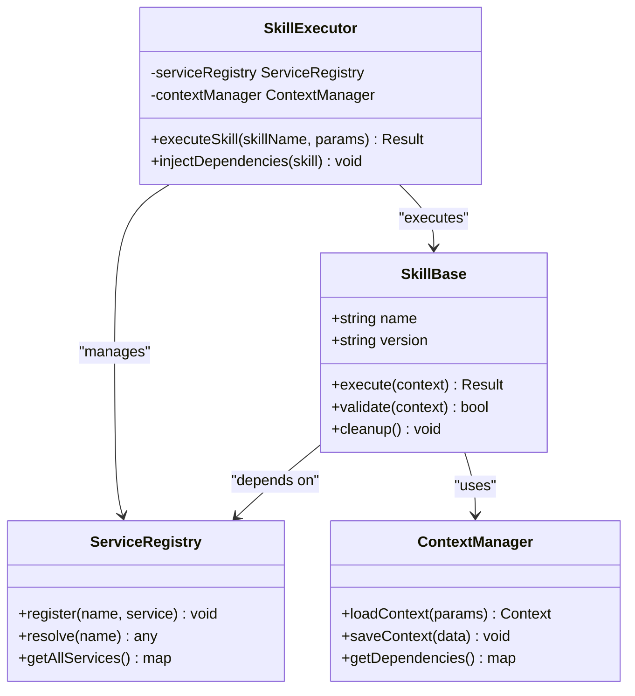
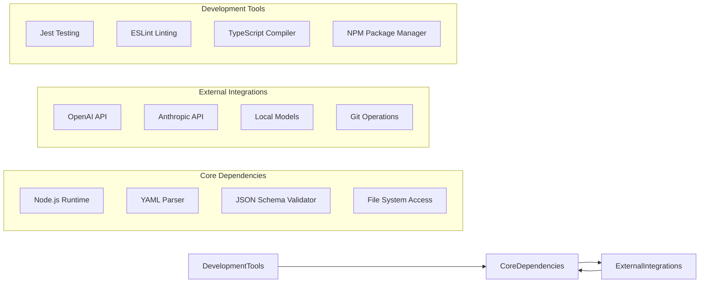

# Skill Interface

<cite>
**Referenced Files in This Document**
- [README.md](file://README.md)
- [skills/README.md](file://skills/README.md)
- [skills/differential-review/SKILL.md](file://skills/differential-review/SKILL.md)
- [skills/differential-review/METHODOLOGY.md](file://skills/differential-review/METHODOLOGY.md)
- [skills/differential-review/reporting.md](file://skills/differential-review/reporting.md)
- [skills/simplify/SKILL.md](file://skills/simplify/SKILL.md)
- [skills/simplify/scripts/simplify-context.mjs](file://skills/simplify/scripts/simplify-context.mjs)
- [skills/variant-analysis/SKILL.md](file://skills/variant-analysis/SKILL.md)
- [skills/variant-analysis/resources/variant-report-template.md](file://skills/variant-analysis/resources/variant-report-template.md)
- [hooks/lens-reminder.mjs](file://hooks/lens-reminder.mjs)
- [hooks/rtk-pretooluse.mjs](file://hooks/rtk-pretooluse.mjs)
</cite>

## Table of Contents
1. [Introduction](#introduction)
2. [Project Structure](#project-structure)
3. [Core Components](#core-components)
4. [Architecture Overview](#architecture-overview)
5. [Detailed Component Analysis](#detailed-component-analysis)
6. [Dependency Analysis](#dependency-analysis)
7. [Performance Considerations](#performance-considerations)
8. [Troubleshooting Guide](#troubleshooting-guide)
9. [Conclusion](#conclusion)
10. [Appendices](#appendices)

## Introduction

The Pi Codex Kit provides a comprehensive framework for developing custom AI-powered skills that extend agent capabilities through structured, reusable components. This documentation explains how to create, register, and deploy custom skills following established patterns for execution lifecycle management, context handling, and result formatting.

The skill system enables developers to build sophisticated AI workflows that integrate seamlessly with the agent framework, supporting complex operations like code analysis, security scanning, architectural review, and automated testing.

## Project Structure

The Pi Codex Kit follows a modular architecture where each skill is self-contained within its own directory, promoting reusability and maintainability.



**Diagram sources**
- [skills/README.md:1-50](file://skills/README.md#L1-L50)
- [skills/differential-review/SKILL.md:1-30](file://skills/differential-review/SKILL.md#L1-L30)
- [skills/simplify/SKILL.md:1-30](file://skills/simplify/SKILL.md#L1-L30)

### Standard Skill Directory Structure

Each skill follows a consistent organizational pattern:

```
skill-name/
├── SKILL.md                    # Main skill definition and instructions
├── agents/                     # Agent configuration files
│   └── openai.yaml            # OpenAI-specific agent settings
├── scripts/                    # Executable helper scripts (optional)
├── resources/                  # Static assets and templates (optional)
├── references/                 # Reference documentation (optional)
└── *.md                       # Additional documentation (optional)
```

**Section sources**
- [skills/README.md:1-100](file://skills/README.md#L1-L100)
- [skills/differential-review/SKILL.md:1-50](file://skills/differential-review/SKILL.md#L1-L50)

## Core Components

### Skill Definition Schema

The core skill definition is contained within the `SKILL.md` file, which serves as both documentation and executable specification for the skill's behavior.

#### Essential Components

1. **Skill Metadata**: Identification, versioning, and capability declarations
2. **Execution Instructions**: Step-by-step procedures for skill operation
3. **Context Requirements**: Input data and environment prerequisites
4. **Output Specifications**: Expected results and formatting requirements
5. **Error Handling**: Failure modes and recovery strategies

#### Agent Configuration

Agent-specific configurations are managed through YAML files in the `agents/` directory, defining model parameters, temperature settings, and other behavioral controls.

**Section sources**
- [skills/differential-review/SKILL.md:1-100](file://skills/differential-review/SKILL.md#L1-L100)
- [skills/differential-review/agents/openai.yaml:1-50](file://skills/differential-review/agents/openai.yaml#L1-L50)

### Execution Lifecycle

The skill execution follows a well-defined lifecycle that ensures consistent behavior across different environments and use cases.



**Diagram sources**
- [skills/differential-review/SKILL.md:50-150](file://skills/differential-review/SKILL.md#L50-L150)
- [skills/simplify/scripts/simplify-context.mjs:1-100](file://skills/simplify/scripts/simplify-context.mjs#L1-L100)

### Context Management

Context management handles the flow of data between skill components, ensuring proper isolation and state management during execution.

#### Context Types

1. **Input Context**: User-provided parameters and configuration
2. **Environment Context**: System state and available resources
3. **Processing Context**: Intermediate results and temporary data
4. **Output Context**: Final formatted results and metadata

#### Context Validation

The framework validates context at multiple stages to ensure data integrity and prevent runtime errors.

**Section sources**
- [skills/simplify/scripts/simplify-context.mjs:1-200](file://skills/simplify/scripts/simplify-context.mjs#L1-L200)

### Result Formatting

Results are standardized through consistent formatting rules that enable interoperability between different skills and downstream processing systems.

#### Output Formats

1. **Structured Data**: JSON-formatted results with defined schemas
2. **Human-Readable Reports**: Markdown or HTML formatted documentation
3. **Machine-Readable Artifacts**: Code, configurations, or other programmatic outputs
4. **Audit Trails**: Execution logs and provenance information

**Section sources**
- [skills/differential-review/reporting.md:1-100](file://skills/differential-review/reporting.md#L1-L100)
- [skills/variant-analysis/resources/variant-report-template.md:1-50](file://skills/variant-analysis/resources/variant-report-template.md#L1-L50)

## Architecture Overview

The Pi Codex Kit implements a layered architecture that separates concerns while maintaining flexibility for diverse skill implementations.



**Diagram sources**
- [hooks/lens-reminder.mjs:1-100](file://hooks/lens-reminder.mjs#L1-L100)
- [hooks/rtk-pretooluse.mjs:1-100](file://hooks/rtk-pretooluse.mjs#L1-L100)

## Detailed Component Analysis

### Skill Registration Process

The skill registration system enables dynamic discovery and loading of skills without requiring application restarts.

#### Registration Flow



**Diagram sources**
- [skills/README.md:1-100](file://skills/README.md#L1-L100)
- [skills/differential-review/SKILL.md:1-50](file://skills/differential-review/SKILL.md#L1-L50)

#### Registration Requirements

1. **Valid SKILL.md**: Properly formatted skill definition
2. **Agent Configuration**: Required agent setup files
3. **Dependencies**: External tool availability verification
4. **Permission Checks**: File system and network access validation

### Dependency Injection

The framework supports flexible dependency injection patterns that allow skills to access shared services and external resources.

#### Available Dependencies

1. **Configuration Services**: Environment-specific settings
2. **Logging Services**: Structured logging and monitoring
3. **Storage Services**: File system and database access
4. **Network Services**: HTTP clients and API integrations
5. **Security Services**: Authentication and authorization

#### Injection Patterns



**Diagram sources**
- [skills/simplify/scripts/simplify-context.mjs:1-150](file://skills/simplify/scripts/simplify-context.mjs#L1-L150)

**Section sources**
- [skills/simplify/scripts/simplify-context.mjs:1-200](file://skills/simplify/scripts/simplify-context.mjs#L1-L200)

### Integration with Agent Framework

Skills integrate with the underlying agent framework through standardized interfaces that abstract away implementation details.

#### Agent Communication Protocol

1. **Request Format**: Structured prompts with context and parameters
2. **Response Processing**: Parsed results with confidence scoring
3. **Error Propagation**: Consistent error handling across layers
4. **Resource Management**: Connection pooling and timeout handling

#### Multi-Agent Support

The framework supports coordination between multiple AI agents for complex multi-step workflows.

**Section sources**
- [skills/differential-review/agents/openai.yaml:1-100](file://skills/differential-review/agents/openai.yaml#L1-L100)

### Example Skill Implementation

#### Basic Skill Pattern

A minimal skill implementation demonstrates the core patterns used throughout the framework.

#### Advanced Skill Features

Complex skills leverage additional framework capabilities including:
- Parallel processing of multiple inputs
- Streaming responses for long-running operations
- Caching mechanisms for repeated computations
- Plugin architectures for extensible functionality

**Section sources**
- [skills/differential-review/SKILL.md:100-300](file://skills/differential-review/SKILL.md#L100-L300)
- [skills/variant-analysis/SKILL.md:1-200](file://skills/variant-analysis/SKILL.md#L1-200)

## Dependency Analysis

The skill system maintains clear separation of concerns while enabling rich integration capabilities.



**Diagram sources**
- [hooks/lens-reminder.mjs:1-50](file://hooks/lens-reminder.mjs#L1-L50)
- [hooks/rtk-pretooluse.mjs:1-50](file://hooks/rtk-pretooluse.mjs#L1-L50)

### Version Compatibility

The framework maintains backward compatibility across major versions while providing migration paths for breaking changes.

### Security Boundaries

Clear security boundaries separate trusted framework code from potentially untrusted skill implementations.

**Section sources**
- [hooks/lens-reminder.mjs:1-100](file://hooks/lens-reminder.mjs#L1-L100)
- [hooks/rtk-pretooluse.mjs:1-100](file://hooks/rtk-pretooluse.mjs#L1-L100)

## Performance Considerations

### Optimization Strategies

1. **Lazy Loading**: Skills load only when needed to minimize startup time
2. **Connection Pooling**: Reuse connections to external services
3. **Caching Layers**: Implement intelligent caching for expensive operations
4. **Parallel Processing**: Execute independent operations concurrently
5. **Memory Management**: Proper cleanup of large objects and temporary files

### Resource Limits

The framework enforces resource limits to prevent individual skills from impacting overall system stability.

### Monitoring and Metrics

Built-in observability provides insights into skill performance and usage patterns.

## Troubleshooting Guide

### Common Issues

1. **Registration Failures**: Invalid skill definitions or missing dependencies
2. **Context Errors**: Missing required parameters or invalid data formats
3. **Agent Communication**: Network timeouts or authentication failures
4. **Resource Exhaustion**: Memory leaks or excessive file handle usage

### Debugging Techniques

1. **Verbose Logging**: Enable detailed execution traces
2. **Context Inspection**: Examine intermediate processing states
3. **Performance Profiling**: Identify bottlenecks and optimization opportunities
4. **Unit Testing**: Isolate and test individual skill components

### Recovery Procedures

Graceful degradation strategies ensure system stability even when individual skills fail.

**Section sources**
- [skills/differential-review/SKILL.md:200-400](file://skills/differential-review/SKILL.md#L200-L400)

## Conclusion

The Pi Codex Kit provides a robust foundation for building sophisticated AI-powered skills that integrate seamlessly with modern development workflows. By following the established patterns and best practices outlined in this documentation, developers can create reliable, maintainable, and high-performance skills that extend the capabilities of their AI agents.

The modular architecture, comprehensive error handling, and extensive integration capabilities make the framework suitable for both simple automation tasks and complex enterprise-grade applications.

## Appendices

### Quick Start Guide

1. **Create Skill Directory**: Establish basic skill structure
2. **Define SKILL.md**: Document skill behavior and requirements  
3. **Configure Agent**: Set up AI model parameters
4. **Test Locally**: Validate functionality before deployment
5. **Deploy**: Integrate with production environment

### Best Practices Checklist

- [ ] Comprehensive error handling and logging
- [ ] Input validation and sanitization
- [ ] Resource cleanup and memory management
- [ ] Security considerations and access controls
- [ ] Performance optimization and monitoring
- [ ] Documentation and examples
- [ ] Unit tests and integration tests
- [ ] Version compatibility and migration strategies