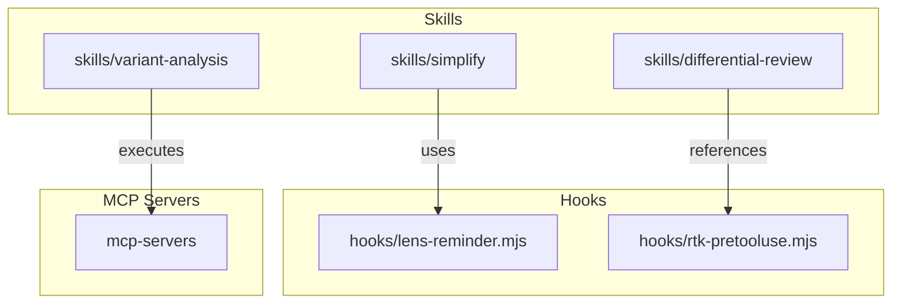
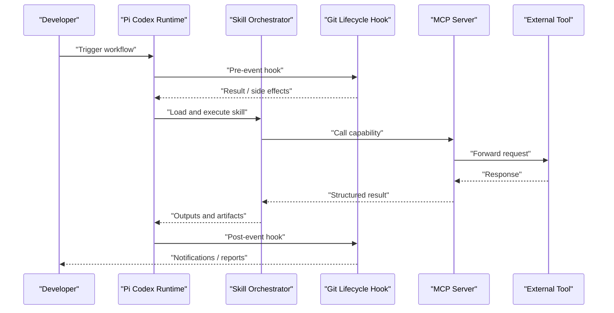
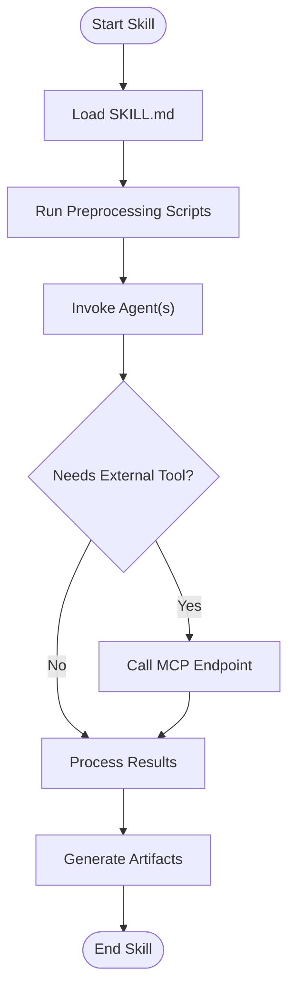
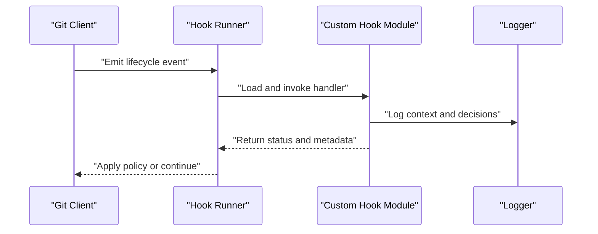
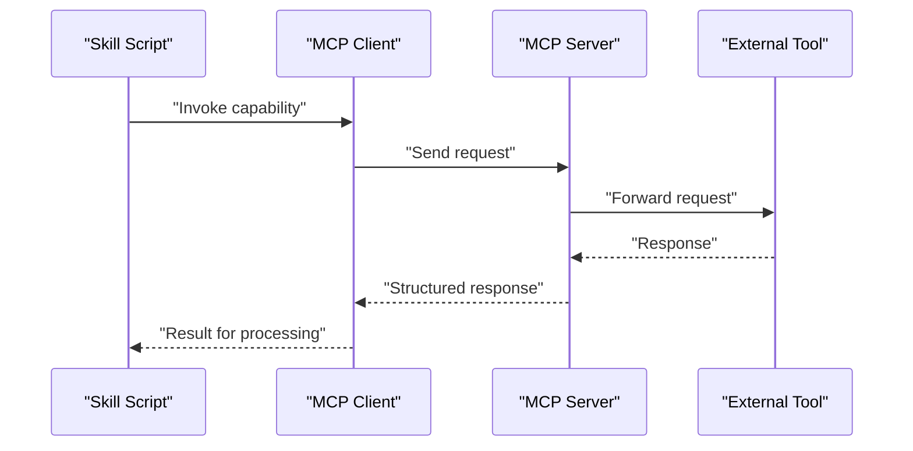
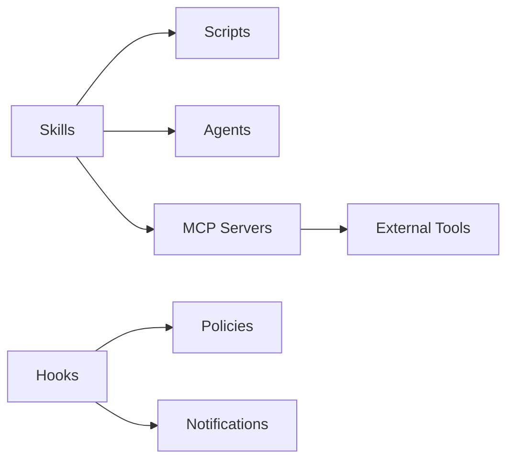

# Advanced Features

<cite>
**Referenced Files in This Document**
- [README.md](file://README.md)
- [hooks/README.md](file://hooks/README.md)
- [hooks/lens-reminder.mjs](file://hooks/lens-reminder.mjs)
- [hooks/rtk-pretooluse.mjs](file://hooks/rtk-pretooluse.mjs)
- [mcp-servers/README.md](file://mcp-servers/README.md)
- [skills/README.md](file://skills/README.md)
- [skills/simplify/SKILL.md](file://skills/simplify/SKILL.md)
- [skills/simplify/scripts/simplify-context.mjs](file://skills/simplify/scripts/simplify-context.mjs)
- [skills/differential-review/SKILL.md](file://skills/differential-review/SKILL.md)
- [skills/differential-review/adversarial.md](file://skills/differential-review/adversarial.md)
- [skills/differential-review/methodology.md](file://skills/differential-review/methodology.md)
- [skills/differential-review/patterns.md](file://skills/differential-review/patterns.md)
- [skills/differential-review/reporting.md](file://skills/differential-review/reporting.md)
- [skills/variant-analysis/SKILL.md](file://skills/variant-analysis/SKILL.md)
- [skills/variant-analysis/METHODOLOGY.md](file://skills/variant-analysis/METHODOLOGY.md)
</cite>

## Table of Contents
1. [Introduction](#introduction)
2. [Project Structure](#project-structure)
3. [Core Components](#core-components)
4. [Architecture Overview](#architecture-overview)
5. [Detailed Component Analysis](#detailed-component-analysis)
6. [Dependency Analysis](#dependency-analysis)
7. [Performance Considerations](#performance-considerations)
8. [Troubleshooting Guide](#troubleshooting-guide)
9. [Conclusion](#conclusion)
10. [Appendices](#appendices)

## Introduction
This document explains the advanced features of the Pi Codex Kit with a focus on:
- Custom skill development and composition patterns
- Hook implementation for Git lifecycle events
- MCP server integration for external tool connectivity
- Plugin architecture extension points and internal APIs
- Performance optimization, debugging, and monitoring strategies
- Contribution guidelines and compatibility maintenance

The goal is to help you extend the system safely and effectively while maintaining high performance and reliability.

## Project Structure
At a high level, the repository organizes capabilities into:
- Skills: declarative units that define agent behavior and supporting assets
- Hooks: executable scripts invoked at specific Git lifecycle events
- MCP Servers: integrations enabling communication with external tools via the Model Context Protocol
- Supporting documentation and configuration files

[No sources needed since this diagram shows conceptual workflow, not actual code structure]

## Core Components
- Skills are defined by a SKILL.md manifest and optional agents, scripts, references, and resources. They encapsulate workflows such as code simplification, differential review, or variant analysis.
- Hooks are Node.js modules (.mjs) executed during Git lifecycle events. They can observe state changes, trigger side effects, or orchestrate pre/post actions.
- MCP servers provide standardized integration points for external tools, allowing skills and hooks to call out to services through a common protocol.

Key responsibilities:
- Skills: define intent, steps, and artifacts; coordinate scripts and agents
- Hooks: intercept Git events and enforce policies or automate tasks
- MCP servers: expose capabilities to the runtime via MCP endpoints

**Section sources**
- [skills/README.md](file://skills/README.md)
- [hooks/README.md](file://hooks/README.md)
- [mcp-servers/README.md](file://mcp-servers/README.md)

## Architecture Overview
The runtime composes skills, hooks, and MCP servers to deliver an extensible developer experience. Skills may invoke scripts and MCP endpoints; hooks run around Git operations to enforce constraints and enrich context.

[No sources needed since this diagram shows conceptual workflow, not actual code structure]

## Detailed Component Analysis

### Custom Skill Development
Skills follow a consistent pattern:
- A SKILL.md file defines the skill’s purpose, inputs, outputs, and execution flow
- Optional agents directory contains agent configurations
- Optional scripts directory provides helper utilities (e.g., context builders)
- Optional references/resources include templates, rules, and methodology documents

Example patterns:
- Simplify skill uses a script to build context before invoking the main logic
- Differential review skill includes multiple supporting documents describing methodology, patterns, adversarial checks, and reporting
- Variant analysis skill integrates static analysis resources and methodology

Guidelines:
- Keep SKILL.md concise and structured; separate detailed procedures into referenced documents
- Use scripts for deterministic preprocessing and postprocessing
- Prefer MCP calls for external tool interactions to maintain portability

**Section sources**
- [skills/simplify/SKILL.md](file://skills/simplify/SKILL.md)
- [skills/simplify/scripts/simplify-context.mjs](file://skills/simplify/scripts/simplify-context.mjs)
- [skills/differential-review/SKILL.md](file://skills/differential-review/SKILL.md)
- [skills/differential-review/adversarial.md](file://skills/differential-review/adversarial.md)
- [skills/differential-review/methodology.md](file://skills/differential-review/methodology.md)
- [skills/differential-review/patterns.md](file://skills/differential-review/patterns.md)
- [skills/differential-review/reporting.md](file://skills/differential-review/reporting.md)
- [skills/variant-analysis/SKILL.md](file://skills/variant-analysis/SKILL.md)
- [skills/variant-analysis/METHODOLOGY.md](file://skills/variant-analysis/METHODOLOGY.md)

#### Skill Composition Flow

[No sources needed since this diagram shows conceptual workflow, not actual code structure]

### Hook Implementation for Git Lifecycle Events
Hooks are Node.js modules designed to run at specific Git lifecycle phases. They can:
- Inspect staged/unstaged changes
- Enforce policies (e.g., require approvals, block risky changes)
- Trigger notifications or auxiliary tasks
- Prepare environment or data for subsequent steps

Implementation tips:
- Use clear entry points and return structured results
- Avoid long-running work in pre-hooks; prefer async offloading when necessary
- Log actionable diagnostics for troubleshooting

**Section sources**
- [hooks/README.md](file://hooks/README.md)
- [hooks/lens-reminder.mjs](file://hooks/lens-reminder.mjs)
- [hooks/rtk-pretooluse.mjs](file://hooks/rtk-pretooluse.mjs)

#### Hook Execution Sequence

[No sources needed since this diagram shows conceptual workflow, not actual code structure]

### MCP Server Integration
MCP servers act as bridges between the runtime and external tools. Skills and hooks can call MCP endpoints to perform actions like code scanning, linting, or deployment.

Integration approach:
- Define MCP endpoints for each capability
- Standardize request/response schemas
- Implement retries and timeouts for resilience
- Provide clear error semantics and diagnostic payloads

**Section sources**
- [mcp-servers/README.md](file://mcp-servers/README.md)

#### MCP Interaction Flow

[No sources needed since this diagram shows conceptual workflow, not actual code structure]

### Plugin Architecture Extension Points
Extension points enable adding new capabilities without modifying core components:
- New skills: add a directory under skills with a SKILL.md and optional assets
- New hooks: add .mjs modules under hooks and register them with the runtime
- New MCP servers: implement endpoints under mcp-servers and configure discovery

Best practices:
- Maintain backward-compatible interfaces
- Version your extensions and document breaking changes
- Provide tests and examples for new extension types

**Section sources**
- [skills/README.md](file://skills/README.md)
- [hooks/README.md](file://hooks/README.md)
- [mcp-servers/README.md](file://mcp-servers/README.md)

## Dependency Analysis
The following diagram illustrates how skills, hooks, and MCP servers relate conceptually within the ecosystem.

[No sources needed since this diagram shows conceptual workflow, not actual code structure]

## Performance Considerations
- Minimize I/O in hooks; batch operations and avoid blocking the Git pipeline
- Cache expensive computations in skills and reuse across runs
- Use MCP clients with connection pooling and sensible timeouts
- Stream large outputs where possible to reduce memory pressure
- Profile critical paths using logging and metrics to identify bottlenecks

[No sources needed since this section provides general guidance]

## Troubleshooting Guide
Common issues and resolutions:
- Hook failures: verify module exports and event signatures; check logs for stack traces
- MCP errors: inspect endpoint availability, authentication, and payload schemas
- Skill execution errors: validate SKILL.md structure and referenced assets; ensure scripts are executable and have correct dependencies
- Performance regressions: measure latency per step and identify slow MCP calls or heavy scripts

Debugging approaches:
- Enable verbose logging in hooks and scripts
- Add structured diagnostics to MCP responses
- Use targeted test cases for skills and hooks to reproduce issues quickly

**Section sources**
- [hooks/README.md](file://hooks/README.md)
- [mcp-servers/README.md](file://mcp-servers/README.md)

## Conclusion
By leveraging skills, hooks, and MCP servers, the Pi Codex Kit offers a powerful and extensible platform for automating and enhancing development workflows. Follow the established patterns for skills and hooks, integrate external tools via MCP, and apply performance and debugging best practices to maintain a robust ecosystem.

[No sources needed since this section summarizes without analyzing specific files]

## Appendices

### Contributing Guidelines
- Align new skills with existing SKILL.md conventions
- Ensure hooks are idempotent and resilient to partial failures
- Document MCP endpoints thoroughly with request/response examples
- Maintain compatibility by avoiding breaking changes to public interfaces
- Include tests and examples for new features

**Section sources**
- [skills/README.md](file://skills/README.md)
- [hooks/README.md](file://hooks/README.md)
- [mcp-servers/README.md](file://mcp-servers/README.md)