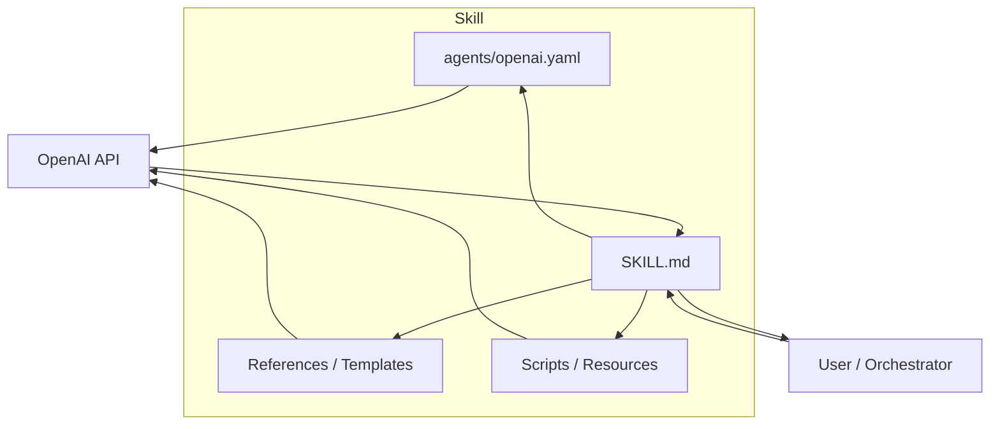
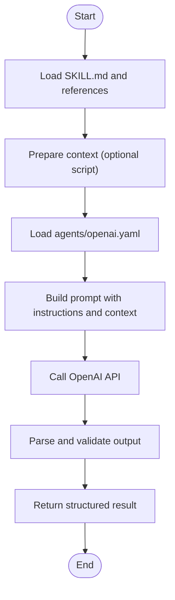
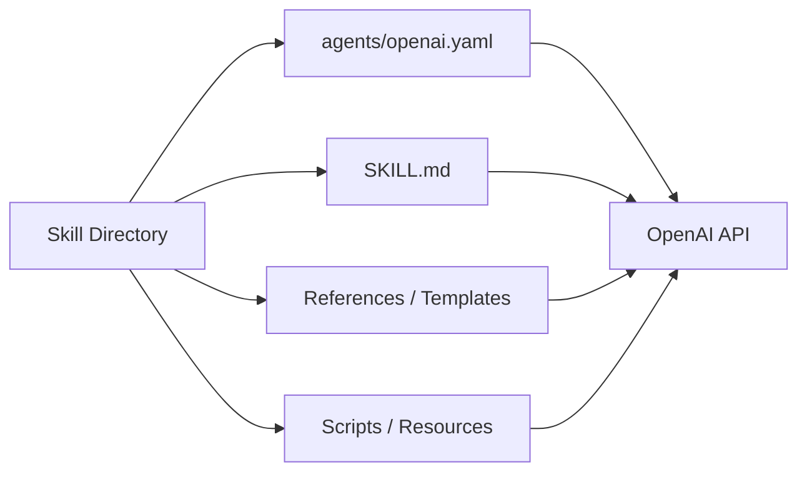

# Agent Configuration & Prompt Engineering

<cite>
**Referenced Files in This Document**
- [README.md](file://README.md)
- [skills/README.md](file://skills/README.md)
- [skills/simplify/SKILL.md](file://skills/simplify/SKILL.md)
- [skills/simplify/scripts/simplify-context.mjs](file://skills/simplify/scripts/simplify-context.mjs)
- [skills/differential-review/SKILL.md](file://skills/differential-review/SKILL.md)
- [skills/differential-review/adversarial.md](file://skills/differential-review/adversarial.md)
- [skills/differential-review/methodology.md](file://skills/differential-review/methodology.md)
- [skills/differential-review/patterns.md](file://skills/differential-review/patterns.md)
- [skills/differential-review/reporting.md](file://skills/differential-review/reporting.md)
- [skills/fp-check/SKILL.md](file://skills/fp-check/SKILL.md)
- [skills/fp-check/references/evidence-templates.md](file://skills/fp-check/references/evidence-templates.md)
- [skills/fp-check/references/false-positive-patterns.md](file://skills/fp-check/references/false-positive-patterns.md)
- [skills/fp-check/references/gate-reviews.md](file://skills/fp-check/references/gate-reviews.md)
- [skills/fp-check/references/standard-verification.md](file://skills/fp-check/references/standard-verification.md)
- [skills/variant-analysis/SKILL.md](file://skills/variant-analysis/SKILL.md)
- [skills/variant-analysis/METHODOLOGY.md](file://skills/variant-analysis/METHODOLOGY.md)
- [skills/variant-analysis/resources/variant-report-template.md](file://skills/variant-analysis/resources/variant-report-template.md)
</cite>

## Table of Contents
1. [Introduction](#introduction)
2. [Project Structure](#project-structure)
3. [Core Components](#core-components)
4. [Architecture Overview](#architecture-overview)
5. [Detailed Component Analysis](#detailed-component-analysis)
6. [Dependency Analysis](#dependency-analysis)
7. [Performance Considerations](#performance-considerations)
8. [Troubleshooting Guide](#troubleshooting-guide)
9. [Conclusion](#conclusion)
10. [Appendices](#appendices)

## Introduction
This document explains how to configure agents and engineer prompts for custom skills within the repository. It focuses on:
- The OpenAI YAML configuration format used by skills
- Model selection strategies and parameter tuning options
- Prompt engineering best practices (context management, instruction formatting, response structuring)
- Examples from existing skills demonstrating different configuration patterns
- Guidelines for testing prompts, optimizing performance, and handling varying AI model capabilities

The goal is to help you author robust, repeatable, and high-quality agent-driven workflows that are easy to maintain and evolve.

## Project Structure
Skills are organized under a dedicated directory. Each skill typically includes:
- A SKILL.md describing purpose, usage, and behavior
- An agents/openai.yaml defining model and runtime parameters
- Optional supporting materials (references, scripts, resources)

```mermaid
graph TB
root["Repository Root"] --> skills_dir["skills/"]
skills_dir --> skill_a["audit-code/"]
skills_dir --> skill_b["code-reviewer/"]
skills_dir --> skill_c["deepen-architecture/"]
skills_dir --> skill_d["develop-tdd/"]
skills_dir --> skill_e["differential-review/"]
skills_dir --> skill_f["enforce-first/"]
skills_dir --> skill_g["fp-check/"]
skills_dir --> skill_h["pi-lens-ast-grep/"]
skills_dir --> skill_i["pi-lens-lsp-navigation/"]
skills_dir --> skill_j["pi-lens-write-ast-grep-rule/"]
skills_dir --> skill_k["pi-lens-write-tree-sitter-rule/"]
skills_dir --> skill_l["request-review/"]
skills_dir --> skill_m["respond-review/"]
skills_dir --> skill_n["simplify/"]
skills_dir --> skill_o["variant-analysis/"]
skills_dir --> skill_p["verify-work/"]
skill_n --> n_agents["agents/openai.yaml"]
skill_n --> n_scripts["scripts/simplify-context.mjs"]
skill_n --> n_skill["SKILL.md"]
skill_e --> e_agents["agents/openai.yaml"]
skill_e --> e_refs["adversarial.md<br/>methodology.md<br/>patterns.md<br/>reporting.md"]
skill_e --> e_skill["SKILL.md"]
skill_g --> g_agents["agents/openai.yaml"]
skill_g --> g_refs["references/*.md"]
skill_g --> g_skill["SKILL.md"]
skill_o --> o_agents["agents/openai.yaml"]
skill_o --> o_res["resources/*"]
skill_o --> o_skill["SKILL.md"]
```

**Diagram sources**
- [skills/README.md](file://skills/README.md)
- [skills/simplify/SKILL.md](file://skills/simplify/SKILL.md)
- [skills/simplify/scripts/simplify-context.mjs](file://skills/simplify/scripts/simplify-context.mjs)
- [skills/differential-review/SKILL.md](file://skills/differential-review/SKILL.md)
- [skills/differential-review/adversarial.md](file://skills/differential-review/adversarial.md)
- [skills/differential-review/methodology.md](file://skills/differential-review/methodology.md)
- [skills/differential-review/patterns.md](file://skills/differential-review/patterns.md)
- [skills/differential-review/reporting.md](file://skills/differential-review/reporting.md)
- [skills/fp-check/SKILL.md](file://skills/fp-check/SKILL.md)
- [skills/fp-check/references/evidence-templates.md](file://skills/fp-check/references/evidence-templates.md)
- [skills/fp-check/references/false-positive-patterns.md](file://skills/fp-check/references/false-positive-patterns.md)
- [skills/fp-check/references/gate-reviews.md](file://skills/fp-check/references/gate-reviews.md)
- [skills/fp-check/references/standard-verification.md](file://skills/fp-check/references/standard-verification.md)
- [skills/variant-analysis/SKILL.md](file://skills/variant-analysis/SKILL.md)
- [skills/variant-analysis/METHODOLOGY.md](file://skills/variant-analysis/METHODOLOGY.md)
- [skills/variant-analysis/resources/variant-report-template.md](file://skills/variant-analysis/resources/variant-report-template.md)

**Section sources**
- [README.md](file://README.md)
- [skills/README.md](file://skills/README.md)

## Core Components
- OpenAI YAML configuration per skill: defines model family, specific model, and runtime parameters such as temperature and max tokens.
- Skill documentation (SKILL.md): describes intent, inputs, outputs, and operational constraints.
- Supporting references and templates: provide structured context, examples, and output schemas to improve reliability.
- Scripts and resources: pre-process or post-process data to fit model constraints and desired formats.

Key responsibilities:
- agents/openai.yaml: specify model selection and tuning knobs.
- SKILL.md: define prompt strategy, context boundaries, and expected response structure.
- References/templates: standardize instructions and outputs across runs.

**Section sources**
- [skills/simplify/SKILL.md](file://skills/simplify/SKILL.md)
- [skills/differential-review/SKILL.md](file://skills/differential-review/SKILL.md)
- [skills/fp-check/SKILL.md](file://skills/fp-check/SKILL.md)
- [skills/variant-analysis/SKILL.md](file://skills/variant-analysis/SKILL.md)

## Architecture Overview
At a high level, each skill composes:
- A configuration file that selects the model and parameters
- A skill description that encodes the prompt strategy and constraints
- Optional references and templates that stabilize outputs
- Optional scripts that prepare context or transform results

[No sources needed since this diagram shows conceptual workflow, not actual code structure]

## Detailed Component Analysis

### OpenAI YAML Configuration Format
Purpose:
- Select the model family and specific model
- Tune generation parameters (e.g., temperature, max tokens)
- Optionally set other provider-specific settings supported by the platform

Guidelines:
- Prefer stable model identifiers and pin versions when possible
- Keep temperature low for deterministic tasks; increase for creative tasks
- Set max tokens conservatively to avoid truncation while allowing complete responses
- Use separate configs per skill to isolate behavior and simplify experimentation

Example locations:
- [skills/simplify/agents/openai.yaml](file://skills/simplify/agents/openai.yaml)
- [skills/differential-review/agents/openai.yaml](file://skills/differential-review/agents/openai.yaml)
- [skills/fp-check/agents/openai.yaml](file://skills/fp-check/agents/openai.yaml)
- [skills/variant-analysis/agents/openai.yaml](file://skills/variant-analysis/agents/openai.yaml)

Model selection strategies:
- Deterministic analysis (reviews, checks): lower temperature, higher top-p control if needed, moderate max tokens
- Creative ideation (brainstorming, design exploration): higher temperature, larger max tokens
- Structured outputs (JSON, reports): strict schema enforcement via references/templates; keep temperature low

Parameter tuning options:
- Temperature: controls randomness; lower for consistency
- Max tokens: caps response length; ensure it accommodates full structured outputs
- Top-p/nucleus sampling: can be used to balance diversity and coherence
- Presence/frequency penalties: adjust cautiously to reduce repetition without harming quality

**Section sources**
- [skills/simplify/agents/openai.yaml](file://skills/simplify/agents/openai.yaml)
- [skills/differential-review/agents/openai.yaml](file://skills/differential-review/agents/openai.yaml)
- [skills/fp-check/agents/openai.yaml](file://skills/fp-check/agents/openai.yaml)
- [skills/variant-analysis/agents/openai.yaml](file://skills/variant-analysis/agents/openai.yaml)

### Prompt Engineering Best Practices
Context management:
- Provide only necessary context to reduce noise and cost
- Chunk large inputs and summarize where appropriate
- Use scripts to assemble context dynamically (e.g., filtering files, extracting snippets)

Instruction formatting:
- Separate system-level instructions from user content
- Use clear headings, bullet points, and explicit constraints
- Define input/output contracts explicitly

Response structuring:
- Enforce consistent formats using templates and references
- Require machine-readable sections when needed (e.g., JSON blocks)
- Include validation rules and examples in references

Examples in this repository:
- Simplify skill uses a script to prepare context before prompting
- Differential review skill organizes methodology, patterns, and reporting into focused documents
- FP check skill provides evidence templates and false positive patterns to guide verification
- Variant analysis skill supplies a report template and methodology to standardize outputs

**Section sources**
- [skills/simplify/SKILL.md](file://skills/simplify/SKILL.md)
- [skills/simplify/scripts/simplify-context.mjs](file://skills/simplify/scripts/simplify-context.mjs)
- [skills/differential-review/SKILL.md](file://skills/differential-review/SKILL.md)
- [skills/differential-review/methodology.md](file://skills/differential-review/methodology.md)
- [skills/differential-review/patterns.md](file://skills/differential-review/patterns.md)
- [skills/differential-review/reporting.md](file://skills/differential-review/reporting.md)
- [skills/fp-check/SKILL.md](file://skills/fp-check/SKILL.md)
- [skills/fp-check/references/evidence-templates.md](file://skills/fp-check/references/evidence-templates.md)
- [skills/fp-check/references/false-positive-patterns.md](file://skills/fp-check/references/false-positive-patterns.md)
- [skills/variant-analysis/SKILL.md](file://skills/variant-analysis/SKILL.md)
- [skills/variant-analysis/resources/variant-report-template.md](file://skills/variant-analysis/resources/variant-report-template.md)

### Example Patterns Across Skills
- Context preparation with scripts:
  - Use a script to filter, summarize, or reformat inputs before invoking the model
  - Reference: [skills/simplify/scripts/simplify-context.mjs](file://skills/simplify/scripts/simplify-context.mjs)
- Methodical guidance and standards:
  - Split complex reasoning into methodology, patterns, and reporting docs
  - References: [skills/differential-review/methodology.md](file://skills/differential-review/methodology.md), [skills/differential-review/patterns.md](file://skills/differential-review/patterns.md), [skills/differential-review/reporting.md](file://skills/differential-review/reporting.md)
- Evidence-based verification:
  - Provide evidence templates and false positive patterns to constrain outputs
  - References: [skills/fp-check/references/evidence-templates.md](file://skills/fp-check/references/evidence-templates.md), [skills/fp-check/references/false-positive-patterns.md](file://skills/fp-check/references/false-positive-patterns.md)
- Standardized reporting:
  - Supply a report template to ensure consistent structure across runs
  - Reference: [skills/variant-analysis/resources/variant-report-template.md](file://skills/variant-analysis/resources/variant-report-template.md)

**Section sources**
- [skills/simplify/scripts/simplify-context.mjs](file://skills/simplify/scripts/simplify-context.mjs)
- [skills/differential-review/methodology.md](file://skills/differential-review/methodology.md)
- [skills/differential-review/patterns.md](file://skills/differential-review/patterns.md)
- [skills/differential-review/reporting.md](file://skills/differential-review/reporting.md)
- [skills/fp-check/references/evidence-templates.md](file://skills/fp-check/references/evidence-templates.md)
- [skills/fp-check/references/false-positive-patterns.md](file://skills/fp-check/references/false-positive-patterns.md)
- [skills/variant-analysis/resources/variant-report-template.md](file://skills/variant-analysis/resources/variant-report-template.md)

### Conceptual Overview
A typical skill execution flow:
- Load skill description and references
- Prepare context (optionally via scripts)
- Apply model configuration (model, temperature, max tokens)
- Invoke the model with structured prompt
- Validate and parse outputs against templates
- Return standardized results

[No sources needed since this diagram shows conceptual workflow, not actual code structure]

## Dependency Analysis
- Skills depend on their own agents/openai.yaml for model selection and parameters
- SKILL.md drives prompt construction and behavior
- References and templates stabilize outputs and reduce ambiguity
- Scripts may transform inputs/outputs to meet model constraints

[No sources needed since this diagram shows conceptual relationships, not specific code mappings]

## Performance Considerations
- Choose models aligned with task complexity and latency requirements
- Reduce context size by summarizing or chunking large inputs
- Lower temperature for deterministic tasks; increase for creative tasks
- Cap max tokens to prevent long, unnecessary outputs
- Cache repeated computations or static references to avoid redundant calls
- Batch similar requests when feasible to amortize overhead

[No sources needed since this section provides general guidance]

## Troubleshooting Guide
Common issues and remedies:
- Truncated outputs: increase max tokens or split tasks into smaller steps
- Inconsistent formatting: enforce templates and include validation rules in references
- High variance in results: lower temperature and add more explicit constraints
- Slow responses: reduce context size, choose faster models, or precompute static parts
- Misaligned expectations: refine SKILL.md instructions and examples

Validation checklist:
- Confirm agents/openai.yaml matches intended model and parameters
- Ensure SKILL.md clearly defines inputs, outputs, and constraints
- Verify references/templates cover edge cases and error conditions
- Test with representative samples and measure stability and latency

**Section sources**
- [skills/simplify/SKILL.md](file://skills/simplify/SKILL.md)
- [skills/differential-review/SKILL.md](file://skills/differential-review/SKILL.md)
- [skills/fp-check/SKILL.md](file://skills/fp-check/SKILL.md)
- [skills/variant-analysis/SKILL.md](file://skills/variant-analysis/SKILL.md)

## Conclusion
Effective agent configuration and prompt engineering hinge on:
- Clear separation of concerns between configuration, instructions, and references
- Conservative parameter tuning for reliability
- Strong output contracts enforced via templates and validation
- Iterative testing and refinement grounded in real-world samples

By following these practices and leveraging the patterns demonstrated in existing skills, you can build robust, maintainable, and high-performing agent-driven workflows.

[No sources needed since this section summarizes without analyzing specific files]

## Appendices

### Appendix A: Testing Prompts
- Create a test harness that loads SKILL.md and references, applies agents/openai.yaml, and invokes the model
- Evaluate outputs against templates and validation rules
- Track metrics: accuracy, latency, token usage, and variance across runs
- Maintain a corpus of golden inputs/outputs for regression testing

[No sources needed since this section provides general guidance]

### Appendix B: Handling Different Model Capabilities
- Smaller models: prefer concise prompts, stricter templates, and lower temperature
- Larger models: leverage richer context and nuanced instructions
- Specialized models: tailor references and examples to domain-specific knowledge
- Always verify outputs with automated checks and human spot reviews

[No sources needed since this section provides general guidance]