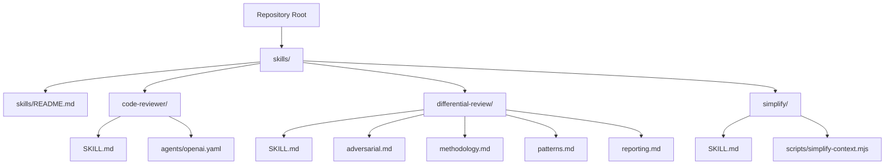
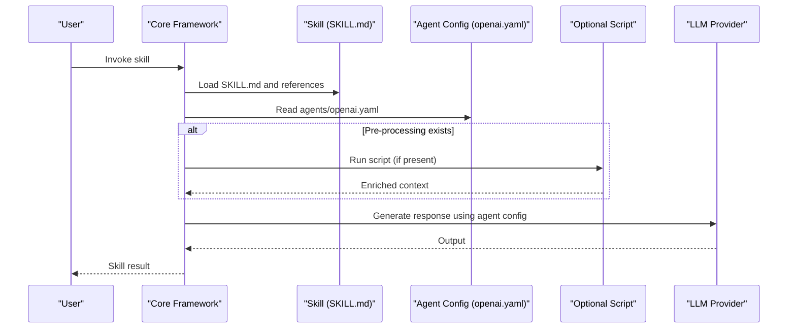
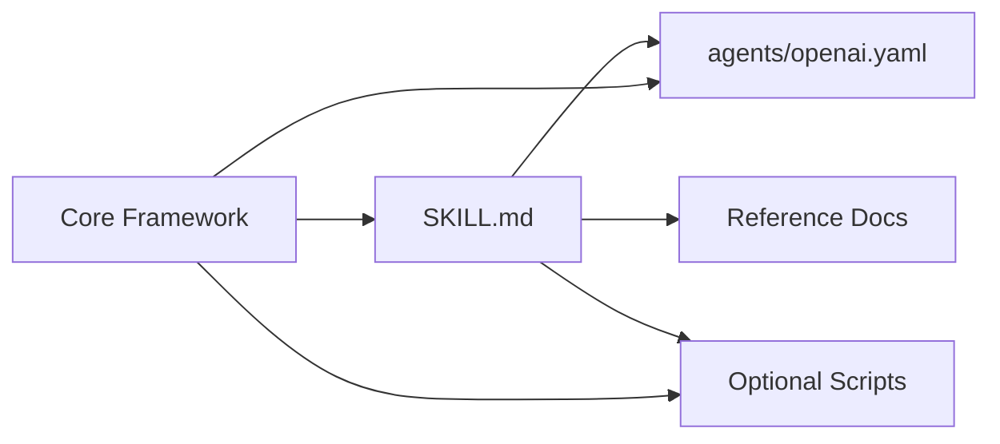

# Custom Skill Development

<cite>
**Referenced Files in This Document**
- [README.md](file://README.md)
- [skills/README.md](file://skills/README.md)
- [skills/code-reviewer/SKILL.md](file://skills/code-reviewer/SKILL.md)
- [skills/code-reviewer/agents/openai.yaml](file://skills/code-reviewer/agents/openai.yaml)
- [skills/differential-review/SKILL.md](file://skills/differential-review/SKILL.md)
- [skills/differential-review/adversarial.md](file://skills/differential-review/adversarial.md)
- [skills/differential-review/methodology.md](file://skills/differential-review/methodology.md)
- [skills/differential-review/patterns.md](file://skills/differential-review/patterns.md)
- [skills/differential-review/reporting.md](file://skills/differential-review/reporting.md)
- [skills/simplify/SKILL.md](file://skills/simplify/SKILL.md)
- [skills/simplify/scripts/simplify-context.mjs](file://skills/simplify/scripts/simplify-context.mjs)
- [hooks/README.md](file://hooks/README.md)
- [hooks/lens-reminder.mjs](file://hooks/lens-reminder.mjs)
- [hooks/rtk-pretooluse.mjs](file://hooks/rtk-pretooluse.mjs)
</cite>

## Table of Contents
1. [Introduction](#introduction)
2. [Project Structure](#project-structure)
3. [Core Components](#core-components)
4. [Architecture Overview](#architecture-overview)
5. [Detailed Component Analysis](#detailed-component-analysis)
6. [Dependency Analysis](#dependency-analysis)
7. [Performance Considerations](#performance-considerations)
8. [Troubleshooting Guide](#troubleshooting-guide)
9. [Conclusion](#conclusion)
10. [Appendices](#appendices)

## Introduction
This document explains how to develop custom skills for the Pi Codex Kit. It covers skill architecture, directory structure requirements, and the SKILL.md format specifications. It also documents the agent configuration system using OpenAI YAML, prompt engineering patterns, model selection strategies, and provides step-by-step examples based on existing implementations such as code-reviewer and differential-review. Additional guidance is included for skill composition, workflow orchestration, integration with the core framework, testing approaches, debugging techniques, and performance optimization.

## Project Structure
The repository organizes reusable capabilities as “skills” under a dedicated directory. Each skill is self-contained and typically includes:
- A primary instruction file (SKILL.md) that defines behavior, inputs, outputs, and references.
- An agents subdirectory containing OpenAI YAML configuration files that specify model parameters and prompts.
- Optional supporting assets such as scripts, references, or methodology documents.

**Diagram sources**
- [skills/README.md](file://skills/README.md)
- [skills/code-reviewer/SKILL.md](file://skills/code-reviewer/SKILL.md)
- [skills/code-reviewer/agents/openai.yaml](file://skills/code-reviewer/agents/openai.yaml)
- [skills/differential-review/SKILL.md](file://skills/differential-review/SKILL.md)
- [skills/differential-review/adversarial.md](file://skills/differential-review/adversarial.md)
- [skills/differential-review/methodology.md](file://skills/differential-review/methodology.md)
- [skills/differential-review/patterns.md](file://skills/differential-review/patterns.md)
- [skills/differential-review/reporting.md](file://skills/differential-review/reporting.md)
- [skills/simplify/SKILL.md](file://skills/simplify/SKILL.md)
- [skills/simplify/scripts/simplify-context.mjs](file://skills/simplify/scripts/simplify-context.mjs)

**Section sources**
- [README.md](file://README.md)
- [skills/README.md](file://skills/README.md)

## Core Components
- Skill definition (SKILL.md): The canonical description of what a skill does, its inputs, outputs, constraints, and references to additional materials.
- Agent configuration (agents/openai.yaml): Model selection, temperature, top-p, and other runtime parameters used by the underlying LLM provider.
- Supporting assets:
  - Scripts (e.g., simplify-context.mjs) for pre-processing or context enrichment.
  - Reference documents (e.g., methodology.md, patterns.md) that inform the skill’s reasoning and reporting.

Key responsibilities:
- SKILL.md establishes the contract between the core framework and the skill.
- agents/openai.yaml configures the model and generation behavior.
- Scripts and references extend capability without changing the core.

**Section sources**
- [skills/code-reviewer/SKILL.md](file://skills/code-reviewer/SKILL.md)
- [skills/code-reviewer/agents/openai.yaml](file://skills/code-reviewer/agents/openai.yaml)
- [skills/differential-review/SKILL.md](file://skills/differential-review/SKILL.md)
- [skills/differential-review/methodology.md](file://skills/differential-review/methodology.md)
- [skills/differential-review/patterns.md](file://skills/differential-review/patterns.md)
- [skills/differential-review/reporting.md](file://skills/differential-review/reporting.md)
- [skills/simplify/SKILL.md](file://skills/simplify/SKILL.md)
- [skills/simplify/scripts/simplify-context.mjs](file://skills/simplify/scripts/simplify-context.mjs)

## Architecture Overview
At a high level, the core framework loads a skill by reading its SKILL.md and associated agent configuration. When invoked, it:
- Resolves the skill’s instructions and references.
- Loads the agent configuration from agents/openai.yaml.
- Executes any optional pre-processing scripts.
- Invokes the configured model to produce outputs according to the skill’s specification.

[No sources needed since this diagram shows conceptual workflow, not actual code structure]

## Detailed Component Analysis

### SKILL.md Format Specifications
Purpose:
- Define the skill’s objective, inputs, outputs, constraints, and references.
- Provide structured guidance for consistent behavior across runs.

Recommended sections:
- Title and overview
- Inputs and expected formats
- Outputs and deliverables
- Constraints and guardrails
- References to additional documents (e.g., methodology, patterns)
- Examples of usage scenarios

Best practices:
- Keep instructions concise and unambiguous.
- Separate concerns by referencing external documents when content grows large.
- Use explicit input/output contracts to reduce ambiguity.

**Section sources**
- [skills/code-reviewer/SKILL.md](file://skills/code-reviewer/SKILL.md)
- [skills/differential-review/SKILL.md](file://skills/differential-review/SKILL.md)
- [skills/simplify/SKILL.md](file://skills/simplify/SKILL.md)

### Agent Configuration (OpenAI YAML)
Purpose:
- Configure model selection and generation parameters for the skill.

Typical keys:
- Model identifier
- Temperature
- Top-p
- Max tokens
- System/user message templates (as applicable)

Guidelines:
- Choose models aligned with task complexity and latency requirements.
- Tune temperature and top-p to balance creativity vs. determinism.
- Set max tokens conservatively to avoid truncation while ensuring completeness.

**Section sources**
- [skills/code-reviewer/agents/openai.yaml](file://skills/code-reviewer/agents/openai.yaml)

### Prompt Engineering Patterns
Patterns observed across skills:
- Role-based framing: Establish the agent’s role and expertise.
- Stepwise reasoning: Encourage structured analysis before conclusions.
- Evidence-first output: Require citations or references to specific artifacts.
- Constraint enforcement: Explicitly state boundaries and non-goals.
- Iterative refinement: Allow follow-up steps to improve results.

Integration points:
- Place detailed prompts in SKILL.md or referenced documents.
- Keep agent configuration focused on model parameters.

**Section sources**
- [skills/differential-review/methodology.md](file://skills/differential-review/methodology.md)
- [skills/differential-review/patterns.md](file://skills/differential-review/patterns.md)
- [skills/differential-review/reporting.md](file://skills/differential-review/reporting.md)

### Workflow Orchestration and Skill Composition
Composition strategies:
- Chain multiple skills sequentially where one skill’s output becomes another’s input.
- Use scripts to transform intermediate artifacts between skills.
- Maintain clear handoff contracts between skills via standardized outputs.

Orchestration tips:
- Prefer small, focused skills over monolithic ones.
- Document dependencies explicitly in each skill’s SKILL.md.
- Centralize shared references to reduce duplication.

**Section sources**
- [skills/simplify/SKILL.md](file://skills/simplify/SKILL.md)
- [skills/simplify/scripts/simplify-context.mjs](file://skills/simplify/scripts/simplify-context.mjs)

### Integration with the Core Framework
Integration points:
- Discovery: The core scans the skills directory for valid skill definitions.
- Loading: SKILL.md and agents/openai.yaml are loaded per skill.
- Execution: The framework invokes the configured model with the resolved context.
- Hooks: Optional hooks can augment behavior around tool use or lens interactions.

Hook examples:
- Reminder hooks to guide user actions.
- Pre-tool-use hooks to prepare environment or validate inputs.

**Section sources**
- [hooks/README.md](file://hooks/README.md)
- [hooks/lens-reminder.mjs](file://hooks/lens-reminder.mjs)
- [hooks/rtk-pretooluse.mjs](file://hooks/rtk-pretooluse.mjs)

### Step-by-Step Example: Creating a New Skill
Follow these steps to create a new skill modeled after existing implementations:

1. Create a new directory under skills/ named after your skill.
2. Add a SKILL.md describing inputs, outputs, constraints, and references.
3. Create an agents/ subdirectory and add openai.yaml with model and generation settings.
4. If needed, add supporting documents (e.g., methodology.md, patterns.md).
5. Optionally add scripts/ for pre-processing or context enrichment.
6. Test the skill by invoking it through the core framework and validating outputs.
7. Iterate on SKILL.md and agent configuration to refine behavior.

References for patterns:
- code-reviewer: Minimal skill with SKILL.md and agent configuration.
- differential-review: Multi-document approach with methodology, patterns, and reporting.
- simplify: Demonstrates script-based context preparation.

**Section sources**
- [skills/code-reviewer/SKILL.md](file://skills/code-reviewer/SKILL.md)
- [skills/code-reviewer/agents/openai.yaml](file://skills/code-reviewer/agents/openai.yaml)
- [skills/differential-review/SKILL.md](file://skills/differential-review/SKILL.md)
- [skills/differential-review/methodology.md](file://skills/differential-review/methodology.md)
- [skills/differential-review/patterns.md](file://skills/differential-review/patterns.md)
- [skills/differential-review/reporting.md](file://skills/differential-review/reporting.md)
- [skills/simplify/SKILL.md](file://skills/simplify/SKILL.md)
- [skills/simplify/scripts/simplify-context.mjs](file://skills/simplify/scripts/simplify-context.mjs)

## Dependency Analysis
Skills depend on:
- SKILL.md for behavioral contracts.
- agents/openai.yaml for model configuration.
- Optional scripts and reference documents for extended functionality.

[No sources needed since this diagram shows conceptual relationships, not direct code mappings]

## Performance Considerations
- Model selection: Choose smaller models for quick feedback loops; larger models for complex reasoning tasks.
- Generation parameters: Lower temperature and top-p for deterministic outputs; increase for creative exploration.
- Token budgets: Set max tokens appropriately to avoid truncation and reduce unnecessary retries.
- Context management: Use scripts to distill large inputs into focused contexts.
- Caching: Reuse intermediate artifacts between skill invocations where possible.
- Parallelization: Where safe, run independent skills concurrently to reduce total time.

[No sources needed since this section provides general guidance]

## Troubleshooting Guide
Common issues and remedies:
- Missing or malformed SKILL.md: Ensure all required sections exist and references resolve.
- Incorrect agent configuration: Validate openai.yaml keys and values; confirm model availability.
- Script failures: Check paths and permissions; log errors within scripts for visibility.
- Hook conflicts: Review hook order and side effects; isolate problematic hooks during debugging.

Debugging techniques:
- Enable verbose logging in the core framework if available.
- Isolate a single skill and invoke it directly to reproduce issues.
- Gradually reintroduce references and scripts to pinpoint causes.

**Section sources**
- [hooks/README.md](file://hooks/README.md)
- [hooks/lens-reminder.mjs](file://hooks/lens-reminder.mjs)
- [hooks/rtk-pretooluse.mjs](file://hooks/rtk-pretooluse.mjs)

## Conclusion
Custom skills in the Pi Codex Kit are modular, well-defined units of capability centered around SKILL.md and agent configuration. By following established patterns from code-reviewer and differential-review, and leveraging scripts and references for extensibility, you can build robust, composable skills. Apply thoughtful prompt engineering, tune model parameters, and adopt disciplined testing and debugging practices to achieve reliable performance.

## Appendices

### Appendix A: Directory Structure Checklist
- skills/<skill-name>/
  - SKILL.md
  - agents/openai.yaml
  - scripts/ (optional)
  - references/ (optional)
  - *.md (optional)

**Section sources**
- [skills/README.md](file://skills/README.md)

### Appendix B: Testing Approaches
- Unit-style checks: Validate SKILL.md structure and required fields.
- Integration tests: Invoke the skill end-to-end with representative inputs.
- Regression tests: Capture known-good outputs for critical scenarios.
- Hook tests: Verify hook behavior in isolation and in combination.

[No sources needed since this section provides general guidance]

### Appendix C: Debugging Techniques
- Incremental validation: Start with minimal SKILL.md and agent config, then add complexity.
- Logging: Emit structured logs in scripts and hooks.
- Reproducibility: Pin model versions and parameters; capture inputs and outputs.

[No sources needed since this section provides general guidance]