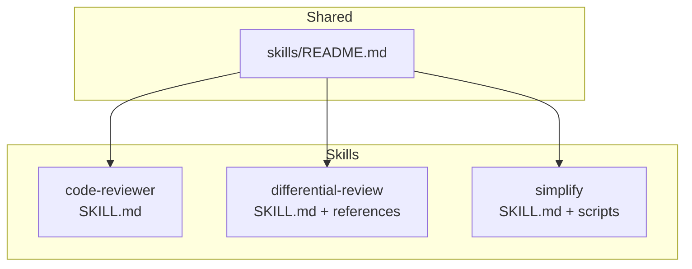
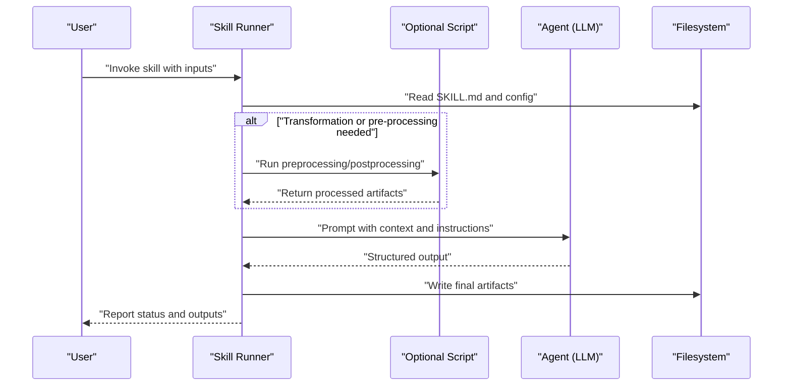
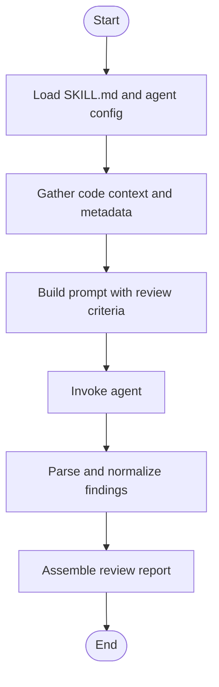
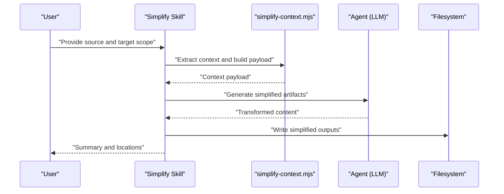
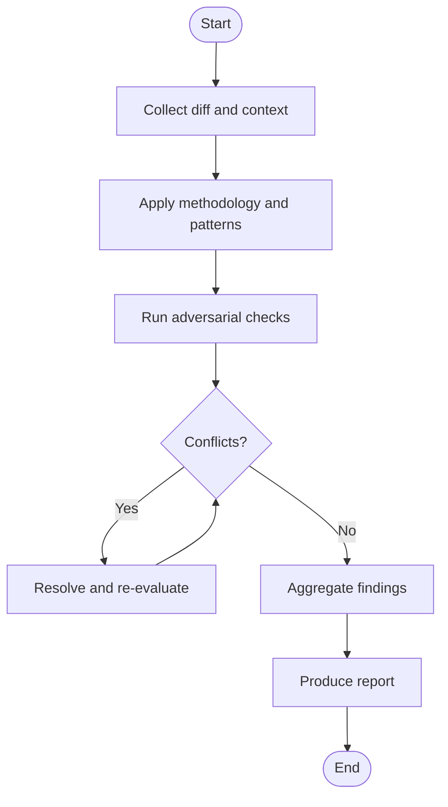
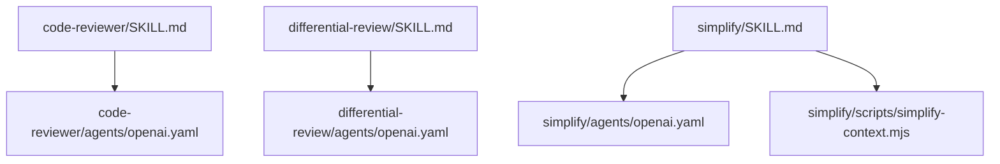

# Implementation Patterns & Examples

<cite>
**Referenced Files in This Document**
- [skills/README.md](file://skills/README.md)
- [skills/code-reviewer/SKILL.md](file://skills/code-reviewer/SKILL.md)
- [skills/differential-review/SKILL.md](file://skills/differential-review/SKILL.md)
- [skills/simplify/SKILL.md](file://skills/simplify/SKILL.md)
- [skills/simplify/scripts/simplify-context.mjs](file://skills/simplify/scripts/simplify-context.mjs)
</cite>

## Table of Contents
1. [Introduction](#introduction)
2. [Project Structure](#project-structure)
3. [Core Components](#core-components)
4. [Architecture Overview](#architecture-overview)
5. [Detailed Component Analysis](#detailed-component-analysis)
6. [Dependency Analysis](#dependency-analysis)
7. [Performance Considerations](#performance-considerations)
8. [Troubleshooting Guide](#troubleshooting-guide)
9. [Conclusion](#conclusion)

## Introduction
This document provides implementation guides for common skill development patterns using real examples from the repository. It focuses on three primary skill types:
- Analysis skills (e.g., code-reviewer)
- Transformation skills (e.g., simplify)
- Workflow orchestration skills (e.g., differential-review)

It also covers script integration patterns, external tool usage, data processing workflows, and strategies for error handling, logging, and debugging tailored to custom skill development.

## Project Structure
The repository organizes reusable capabilities as “skills.” Each skill typically includes:
- A SKILL.md describing purpose, inputs, outputs, and workflow
- An agents configuration for model invocation
- Optional scripts or resources for automation and data processing

**Diagram sources**
- [skills/README.md](file://skills/README.md)
- [skills/code-reviewer/SKILL.md](file://skills/code-reviewer/SKILL.md)
- [skills/differential-review/SKILL.md](file://skills/differential-review/SKILL.md)
- [skills/simplify/SKILL.md](file://skills/simplify/SKILL.md)

**Section sources**
- [skills/README.md](file://skills/README.md)

## Core Components
- Skill manifest (SKILL.md): Defines the skill’s intent, inputs, outputs, and step-by-step process.
- Agent configuration (agents/openai.yaml): Declares how the skill invokes a language model.
- Scripts (optional): Provide deterministic preprocessing, postprocessing, or orchestration logic.

Key patterns:
- Analysis skills focus on reading and synthesizing information to produce insights.
- Transformation skills read input artifacts and generate new artifacts deterministically or semi-deterministically.
- Orchestration skills coordinate multiple steps, tools, and artifacts across a workflow.

**Section sources**
- [skills/code-reviewer/SKILL.md](file://skills/code-reviewer/SKILL.md)
- [skills/differential-review/SKILL.md](file://skills/differential-review/SKILL.md)
- [skills/simplify/SKILL.md](file://skills/simplify/SKILL.md)

## Architecture Overview
A typical skill execution flow:
- The orchestrator loads the SKILL.md and agent config.
- For analysis skills, it gathers context and prompts the model to produce findings.
- For transformation skills, it runs scripts to prepare or transform data before invoking the model or writing outputs.
- For orchestration skills, it sequences multiple stages, persists intermediate artifacts, and aggregates results.

[No sources needed since this diagram shows conceptual workflow, not actual code structure]

## Detailed Component Analysis

### Analysis Skill Pattern: Code Reviewer
Purpose:
- Analyze code changes or files and produce structured feedback, risks, and recommendations.

Implementation pattern:
- Define inputs (files, diffs, or repositories).
- Prompt the model with review criteria and evidence extraction rules.
- Aggregate findings into a report format suitable for downstream consumption.

**Section sources**
- [skills/code-reviewer/SKILL.md](file://skills/code-reviewer/SKILL.md)

### Transformation Skill Pattern: Simplify
Purpose:
- Transform existing code or documentation into a simplified form while preserving semantics and intent.

Implementation pattern:
- Use a script to extract relevant context and build a focused prompt payload.
- Run the agent to generate simplified artifacts.
- Validate and write outputs deterministically where possible.

**Diagram sources**
- [skills/simplify/SKILL.md](file://skills/simplify/SKILL.md)
- [skills/simplify/scripts/simplify-context.mjs](file://skills/simplify/scripts/simplify-context.mjs)

**Section sources**
- [skills/simplify/SKILL.md](file://skills/simplify/SKILL.md)
- [skills/simplify/scripts/simplify-context.mjs](file://skills/simplify/scripts/simplify-context.mjs)

### Orchestration Skill Pattern: Differential Review
Purpose:
- Coordinate multi-stage reviews across different aspects (e.g., methodology, patterns, adversarial checks) and synthesize a comprehensive report.

Implementation pattern:
- Stage 1: Collect diff and related artifacts.
- Stage 2: Apply domain-specific checklists and methodologies.
- Stage 3: Cross-check findings and resolve conflicts.
- Stage 4: Produce a consolidated report with prioritized actions.

**Section sources**
- [skills/differential-review/SKILL.md](file://skills/differential-review/SKILL.md)

### Script Integration Patterns
Common patterns observed in the repository:
- Context extraction: Scripts gather relevant files, symbols, and metadata to reduce prompt size and improve accuracy.
- Deterministic transformations: Scripts perform stable operations (e.g., filtering, normalization) before or after model calls.
- Artifact management: Scripts write intermediate artifacts to disk for reproducibility and inspection.

Example reference:
- [simplify-context.mjs](file://skills/simplify/scripts/simplify-context.mjs) demonstrates a script-driven approach to preparing context for a transformation skill.

**Section sources**
- [skills/simplify/scripts/simplify-context.mjs](file://skills/simplify/scripts/simplify-context.mjs)

### External Tool Usage
Guidelines:
- Prefer small, composable scripts that can be invoked by skills.
- Keep external tool invocations explicit and logged.
- Validate tool outputs before passing them to models or persisting them.

[No sources needed since this section provides general guidance]

### Data Processing Workflows
Recommended pipeline:
- Ingest raw inputs (diffs, logs, ASTs).
- Normalize and filter to minimal necessary context.
- Enrich with metadata (file paths, line ranges, change type).
- Persist intermediate artifacts for auditability.
- Feed curated context to the model or downstream processors.

[No sources needed since this section provides general guidance]

## Dependency Analysis
Skills depend on:
- Their own SKILL.md definitions
- Agent configurations for model invocation
- Optional scripts for preprocessing/postprocessing

**Diagram sources**
- [skills/code-reviewer/SKILL.md](file://skills/code-reviewer/SKILL.md)
- [skills/differential-review/SKILL.md](file://skills/differential-review/SKILL.md)
- [skills/simplify/SKILL.md](file://skills/simplify/SKILL.md)
- [skills/simplify/scripts/simplify-context.mjs](file://skills/simplify/scripts/simplify-context.mjs)

**Section sources**
- [skills/code-reviewer/SKILL.md](file://skills/code-reviewer/SKILL.md)
- [skills/differential-review/SKILL.md](file://skills/differential-review/SKILL.md)
- [skills/simplify/SKILL.md](file://skills/simplify/SKILL.md)
- [skills/simplify/scripts/simplify-context.mjs](file://skills/simplify/scripts/simplify-context.mjs)

## Performance Considerations
- Minimize context size by extracting only what is necessary.
- Cache repeated computations (e.g., symbol indexes) when feasible.
- Parallelize independent stages in orchestration skills.
- Stream large outputs and validate incrementally.

[No sources needed since this section provides general guidance]

## Troubleshooting Guide
Error handling and debugging strategies:
- Fail fast on invalid inputs; log detailed diagnostics including file paths and line ranges.
- Wrap external tool calls with retries and timeouts; capture stderr and exit codes.
- Persist intermediate artifacts to enable post-mortem analysis.
- Use structured logs with correlation IDs to trace requests across stages.
- For model calls, include request/response summaries and token usage metrics.

[No sources needed since this section provides general guidance]

## Conclusion
By following these patterns—analysis, transformation, and orchestration—you can build robust, maintainable skills. Leverage scripts for deterministic work, keep prompts focused, and instrument your flows for observability and reliability.