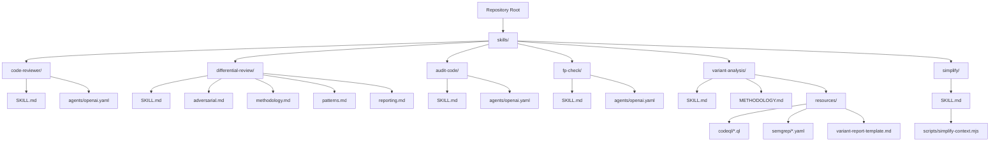
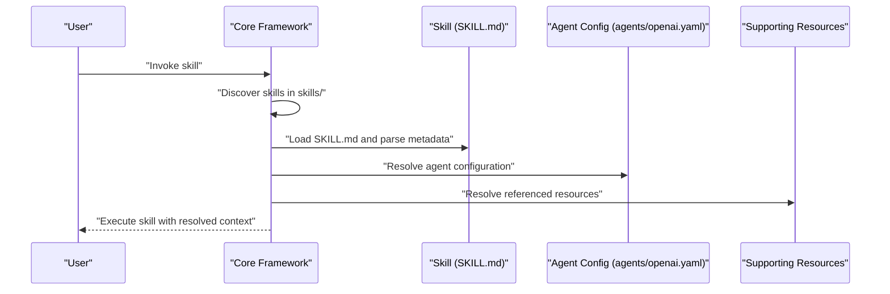
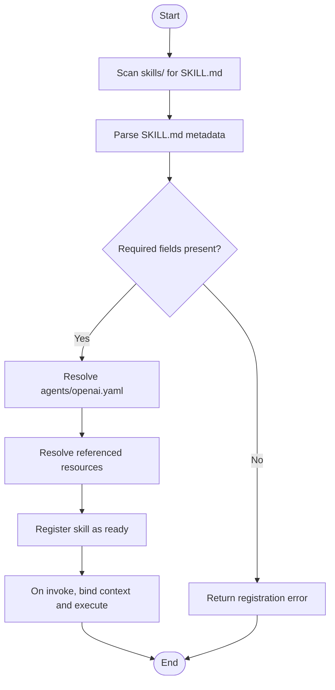
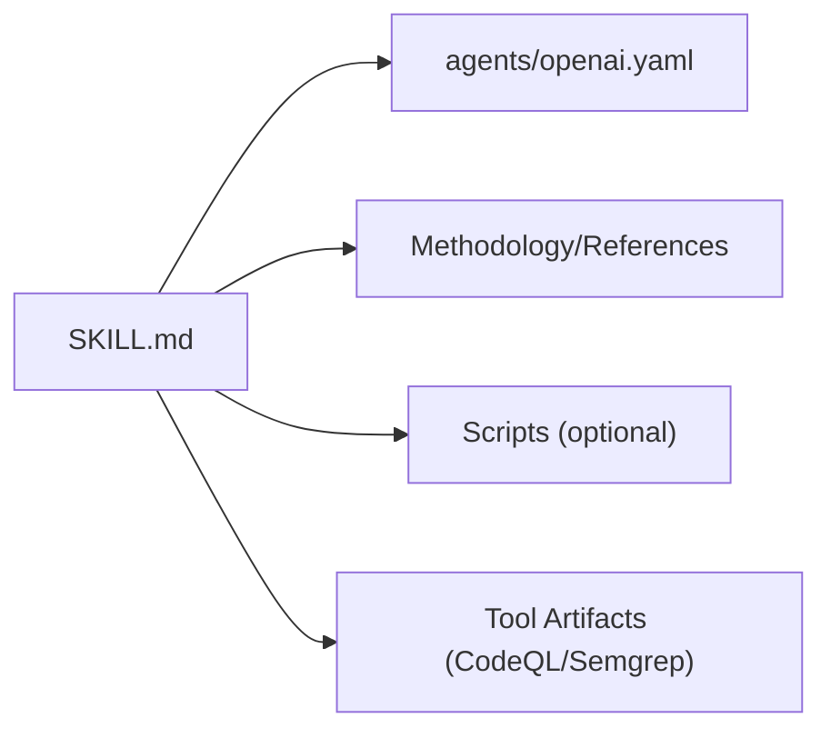

# Skill Architecture & Structure

<cite>
**Referenced Files in This Document**
- [skills/README.md](file://skills/README.md)
- [skills/code-reviewer/SKILL.md](file://skills/code-reviewer/SKILL.md)
- [skills/code-reviewer/agents/openai.yaml](file://skills/code-reviewer/agents/openai.yaml)
- [skills/differential-review/SKILL.md](file://skills/differential-review/SKILL.md)
- [skills/differential-review/adversarial.md](file://skills/differential-review/adversarial.md)
- [skills/differential-review/methodology.md](file://skills/differential-review/methodology.md)
- [skills/differential-review/patterns.md](file://skills/differential-review/patterns.md)
- [skills/differential-review/reporting.md](file://skills/differential-review/reporting.md)
- [skills/audit-code/SKILL.md](file://skills/audit-code/SKILL.md)
- [skills/audit-code/agents/openai.yaml](file://skills/audit-code/agents/openai.yaml)
- [skills/deepen-architecture/SKILL.md](file://skills/deepen-architecture/SKILL.md)
- [skills/deepen-architecture/agents/openai.yaml](file://skills/deepen-architecture/agents/openai.yaml)
- [skills/develop-tdd/SKILL.md](file://skills/develop-tdd/SKILL.md)
- [skills/develop-tdd/agents/openai.yaml](file://skills/develop-tdd/agents/openai.yaml)
- [skills/enforce-first/SKILL.md](file://skills/enforce-first/SKILL.md)
- [skills/enforce-first/agents/openai.yaml](file://skills/enforce-first/agents/openai.yaml)
- [skills/fp-check/SKILL.md](file://skills/fp-check/SKILL.md)
- [skills/fp-check/agents/openai.yaml](file://skills/fp-check/agents/openai.yaml)
- [skills/pi-lens-ast-grep/SKILL.md](file://skills/pi-lens-ast-grep/SKILL.md)
- [skills/pi-lens-ast-grep/agents/openai.yaml](file://skills/pi-lens-ast-grep/agents/openai.yaml)
- [skills/pi-lens-lsp-navigation/SKILL.md](file://skills/pi-lens-lsp-navigation/SKILL.md)
- [skills/pi-lens-lsp-navigation/agents/openai.yaml](file://skills/pi-lens-lsp-navigation/agents/openai.yaml)
- [skills/pi-lens-write-ast-grep-rule/SKILL.md](file://skills/pi-lens-write-ast-grep-rule/SKILL.md)
- [skills/pi-lens-write-ast-grep-rule/agents/openai.yaml](file://skills/pi-lens-write-ast-grep-rule/agents/openai.yaml)
- [skills/pi-lens-write-tree-sitter-rule/SKILL.md](file://skills/pi-lens-write-tree-sitter-rule/SKILL.md)
- [skills/pi-lens-write-tree-sitter-rule/agents/openai.yaml](file://skills/pi-lens-write-tree-sitter-rule/agents/openai.yaml)
- [skills/request-review/SKILL.md](file://skills/request-review/SKILL.md)
- [skills/request-review/agents/openai.yaml](file://skills/request-review/agents/openai.yaml)
- [skills/respond-review/SKILL.md](file://skills/respond-review/SKILL.md)
- [skills/respond-review/agents/openai.yaml](file://skills/respond-review/agents/openai.yaml)
- [skills/simplify/SKILL.md](file://skills/simplify/SKILL.md)
- [skills/simplify/agents/openai.yaml](file://skills/simplify/agents/openai.yaml)
- [skills/simplify/scripts/simplify-context.mjs](file://skills/simplify/scripts/simplify-context.mjs)
- [skills/variant-analysis/SKILL.md](file://skills/variant-analysis/SKILL.md)
- [skills/variant-analysis/METHODOLOGY.md](file://skills/variant-analysis/METHODOLOGY.md)
- [skills/variant-analysis/resources/codeql/cpp.ql](file://skills/variant-analysis/resources/codeql/cpp.ql)
- [skills/variant-analysis/resources/codeql/go.ql](file://skills/variant-analysis/resources/codeql/go.ql)
- [skills/variant-analysis/resources/codeql/java.ql](file://skills/variant-analysis/resources/codeql/java.ql)
- [skills/variant-analysis/resources/codeql/javascript.ql](file://skills/variant-analysis/resources/codeql/javascript.ql)
- [skills/variant-analysis/resources/codeql/python.ql](file://skills/variant-analysis/resources/codeql/python.ql)
- [skills/variant-analysis/resources/semgrep/cpp.yaml](file://skills/variant-analysis/resources/semgrep/cpp.yaml)
- [skills/variant-analysis/resources/semgrep/go.yaml](file://skills/variant-analysis/resources/semgrep/go.yaml)
- [skills/variant-analysis/resources/semgrep/java.yaml](file://skills/variant-analysis/resources/semgrep/java.yaml)
- [skills/variant-analysis/resources/semgrep/javascript.yaml](file://skills/variant-analysis/resources/semgrep/javascript.yaml)
- [skills/variant-analysis/resources/semgrep/python.yaml](file://skills/variant-analysis/resources/semgrep/python.yaml)
- [skills/variant-analysis/resources/variant-report-template.md](file://skills/variant-analysis/resources/variant-report-template.md)
- [skills/verify-work/SKILL.md](file://skills/verify-work/SKILL.md)
- [skills/verify-work/agents/openai.yaml](file://skills/verify-work/agents/openai.yaml)
</cite>

## Table of Contents
1. [Introduction](#introduction)
2. [Project Structure](#project-structure)
3. [Core Components](#core-components)
4. [Architecture Overview](#architecture-overview)
5. [Detailed Component Analysis](#detailed-component-analysis)
6. [Dependency Analysis](#dependency-analysis)
7. [Performance Considerations](#performance-considerations)
8. [Troubleshooting Guide](#troubleshooting-guide)
9. [Conclusion](#conclusion)

## Introduction
This document explains the Pi Codex Kit skill architecture and directory structure. It focuses on the standardized skill layout, including SKILL.md files, agents subdirectories, and supporting resources. It also documents the skill definition format, metadata requirements, configuration schemas, and how skills integrate with the core framework (registration, lifecycle, dependencies). Finally, it provides examples of proper organization patterns and naming conventions used across existing skills such as code-reviewer and differential-review.

## Project Structure
At a high level, each skill is a self-contained directory under skills/. The standard layout includes:
- A top-level SKILL.md that defines the skill’s purpose, behavior, inputs, outputs, and references to additional materials.
- An agents/ subdirectory containing provider-specific agent configuration files (for example, openai.yaml).
- Optional supporting directories and files for methodology, references, scripts, and tool artifacts.

**Diagram sources**
- [skills/README.md](file://skills/README.md)
- [skills/code-reviewer/SKILL.md](file://skills/code-reviewer/SKILL.md)
- [skills/code-reviewer/agents/openai.yaml](file://skills/code-reviewer/agents/openai.yaml)
- [skills/differential-review/SKILL.md](file://skills/differential-review/SKILL.md)
- [skills/differential-review/adversarial.md](file://skills/differential-review/adversarial.md)
- [skills/differential-review/methodology.md](file://skills/differential-review/methodology.md)
- [skills/differential-review/patterns.md](file://skills/differential-review/patterns.md)
- [skills/differential-review/reporting.md](file://skills/differential-review/reporting.md)
- [skills/audit-code/SKILL.md](file://skills/audit-code/SKILL.md)
- [skills/audit-code/agents/openai.yaml](file://skills/audit-code/agents/openai.yaml)
- [skills/fp-check/SKILL.md](file://skills/fp-check/SKILL.md)
- [skills/fp-check/agents/openai.yaml](file://skills/fp-check/agents/openai.yaml)
- [skills/variant-analysis/SKILL.md](file://skills/variant-analysis/SKILL.md)
- [skills/variant-analysis/METHODOLOGY.md](file://skills/variant-analysis/METHODOLOGY.md)
- [skills/variant-analysis/resources/codeql/cpp.ql](file://skills/variant-analysis/resources/codeql/cpp.ql)
- [skills/variant-analysis/resources/codeql/go.ql](file://skills/variant-analysis/resources/codeql/go.ql)
- [skills/variant-analysis/resources/codeql/java.ql](file://skills/variant-analysis/resources/codeql/java.ql)
- [skills/variant-analysis/resources/codeql/javascript.ql](file://skills/variant-analysis/resources/codeql/javascript.ql)
- [skills/variant-analysis/resources/codeql/python.ql](file://skills/variant-analysis/resources/codeql/python.ql)
- [skills/variant-analysis/resources/semgrep/cpp.yaml](file://skills/variant-analysis/resources/semgrep/cpp.yaml)
- [skills/variant-analysis/resources/semgrep/go.yaml](file://skills/variant-analysis/resources/semgrep/go.yaml)
- [skills/variant-analysis/resources/semgrep/java.yaml](file://skills/variant-analysis/resources/semgrep/java.yaml)
- [skills/variant-analysis/resources/semgrep/javascript.yaml](file://skills/variant-analysis/resources/semgrep/javascript.yaml)
- [skills/variant-analysis/resources/semgrep/python.yaml](file://skills/variant-analysis/resources/semgrep/python.yaml)
- [skills/variant-analysis/resources/variant-report-template.md](file://skills/variant-analysis/resources/variant-report-template.md)
- [skills/simplify/SKILL.md](file://skills/simplify/SKILL.md)
- [skills/simplify/scripts/simplify-context.mjs](file://skills/simplify/scripts/simplify-context.mjs)

**Section sources**
- [skills/README.md](file://skills/README.md)

## Core Components
The core components of a skill are:
- SKILL.md: The primary skill definition file describing intent, scope, inputs, outputs, workflow, and references to other materials.
- agents/: Provider-specific agent configuration files (e.g., openai.yaml) that define model selection, parameters, and runtime settings.
- Supporting resources: Methodologies, reference guides, templates, scripts, and tool definitions (e.g., CodeQL queries, Semgrep rules).

Key responsibilities:
- SKILL.md establishes the contract between the core framework and the skill, including required inputs, expected outputs, and links to detailed guidance.
- agents/openai.yaml configures the execution environment for the skill when using OpenAI-compatible providers.
- Additional resources provide domain knowledge and reusable assets consumed by the skill during operation.

Examples of this pattern can be seen in:
- code-reviewer: minimal skill with SKILL.md and an OpenAI agent configuration.
- differential-review: richer skill with multiple supporting documents (adversarial.md, methodology.md, patterns.md, reporting.md).
- variant-analysis: extensive resource set including language-specific CodeQL queries and Semgrep rules plus a report template.

**Section sources**
- [skills/code-reviewer/SKILL.md](file://skills/code-reviewer/SKILL.md)
- [skills/code-reviewer/agents/openai.yaml](file://skills/code-reviewer/agents/openai.yaml)
- [skills/differential-review/SKILL.md](file://skills/differential-review/SKILL.md)
- [skills/differential-review/adversarial.md](file://skills/differential-review/adversarial.md)
- [skills/differential-review/methodology.md](file://skills/differential-review/methodology.md)
- [skills/differential-review/patterns.md](file://skills/differential-review/patterns.md)
- [skills/differential-review/reporting.md](file://skills/differential-review/reporting.md)
- [skills/variant-analysis/SKILL.md](file://skills/variant-analysis/SKILL.md)
- [skills/variant-analysis/METHODOLOGY.md](file://skills/variant-analysis/METHODOLOGY.md)
- [skills/variant-analysis/resources/codeql/cpp.ql](file://skills/variant-analysis/resources/codeql/cpp.ql)
- [skills/variant-analysis/resources/codeql/go.ql](file://skills/variant-analysis/resources/codeql/go.ql)
- [skills/variant-analysis/resources/codeql/java.ql](file://skills/variant-analysis/resources/codeql/java.ql)
- [skills/variant-analysis/resources/codeql/javascript.ql](file://skills/variant-analysis/resources/codeql/javascript.ql)
- [skills/variant-analysis/resources/codeql/python.ql](file://skills/variant-analysis/resources/codeql/python.ql)
- [skills/variant-analysis/resources/semgrep/cpp.yaml](file://skills/variant-analysis/resources/semgrep/cpp.yaml)
- [skills/variant-analysis/resources/semgrep/go.yaml](file://skills/variant-analysis/resources/semgrep/go.yaml)
- [skills/variant-analysis/resources/semgrep/java.yaml](file://skills/variant-analysis/resources/semgrep/java.yaml)
- [skills/variant-analysis/resources/semgrep/javascript.yaml](file://skills/variant-analysis/resources/semgrep/javascript.yaml)
- [skills/variant-analysis/resources/semgrep/python.yaml](file://skills/variant-analysis/resources/semgrep/python.yaml)
- [skills/variant-analysis/resources/variant-report-template.md](file://skills/variant-analysis/resources/variant-report-template.md)

## Architecture Overview
The skill architecture follows a declarative, file-driven approach:
- Discovery: The core framework discovers skills by scanning the skills/ directory for valid SKILL.md entries.
- Registration: Each SKILL.md registers itself with the framework by providing metadata and behavioral contracts.
- Lifecycle: The framework loads the SKILL.md, resolves referenced resources, and initializes the appropriate agent configuration from agents/.
- Execution: When invoked, the framework uses the configured agent(s) and provided resources to perform the skill’s task.

[No diagram sources needed since this diagram shows conceptual workflow, not actual code structure]

## Detailed Component Analysis

### Standardized Skill Directory Layout
A typical skill directory contains:
- SKILL.md at the root defining the skill’s purpose, inputs, outputs, and references.
- agents/openai.yaml for provider-specific configuration.
- Optional supporting directories and files such as methodology, references, scripts, and tool definitions.

Patterns observed:
- Minimal skills (e.g., audit-code, deepen-architecture, develop-tdd, enforce-first, fp-check, pi-lens-* variants, request-review, respond-review, verify-work) follow the base layout with SKILL.md and agents/openai.yaml.
- Richer skills (e.g., differential-review, variant-analysis, simplify) include additional documentation or scripts to support complex workflows.

Naming conventions:
- Use lowercase, kebab-case directory names for skills (e.g., code-reviewer, differential-review, variant-analysis).
- Keep SKILL.md at the root of each skill directory.
- Place provider configurations under agents/, typically named openai.yaml.
- Group related resources under descriptive subdirectories (e.g., resources/codeql, resources/semgrep).

**Section sources**
- [skills/audit-code/SKILL.md](file://skills/audit-code/SKILL.md)
- [skills/audit-code/agents/openai.yaml](file://skills/audit-code/agents/openai.yaml)
- [skills/deepen-architecture/SKILL.md](file://skills/deepen-architecture/SKILL.md)
- [skills/deepen-architecture/agents/openai.yaml](file://skills/deepen-architecture/agents/openai.yaml)
- [skills/develop-tdd/SKILL.md](file://skills/develop-tdd/SKILL.md)
- [skills/develop-tdd/agents/openai.yaml](file://skills/develop-tdd/agents/openai.yaml)
- [skills/enforce-first/SKILL.md](file://skills/enforce-first/SKILL.md)
- [skills/enforce-first/agents/openai.yaml](file://skills/enforce-first/agents/openai.yaml)
- [skills/fp-check/SKILL.md](file://skills/fp-check/SKILL.md)
- [skills/fp-check/agents/openai.yaml](file://skills/fp-check/agents/openai.yaml)
- [skills/pi-lens-ast-grep/SKILL.md](file://skills/pi-lens-ast-grep/SKILL.md)
- [skills/pi-lens-ast-grep/agents/openai.yaml](file://skills/pi-lens-ast-grep/agents/openai.yaml)
- [skills/pi-lens-lsp-navigation/SKILL.md](file://skills/pi-lens-lsp-navigation/SKILL.md)
- [skills/pi-lens-lsp-navigation/agents/openai.yaml](file://skills/pi-lens-lsp-navigation/agents/openai.yaml)
- [skills/pi-lens-write-ast-grep-rule/SKILL.md](file://skills/pi-lens-write-ast-grep-rule/SKILL.md)
- [skills/pi-lens-write-ast-grep-rule/agents/openai.yaml](file://skills/pi-lens-write-ast-grep-rule/agents/openai.yaml)
- [skills/pi-lens-write-tree-sitter-rule/SKILL.md](file://skills/pi-lens-write-tree-sitter-rule/SKILL.md)
- [skills/pi-lens-write-tree-sitter-rule/agents/openai.yaml](file://skills/pi-lens-write-tree-sitter-rule/agents/openai.yaml)
- [skills/request-review/SKILL.md](file://skills/request-review/SKILL.md)
- [skills/request-review/agents/openai.yaml](file://skills/request-review/agents/openai.yaml)
- [skills/respond-review/SKILL.md](file://skills/respond-review/SKILL.md)
- [skills/respond-review/agents/openai.yaml](file://skills/respond-review/agents/openai.yaml)
- [skills/verify-work/SKILL.md](file://skills/verify-work/SKILL.md)
- [skills/verify-work/agents/openai.yaml](file://skills/verify-work/agents/openai.yaml)

### Skill Definition Format (SKILL.md)
The SKILL.md file serves as the canonical skill definition. It should include:
- Title and description summarizing the skill’s purpose.
- Inputs and outputs specifying what the skill expects and produces.
- Workflow steps or instructions guiding execution.
- References to additional materials (e.g., methodology, patterns, reporting).
- Links to agent configuration and any scripts or tools used.

Examples:
- code-reviewer demonstrates a focused review workflow with clear inputs/outputs and references to agent configuration.
- differential-review expands the definition with adversarial considerations, methodology, patterns, and reporting guidelines.

Best practices:
- Keep SKILL.md concise but comprehensive enough for the framework to register and execute the skill.
- Use cross-references to detailed documents rather than embedding large amounts of content directly.
- Clearly separate concerns: operational instructions in SKILL.md; deep guidance in supporting docs.

**Section sources**
- [skills/code-reviewer/SKILL.md](file://skills/code-reviewer/SKILL.md)
- [skills/differential-review/SKILL.md](file://skills/differential-review/SKILL.md)
- [skills/differential-review/adversarial.md](file://skills/differential-review/adversarial.md)
- [skills/differential-review/methodology.md](file://skills/differential-review/methodology.md)
- [skills/differential-review/patterns.md](file://skills/differential-review/patterns.md)
- [skills/differential-review/reporting.md](file://skills/differential-review/reporting.md)

### Agent Configuration Schema (agents/openai.yaml)
Each skill may include an agents/openai.yaml file to configure the OpenAI-compatible provider. Typical responsibilities include:
- Model selection and parameterization.
- Prompt templates or system instructions.
- Tool integrations or function calling settings.
- Environment-specific overrides.

Observations:
- Most skills include a simple openai.yaml aligned with their SKILL.md behavior.
- Complex skills may extend configuration to support specialized workflows or tool usage.

Recommendations:
- Keep agent configuration minimal and focused on runtime behavior.
- Avoid duplicating logic present in SKILL.md; use the YAML to complement execution details.
- Validate configuration against provider constraints before deployment.

**Section sources**
- [skills/code-reviewer/agents/openai.yaml](file://skills/code-reviewer/agents/openai.yaml)
- [skills/audit-code/agents/openai.yaml](file://skills/audit-code/agents/openai.yaml)
- [skills/deepen-architecture/agents/openai.yaml](file://skills/deepen-architecture/agents/openai.yaml)
- [skills/develop-tdd/agents/openai.yaml](file://skills/develop-tdd/agents/openai.yaml)
- [skills/enforce-first/agents/openai.yaml](file://skills/enforce-first/agents/openai.yaml)
- [skills/fp-check/agents/openai.yaml](file://skills/fp-check/agents/openai.yaml)
- [skills/pi-lens-ast-grep/agents/openai.yaml](file://skills/pi-lens-ast-grep/agents/openai.yaml)
- [skills/pi-lens-lsp-navigation/agents/openai.yaml](file://skills/pi-lens-lsp-navigation/agents/openai.yaml)
- [skills/pi-lens-write-ast-grep-rule/agents/openai.yaml](file://skills/pi-lens-write-ast-grep-rule/agents/openai.yaml)
- [skills/pi-lens-write-tree-sitter-rule/agents/openai.yaml](file://skills/pi-lens-write-tree-sitter-rule/agents/openai.yaml)
- [skills/request-review/agents/openai.yaml](file://skills/request-review/agents/openai.yaml)
- [skills/respond-review/agents/openai.yaml](file://skills/respond-review/agents/openai.yaml)
- [skills/simplify/agents/openai.yaml](file://skills/simplify/agents/openai.yaml)
- [skills/verify-work/agents/openai.yaml](file://skills/verify-work/agents/openai.yaml)

### Supporting Resources and Scripts
Skills often include additional resources to support complex operations:
- Methodology and reference documents (e.g., methodology.md, patterns.md, reporting.md).
- Language-specific analysis artifacts (e.g., CodeQL queries, Semgrep rules).
- Templates for reports or structured outputs.
- Scripts to prepare context or automate tasks.

Examples:
- differential-review includes adversarial.md, methodology.md, patterns.md, and reporting.md to guide nuanced review processes.
- variant-analysis organizes resources under resources/codeql and resources/semgrep, plus a variant-report-template.md for consistent output.
- simplify includes a script (scripts/simplify-context.mjs) to assist with context preparation.

Guidelines:
- Organize resources under descriptive subdirectories to improve discoverability.
- Version control all artifacts alongside the skill to ensure reproducibility.
- Reference resources explicitly from SKILL.md to maintain clear linkage.

**Section sources**
- [skills/differential-review/adversarial.md](file://skills/differential-review/adversarial.md)
- [skills/differential-review/methodology.md](file://skills/differential-review/methodology.md)
- [skills/differential-review/patterns.md](file://skills/differential-review/patterns.md)
- [skills/differential-review/reporting.md](file://skills/differential-review/reporting.md)
- [skills/variant-analysis/resources/codeql/cpp.ql](file://skills/variant-analysis/resources/codeql/cpp.ql)
- [skills/variant-analysis/resources/codeql/go.ql](file://skills/variant-analysis/resources/codeql/go.ql)
- [skills/variant-analysis/resources/codeql/java.ql](file://skills/variant-analysis/resources/codeql/java.ql)
- [skills/variant-analysis/resources/codeql/javascript.ql](file://skills/variant-analysis/resources/codeql/javascript.ql)
- [skills/variant-analysis/resources/codeql/python.ql](file://skills/variant-analysis/resources/codeql/python.ql)
- [skills/variant-analysis/resources/semgrep/cpp.yaml](file://skills/variant-analysis/resources/semgrep/cpp.yaml)
- [skills/variant-analysis/resources/semgrep/go.yaml](file://skills/variant-analysis/resources/semgrep/go.yaml)
- [skills/variant-analysis/resources/semgrep/java.yaml](file://skills/variant-analysis/resources/semgrep/java.yaml)
- [skills/variant-analysis/resources/semgrep/javascript.yaml](file://skills/variant-analysis/resources/semgrep/javascript.yaml)
- [skills/variant-analysis/resources/semgrep/python.yaml](file://skills/variant-analysis/resources/semgrep/python.yaml)
- [skills/variant-analysis/resources/variant-report-template.md](file://skills/variant-analysis/resources/variant-report-template.md)
- [skills/simplify/scripts/simplify-context.mjs](file://skills/simplify/scripts/simplify-context.mjs)

### Integration with the Core Framework
Integration points:
- Registration: The framework scans skills/ and registers each SKILL.md as a discoverable unit.
- Lifecycle management: On invocation, the framework loads SKILL.md, resolves agent configuration, and prepares resources.
- Dependency resolution: The framework resolves relative paths within the skill directory and external references as defined in SKILL.md.

Operational flow:
- Discovery phase enumerates valid skill directories.
- Initialization phase parses SKILL.md and validates required fields.
- Execution phase binds agent configuration and resources to the skill’s workflow.

[No diagram sources needed since this diagram shows conceptual workflow, not actual code structure]

## Dependency Analysis
Skills depend on:
- The core framework for discovery, registration, and lifecycle management.
- Agent providers via agents/openai.yaml for model execution.
- Supporting resources for domain knowledge and tool artifacts.

Relationships:
- SKILL.md depends on agents/openai.yaml for runtime configuration.
- SKILL.md may reference additional documents and scripts located within the skill directory.
- Resource-heavy skills (e.g., variant-analysis) depend on multiple language-specific artifacts.

[No diagram sources needed since this diagram shows conceptual relationships, not actual code structure]

## Performance Considerations
- Prefer concise SKILL.md definitions to reduce parsing overhead.
- Keep agent configurations lean and avoid unnecessary parameters.
- Organize resources efficiently to minimize I/O during initialization.
- Use targeted scripts only when they significantly improve performance or clarity.

## Troubleshooting Guide
Common issues and resolutions:
- Missing SKILL.md: Ensure each skill directory contains a valid SKILL.md with required metadata.
- Invalid agent configuration: Validate agents/openai.yaml against provider constraints and correct syntax.
- Unresolved resources: Confirm that referenced documents and scripts exist at the specified paths within the skill directory.
- Naming inconsistencies: Follow kebab-case directory names and keep SKILL.md at the root.

Validation checklist:
- Verify SKILL.md includes title, description, inputs, outputs, and references.
- Confirm agents/openai.yaml is present and correctly formatted.
- Check that all referenced resources are accessible and up-to-date.

**Section sources**
- [skills/code-reviewer/SKILL.md](file://skills/code-reviewer/SKILL.md)
- [skills/code-reviewer/agents/openai.yaml](file://skills/code-reviewer/agents/openai.yaml)
- [skills/differential-review/SKILL.md](file://skills/differential-review/SKILL.md)
- [skills/variant-analysis/SKILL.md](file://skills/variant-analysis/SKILL.md)

## Conclusion
The Pi Codex Kit skill architecture centers around a standardized directory layout and a clear separation of concerns: SKILL.md defines the skill contract, agents/openai.yaml configures execution, and supporting resources enrich capability. By following the established patterns and naming conventions—especially in well-structured skills like code-reviewer and differential-review—teams can create maintainable, discoverable, and robust skills that integrate seamlessly with the core framework.