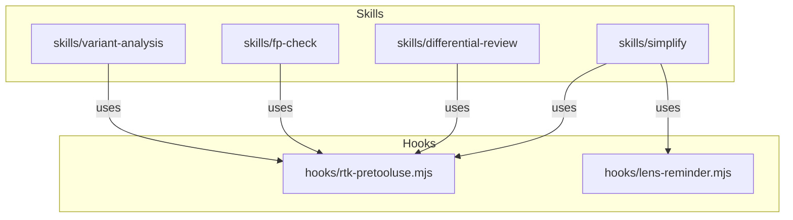
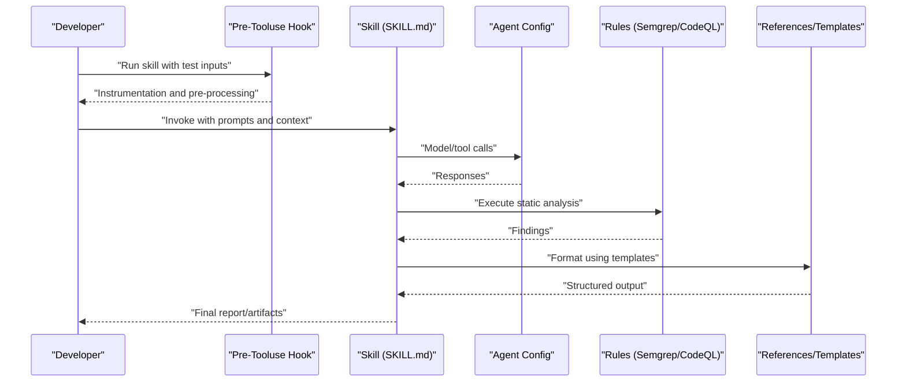
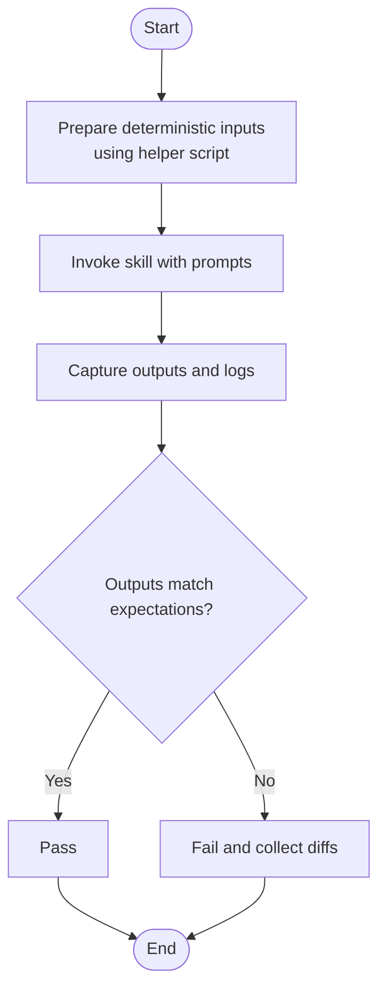
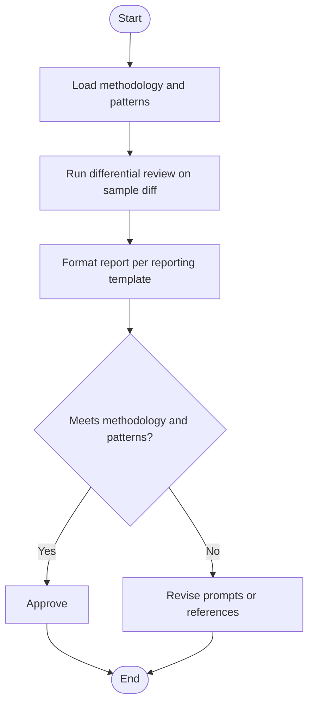
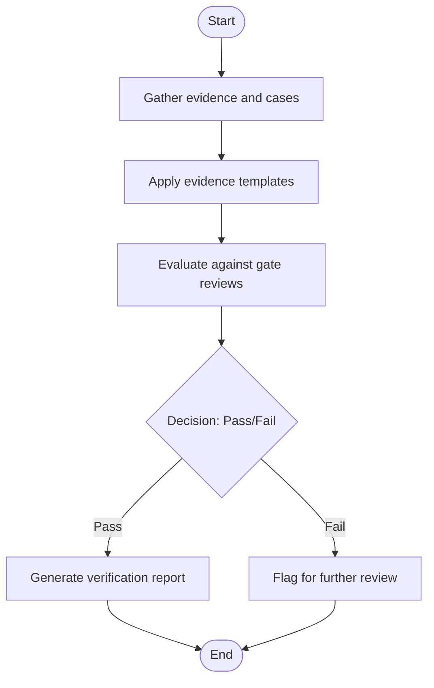
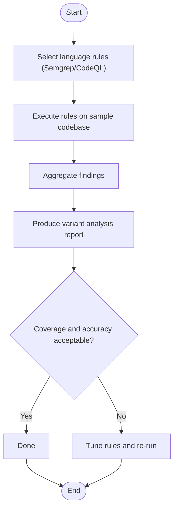
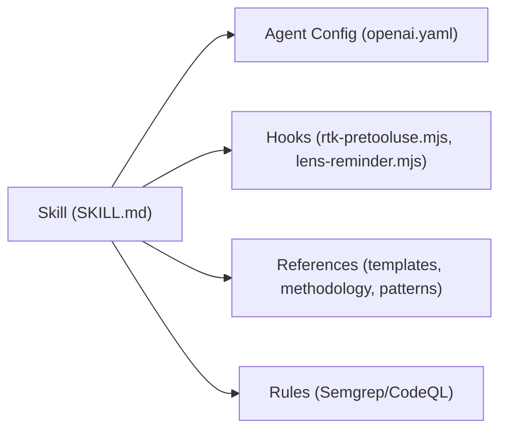

# Testing & Debugging Custom Skills

<cite>
**Referenced Files in This Document**
- [README.md](file://README.md)
- [skills/README.md](file://skills/README.md)
- [skills/simplify/SKILL.md](file://skills/simplify/SKILL.md)
- [skills/simplify/scripts/simplify-context.mjs](file://skills/simplify/scripts/simplify-context.mjs)
- [skills/differential-review/SKILL.md](file://skills/differential-review/SKILL.md)
- [skills/differential-review/methodology.md](file://skills/differential-review/methodology.md)
- [skills/differential-review/patterns.md](file://skills/differential-review/patterns.md)
- [skills/differential-review/reporting.md](file://skills/differential-review/reporting.md)
- [skills/fp-check/SKILL.md](file://skills/fp-check/SKILL.md)
- [skills/fp-check/references/evidence-templates.md](file://skills/fp-check/references/evidence-templates.md)
- [skills/fp-check/references/false-positive-patterns.md](file://skills/fp-check/references/false-positive-patterns.md)
- [skills/fp-check/references/gate-reviews.md](file://skills/fp-check/references/gate-reviews.md)
- [skills/fp-check/references/standard-verification.md](file://skills/fp-check/references/standard-verification.md)
- [skills/variant-analysis/SKILL.md](file://skills/variant-analysis/SKILL.md)
- [skills/variant-analysis/METHODOLOGY.md](file://skills/variant-analysis/METHODOLOGY.md)
- [skills/variant-analysis/resources/semgrep/javascript.yaml](file://skills/variant-analysis/resources/semgrep/javascript.yaml)
- [skills/variant-analysis/resources/codeql/javascript.ql](file://skills/variant-analysis/resources/codeql/javascript.ql)
- [hooks/rtk-pretooluse.mjs](file://hooks/rtk-pretooluse.mjs)
- [hooks/lens-reminder.mjs](file://hooks/lens-reminder.mjs)
</cite>

## Table of Contents
1. [Introduction](#introduction)
2. [Project Structure](#project-structure)
3. [Core Components](#core-components)
4. [Architecture Overview](#architecture-overview)
5. [Detailed Component Analysis](#detailed-component-analysis)
6. [Dependency Analysis](#dependency-analysis)
7. [Performance Considerations](#performance-considerations)
8. [Troubleshooting Guide](#troubleshooting-guide)
9. [Conclusion](#conclusion)
10. [Appendices](#appendices)

## Introduction
This document provides a comprehensive guide to testing and debugging custom skills in the Pi Codex Kit. It focuses on validating skill behavior, ensuring prompt effectiveness, verifying integration points, and establishing robust development workflows. You will learn how to set up test environments, create mock data, analyze logs, profile performance, isolate issues, and maintain quality across your skill lifecycle.

## Project Structure
The repository organizes skills under a dedicated directory with consistent structure: each skill includes a SKILL.md describing its purpose and prompts, an agents configuration for model invocation, and optional resources such as scripts, references, or rule definitions. Hooks provide pre-processing and reminders that can be leveraged during testing and debugging.

**Diagram sources**
- [skills/simplify/SKILL.md](file://skills/simplify/SKILL.md)
- [skills/differential-review/SKILL.md](file://skills/differential-review/SKILL.md)
- [skills/fp-check/SKILL.md](file://skills/fp-check/SKILL.md)
- [skills/variant-analysis/SKILL.md](file://skills/variant-analysis/SKILL.md)
- [hooks/rtk-pretooluse.mjs](file://hooks/rtk-pretooluse.mjs)
- [hooks/lens-reminder.mjs](file://hooks/lens-reminder.mjs)

**Section sources**
- [README.md](file://README.md)
- [skills/README.md](file://skills/README.md)

## Core Components
- Skill definition files (SKILL.md): Define prompts, instructions, and expected behaviors for each skill. These are primary artifacts for validation and regression testing.
- Agent configurations (agents/openai.yaml): Specify model parameters and tool usage settings used by the runtime when invoking skills.
- Supporting scripts (e.g., simplify-context.mjs): Provide deterministic context generation or preprocessing useful for reproducible tests.
- Reference materials (methodology.md, patterns.md, reporting.md, evidence-templates.md, etc.): Encapsulate domain knowledge and templates that influence prompt design and output expectations.
- Rule assets (semgrep/*.yaml, codeql/*.ql): Enable automated checks and variant analysis; these are ideal targets for unit-style validations within skill tests.
- Hooks (rtk-pretooluse.mjs, lens-reminder.mjs): Pre-execution hooks that can log, transform inputs, or enforce constraints—valuable for instrumentation and debugging.

Key responsibilities:
- Prompt effectiveness: Validate SKILL.md content against reference materials and rule assets to ensure alignment with methodology and patterns.
- Integration points: Confirm agent configuration compatibility and hook interactions.
- Output validation: Use reference templates and rule outputs to assert correctness and consistency.

**Section sources**
- [skills/simplify/SKILL.md](file://skills/simplify/SKILL.md)
- [skills/simplify/scripts/simplify-context.mjs](file://skills/simplify/scripts/simplify-context.mjs)
- [skills/differential-review/SKILL.md](file://skills/differential-review/SKILL.md)
- [skills/differential-review/methodology.md](file://skills/differential-review/methodology.md)
- [skills/differential-review/patterns.md](file://skills/differential-review/patterns.md)
- [skills/differential-review/reporting.md](file://skills/differential-review/reporting.md)
- [skills/fp-check/SKILL.md](file://skills/fp-check/SKILL.md)
- [skills/fp-check/references/evidence-templates.md](file://skills/fp-check/references/evidence-templates.md)
- [skills/fp-check/references/false-positive-patterns.md](file://skills/fp-check/references/false-positive-patterns.md)
- [skills/fp-check/references/gate-reviews.md](file://skills/fp-check/references/gate-reviews.md)
- [skills/fp-check/references/standard-verification.md](file://skills/fp-check/references/standard-verification.md)
- [skills/variant-analysis/SKILL.md](file://skills/variant-analysis/SKILL.md)
- [skills/variant-analysis/METHODOLOGY.md](file://skills/variant-analysis/METHODOLOGY.md)
- [skills/variant-analysis/resources/semgrep/javascript.yaml](file://skills/variant-analysis/resources/semgrep/javascript.yaml)
- [skills/variant-analysis/resources/codeql/javascript.ql](file://skills/variant-analysis/resources/codeql/javascript.ql)
- [hooks/rtk-pretooluse.mjs](file://hooks/rtk-pretooluse.mjs)
- [hooks/lens-reminder.mjs](file://hooks/lens-reminder.mjs)

## Architecture Overview
The typical flow for testing a skill involves preparing deterministic input, invoking the skill via the agent configuration, capturing logs and outputs, and asserting results against references and rules. Hooks can instrument the process for deeper inspection.

**Diagram sources**
- [hooks/rtk-pretooluse.mjs](file://hooks/rtk-pretooluse.mjs)
- [skills/simplify/SKILL.md](file://skills/simplify/SKILL.md)
- [skills/variant-analysis/SKILL.md](file://skills/variant-analysis/SKILL.md)
- [skills/variant-analysis/resources/semgrep/javascript.yaml](file://skills/variant-analysis/resources/semgrep/javascript.yaml)
- [skills/variant-analysis/resources/codeql/javascript.ql](file://skills/variant-analysis/resources/codeql/javascript.ql)
- [skills/fp-check/references/evidence-templates.md](file://skills/fp-check/references/evidence-templates.md)

## Detailed Component Analysis

### Simplify Skill Test Strategy
- Objective: Validate that context simplification produces concise, accurate summaries without losing critical information.
- Inputs: Deterministic code snippets and metadata generated by the helper script.
- Outputs: Summarized context aligned with the skill’s instructions.
- Validation: Compare outputs against baseline expectations and ensure no regressions in key details.

**Diagram sources**
- [skills/simplify/scripts/simplify-context.mjs](file://skills/simplify/scripts/simplify-context.mjs)
- [skills/simplify/SKILL.md](file://skills/simplify/SKILL.md)

**Section sources**
- [skills/simplify/SKILL.md](file://skills/simplify/SKILL.md)
- [skills/simplify/scripts/simplify-context.mjs](file://skills/simplify/scripts/simplify-context.mjs)

### Differential Review Skill Test Strategy
- Objective: Ensure review guidance adheres to methodology, patterns, and reporting standards.
- Inputs: Sample diffs and change descriptions.
- Outputs: Structured review reports following the reporting template.
- Validation: Check adherence to methodology and patterns; verify completeness and clarity of findings.

**Diagram sources**
- [skills/differential-review/SKILL.md](file://skills/differential-review/SKILL.md)
- [skills/differential-review/methodology.md](file://skills/differential-review/methodology.md)
- [skills/differential-review/patterns.md](file://skills/differential-review/patterns.md)
- [skills/differential-review/reporting.md](file://skills/differential-review/reporting.md)

**Section sources**
- [skills/differential-review/SKILL.md](file://skills/differential-review/SKILL.md)
- [skills/differential-review/methodology.md](file://skills/differential-review/methodology.md)
- [skills/differential-review/patterns.md](file://skills/differential-review/patterns.md)
- [skills/differential-review/reporting.md](file://skills/differential-review/reporting.md)

### FP Check Skill Test Strategy
- Objective: Validate false positive detection and verification processes using standardized templates and gate reviews.
- Inputs: Evidence samples and verification cases.
- Outputs: Verification reports and gate decisions based on standard verification criteria.
- Validation: Ensure evidence templates are correctly applied and false positive patterns are recognized.

**Diagram sources**
- [skills/fp-check/SKILL.md](file://skills/fp-check/SKILL.md)
- [skills/fp-check/references/evidence-templates.md](file://skills/fp-check/references/evidence-templates.md)
- [skills/fp-check/references/false-positive-patterns.md](file://skills/fp-check/references/false-positive-patterns.md)
- [skills/fp-check/references/gate-reviews.md](file://skills/fp-check/references/gate-reviews.md)
- [skills/fp-check/references/standard-verification.md](file://skills/fp-check/references/standard-verification.md)

**Section sources**
- [skills/fp-check/SKILL.md](file://skills/fp-check/SKILL.md)
- [skills/fp-check/references/evidence-templates.md](file://skills/fp-check/references/evidence-templates.md)
- [skills/fp-check/references/false-positive-patterns.md](file://skills/fp-check/references/false-positive-patterns.md)
- [skills/fp-check/references/gate-reviews.md](file://skills/fp-check/references/gate-reviews.md)
- [skills/fp-check/references/standard-verification.md](file://skills/fp-check/references/standard-verification.md)

### Variant Analysis Skill Test Strategy
- Objective: Validate variant detection using Semgrep and CodeQL rules, ensuring coverage and accuracy.
- Inputs: Language-specific rule sets and sample codebases.
- Outputs: Findings and reports aligned with methodology.
- Validation: Cross-check rule effectiveness and report completeness.

**Diagram sources**
- [skills/variant-analysis/SKILL.md](file://skills/variant-analysis/SKILL.md)
- [skills/variant-analysis/METHODOLOGY.md](file://skills/variant-analysis/METHODOLOGY.md)
- [skills/variant-analysis/resources/semgrep/javascript.yaml](file://skills/variant-analysis/resources/semgrep/javascript.yaml)
- [skills/variant-analysis/resources/codeql/javascript.ql](file://skills/variant-analysis/resources/codeql/javascript.ql)

**Section sources**
- [skills/variant-analysis/SKILL.md](file://skills/variant-analysis/SKILL.md)
- [skills/variant-analysis/METHODOLOGY.md](file://skills/variant-analysis/METHODOLOGY.md)
- [skills/variant-analysis/resources/semgrep/javascript.yaml](file://skills/variant-analysis/resources/semgrep/javascript.yaml)
- [skills/variant-analysis/resources/codeql/javascript.ql](file://skills/variant-analysis/resources/codeql/javascript.ql)

## Dependency Analysis
Skills depend on:
- Agent configuration for model invocation and tool usage.
- Hooks for pre-processing and logging.
- Reference materials and rule assets for validation and formatting.

**Diagram sources**
- [skills/simplify/SKILL.md](file://skills/simplify/SKILL.md)
- [skills/differential-review/SKILL.md](file://skills/differential-review/SKILL.md)
- [skills/fp-check/SKILL.md](file://skills/fp-check/SKILL.md)
- [skills/variant-analysis/SKILL.md](file://skills/variant-analysis/SKILL.md)
- [hooks/rtk-pretooluse.mjs](file://hooks/rtk-pretooluse.mjs)
- [hooks/lens-reminder.mjs](file://hooks/lens-reminder.mjs)

**Section sources**
- [skills/README.md](file://skills/README.md)
- [hooks/rtk-pretooluse.mjs](file://hooks/rtk-pretooluse.mjs)
- [hooks/lens-reminder.mjs](file://hooks/lens-reminder.mjs)

## Performance Considerations
- Prefer deterministic inputs and minimal context to reduce token usage and latency.
- Cache reusable rule outputs where possible to avoid repeated scans.
- Profile hook execution time and limit heavy operations in pre-tooluse hooks.
- Use targeted rule sets per language to minimize overhead.
- Monitor model response times and adjust prompts to reduce unnecessary iterations.

[No sources needed since this section provides general guidance]

## Troubleshooting Guide
Common issues and strategies:
- Prompt drift: Revisit SKILL.md and align with methodology and patterns; run regression tests on reference outputs.
- Hook failures: Inspect pre-tooluse hook logs and validate input transformations; add guard clauses for malformed inputs.
- Rule misfires: Update Semgrep/CodeQL rules incrementally; use small, focused test suites to isolate changes.
- Template mismatches: Ensure evidence templates and reporting formats are consistently applied; compare outputs against baselines.
- Environment inconsistencies: Pin dependencies and versions for tools invoked by hooks and rules; record environment snapshots for reproducibility.

**Section sources**
- [hooks/rtk-pretooluse.mjs](file://hooks/rtk-pretooluse.mjs)
- [hooks/lens-reminder.mjs](file://hooks/lens-reminder.mjs)
- [skills/variant-analysis/resources/semgrep/javascript.yaml](file://skills/variant-analysis/resources/semgrep/javascript.yaml)
- [skills/variant-analysis/resources/codeql/javascript.ql](file://skills/variant-analysis/resources/codeql/javascript.ql)
- [skills/fp-check/references/evidence-templates.md](file://skills/fp-check/references/evidence-templates.md)
- [skills/differential-review/reporting.md](file://skills/differential-review/reporting.md)

## Conclusion
By structuring tests around SKILL.md definitions, leveraging hooks for instrumentation, and validating outputs against references and rules, you can maintain high-quality skills throughout development. Adopt deterministic inputs, incremental rule tuning, and clear reporting to streamline debugging and ensure reliable performance.

[No sources needed since this section summarizes without analyzing specific files]

## Appendices
- Best practices:
  - Keep SKILL.md concise and focused; split complex logic into referenced documents.
  - Maintain separate test fixtures for different languages and scenarios.
  - Version control rule assets alongside skills to track changes precisely.
  - Record baseline outputs for regression comparisons.
- Setup checklist:
  - Install required tools for Semgrep and CodeQL.
  - Configure agent parameters in openai.yaml for consistent behavior.
  - Enable hook logging for detailed diagnostics.
  - Create mock datasets representative of real-world usage.

[No sources needed since this section provides general guidance]