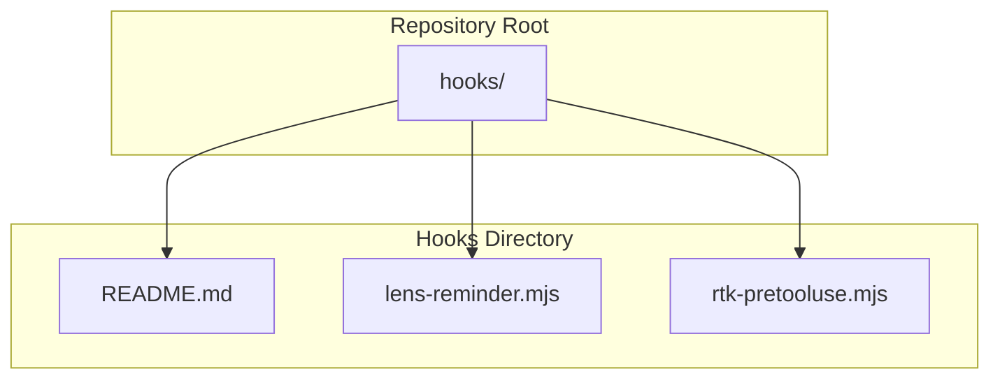
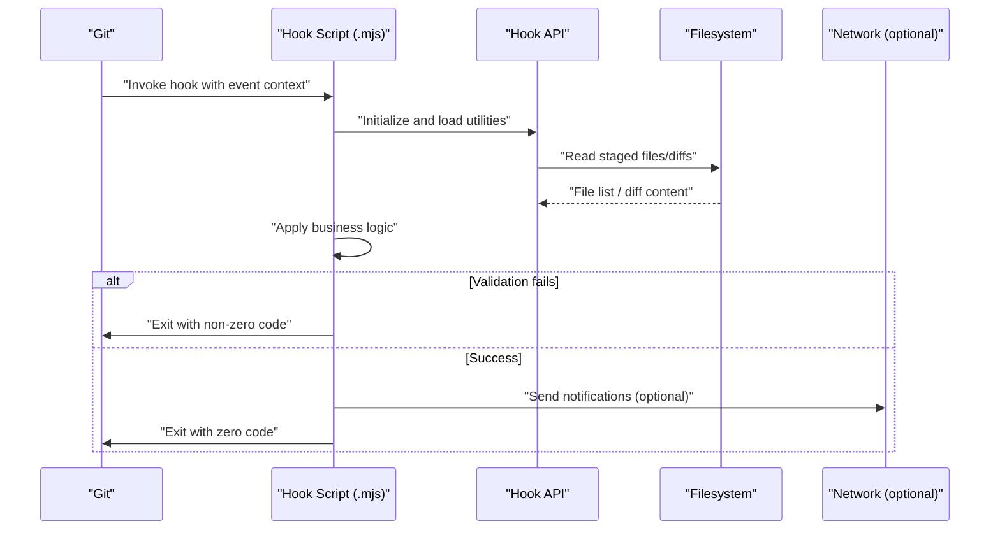
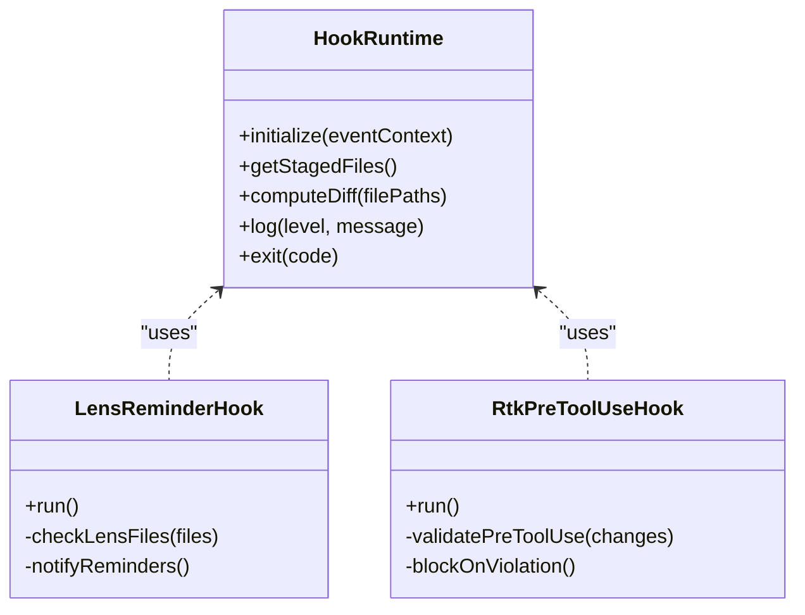
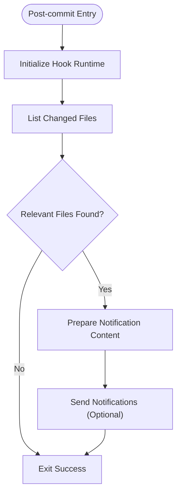
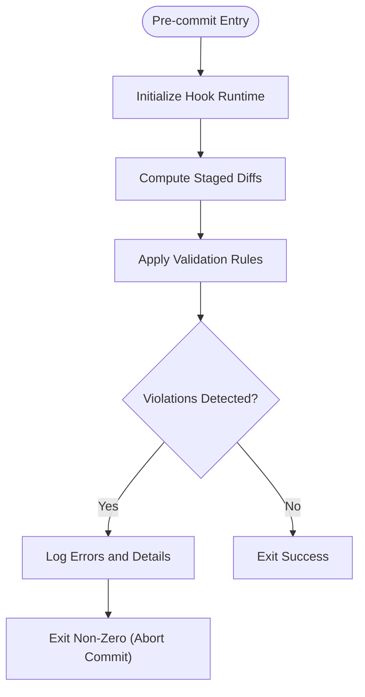
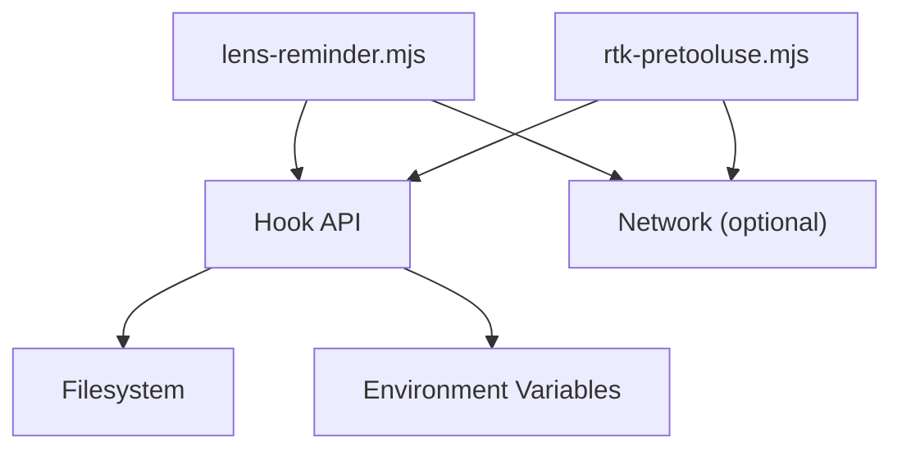

# Hook System Implementation

<cite>
**Referenced Files in This Document**
- [README.md](file://hooks/README.md)
- [lens-reminder.mjs](file://hooks/lens-reminder.mjs)
- [rtk-pretooluse.mjs](file://hooks/rtk-pretooluse.mjs)
</cite>

## Table of Contents
1. [Introduction](#introduction)
2. [Project Structure](#project-structure)
3. [Core Components](#core-components)
4. [Architecture Overview](#architecture-overview)
5. [Detailed Component Analysis](#detailed-component-analysis)
6. [Dependency Analysis](#dependency-analysis)
7. [Performance Considerations](#performance-considerations)
8. [Troubleshooting Guide](#troubleshooting-guide)
9. [Conclusion](#conclusion)
10. [Appendices](#appendices)

## Introduction
This document explains the Git hook system implementation in Pi Codex Kit with a focus on MJS-based hooks. It covers the hook lifecycle, event types, execution context, API interfaces, and utilities exposed to hooks. It also provides concrete examples from lens-reminder.mjs and rtk-pretooluse.mjs for pre-commit and post-commit scenarios, along with guidelines for creating custom hooks, error handling, logging, debugging, installation, configuration, and troubleshooting.

## Project Structure
The hook system is implemented as plain MJS files under the hooks directory. Each file represents a single hook script that can be wired into Git via standard Git hook mechanisms or an external orchestrator. The structure is intentionally minimal:
- hooks/README.md: Documentation and usage notes for the hook system
- hooks/lens-reminder.mjs: Example hook demonstrating a reminder-style workflow
- hooks/rtk-pretooluse.mjs: Example hook demonstrating a pre-commit validation flow

**Diagram sources**
- [README.md](file://hooks/README.md)
- [lens-reminder.mjs](file://hooks/lens-reminder.mjs)
- [rtk-pretooluse.mjs](file://hooks/rtk-pretooluse.mjs)

**Section sources**
- [README.md](file://hooks/README.md)
- [lens-reminder.mjs](file://hooks/lens-reminder.mjs)
- [rtk-pretooluse.mjs](file://hooks/rtk-pretooluse.mjs)

## Core Components
- Hook entry points: Each .mjs file is a self-contained hook script executed by Git or an orchestrator.
- Event model: Hooks receive contextual information about the Git event (e.g., pre-commit, post-commit).
- Execution context: Node.js environment with access to process environment variables, file system, and network if configured.
- API surface: A small set of utilities and helpers are provided to read staged files, compute diffs, log messages, and signal success/failure.

Key responsibilities:
- Validate changes before commit (pre-commit)
- Notify or remind after successful operations (post-commit)
- Provide structured logs and exit codes to control Git behavior

**Section sources**
- [README.md](file://hooks/README.md)
- [lens-reminder.mjs](file://hooks/lens-reminder.mjs)
- [rtk-pretooluse.mjs](file://hooks/rtk-pretooluse.mjs)

## Architecture Overview
The hook system follows a simple, composable architecture:
- Git invokes the appropriate hook script based on the event type.
- The script runs in a Node.js environment and uses the shared API to inspect the repository state.
- The script returns an exit code to Git: non-zero aborts the operation; zero allows it to proceed.

[No diagram sources since this diagram shows conceptual workflow, not actual code structure]

## Detailed Component Analysis

### Hook Lifecycle and Event Types
- Pre-commit: Runs before a commit is finalized. Use this to validate staged changes, enforce policies, or block commits when checks fail.
- Post-commit: Runs after a commit is created. Use this for notifications, reminders, or side effects that should not block the commit.

Execution context:
- Environment variables: Standard Git-provided variables are available (e.g., paths, refs).
- Working tree: Read-only access to staged changes and repository metadata.
- Exit codes: Non-zero signals failure; zero signals success.

**Section sources**
- [README.md](file://hooks/README.md)
- [lens-reminder.mjs](file://hooks/lens-reminder.mjs)
- [rtk-pretooluse.mjs](file://hooks/rtk-pretooluse.mjs)

### MJS Hook Structure and API Interfaces
Each hook script:
- Imports shared utilities from the hook API
- Initializes the runtime with event-specific parameters
- Performs checks or actions using the API
- Logs results and exits with an appropriate code

Common API capabilities:
- Initialize hook with event context
- List staged files and compute diffs
- Log structured messages
- Signal success/failure via exit codes
- Optional network calls for notifications

**Diagram sources**
- [lens-reminder.mjs](file://hooks/lens-reminder.mjs)
- [rtk-pretooluse.mjs](file://hooks/rtk-pretooluse.mjs)

**Section sources**
- [README.md](file://hooks/README.md)
- [lens-reminder.mjs](file://hooks/lens-reminder.mjs)
- [rtk-pretooluse.mjs](file://hooks/rtk-pretooluse.mjs)

### Example: lens-reminder.mjs (Post-commit Reminder)
Purpose:
- After a successful commit, review staged or recent changes and send reminders or notifications based on specific patterns (e.g., lens-related files).

Workflow:
- Initialize hook with post-commit context
- Enumerate changed files
- Identify relevant items for reminders
- Send notifications (optional)
- Exit successfully

**Diagram sources**
- [lens-reminder.mjs](file://hooks/lens-reminder.mjs)

**Section sources**
- [lens-reminder.mjs](file://hooks/lens-reminder.mjs)

### Example: rtk-pretooluse.mjs (Pre-commit Validation)
Purpose:
- Before committing, validate that certain rules or patterns are satisfied (e.g., preventing misuse of tools or enforcing conventions).

Workflow:
- Initialize hook with pre-commit context
- Compute diffs for staged files
- Apply validation rules
- If violations exist, log details and exit with non-zero code
- Otherwise, exit successfully

**Diagram sources**
- [rtk-pretooluse.mjs](file://hooks/rtk-pretooluse.mjs)

**Section sources**
- [rtk-pretooluse.mjs](file://hooks/rtk-pretooluse.mjs)

### Creating Custom Hooks
Guidelines:
- Create a new .mjs file under hooks/
- Import and initialize the hook runtime with the appropriate event context
- Use the API to inspect staged files and diffs
- Implement clear validation or notification logic
- Log actionable messages at appropriate levels
- Exit with zero on success, non-zero on failure

Best practices:
- Keep hooks fast and idempotent
- Avoid heavy I/O or long-running tasks in pre-commit
- Use structured logging for easier debugging
- Fail fast with informative messages

**Section sources**
- [README.md](file://hooks/README.md)
- [lens-reminder.mjs](file://hooks/lens-reminder.mjs)
- [rtk-pretooluse.mjs](file://hooks/rtk-pretooluse.mjs)

### Error Handling and Logging
- Use the API’s logging utilities to record warnings and errors
- Include context such as file paths and rule names in log messages
- For pre-commit hooks, ensure failures provide clear remediation steps
- For post-commit hooks, avoid blocking the commit; use notifications instead

**Section sources**
- [README.md](file://hooks/README.md)
- [lens-reminder.mjs](file://hooks/lens-reminder.mjs)
- [rtk-pretooluse.mjs](file://hooks/rtk-pretooluse.mjs)

### Debugging Hooks
- Enable verbose logging during development
- Inspect environment variables passed by Git
- Test hooks locally by invoking them directly with sample contexts
- Review exit codes and console output for clues

**Section sources**
- [README.md](file://hooks/README.md)
- [lens-reminder.mjs](file://hooks/lens-reminder.mjs)
- [rtk-pretooluse.mjs](file://hooks/rtk-pretooluse.mjs)

## Dependency Analysis
The hook scripts depend on:
- Node.js runtime
- Filesystem access for reading staged files and diffs
- Optional network access for notifications
- Shared hook API for initialization and utilities

**Diagram sources**
- [lens-reminder.mjs](file://hooks/lens-reminder.mjs)
- [rtk-pretooluse.mjs](file://hooks/rtk-pretooluse.mjs)
- [README.md](file://hooks/README.md)

**Section sources**
- [README.md](file://hooks/README.md)
- [lens-reminder.mjs](file://hooks/lens-reminder.mjs)
- [rtk-pretooluse.mjs](file://hooks/rtk-pretooluse.mjs)

## Performance Considerations
- Prefer lightweight checks in pre-commit hooks to keep commit times short
- Cache expensive computations where possible
- Avoid unnecessary network calls; batch notifications if needed
- Limit file scanning scope to staged changes only

[No sources needed since this section provides general guidance]

## Troubleshooting Guide
Common issues:
- Hook not invoked: Ensure proper Git integration or orchestrator configuration
- Permission errors: Verify filesystem access permissions for the hook user
- Long-running hooks: Optimize logic or move heavy work to post-commit
- Missing dependencies: Confirm Node.js availability and required modules

Diagnostic steps:
- Run hooks manually with sample inputs
- Check exit codes and logs
- Validate environment variables and working directory
- Review network connectivity for notification hooks

**Section sources**
- [README.md](file://hooks/README.md)
- [lens-reminder.mjs](file://hooks/lens-reminder.mjs)
- [rtk-pretooluse.mjs](file://hooks/rtk-pretooluse.mjs)

## Conclusion
The Pi Codex Kit hook system provides a straightforward, extensible framework for implementing Git hooks in MJS. By leveraging the shared API, developers can create robust pre-commit validations and post-commit reminders while maintaining clarity and performance. Follow the guidelines for custom hooks, error handling, and debugging to ensure reliable and maintainable workflows.

[No sources needed since this section summarizes without analyzing specific files]

## Appendices

### Installation and Configuration
- Place hook scripts under hooks/
- Configure Git or your orchestrator to invoke the desired .mjs files for each event
- Ensure Node.js is available in the execution environment
- Set any required environment variables for notifications or integrations

**Section sources**
- [README.md](file://hooks/README.md)

### API Reference Summary
- Initialization: Prepare the hook with event context
- File inspection: List staged files and compute diffs
- Logging: Record structured messages
- Exit signaling: Return success or failure to Git

**Section sources**
- [README.md](file://hooks/README.md)
- [lens-reminder.mjs](file://hooks/lens-reminder.mjs)
- [rtk-pretooluse.mjs](file://hooks/rtk-pretooluse.mjs)