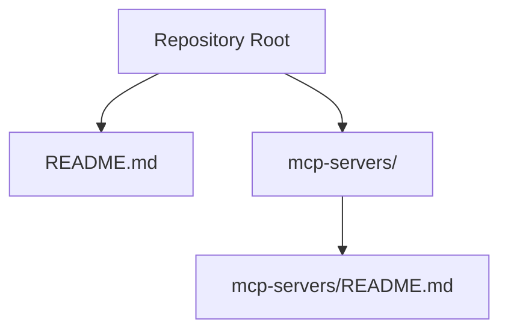
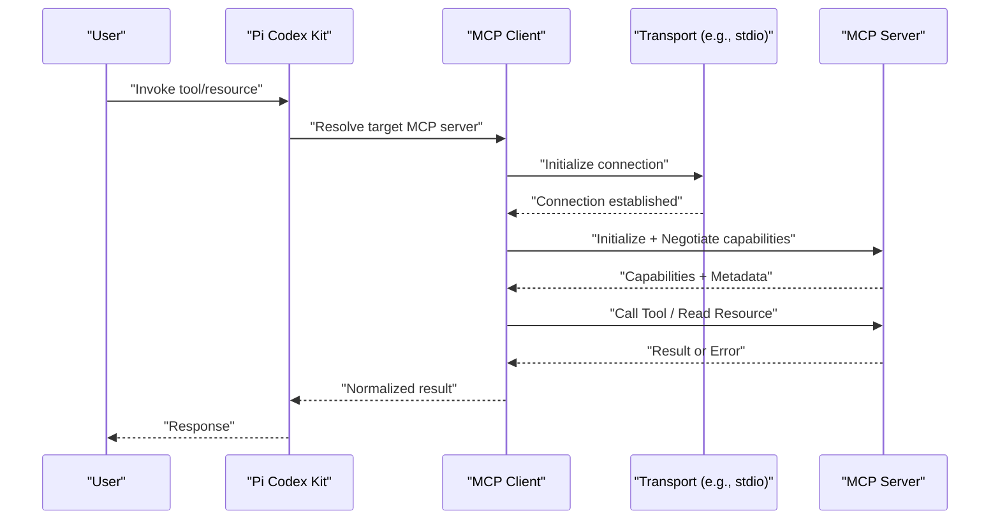
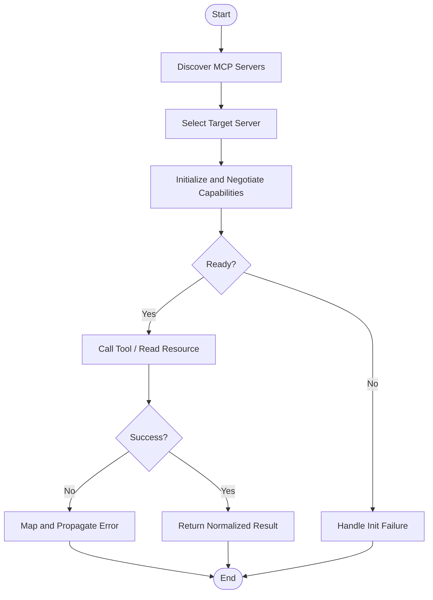
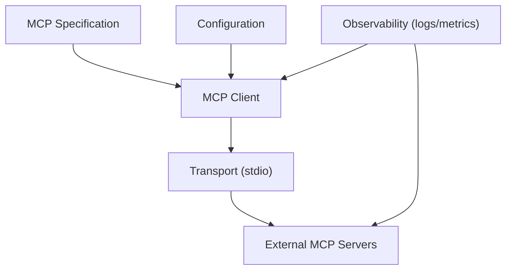

# Model Context Protocol Integration

<cite>
**Referenced Files in This Document**
- [README.md](file://README.md)
- [mcp-servers/README.md](file://mcp-servers/README.md)
</cite>

## Table of Contents
1. [Introduction](#introduction)
2. [Project Structure](#project-structure)
3. [Core Components](#core-components)
4. [Architecture Overview](#architecture-overview)
5. [Detailed Component Analysis](#detailed-component-analysis)
6. [Dependency Analysis](#dependency-analysis)
7. [Performance Considerations](#performance-considerations)
8. [Troubleshooting Guide](#troubleshooting-guide)
9. [Conclusion](#conclusion)
10. [Appendices](#appendices)

## Introduction
This document explains how the Model Context Protocol (MCP) integrates with Pi Codex Kit to connect external tools and services as MCP servers. It covers architecture, protocol specifications, communication patterns, message formats, lifecycle management, integration examples, guidelines for building custom MCP servers, error handling, security considerations, performance optimization, debugging, monitoring, and troubleshooting connectivity issues. The goal is to enable developers to reliably extend Pi Codex Kit capabilities by integrating MCP-based resources and tools.

## Project Structure
At a high level, MCP-related content in this repository includes:
- A top-level README describing project context and usage
- An MCP servers directory that documents available or example MCP server integrations

**Diagram sources**
- [README.md](file://README.md)
- [mcp-servers/README.md](file://mcp-servers/README.md)

**Section sources**
- [README.md](file://README.md)
- [mcp-servers/README.md](file://mcp-servers/README.md)

## Core Components
The MCP integration centers around these core concepts:
- MCP Server: An external process exposing capabilities via the MCP specification.
- MCP Client: The runtime component within Pi Codex Kit that discovers, connects to, and communicates with MCP servers.
- Messages: Structured requests and responses exchanged over the chosen transport (for example, stdio).
- Lifecycle: Initialization, capability negotiation, resource/tool invocation, and graceful shutdown.

Key responsibilities:
- Discover and register MCP servers defined under the MCP servers directory.
- Establish transports and negotiate capabilities during initialization.
- Route tool calls and resource reads through the MCP client to appropriate servers.
- Manage timeouts, retries, and error propagation back to callers.

[No sources needed since this section provides general guidance]

## Architecture Overview
The following diagram shows the end-to-end flow from a user request to an MCP server response.

**Diagram sources**
- [mcp-servers/README.md](file://mcp-servers/README.md)

## Detailed Component Analysis

### MCP Servers Directory
The MCP servers directory contains documentation and references for available or example MCP servers. Use it to:
- Identify supported servers and their capabilities
- Understand configuration requirements and environment variables
- Review integration notes and constraints

Operational guidance:
- Place new server definitions or manifests under this directory.
- Ensure each server’s README documents its endpoints, parameters, and error semantics.
- Keep versioning and compatibility notes up to date.

**Section sources**
- [mcp-servers/README.md](file://mcp-servers/README.md)

### MCP Client and Message Flow
The MCP client coordinates:
- Discovery and selection of the correct server based on requested tool or resource
- Connection establishment and capability negotiation
- Serialization/deserialization of messages according to the MCP specification
- Timeouts, retries, and error mapping

Message format expectations:
- Requests include method identifiers and typed parameters
- Responses include results or structured errors
- Notifications may be used for asynchronous events

Lifecycle stages:
- Initialize: handshake and capability exchange
- Invoke: call tools or read resources
- Shutdown: graceful teardown and cleanup

[No sources needed since this section provides general guidance]

### Example Integrations
Use cases for integrating external tools and services via MCP:
- Code analysis engines (static analyzers, linters)
- Repository operations (diffs, search, metadata)
- CI/CD and deployment pipelines
- Documentation generators and link checkers
- Security scanners and policy validators

Integration steps:
- Choose or implement an MCP server that exposes the desired capability
- Document server configuration and environment requirements
- Register the server in the MCP servers directory
- Validate connectivity and capability negotiation
- Test common success and failure paths

**Section sources**
- [mcp-servers/README.md](file://mcp-servers/README.md)

### Guidelines for Developing Custom MCP Servers
When building a custom MCP server:
- Follow the MCP specification for methods, parameters, and error structures
- Implement robust initialization and capability reporting
- Provide clear documentation for inputs, outputs, and side effects
- Support idempotent operations where possible
- Include meaningful error codes and messages
- Add health checks and readiness signals
- Log structured telemetry for observability

Security considerations:
- Validate all inputs and sanitize outputs
- Enforce least privilege and sandbox execution when invoking external commands
- Avoid leaking secrets; use secure configuration mechanisms
- Apply rate limiting and request size limits
- Audit access to sensitive resources

Performance tips:
- Cache expensive computations and frequently accessed data
- Batch operations when supported by the underlying service
- Use streaming for large payloads
- Tune concurrency and timeouts per workload characteristics

**Section sources**
- [mcp-servers/README.md](file://mcp-servers/README.md)

## Dependency Analysis
High-level dependencies for MCP integration:
- MCP Specification: Defines message formats, methods, and lifecycle
- Transport Layer: Typically stdio or another IPC mechanism
- Configuration: Environment variables and server manifests
- Observability: Logging and metrics for diagnostics

[No sources needed since this section provides general guidance]

## Performance Considerations
- Concurrency control: Limit parallel calls to avoid overwhelming downstream services
- Timeouts and deadlines: Set sensible per-operation timeouts and propagate them
- Caching: Cache stable resources and repeated queries
- Backpressure: Stream large responses and handle partial failures gracefully
- Resource limits: Enforce memory and CPU quotas for long-running tasks
- Batching: Combine small operations into larger batches when supported

[No sources needed since this section provides general guidance]

## Troubleshooting Guide
Common issues and resolutions:
- Connectivity failures: Verify server process is running and reachable; check transport bindings and permissions
- Capability mismatches: Confirm server advertises required features; update client or server versions
- Timeout errors: Increase timeouts or optimize server-side processing; consider batching
- Authentication/authorization: Validate credentials and scopes; ensure secrets are correctly injected
- Malformed messages: Inspect logs for serialization errors; validate schemas
- Resource exhaustion: Monitor memory/CPU; adjust concurrency and limits

Debugging and monitoring:
- Enable detailed logging at both client and server sides
- Capture request/response envelopes for failed calls
- Instrument key metrics: latency, throughput, error rates
- Use health checks and readiness probes to detect degraded states

**Section sources**
- [mcp-servers/README.md](file://mcp-servers/README.md)

## Conclusion
Integrating MCP servers into Pi Codex Kit enables powerful extensibility by connecting external tools and services through a standardized protocol. By adhering to the MCP specification, implementing robust lifecycle management, and applying strong security and performance practices, teams can build reliable, observable, and scalable integrations. Use the MCP servers directory as the source of truth for available servers and follow the provided guidelines to develop and operate custom MCP servers effectively.

[No sources needed since this section summarizes without analyzing specific files]

## Appendices

### Appendix A: Quickstart Checklist
- Define or select an MCP server
- Document configuration and environment variables
- Register the server in the MCP servers directory
- Validate initialization and capability negotiation
- Test typical and edge-case scenarios
- Add logging and metrics
- Review security and performance settings

**Section sources**
- [mcp-servers/README.md](file://mcp-servers/README.md)