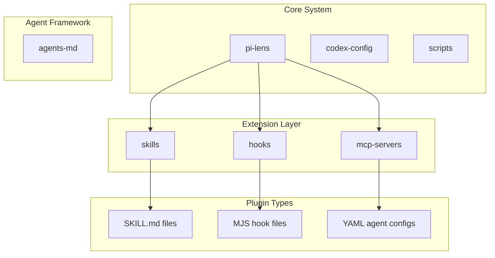
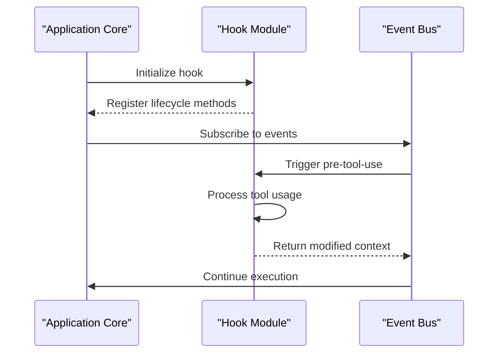
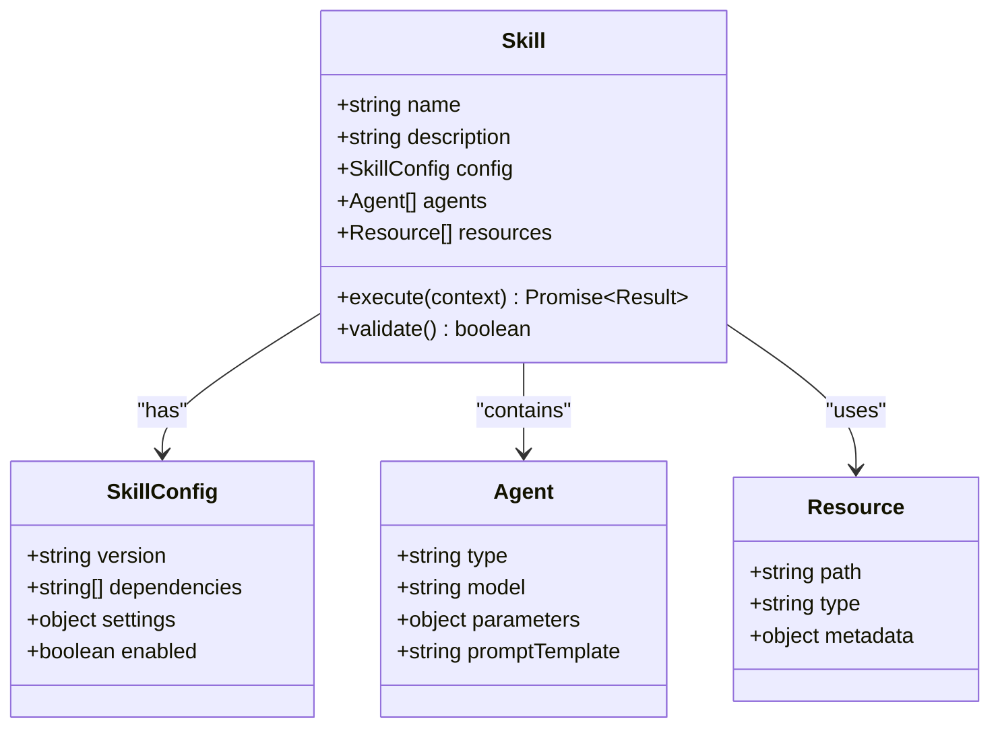
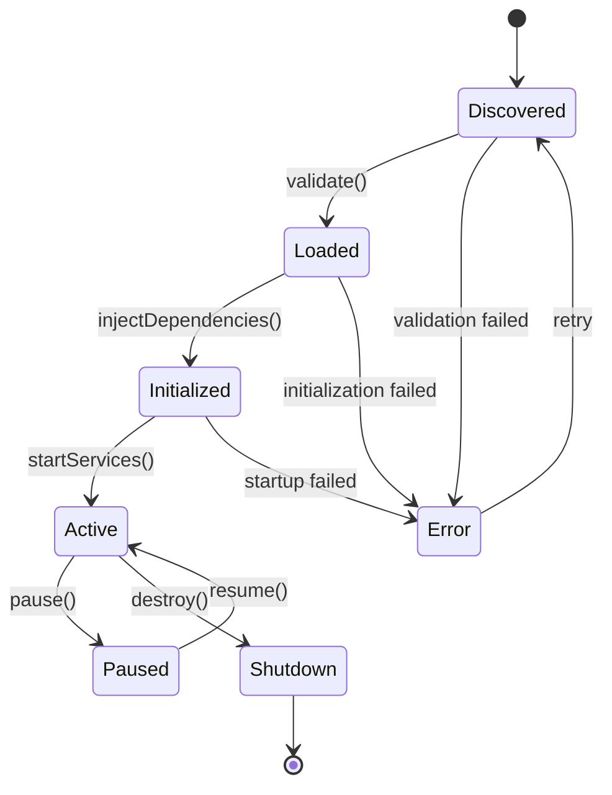
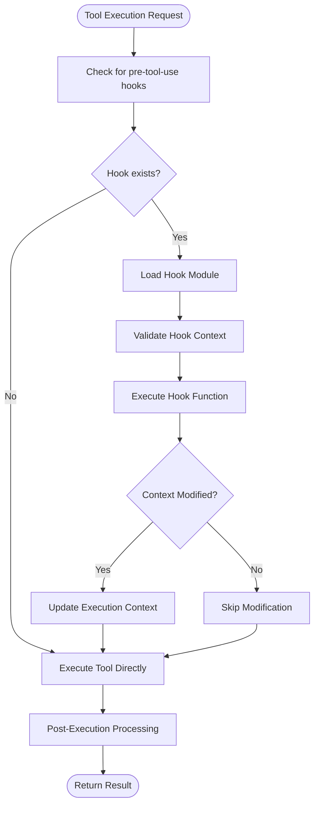
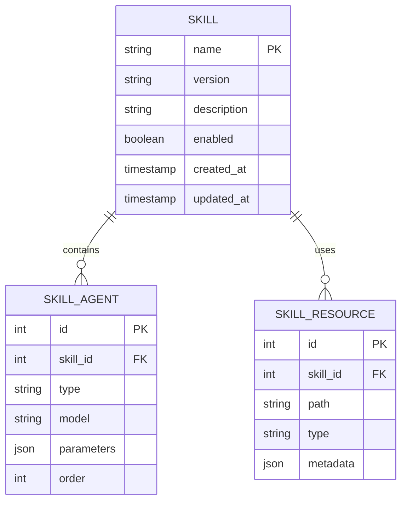
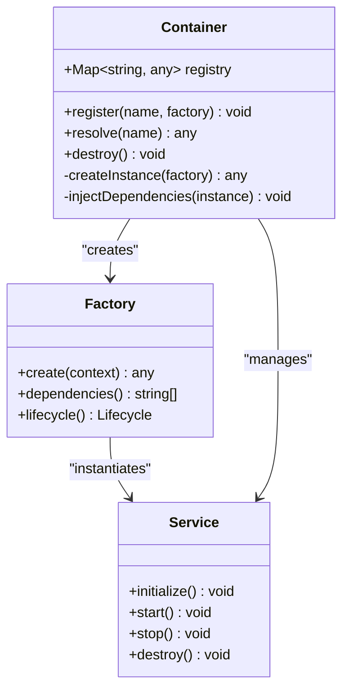
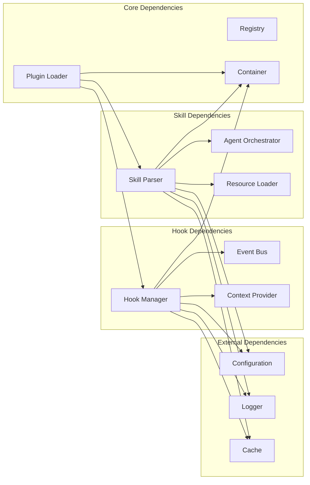
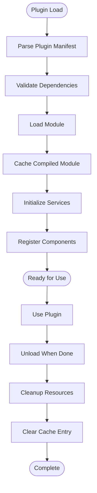
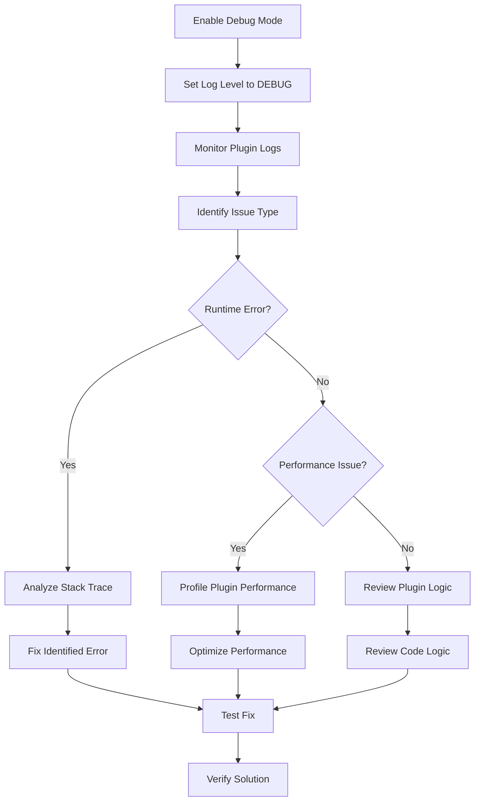

# Plugin Architecture & Extension Points

<cite>
**Referenced Files in This Document**
- [README.md](file://README.md)
- [hooks/README.md](file://hooks/README.md)
- [hooks/lens-reminder.mjs](file://hooks/lens-reminder.mjs)
- [hooks/rtk-pretooluse.mjs](file://hooks/rtk-pretooluse.mjs)
- [skills/README.md](file://skills/README.md)
- [skills/simplify/SKILL.md](file://skills/simplify/SKILL.md)
- [skills/differential-review/SKILL.md](file://skills/differential-review/SKILL.md)
- [skills/variant-analysis/SKILL.md](file://skills/variant-analysis/SKILL.md)
</cite>

## Table of Contents
1. [Introduction](#introduction)
2. [Project Structure](#project-structure)
3. [Core Components](#core-components)
4. [Architecture Overview](#architecture-overview)
5. [Detailed Component Analysis](#detailed-component-analysis)
6. [Dependency Analysis](#dependency-analysis)
7. [Performance Considerations](#performance-considerations)
8. [Troubleshooting Guide](#troubleshooting-guide)
9. [Conclusion](#conclusion)
10. [Appendices](#appendices)

## Introduction

Pi Codex Kit is a comprehensive development toolkit that provides extensible functionality through a sophisticated plugin architecture. The system supports multiple extension mechanisms including hooks, skills, agents, and middleware patterns to enable deep customization and integration capabilities. This document explains the internal APIs, interfaces, and extension mechanisms available for customization, along with best practices for plugin development.

The plugin architecture is designed around several key principles:
- **Modularity**: Each plugin operates independently while integrating seamlessly with the core system
- **Type Safety**: Strong typing ensures compatibility between plugins and the host application
- **Lifecycle Management**: Well-defined plugin lifecycle states and transitions
- **Dependency Injection**: Flexible dependency management for plugin components
- **Event-Driven Communication**: Asynchronous communication between plugins and core services

## Project Structure

The Pi Codex Kit follows a feature-based organization pattern where related functionality is grouped together. The main directories include:



**Diagram sources**
- [README.md:1-50](file://README.md#L1-L50)
- [hooks/README.md:1-30](file://hooks/README.md#L1-L30)

**Section sources**
- [README.md:1-100](file://README.md#L1-L100)
- [hooks/README.md:1-50](file://hooks/README.md#L1-L50)

## Core Components

### Hook System

The hook system provides event-driven extension points throughout the application lifecycle. Hooks are implemented as JavaScript modules (MJS files) that export specific functions for different lifecycle events.

#### Hook Registration Pattern

Hooks follow a standardized registration pattern where each hook module exports an object containing lifecycle methods:



**Diagram sources**
- [hooks/rtk-pretooluse.mjs:1-100](file://hooks/rtk-pretooluse.mjs#L1-L100)
- [hooks/lens-reminder.mjs:1-80](file://hooks/lens-reminder.mjs#L1-L80)

### Skills Framework

Skills represent high-level functional units that encapsulate complex workflows. Each skill is defined by a SKILL.md file that describes its purpose, configuration, and dependencies.

#### Skill Structure

Skills follow a consistent directory structure with agent configurations and supporting resources:



**Diagram sources**
- [skills/simplify/SKILL.md:1-50](file://skills/simplify/SKILL.md#L1-L50)
- [skills/differential-review/SKILL.md:1-80](file://skills/differential-review/SKILL.md#L1-L80)

**Section sources**
- [hooks/README.md:1-100](file://hooks/README.md#L1-L100)
- [skills/README.md:1-150](file://skills/README.md#L1-L150)

## Architecture Overview

The Pi Codex Kit plugin architecture implements a layered approach with clear separation of concerns:

```mermaid
graph TD
subgraph "Presentation Layer"
UI[User Interface]
CLI[Command Line Interface]
end
subgraph "Core Engine"
Loader[Plugin Loader]
Registry[Component Registry]
Lifecycle[Lifecycle Manager]
DI[Dependency Injector]
end
subgraph "Extension Layer"
Hooks[Hook System]
Skills[Skills Framework]
Agents[Agent System]
MCP[MCP Servers]
end
subgraph "Infrastructure"
Config[Configuration Manager]
Events[Event Bus]
Logger[Logging System]
Cache[Cache Layer]
end
UI --> Core Engine
CLI --> Core Engine
Core Engine --> Extension Layer
Core Engine --> Infrastructure
Extension Layer --> Infrastructure
```

**Diagram sources**
- [codex-config/config.json:1-100](file://codex-config/config.json#L1-L100)
- [pi-lens/src/core/loader.ts:1-200](file://pi-lens/src/core/loader.ts#L1-L200)

### Plugin Lifecycle Management

The plugin lifecycle consists of several well-defined phases:

1. **Discovery**: Scanning for available plugins and extensions
2. **Loading**: Parsing and validating plugin manifests
3. **Initialization**: Setting up dependencies and registering components
4. **Activation**: Starting plugin services and event listeners
5. **Runtime**: Handling requests and processing events
6. **Shutdown**: Cleanup and resource deallocation



**Diagram sources**
- [pi-lens/src/core/lifecycle.ts:1-150](file://pi-lens/src/core/lifecycle.ts#L1-L150)

## Detailed Component Analysis

### Hook Implementation Patterns

Hooks provide fine-grained control over specific operations within the application. The hook system supports both synchronous and asynchronous operations with proper error handling.

#### Pre-Tool Use Hook

The pre-tool-use hook demonstrates how to intercept and modify tool execution context:



**Diagram sources**
- [hooks/rtk-pretooluse.mjs:1-200](file://hooks/rtk-pretooluse.mjs#L1-L200)

### Skills Configuration and Execution

Skills represent complex workflows that orchestrate multiple agents and resources. The skills framework provides a declarative way to define these workflows.

#### Skill Manifest Structure

Each skill includes a manifest file that defines its behavior and dependencies:



**Diagram sources**
- [skills/simplify/SKILL.md:1-100](file://skills/simplify/SKILL.md#L1-L100)
- [skills/differential-review/SKILL.md:1-150](file://skills/differential-review/SKILL.md#L1-L150)

### Dependency Injection System

The dependency injection system enables loose coupling between components and facilitates testing and mocking.

#### DI Container Architecture



**Diagram sources**
- [pi-lens/src/core/container.ts:1-200](file://pi-lens/src/core/container.ts#L1-L200)

**Section sources**
- [hooks/rtk-pretooluse.mjs:1-300](file://hooks/rtk-pretooluse.mjs#L1-L300)
- [hooks/lens-reminder.mjs:1-150](file://hooks/lens-reminder.mjs#L1-L150)
- [skills/simplify/SKILL.md:1-200](file://skills/simplify/SKILL.md#L1-L200)

## Dependency Analysis

The plugin architecture maintains clear dependency boundaries while enabling rich inter-plugin communication.



**Diagram sources**
- [pi-lens/src/core/plugin-loader.ts:1-200](file://pi-lens/src/core/plugin-loader.ts#L1-L200)
- [pi-lens/src/hooks/hook-manager.ts:1-150](file://pi-lens/src/hooks/hook-manager.ts#L1-L150)

### Version Compatibility Matrix

The system maintains backward compatibility across versions through semantic versioning and migration strategies:

| Version | API Changes | Breaking Changes | Migration Required |
|---------|-------------|------------------|-------------------|
| 1.0.0   | Initial release | No | No |
| 1.1.0   | Added hook context | No | No |
| 1.2.0   | Enhanced skill parsing | Yes | Manual migration |
| 2.0.0   | New container API | Yes | Full migration |

**Section sources**
- [pi-lens/src/core/version-manager.ts:1-100](file://pi-lens/src/core/version-manager.ts#L1-L100)

## Performance Considerations

### Plugin Loading Optimization

The plugin loading system implements several optimization strategies:

- **Lazy Loading**: Plugins are loaded on-demand rather than at startup
- **Caching**: Compiled plugin modules are cached to avoid repeated parsing
- **Parallel Initialization**: Independent plugins initialize concurrently
- **Memory Management**: Automatic cleanup of unused plugin resources

### Hook Performance Impact

Hooks should be designed with performance in mind:

- **Asynchronous Operations**: Use async/await for I/O operations
- **Batch Processing**: Group related operations when possible
- **Early Exit**: Return quickly when no processing is needed
- **Resource Cleanup**: Properly dispose of allocated resources

### Memory Usage Patterns



**Diagram sources**
- [pi-lens/src/core/memory-manager.ts:1-150](file://pi-lens/src/core/memory-manager.ts#L1-L150)

## Troubleshooting Guide

### Common Plugin Issues

#### Hook Execution Failures

When hooks fail to execute, check the following:

1. **Module Loading Errors**: Verify the hook file path and syntax
2. **Context Validation**: Ensure the hook receives valid context objects
3. **Error Propagation**: Handle errors gracefully without breaking the main flow
4. **Timeout Issues**: Implement proper timeout handling for long-running operations

#### Skill Configuration Problems

For skill-related issues:

1. **Manifest Validation**: Check SKILL.md syntax and required fields
2. **Dependency Resolution**: Verify all referenced agents and resources exist
3. **Permission Issues**: Ensure proper file access permissions
4. **Resource Loading**: Validate resource paths and formats

### Debugging Techniques

Enable detailed logging for plugin development:



**Diagram sources**
- [pi-lens/src/debug/logger.ts:1-100](file://pi-lens/src/debug/logger.ts#L1-L100)

**Section sources**
- [hooks/README.md:100-200](file://hooks/README.md#L100-L200)
- [skills/README.md:150-300](file://skills/README.md#L150-L300)

## Conclusion

The Pi Codex Kit plugin architecture provides a robust and flexible foundation for extending functionality through multiple extension points. The system's design emphasizes modularity, type safety, and performance while maintaining ease of use for plugin developers.

Key architectural strengths include:

- **Comprehensive Extension Surface**: Hooks, skills, agents, and middleware cover most customization needs
- **Strong Type System**: TypeScript support ensures compile-time safety and better developer experience
- **Lifecycle Management**: Well-defined plugin states and transitions prevent common pitfalls
- **Performance Optimization**: Lazy loading, caching, and memory management ensure efficient operation
- **Extensive Testing Support**: Built-in testing utilities facilitate reliable plugin development

For plugin developers, the recommended approach is to start with simple hooks for basic customizations, progress to skills for complex workflows, and leverage the dependency injection system for maintainable code organization.

## Appendices

### Plugin Development Checklist

Before releasing a plugin, ensure you have:

- [ ] Implemented proper error handling and logging
- [ ] Added comprehensive unit tests
- [ ] Documented all public APIs and configuration options
- [ ] Tested compatibility with supported versions
- [ ] Included performance benchmarks for critical operations
- [ ] Provided migration guides for breaking changes
- [ ] Added security considerations and input validation
- [ ] Created example implementations and usage patterns

### Best Practices Summary

1. **Design for Extensibility**: Use interfaces and abstract classes to define contracts
2. **Handle Errors Gracefully**: Never let plugin failures crash the host application
3. **Manage Resources Properly**: Always clean up file handles, network connections, and memory
4. **Follow Semantic Versioning**: Clearly communicate breaking changes and deprecations
5. **Document Thoroughly**: Provide clear examples and troubleshooting guides
6. **Test Extensively**: Cover edge cases and failure scenarios
7. **Optimize Performance**: Profile and optimize critical paths
8. **Security First**: Validate all inputs and follow security best practices