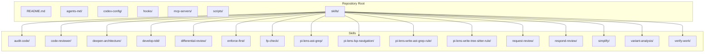
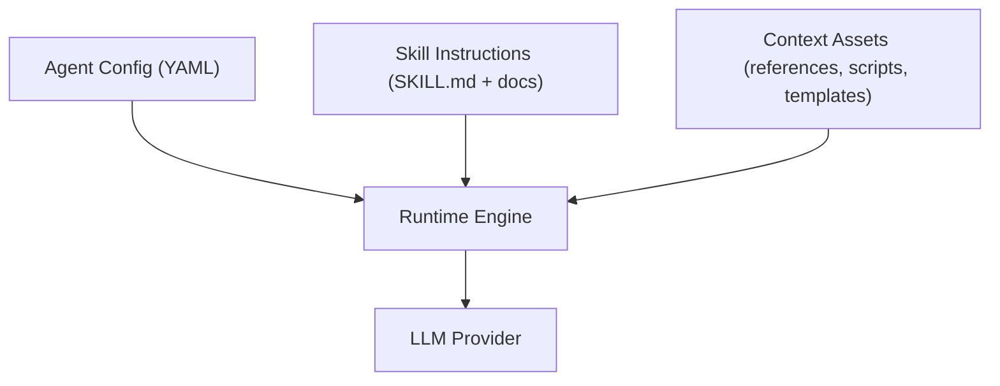
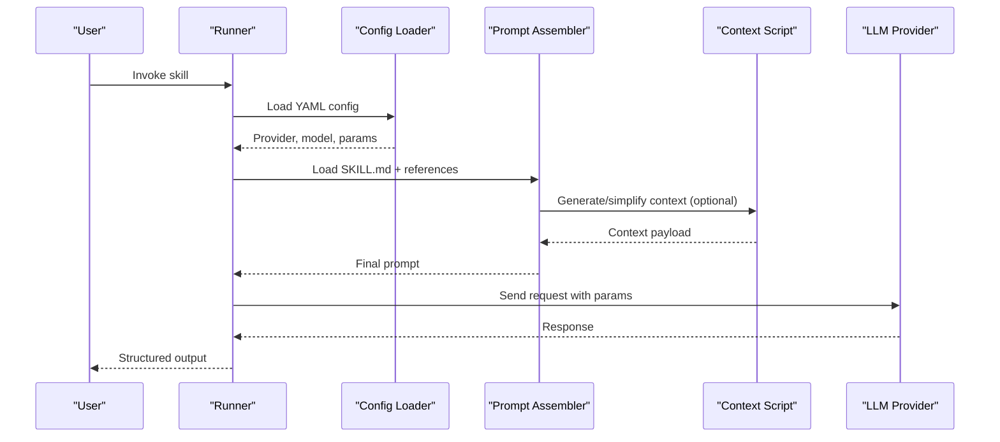
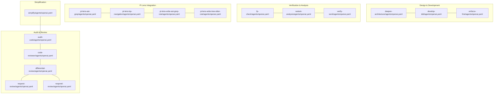

# Agent Configuration

<cite>
**Referenced Files in This Document**
- [README.md](file://README.md)
- [agents-md/README.md](file://agents-md/README.md)
- [codex-config/README.md](file://codex-config/README.md)
- [hooks/README.md](file://hooks/README.md)
- [mcp-servers/README.md](file://mcp-servers/README.md)
- [skills/README.md](file://skills/README.md)
- [skills/simplify/SKILL.md](file://skills/simplify/SKILL.md)
- [skills/simplify/scripts/simplify-context.mjs](file://skills/simplify/scripts/simplify-context.mjs)
- [skills/differential-review/SKILL.md](file://skills/differential-review/SKILL.md)
- [skills/differential-review/adversarial.md](file://skills/differential-review/adversarial.md)
- [skills/differential-review/methodology.md](file://skills/differential-review/methodology.md)
- [skills/differential-review/patterns.md](file://skills/differential-review/patterns.md)
- [skills/differential-review/reporting.md](file://skills/differential-review/reporting.md)
- [skills/fp-check/SKILL.md](file://skills/fp-check/SKILL.md)
- [skills/fp-check/references/bug-class-verification.md](file://skills/fp-check/references/bug-class-verification.md)
- [skills/fp-check/references/deep-verification.md](file://skills/fp-check/references/deep-verification.md)
- [skills/fp-check/references/evidence-templates.md](file://skills/fp-check/references/evidence-templates.md)
- [skills/fp-check/references/false-positive-patterns.md](file://skills/fp-check/references/false-positive-patterns.md)
- [skills/fp-check/references/gate-reviews.md](file://skills/fp-check/references/gate-reviews.md)
- [skills/fp-check/references/standard-verification.md](file://skills/fp-check/references/standard-verification.md)
- [skills/variant-analysis/SKILL.md](file://skills/variant-analysis/SKILL.md)
- [skills/variant-analysis/METHODOLOGY.md](file://skills/variant-analysis/METHODOLOGY.md)
- [skills/variant-analysis/resources/variant-report-template.md](file://skills/variant-analysis/resources/variant-report-template.md)
- [skills/audit-code/agents/openai.yaml](file://skills/audit-code/agents/openai.yaml)
- [skills/code-reviewer/agents/openai.yaml](file://skills/code-reviewer/agents/openai.yaml)
- [skills/deepen-architecture/agents/openai.yaml](file://skills/deepen-architecture/agents/openai.yaml)
- [skills/develop-tdd/agents/openai.yaml](file://skills/develop-tdd/agents/openai.yaml)
- [skills/differential-review/agents/openai.yaml](file://skills/differential-review/agents/openai.yaml)
- [skills/enforce-first/agents/openai.yaml](file://skills/enforce-first/agents/openai.yaml)
- [skills/fp-check/agents/openai.yaml](file://skills/fp-check/agents/openai.yaml)
- [skills/pi-lens-ast-grep/agents/openai.yaml](file://skills/pi-lens-ast-grep/agents/openai.yaml)
- [skills/pi-lens-lsp-navigation/agents/openai.yaml](file://skills/pi-lens-lsp-navigation/agents/openai.yaml)
- [skills/pi-lens-write-ast-grep-rule/agents/openai.yaml](file://skills/pi-lens-write-ast-grep-rule/agents/openai.yaml)
- [skills/pi-lens-write-tree-sitter-rule/agents/openai.yaml](file://skills/pi-lens-write-tree-sitter-rule/agents/openai.yaml)
- [skills/request-review/agents/openai.yaml](file://skills/request-review/agents/openai.yaml)
- [skills/respond-review/agents/openai.yaml](file://skills/respond-review/agents/openai.yaml)
- [skills/simplify/agents/openai.yaml](file://skills/simplify/agents/openai.yaml)
- [skills/variant-analysis/agents/openai.yaml](file://skills/variant-analysis/agents/openai.yaml)
- [skills/verify-work/agents/openai.yaml](file://skills/verify-work/agents/openai.yaml)
</cite>

## Table of Contents
1. [Introduction](#introduction)
2. [Project Structure](#project-structure)
3. [Core Components](#core-components)
4. [Architecture Overview](#architecture-overview)
5. [Detailed Component Analysis](#detailed-component-analysis)
6. [Dependency Analysis](#dependency-analysis)
7. [Performance Considerations](#performance-considerations)
8. [Security Considerations](#security-considerations)
9. [Troubleshooting Guide](#troubleshooting-guide)
10. [Conclusion](#conclusion)
11. [Appendices](#appendices)

## Introduction
This document explains how to configure AI agents throughout the Pi Codex Kit using YAML-based agent configuration files. It covers prompt engineering best practices, model selection strategies, and how prompts are processed and contextualized. You will learn the structure of agent configuration files, available parameters, customization options, and examples for different use cases. Guidance is also provided on optimizing performance and securing sensitive information such as API keys.

## Project Structure
The repository organizes skills and their associated agents under a consistent layout:
- Each skill has a SKILL.md describing its purpose and usage.
- Each skill may include an agents directory with one or more YAML configuration files (e.g., openai.yaml).
- Some skills provide additional context, references, scripts, or resources that influence prompt processing and agent behavior.

**Diagram sources**
- [README.md](file://README.md)
- [skills/README.md](file://skills/README.md)

**Section sources**
- [README.md](file://README.md)
- [skills/README.md](file://skills/README.md)

## Core Components
- YAML-based agent configuration files: Located under each skill’s agents directory (e.g., openai.yaml). These define model selection, system prompts, and runtime parameters.
- Skill definitions: SKILL.md files describe the intent, inputs, outputs, and any special instructions for invoking the agent.
- Contextual assets: References, methodologies, templates, and scripts that inform prompt construction and context management.

Key responsibilities:
- Model selection and provider settings via YAML.
- Prompt composition and instruction framing via SKILL.md and referenced documents.
- Context assembly via scripts and resource files where applicable.

**Section sources**
- [skills/README.md](file://skills/README.md)
- [skills/simplify/SKILL.md](file://skills/simplify/SKILL.md)
- [skills/differential-review/SKILL.md](file://skills/differential-review/SKILL.md)
- [skills/fp-check/SKILL.md](file://skills/fp-check/SKILL.md)
- [skills/variant-analysis/SKILL.md](file://skills/variant-analysis/SKILL.md)

## Architecture Overview
At a high level, the agent configuration system composes three layers:
- Configuration layer: YAML files specify provider, model, and parameters.
- Instruction layer: SKILL.md and related documents define the task, constraints, and output format.
- Context layer: Scripts and reference materials supply dynamic or static context to enrich prompts.

[No sources needed since this diagram shows conceptual workflow, not actual code structure]

## Detailed Component Analysis

### YAML-Based Agent Configuration System
- Location: Each skill contains an agents directory with YAML files (commonly named openai.yaml).
- Purpose: Define provider-specific settings, model identifiers, and parameters that control generation behavior.
- Typical fields (based on observed naming conventions):
  - Provider identification (e.g., OpenAI-compatible endpoints).
  - Model name or identifier.
  - Generation parameters (e.g., temperature, max tokens).
  - System prompt or instruction references.
  - Optional tool or function-calling flags if supported by the provider.

Best practices:
- Keep provider and model selections explicit and pinned to stable versions when possible.
- Use separate YAML files per role or persona within a skill to avoid overloading a single config.
- Externalize secrets (API keys) from YAML; load them at runtime via environment variables or secure secret managers.

Example patterns across skills:
- Code review and audit roles often emphasize strict formatting and verification steps.
- Architectural deepening tasks may require higher creativity and longer responses.
- Verification and variant analysis tasks benefit from deterministic parameters and structured outputs.

**Section sources**
- [skills/audit-code/agents/openai.yaml](file://skills/audit-code/agents/openai.yaml)
- [skills/code-reviewer/agents/openai.yaml](file://skills/code-reviewer/agents/openai.yaml)
- [skills/deepen-architecture/agents/openai.yaml](file://skills/deepen-architecture/agents/openai.yaml)
- [skills/develop-tdd/agents/openai.yaml](file://skills/develop-tdd/agents/openai.yaml)
- [skills/differential-review/agents/openai.yaml](file://skills/differential-review/agents/openai.yaml)
- [skills/enforce-first/agents/openai.yaml](file://skills/enforce-first/agents/openai.yaml)
- [skills/fp-check/agents/openai.yaml](file://skills/fp-check/agents/openai.yaml)
- [skills/pi-lens-ast-grep/agents/openai.yaml](file://skills/pi-lens-ast-grep/agents/openai.yaml)
- [skills/pi-lens-lsp-navigation/agents/openai.yaml](file://skills/pi-lens-lsp-navigation/agents/openai.yaml)
- [skills/pi-lens-write-ast-grep-rule/agents/openai.yaml](file://skills/pi-lens-write-ast-grep-rule/agents/openai.yaml)
- [skills/pi-lens-write-tree-sitter-rule/agents/openai.yaml](file://skills/pi-lens-write-tree-sitter-rule/agents/openai.yaml)
- [skills/request-review/agents/openai.yaml](file://skills/request-review/agents/openai.yaml)
- [skills/respond-review/agents/openai.yaml](file://skills/respond-review/agents/openai.yaml)
- [skills/simplify/agents/openai.yaml](file://skills/simplify/agents/openai.yaml)
- [skills/variant-analysis/agents/openai.yaml](file://skills/variant-analysis/agents/openai.yaml)
- [skills/verify-work/agents/openai.yaml](file://skills/verify-work/agents/openai.yaml)

### Prompt Engineering Best Practices
- Clarity and specificity: Define exact inputs, expected outputs, and constraints.
- Role framing: Assign a clear role to the agent (e.g., “Senior Security Auditor”).
- Step-by-step reasoning: Encourage structured thinking and verification before finalizing answers.
- Output formatting: Specify formats (e.g., JSON, Markdown tables) to enable downstream parsing.
- Guardrails: Include negative constraints (“Do not suggest…”) to reduce hallucinations.
- Iterative refinement: Split complex tasks into smaller prompts with intermediate checkpoints.

Where to define prompts:
- In YAML system prompt fields (provider-specific).
- In SKILL.md instructions and referenced documents.
- In scripts that assemble context dynamically.

**Section sources**
- [skills/differential-review/SKILL.md](file://skills/differential-review/SKILL.md)
- [skills/differential-review/adversarial.md](file://skills/differential-review/adversarial.md)
- [skills/differential-review/methodology.md](file://skills/differential-review/methodology.md)
- [skills/differential-review/patterns.md](file://skills/differential-review/patterns.md)
- [skills/differential-review/reporting.md](file://skills/differential-review/reporting.md)
- [skills/fp-check/SKILL.md](file://skills/fp-check/SKILL.md)
- [skills/fp-check/references/bug-class-verification.md](file://skills/fp-check/references/bug-class-verification.md)
- [skills/fp-check/references/deep-verification.md](file://skills/fp-check/references/deep-verification.md)
- [skills/fp-check/references/evidence-templates.md](file://skills/fp-check/references/evidence-templates.md)
- [skills/fp-check/references/false-positive-patterns.md](file://skills/fp-check/references/false-positive-patterns.md)
- [skills/fp-check/references/gate-reviews.md](file://skills/fp-check/references/gate-reviews.md)
- [skills/fp-check/references/standard-verification.md](file://skills/fp-check/references/standard-verification.md)
- [skills/variant-analysis/SKILL.md](file://skills/variant-analysis/SKILL.md)
- [skills/variant-analysis/METHODOLOGY.md](file://skills/variant-analysis/METHODOLOGY.md)
- [skills/variant-analysis/resources/variant-report-template.md](file://skills/variant-analysis/resources/variant-report-template.md)

### Model Selection Strategies
- Match model capability to task complexity:
  - Simple classification or extraction: Smaller, faster models.
  - Complex reasoning or multi-step workflows: Larger models with stronger reasoning.
- Cost-performance trade-offs:
  - Prefer cheaper models for iterative drafts; switch to premium models for final validation.
- Determinism vs. creativity:
  - Lower temperature for deterministic outputs (reports, checklists).
  - Higher temperature for ideation and design exploration.
- Provider compatibility:
  - Ensure YAML provider settings align with your endpoint capabilities (function calling, streaming, etc.).

**Section sources**
- [skills/audit-code/agents/openai.yaml](file://skills/audit-code/agents/openai.yaml)
- [skills/code-reviewer/agents/openai.yaml](file://skills/code-reviewer/agents/openai.yaml)
- [skills/deepen-architecture/agents/openai.yaml](file://skills/deepen-architecture/agents/openai.yaml)
- [skills/develop-tdd/agents/openai.yaml](file://skills/develop-tdd/agents/openai.yaml)
- [skills/differential-review/agents/openai.yaml](file://skills/differential-review/agents/openai.yaml)
- [skills/enforce-first/agents/openai.yaml](file://skills/enforce-first/agents/openai.yaml)
- [skills/fp-check/agents/openai.yaml](file://skills/fp-check/agents/openai.yaml)
- [skills/pi-lens-ast-grep/agents/openai.yaml](file://skills/pi-lens-ast-grep/agents/openai.yaml)
- [skills/pi-lens-lsp-navigation/agents/openai.yaml](file://skills/pi-lens-lsp-navigation/agents/openai.yaml)
- [skills/pi-lens-write-ast-grep-rule/agents/openai.yaml](file://skills/pi-lens-write-ast-grep-rule/agents/openai.yaml)
- [skills/pi-lens-write-tree-sitter-rule/agents/openai.yaml](file://skills/pi-lens-write-tree-sitter-rule/agents/openai.yaml)
- [skills/request-review/agents/openai.yaml](file://skills/request-review/agents/openai.yaml)
- [skills/respond-review/agents/openai.yaml](file://skills/respond-review/agents/openai.yaml)
- [skills/simplify/agents/openai.yaml](file://skills/simplify/agents/openai.yaml)
- [skills/variant-analysis/agents/openai.yaml](file://skills/variant-analysis/agents/openai.yaml)
- [skills/verify-work/agents/openai.yaml](file://skills/verify-work/agents/openai.yaml)

### Prompt Processing and Context Management
- Prompt assembly pipeline:
  - Load YAML configuration for provider/model/parameters.
  - Read SKILL.md and referenced documents for instructions and constraints.
  - Optionally run scripts to generate or simplify context.
  - Compose final prompt with system instructions, user input, and context.
- Context sources:
  - Static references (methodologies, patterns, evidence templates).
  - Dynamic context (AST grep rules, LSP navigation results, simplified code snippets).
- Example script-driven context:
  - The simplify skill includes a script to prepare concise context for the agent.

**Diagram sources**
- [skills/simplify/SKILL.md](file://skills/simplify/SKILL.md)
- [skills/simplify/scripts/simplify-context.mjs](file://skills/simplify/scripts/simplify-context.mjs)
- [skills/simplify/agents/openai.yaml](file://skills/simplify/agents/openai.yaml)

**Section sources**
- [skills/simplify/SKILL.md](file://skills/simplify/SKILL.md)
- [skills/simplify/scripts/simplify-context.mjs](file://skills/simplify/scripts/simplify-context.mjs)
- [skills/differential-review/SKILL.md](file://skills/differential-review/SKILL.md)
- [skills/fp-check/SKILL.md](file://skills/fp-check/SKILL.md)
- [skills/variant-analysis/SKILL.md](file://skills/variant-analysis/SKILL.md)

### Examples of Different Agent Configurations
- Audit and security-focused agents:
  - Emphasize strict verification, evidence-based reporting, and conservative parameters.
- Code reviewer agents:
  - Focus on style, correctness, and maintainability with structured feedback.
- Architectural deepening agents:
  - Allow more creative exploration while maintaining architectural principles.
- TDD development agents:
  - Prioritize test-first guidance and incremental implementation steps.
- Differential review agents:
  - Combine adversarial checks, methodology, patterns, and reporting guidelines.
- FP-check agents:
  - Leverage references for bug class verification, evidence templates, and false positive patterns.
- Variant analysis agents:
  - Use methodology and report templates to produce standardized findings.
- Pi Lens integration agents:
  - AST grep and tree-sitter rule writing agents tailored to codebase queries and rule generation.

For concrete parameter values and field names, inspect the corresponding openai.yaml files under each skill’s agents directory.

**Section sources**
- [skills/audit-code/agents/openai.yaml](file://skills/audit-code/agents/openai.yaml)
- [skills/code-reviewer/agents/openai.yaml](file://skills/code-reviewer/agents/openai.yaml)
- [skills/deepen-architecture/agents/openai.yaml](file://skills/deepen-architecture/agents/openai.yaml)
- [skills/develop-tdd/agents/openai.yaml](file://skills/develop-tdd/agents/openai.yaml)
- [skills/differential-review/agents/openai.yaml](file://skills/differential-review/agents/openai.yaml)
- [skills/enforce-first/agents/openai.yaml](file://skills/enforce-first/agents/openai.yaml)
- [skills/fp-check/agents/openai.yaml](file://skills/fp-check/agents/openai.yaml)
- [skills/pi-lens-ast-grep/agents/openai.yaml](file://skills/pi-lens-ast-grep/agents/openai.yaml)
- [skills/pi-lens-lsp-navigation/agents/openai.yaml](file://skills/pi-lens-lsp-navigation/agents/openai.yaml)
- [skills/pi-lens-write-ast-grep-rule/agents/openai.yaml](file://skills/pi-lens-write-ast-grep-rule/agents/openai.yaml)
- [skills/pi-lens-write-tree-sitter-rule/agents/openai.yaml](file://skills/pi-lens-write-tree-sitter-rule/agents/openai.yaml)
- [skills/request-review/agents/openai.yaml](file://skills/request-review/agents/openai.yaml)
- [skills/respond-review/agents/openai.yaml](file://skills/respond-review/agents/openai.yaml)
- [skills/simplify/agents/openai.yaml](file://skills/simplify/agents/openai.yaml)
- [skills/variant-analysis/agents/openai.yaml](file://skills/variant-analysis/agents/openai.yaml)
- [skills/verify-work/agents/openai.yaml](file://skills/verify-work/agents/openai.yaml)

## Dependency Analysis
The following diagram maps the relationships between skills, their agent configurations, and supporting documents.

**Diagram sources**
- [skills/audit-code/agents/openai.yaml](file://skills/audit-code/agents/openai.yaml)
- [skills/code-reviewer/agents/openai.yaml](file://skills/code-reviewer/agents/openai.yaml)
- [skills/deepen-architecture/agents/openai.yaml](file://skills/deepen-architecture/agents/openai.yaml)
- [skills/develop-tdd/agents/openai.yaml](file://skills/develop-tdd/agents/openai.yaml)
- [skills/differential-review/agents/openai.yaml](file://skills/differential-review/agents/openai.yaml)
- [skills/enforce-first/agents/openai.yaml](file://skills/enforce-first/agents/openai.yaml)
- [skills/fp-check/agents/openai.yaml](file://skills/fp-check/agents/openai.yaml)
- [skills/pi-lens-ast-grep/agents/openai.yaml](file://skills/pi-lens-ast-grep/agents/openai.yaml)
- [skills/pi-lens-lsp-navigation/agents/openai.yaml](file://skills/pi-lens-lsp-navigation/agents/openai.yaml)
- [skills/pi-lens-write-ast-grep-rule/agents/openai.yaml](file://skills/pi-lens-write-ast-grep-rule/agents/openai.yaml)
- [skills/pi-lens-write-tree-sitter-rule/agents/openai.yaml](file://skills/pi-lens-write-tree-sitter-rule/agents/openai.yaml)
- [skills/request-review/agents/openai.yaml](file://skills/request-review/agents/openai.yaml)
- [skills/respond-review/agents/openai.yaml](file://skills/respond-review/agents/openai.yaml)
- [skills/simplify/agents/openai.yaml](file://skills/simplify/agents/openai.yaml)
- [skills/variant-analysis/agents/openai.yaml](file://skills/variant-analysis/agents/openai.yaml)
- [skills/verify-work/agents/openai.yaml](file://skills/verify-work/agents/openai.yaml)

**Section sources**
- [skills/README.md](file://skills/README.md)

## Performance Considerations
- Parameter tuning:
  - Reduce temperature for deterministic outputs (reports, checklists).
  - Increase temperature slightly for exploratory tasks (design brainstorming).
- Token budgeting:
  - Keep prompts concise; leverage scripts to simplify context.
  - Use chunked processing for large codebases.
- Streaming and retries:
  - Enable streaming where supported to improve responsiveness.
  - Implement retry logic for transient network errors.
- Caching:
  - Cache repeated context computations (e.g., AST grep results) to reduce latency.
- Model routing:
  - Route simple tasks to smaller models; escalate complex tasks to larger models.

[No sources needed since this section provides general guidance]

## Security Considerations
- Secrets management:
  - Do not embed API keys or tokens directly in YAML files.
  - Load credentials from environment variables or secure secret stores at runtime.
- Least privilege:
  - Restrict access to repositories and tools used by agents.
- Input sanitization:
  - Validate and sanitize user inputs before inclusion in prompts.
- Output redaction:
  - Avoid echoing sensitive data in logs or responses.
- Provider compliance:
  - Ensure provider endpoints comply with organizational policies and data residency requirements.

[No sources needed since this section provides general guidance]

## Troubleshooting Guide
Common issues and resolutions:
- Missing or invalid YAML:
  - Validate syntax and required fields in openai.yaml.
  - Ensure provider and model identifiers match supported values.
- Authentication failures:
  - Verify API keys are set in environment variables and accessible to the runner.
  - Check endpoint URLs and scopes.
- Excessive token usage:
  - Simplify context using scripts; trim SKILL.md instructions.
  - Adjust max tokens and temperature to reduce response size.
- Hallucinations or off-topic outputs:
  - Strengthen system instructions and add negative constraints.
  - Provide clearer examples and structured output formats.
- Slow responses:
  - Switch to a faster model for draft stages.
  - Enable streaming and caching where applicable.

**Section sources**
- [skills/simplify/agents/openai.yaml](file://skills/simplify/agents/openai.yaml)
- [skills/simplify/scripts/simplify-context.mjs](file://skills/simplify/scripts/simplify-context.mjs)
- [skills/differential-review/agents/openai.yaml](file://skills/differential-review/agents/openai.yaml)
- [skills/fp-check/agents/openai.yaml](file://skills/fp-check/agents/openai.yaml)
- [skills/variant-analysis/agents/openai.yaml](file://skills/variant-analysis/agents/openai.yaml)

## Conclusion
The Pi Codex Kit’s agent configuration system combines YAML-based settings with rich skill documentation and optional scripts to deliver flexible, secure, and performant AI-powered workflows. By carefully selecting models, engineering precise prompts, managing context effectively, and adhering to security best practices, you can tailor agents to diverse use cases—from code review and auditing to architecture deepening and variant analysis.

[No sources needed since this section summarizes without analyzing specific files]

## Appendices

### Appendix A: Reference Index
- Repository overview: [README.md](file://README.md)
- Skills index: [skills/README.md](file://skills/README.md)
- Agents metadata: [agents-md/README.md](file://agents-md/README.md)
- Hooks: [hooks/README.md](file://hooks/README.md)
- MCP servers: [mcp-servers/README.md](file://mcp-servers/README.md)

**Section sources**
- [README.md](file://README.md)
- [agents-md/README.md](file://agents-md/README.md)
- [codex-config/README.md](file://codex-config/README.md)
- [hooks/README.md](file://hooks/README.md)
- [mcp-servers/README.md](file://mcp-servers/README.md)
- [skills/README.md](file://skills/README.md)