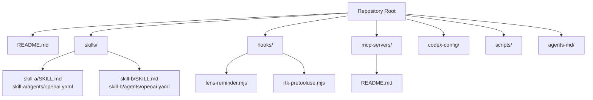
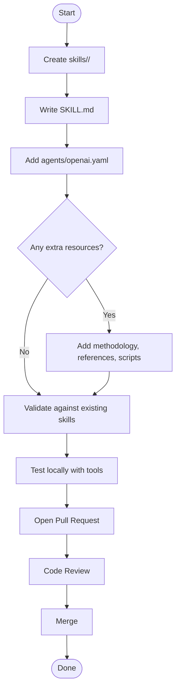
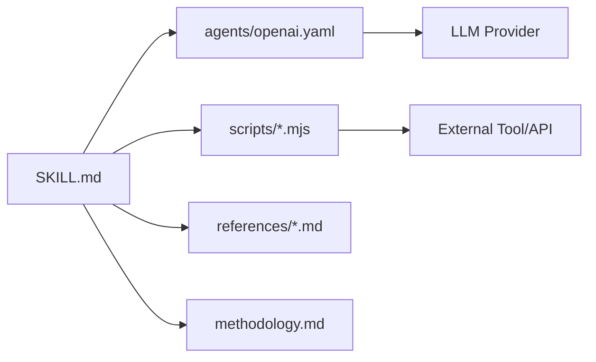

# Contributing Guidelines

<cite>
**Referenced Files in This Document**
- [README.md](file://README.md)
- [skills/README.md](file://skills/README.md)
- [hooks/README.md](file://hooks/README.md)
- [mcp-servers/README.md](file://mcp-servers/README.md)
- [skills/audit-code/SKILL.md](file://skills/audit-code/SKILL.md)
- [skills/code-reviewer/SKILL.md](file://skills/code-reviewer/SKILL.md)
- [skills/deepen-architecture/SKILL.md](file://skills/deepen-architecture/SKILL.md)
- [skills/develop-tdd/SKILL.md](file://skills/develop-tdd/SKILL.md)
- [skills/differential-review/SKILL.md](file://skills/differential-review/SKILL.md)
- [skills/enforce-first/SKILL.md](file://skills/enforce-first/SKILL.md)
- [skills/fp-check/SKILL.md](file://skills/fp-check/SKILL.md)
- [skills/pi-lens-ast-grep/SKILL.md](file://skills/pi-lens-ast-grep/SKILL.md)
- [skills/pi-lens-lsp-navigation/SKILL.md](file://skills/pi-lens-lsp-navigation/SKILL.md)
- [skills/pi-lens-write-ast-grep-rule/SKILL.md](file://skills/pi-lens-write-ast-grep-rule/SKILL.md)
- [skills/pi-lens-write-tree-sitter-rule/SKILL.md](file://skills/pi-lens-write-tree-sitter-rule/SKILL.md)
- [skills/request-review/SKILL.md](file://skills/request-review/SKILL.md)
- [skills/respond-review/SKILL.md](file://skills/respond-review/SKILL.md)
- [skills/simplify/SKILL.md](file://skills/simplify/SKILL.md)
- [skills/variant-analysis/SKILL.md](file://skills/variant-analysis/SKILL.md)
- [skills/verify-work/SKILL.md](file://skills/verify-work/SKILL.md)
- [skills/differential-review/methodology.md](file://skills/differential-review/methodology.md)
- [skills/differential-review/adversarial.md](file://skills/differential-review/adversarial.md)
- [skills/differential-review/patterns.md](file://skills/differential-review/patterns.md)
- [skills/differential-review/reporting.md](file://skills/differential-review/reporting.md)
- [skills/fp-check/references/bug-class-verification.md](file://skills/fp-check/references/bug-class-verification.md)
- [skills/fp-check/references/deep-verification.md](file://skills/fp-check/references/deep-verification.md)
- [skills/fp-check/references/evidence-templates.md](file://skills/fp-check/references/evidence-templates.md)
- [skills/fp-check/references/false-positive-patterns.md](file://skills/fp-check/references/false-positive-patterns.md)
- [skills/fp-check/references/gate-reviews.md](file://skills/fp-check/references/gate-reviews.md)
- [skills/fp-check/references/standard-verification.md](file://skills/fp-check/references/standard-verification.md)
- [skills/variant-analysis/METHODOLOGY.md](file://skills/variant-analysis/METHODOLOGY.md)
- [skills/variant-analysis/resources/variant-report-template.md](file://skills/variant-analysis/resources/variant-report-template.md)
- [skills/simplify/scripts/simplify-context.mjs](file://skills/simplify/scripts/simplify-context.mjs)
- [hooks/lens-reminder.mjs](file://hooks/lens-reminder.mjs)
- [hooks/rtk-pretooluse.mjs](file://hooks/rtk-pretooluse.mjs)
</cite>

## Table of Contents
1. [Introduction](#introduction)
2. [Project Structure](#project-structure)
3. [Core Components](#core-components)
4. [Architecture Overview](#architecture-overview)
5. [Detailed Component Analysis](#detailed-component-analysis)
6. [Dependency Analysis](#dependency-analysis)
7. [Performance Considerations](#performance-considerations)
8. [Troubleshooting Guide](#troubleshooting-guide)
9. [Conclusion](#conclusion)
10. [Appendices](#appendices)

## Introduction
This document provides comprehensive contributing guidelines for the Pi Codex Kit. It explains how to set up your development environment, follow coding standards, understand the project structure, and contribute effectively through skills, hooks, and MCP servers. It also covers testing expectations, documentation standards, code review processes, release procedures, versioning policies, maintenance responsibilities, issue reporting, feature requests, and community participation.

## Project Structure
The repository is organized around reusable “skills” that encapsulate agent instructions and optional scripts or references. Supporting infrastructure includes configuration, hooks, and MCP server definitions. The top-level README introduces the project, while each skill directory contains a SKILL.md describing its purpose and usage, along with an agents configuration folder and optional resources.

**Diagram sources**
- [README.md](file://README.md)
- [skills/README.md](file://skills/README.md)
- [hooks/README.md](file://hooks/README.md)
- [mcp-servers/README.md](file://mcp-servers/README.md)

**Section sources**
- [README.md](file://README.md)
- [skills/README.md](file://skills/README.md)
- [hooks/README.md](file://hooks/README.md)
- [mcp-servers/README.md](file://mcp-servers/README.md)

## Core Components
- Skills: Self-contained units of behavior defined by a SKILL.md and agent configuration files under agents/. Some skills include additional methodology, patterns, references, or scripts to support their operation.
- Hooks: Node.js scripts that integrate with toolchains (e.g., pre-tool-use hooks).
- MCP Servers: Definitions and documentation for Model Context Protocol servers.
- Configuration: Centralized settings under codex-config/.
- Scripts: Utility scripts under scripts/.

When adding new functionality, prefer creating a new skill unless the change affects shared behavior across multiple skills, in which case update the relevant shared component or add a hook.

**Section sources**
- [skills/README.md](file://skills/README.md)
- [hooks/README.md](file://hooks/README.md)
- [mcp-servers/README.md](file://mcp-servers/README.md)

## Architecture Overview
The Pi Codex Kit follows a modular architecture where each skill encapsulates its own instructions, agent configuration, and any supporting materials. Hooks provide lifecycle integration points, and MCP servers expose capabilities via standardized interfaces.

```mermaid
graph TB
subgraph "Skills"
S1["audit-code/SKILL.md"]
S2["code-reviewer/SKILL.md"]
S3["deepen-architecture/SKILL.md"]
S4["develop-tdd/SKILL.md"]
S5["differential-review/SKILL.md"]
S6["enforce-first/SKILL.md"]
S7["fp-check/SKILL.md"]
S8["pi-lens-ast-grep/SKILL.md"]
S9["pi-lens-lsp-navigation/SKILL.md"]
S10["pi-lens-write-ast-grep-rule/SKILL.md"]
S11["pi-lens-write-tree-sitter-rule/SKILL.md"]
S12["request-review/SKILL.md"]
S13["respond-review/SKILL.md"]
S14["simplify/SKILL.md"]
S15["variant-analysis/SKILL.md"]
S16["verify-work/SKILL.md"]
end
subgraph "Support"
H1["hooks/lens-reminder.mjs"]
H2["hooks/rtk-pretooluse.mjs"]
M1["mcp-servers/README.md"]
C1["codex-config/"]
R1["scripts/"]
end
S1 --> H1
S2 --> H2
S3 --> M1
S4 --> C1
S5 --> R1
S6 --> H1
S7 --> H2
S8 --> M1
S9 --> C1
S10 --> R1
S11 --> H1
S12 --> H2
S13 --> M1
S14 --> C1
S15 --> R1
S16 --> H1
```

[No diagram sources needed since this diagram shows conceptual relationships without mapping to specific code structures]

## Detailed Component Analysis

### Adding a New Skill
To add a new skill:
- Create a new directory under skills/ named after the skill.
- Add a SKILL.md that describes the skill’s purpose, inputs, outputs, and usage.
- Provide an agent configuration file under agents/openai.yaml as per existing conventions.
- Include any supporting files (methodology, patterns, references, scripts) within the skill directory.
- Update skills/README.md if it catalogs available skills.

**Section sources**
- [skills/audit-code/SKILL.md](file://skills/audit-code/SKILL.md)
- [skills/code-reviewer/SKILL.md](file://skills/code-reviewer/SKILL.md)
- [skills/deepen-architecture/SKILL.md](file://skills/deepen-architecture/SKILL.md)
- [skills/develop-tdd/SKILL.md](file://skills/develop-tdd/SKILL.md)
- [skills/differential-review/SKILL.md](file://skills/differential-review/SKILL.md)
- [skills/enforce-first/SKILL.md](file://skills/enforce-first/SKILL.md)
- [skills/fp-check/SKILL.md](file://skills/fp-check/SKILL.md)
- [skills/pi-lens-ast-grep/SKILL.md](file://skills/pi-lens-ast-grep/SKILL.md)
- [skills/pi-lens-lsp-navigation/SKILL.md](file://skills/pi-lens-lsp-navigation/SKILL.md)
- [skills/pi-lens-write-ast-grep-rule/SKILL.md](file://skills/pi-lens-write-ast-grep-rule/SKILL.md)
- [skills/pi-lens-write-tree-sitter-rule/SKILL.md](file://skills/pi-lens-write-tree-sitter-rule/SKILL.md)
- [skills/request-review/SKILL.md](file://skills/request-review/SKILL.md)
- [skills/respond-review/SKILL.md](file://skills/respond-review/SKILL.md)
- [skills/simplify/SKILL.md](file://skills/simplify/SKILL.md)
- [skills/variant-analysis/SKILL.md](file://skills/variant-analysis/SKILL.md)
- [skills/verify-work/SKILL.md](file://skills/verify-work/SKILL.md)

### Modifying Existing Functionality
- Identify the skill(s) affected by the change.
- Update SKILL.md and any referenced methodology or reference documents.
- If behavior changes require script updates, modify the corresponding .mjs files under the skill’s scripts/ directory.
- Ensure backward compatibility where possible; document breaking changes clearly.
- Run local tests and validate with representative workloads before submitting a PR.

**Section sources**
- [skills/differential-review/methodology.md](file://skills/differential-review/methodology.md)
- [skills/differential-review/adversarial.md](file://skills/differential-review/adversarial.md)
- [skills/differential-review/patterns.md](file://skills/differential-review/patterns.md)
- [skills/differential-review/reporting.md](file://skills/differential-review/reporting.md)
- [skills/fp-check/references/bug-class-verification.md](file://skills/fp-check/references/bug-class-verification.md)
- [skills/fp-check/references/deep-verification.md](file://skills/fp-check/references/deep-verification.md)
- [skills/fp-check/references/evidence-templates.md](file://skills/fp-check/references/evidence-templates.md)
- [skills/fp-check/references/false-positive-patterns.md](file://skills/fp-check/references/false-positive-patterns.md)
- [skills/fp-check/references/gate-reviews.md](file://skills/fp-check/references/gate-reviews.md)
- [skills/fp-check/references/standard-verification.md](file://skills/fp-check/references/standard-verification.md)
- [skills/variant-analysis/METHODOLOGY.md](file://skills/variant-analysis/METHODOLOGY.md)
- [skills/variant-analysis/resources/variant-report-template.md](file://skills/variant-analysis/resources/variant-report-template.md)
- [skills/simplify/scripts/simplify-context.mjs](file://skills/simplify/scripts/simplify-context.mjs)

### Hooks Integration
Hooks are Node.js scripts used to integrate with toolchains. When modifying or adding hooks:
- Follow existing naming and structure conventions.
- Keep side effects minimal and idempotent where possible.
- Provide clear error messages and exit codes.
- Test hooks locally with the intended toolchain invocation.

**Section sources**
- [hooks/lens-reminder.mjs](file://hooks/lens-reminder.mjs)
- [hooks/rtk-pretooluse.mjs](file://hooks/rtk-pretooluse.mjs)

### MCP Servers
MCP servers are documented under mcp-servers/. When contributing:
- Follow the documented schema and examples.
- Ensure endpoints are stable and well-documented.
- Include usage examples and error handling guidance.

**Section sources**
- [mcp-servers/README.md](file://mcp-servers/README.md)

## Dependency Analysis
Skills may depend on external tools, APIs, or internal scripts. Dependencies should be:
- Declared explicitly in SKILL.md or associated configuration.
- Versioned and pinned where necessary to ensure reproducibility.
- Tested with representative inputs to confirm expected behavior.

[No diagram sources needed since this diagram shows conceptual dependencies without mapping to specific code structures]

## Performance Considerations
- Prefer concise, focused SKILL.md content to reduce token usage and improve response times.
- Avoid unnecessary large attachments in references; link to external resources when appropriate.
- Optimize scripts for efficiency and avoid blocking operations.
- Cache results where feasible and document cache invalidation strategies.

[No sources needed since this section provides general guidance]

## Troubleshooting Guide
Common issues and resolutions:
- Hook failures: Check logs from the invoking toolchain and verify Node.js environment compatibility.
- Agent misconfiguration: Validate agents/openai.yaml against existing patterns and required fields.
- Missing references: Ensure all linked methodology and reference files exist and are accessible.
- Script errors: Run scripts locally with verbose logging and validate input/output contracts.

**Section sources**
- [hooks/lens-reminder.mjs](file://hooks/lens-reminder.mjs)
- [hooks/rtk-pretooluse.mjs](file://hooks/rtk-pretooluse.mjs)

## Conclusion
By following these guidelines, contributors can consistently extend the Pi Codex Kit with high-quality skills, hooks, and MCP servers. Adhering to the established structure, documentation standards, and review process ensures maintainability and reliability across the ecosystem.

[No sources needed since this section summarizes without analyzing specific files]

## Appendices

### Development Setup
- Install Node.js and ensure compatibility with existing hooks.
- Familiarize yourself with existing skills and their SKILL.md structure.
- Set up any external tools or APIs referenced by skills or hooks.

**Section sources**
- [hooks/README.md](file://hooks/README.md)
- [skills/README.md](file://skills/README.md)

### Coding Standards
- Use clear, descriptive names for files and directories.
- Keep SKILL.md concise and structured with consistent sections.
- Follow existing patterns for agent configurations and scripts.
- Comment complex logic and document assumptions.

**Section sources**
- [skills/audit-code/SKILL.md](file://skills/audit-code/SKILL.md)
- [skills/code-reviewer/SKILL.md](file://skills/code-reviewer/SKILL.md)
- [skills/differential-review/SKILL.md](file://skills/differential-review/SKILL.md)
- [skills/fp-check/SKILL.md](file://skills/fp-check/SKILL.md)
- [skills/variant-analysis/SKILL.md](file://skills/variant-analysis/SKILL.md)

### Testing Requirements
- Validate skills locally using representative inputs.
- Test hooks with the intended toolchain invocation.
- Verify MCP server endpoints with example requests.
- Document test cases and expected outcomes in SKILL.md or references.

**Section sources**
- [skills/simplify/scripts/simplify-context.mjs](file://skills/simplify/scripts/simplify-context.mjs)
- [hooks/lens-reminder.mjs](file://hooks/lens-reminder.mjs)
- [hooks/rtk-pretooluse.mjs](file://hooks/rtk-pretooluse.mjs)

### Documentation Standards
- Maintain SKILL.md with purpose, usage, inputs, outputs, and examples.
- Update methodology and reference documents when behavior changes.
- Keep MCP server documentation current with endpoint schemas and examples.

**Section sources**
- [skills/differential-review/methodology.md](file://skills/differential-review/methodology.md)
- [skills/fp-check/references/standard-verification.md](file://skills/fp-check/references/standard-verification.md)
- [skills/variant-analysis/resources/variant-report-template.md](file://skills/variant-analysis/resources/variant-report-template.md)

### Code Review Process
- Submit a pull request with a clear description of changes.
- Link related issues and provide evidence of testing.
- Address reviewer feedback promptly and thoroughly.
- Ensure all checks pass before requesting final approval.

**Section sources**
- [skills/README.md](file://skills/README.md)
- [hooks/README.md](file://hooks/README.md)

### Release Procedures and Versioning
- Tag releases following semantic versioning principles.
- Update changelog entries for notable changes.
- Validate all skills and hooks in a clean environment before release.
- Communicate breaking changes and migration steps clearly.

[No sources needed since this section provides general guidance]

### Maintenance Responsibilities
- Monitor issues and pull requests regularly.
- Update dependencies and address security advisories.
- Refactor deprecated features and remove obsolete code.
- Engage with the community to gather feedback and prioritize improvements.

[No sources needed since this section provides general guidance]

### Issue Reporting and Feature Requests
- Open an issue with a clear title, description, and steps to reproduce.
- For feature requests, outline the problem, proposed solution, and benefits.
- Label issues appropriately and provide context for maintainers.

[No sources needed since this section provides general guidance]

### Community Participation
- Participate in discussions and reviews constructively.
- Share knowledge through documentation and examples.
- Help onboard new contributors and answer questions.

[No sources needed since this section provides general guidance]