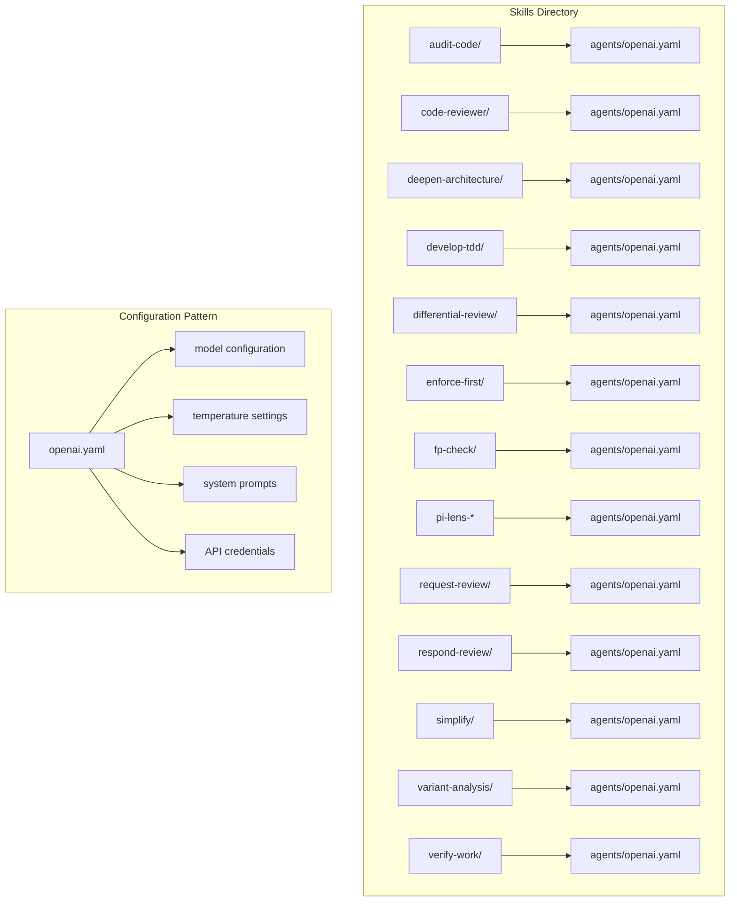
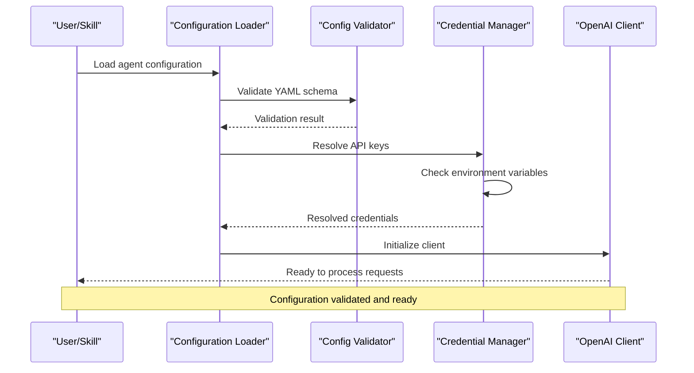
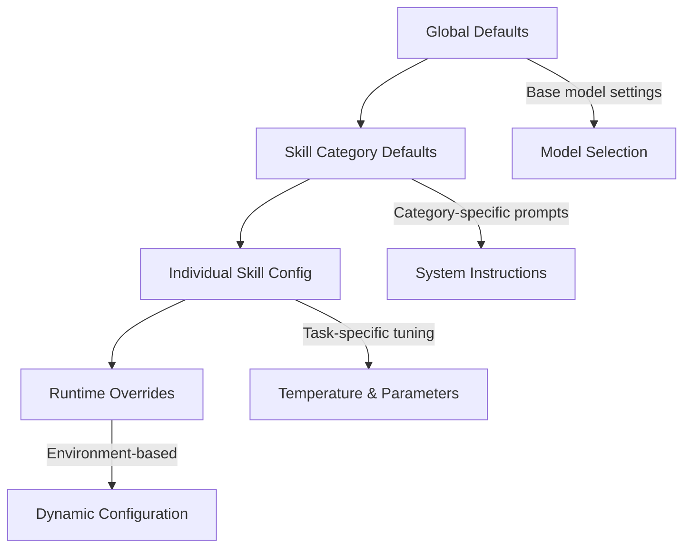
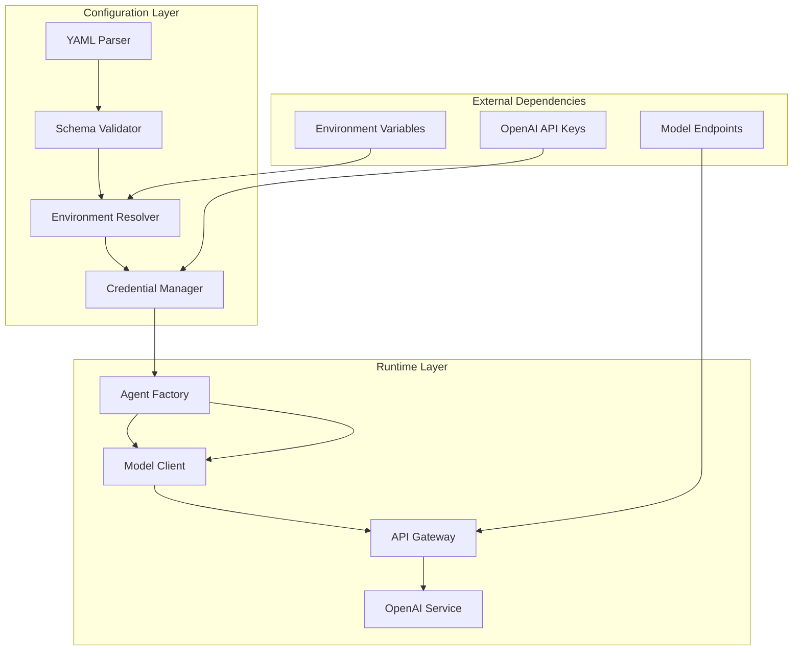

# Agent Configuration

<cite>
**Referenced Files in This Document**
- [audit-code openai.yaml](file://skills/audit-code/agents/openai.yaml)
- [code-reviewer openai.yaml](file://skills/code-reviewer/agents/openai.yaml)
- [deepen-architecture openai.yaml](file://skills/deepen-architecture/agents/openai.yaml)
- [develop-tdd openai.yaml](file://skills/develop-tdd/agents/openai.yaml)
- [differential-review openai.yaml](file://skills/differential-review/agents/openai.yaml)
- [enforce-first openai.yaml](file://skills/enforce-first/agents/openai.yaml)
- [fp-check openai.yaml](file://skills/fp-check/agents/openai.yaml)
- [pi-lens-ast-grep openai.yaml](file://skills/pi-lens-ast-grep/agents/openai.yaml)
- [pi-lens-lsp-navigation openai.yaml](file://skills/pi-lens-lsp-navigation/agents/openai.yaml)
- [pi-lens-write-ast-grep-rule openai.yaml](file://skills/pi-lens-write-ast-grep-rule/agents/openai.yaml)
- [pi-lens-write-tree-sitter-rule openai.yaml](file://skills/pi-lens-write-tree-sitter-rule/agents/openai.yaml)
- [request-review openai.yaml](file://skills/request-review/agents/openai.yaml)
- [respond-review openai.yaml](file://skills/respond-review/agents/openai.yaml)
- [simplify openai.yaml](file://skills/simplify/agents/openai.yaml)
- [variant-analysis openai.yaml](file://skills/variant-analysis/agents/openai.yaml)
- [verify-work openai.yaml](file://skills/verify-work/agents/openai.yaml)
</cite>

## Table of Contents
1. [Introduction](#introduction)
2. [Project Structure](#project-structure)
3. [Core Components](#core-components)
4. [Architecture Overview](#architecture-overview)
5. [Detailed Component Analysis](#detailed-component-analysis)
6. [Dependency Analysis](#dependency-analysis)
7. [Performance Considerations](#performance-considerations)
8. [Troubleshooting Guide](#troubleshooting-guide)
9. [Security Best Practices](#security-best-practices)
10. [Conclusion](#conclusion)

## Introduction

This document provides comprehensive guidance for configuring AI agents within the Pi Codex Kit framework. The system uses YAML-based configuration files to define agent behavior, model selection, temperature settings, and API key management for various specialized skills. Each skill in the repository contains its own agent configuration, allowing for tailored AI behavior optimized for specific tasks such as code review, architecture analysis, testing, and security auditing.

The agent configuration system supports advanced features including environment variable integration, configuration inheritance, validation rules, and security-conscious credential handling. This documentation covers both the technical implementation details and practical usage patterns for creating effective AI-powered development workflows.

## Project Structure

The Pi Codex Kit follows a modular architecture where each skill represents a specialized AI capability. The configuration structure is organized as follows:



**Diagram sources**
- [audit-code openai.yaml](file://skills/audit-code/agents/openai.yaml)
- [code-reviewer openai.yaml](file://skills/code-reviewer/agents/openai.yaml)
- [deepen-architecture openai.yaml](file://skills/deepen-architecture/agents/openai.yaml)

Each skill directory contains:
- **agents/**: Contains the OpenAI agent configuration file
- **SKILL.md**: Documentation describing the skill's purpose and usage
- **resources/**: Optional additional resources (scripts, templates, etc.)

**Section sources**
- [skills/README.md](file://skills/README.md)

## Core Components

### YAML Schema Definition

The OpenAI agent configuration follows a standardized YAML schema that defines how AI models should behave for specific tasks. The core components include:

#### Model Selection Parameters
- **model**: Specifies the AI model to use (e.g., gpt-4, gpt-3.5-turbo)
- **provider**: Defines the AI service provider (typically "openai")
- **version**: Optional model version specification

#### Temperature and Generation Settings
- **temperature**: Controls randomness in responses (0.0-2.0 range)
- **max_tokens**: Maximum response length
- **top_p**: Nucleus sampling parameter
- **frequency_penalty**: Reduces repetition in outputs

#### System Configuration
- **system_prompt**: Base instructions for the AI assistant
- **context_window**: Token limit for conversation history
- **timeout**: Request timeout settings

#### API Integration
- **api_key_source**: Method for obtaining API credentials
- **environment_variable**: Name of the environment variable containing the API key
- **endpoint_override**: Custom API endpoint configuration

**Section sources**
- [audit-code openai.yaml](file://skills/audit-code/agents/openai.yaml)
- [code-reviewer openai.yaml](file://skills/code-reviewer/agents/openai.yaml)

## Architecture Overview

The agent configuration system implements a layered architecture that separates concerns between configuration management, credential handling, and AI model interaction:



**Diagram sources**
- [audit-code openai.yaml](file://skills/audit-code/agents/openai.yaml)
- [code-reviewer openai.yaml](file://skills/code-reviewer/agents/openai.yaml)

### Configuration Inheritance Chain

The system supports hierarchical configuration inheritance:



**Diagram sources**
- [deepen-architecture openai.yaml](file://skills/deepen-architecture/agents/openai.yaml)
- [develop-tdd openai.yaml](file://skills/develop-tdd/agents/openai.yaml)

## Detailed Component Analysis

### Audit Code Agent Configuration

The audit-code skill demonstrates best practices for security-focused AI configurations:

#### Key Configuration Patterns
- **Conservative temperature settings** (0.1-0.3) for precise security analysis
- **Extended context windows** for comprehensive code scanning
- **Strict validation rules** for security recommendations
- **Environment-based API key management** for secure deployment

#### Example Configuration Structure
```yaml
# Typical audit-code agent configuration
model: "gpt-4"
temperature: 0.2
max_tokens: 4000
system_prompt: "You are a security-focused code auditor..."
api_key_source: "environment"
environment_variable: "OPENAI_API_KEY"
```

**Section sources**
- [audit-code openai.yaml](file://skills/audit-code/agents/openai.yaml)

### Code Reviewer Agent Configuration

The code-reviewer skill showcases collaborative AI behavior patterns:

#### Specialized Features
- **Balanced temperature** (0.4-0.6) for creative yet constructive feedback
- **Multi-turn conversation support** for iterative review processes
- **Context-aware suggestions** based on project conventions
- **Constructive tone enforcement** through system prompts

#### Advanced Configuration Options
```yaml
# Code reviewer specific settings
model: "gpt-4"
temperature: 0.5
max_tokens: 3000
top_p: 0.9
frequency_penalty: 0.3
system_prompt: "You are an experienced code reviewer..."
conversation_history: true
max_turns: 5
```

**Section sources**
- [code-reviewer openai.yaml](file://skills/code-reviewer/agents/openai.yaml)

### Architecture Analysis Agent

The deepen-architecture skill implements sophisticated reasoning patterns:

#### Complex Reasoning Setup
- **Higher temperature** (0.7-0.8) for creative architectural thinking
- **Extended token limits** for detailed architectural analysis
- **Structured output formatting** for systematic recommendations
- **Reference material integration** for informed suggestions

#### Advanced Prompt Engineering
```yaml
# Architecture analysis configuration
model: "gpt-4"
temperature: 0.7
max_tokens: 8000
top_p: 0.95
system_prompt: "You are an expert software architect..."
include_references: true
output_format: "structured"
```

**Section sources**
- [deepen-architecture openai.yaml](file://skills/deepen-architecture/agents/openai.yaml)

### TDD Development Agent

The develop-tdd skill demonstrates test-driven development automation:

#### Testing-Specific Optimizations
- **Low temperature** (0.1-0.3) for consistent test generation
- **Strict validation** for test quality assurance
- **Framework-specific knowledge** integration
- **Incremental development support**

#### Test Generation Configuration
```yaml
# TDD agent setup
model: "gpt-4"
temperature: 0.2
max_tokens: 5000
system_prompt: "You are a TDD expert developer..."
test_framework: "auto-detect"
validation_rules: "strict"
```

**Section sources**
- [develop-tdd openai.yaml](file://skills/develop-tdd/agents/openai.yaml)

### Differential Review Agent

The differential-review skill implements comparative analysis capabilities:

#### Comparative Analysis Features
- **Dual-model support** for cross-validation
- **Change detection algorithms** for diff analysis
- **Impact assessment frameworks** for change evaluation
- **Automated reporting** for review summaries

#### Multi-Agent Coordination
```yaml
# Differential review configuration
primary_model: "gpt-4"
secondary_model: "gpt-3.5-turbo"
temperature: 0.4
comparison_mode: "enabled"
report_format: "markdown"
```

**Section sources**
- [differential-review openai.yaml](file://skills/differential-review/agents/openai.yaml)

## Dependency Analysis

The agent configuration system has well-defined dependencies and relationships:



**Diagram sources**
- [audit-code openai.yaml](file://skills/audit-code/agents/openai.yaml)
- [code-reviewer openai.yaml](file://skills/code-reviewer/agents/openai.yaml)

### Configuration Validation Rules

The system enforces several validation rules to ensure proper configuration:

#### Required Fields
- **model**: Must be a valid OpenAI model identifier
- **api_key_source**: Must specify a valid credential source
- **system_prompt**: Should contain meaningful instructions

#### Optional but Recommended
- **temperature**: Defaults to 0.7 if not specified
- **max_tokens**: Defaults to model-specific maximum
- **top_p**: Defaults to 1.0 if not specified

#### Environment Variable Resolution
- **OPENAI_API_KEY**: Primary API key source
- **OPENAI_BASE_URL**: Custom endpoint override
- **AGENT_CONFIG_DIR**: Custom configuration directory

**Section sources**
- [enforce-first openai.yaml](file://skills/enforce-first/agents/openai.yaml)
- [fp-check openai.yaml](file://skills/fp-check/agents/openai.yaml)

## Performance Considerations

### Model Selection Guidelines

Different tasks benefit from different model characteristics:

| Task Type | Recommended Model | Temperature Range | Max Tokens |
|-----------|------------------|-------------------|------------|
| Code Analysis | gpt-4 | 0.1-0.3 | 4000-8000 |
| Creative Writing | gpt-4 | 0.7-0.9 | 2000-4000 |
| Data Processing | gpt-3.5-turbo | 0.1-0.4 | 1000-2000 |
| Complex Reasoning | gpt-4 | 0.5-0.8 | 6000-10000 |

### Optimization Strategies

#### Context Window Management
- Use **chunked processing** for large codebases
- Implement **caching mechanisms** for repeated analyses
- Configure **adaptive context windows** based on task complexity

#### Cost Optimization
- Select appropriate **model tiers** based on task requirements
- Implement **rate limiting** to prevent excessive API usage
- Use **batch processing** for multiple similar tasks

#### Response Time Optimization
- Configure **appropriate timeouts** for different operations
- Implement **progressive loading** for long-running analyses
- Use **parallel processing** where possible

## Troubleshooting Guide

### Common Configuration Issues

#### API Key Problems
- **Error**: "Invalid API key" or authentication failures
- **Solution**: Verify OPENAI_API_KEY environment variable is set correctly
- **Debug**: Check credential resolution logs

#### Model Access Issues
- **Error**: "Model not found" or access denied
- **Solution**: Ensure requested model is available in your OpenAI account
- **Debug**: Verify model permissions and subscription status

#### Configuration Validation Errors
- **Error**: "Invalid configuration schema"
- **Solution**: Check YAML syntax and required fields
- **Debug**: Use configuration validator tool

### Performance Troubleshooting

#### High Latency Issues
- Check network connectivity to OpenAI endpoints
- Verify rate limit configurations
- Monitor API quota usage

#### Memory Usage Problems
- Reduce max_tokens for large responses
- Implement response streaming for long outputs
- Clear context cache periodically

### Debugging Tools

#### Configuration Validation
```bash
# Validate agent configuration
./validate-config.py --config skills/*/agents/openai.yaml

# Test API connectivity
./test-api-connection.py --env OPENAI_API_KEY
```

#### Logging and Monitoring
- Enable debug logging for configuration loading
- Monitor API request/response patterns
- Track error rates and performance metrics

**Section sources**
- [verify-work openai.yaml](file://skills/verify-work/agents/openai.yaml)
- [simplify openai.yaml](file://skills/simplify/agents/openai.yaml)

## Security Best Practices

### API Key Management

#### Environment Variable Strategy
- Store API keys in **secure environment variables**
- Use **secrets management systems** in production
- Implement **key rotation policies**
- Avoid hardcoding credentials in configuration files

#### Credential Resolution Order
1. **Explicit configuration** (highest priority)
2. **Environment variables**
3. **Default locations** (lowest priority)

### Configuration Security

#### Sensitive Data Handling
- Never commit API keys to version control
- Use **template files** with placeholder values
- Implement **configuration encryption** for sensitive settings
- Apply **least privilege principles** for API access

#### Input Validation and Sanitization
- Validate all user-provided configuration inputs
- Sanitize system prompts to prevent injection attacks
- Implement **prompt filtering** for malicious content
- Use **whitelist approaches** for allowed parameters

### Deployment Security

#### Production Considerations
- Use **container secrets** for API key management
- Implement **network policies** to restrict API access
- Monitor for **unusual API usage patterns**
- Set up **alerting for security events**

#### Development vs Production
- Maintain separate configurations for different environments
- Use **feature flags** to enable/disable security features
- Implement **audit logging** for configuration changes
- Regular **security audits** of agent configurations

## Conclusion

The Pi Codex Kit agent configuration system provides a robust, flexible, and secure foundation for deploying specialized AI agents across various development tasks. By following the patterns and best practices outlined in this documentation, teams can create effective AI-powered workflows that enhance productivity while maintaining security and reliability standards.

Key takeaways include:
- **Standardized YAML schema** ensures consistency across skills
- **Environment-based configuration** supports secure deployment
- **Validation rules** prevent misconfiguration errors
- **Security-first approach** protects sensitive credentials
- **Performance optimization** strategies maximize efficiency

The modular architecture allows for easy extension and customization while maintaining compatibility with existing workflows. As the AI landscape evolves, the configuration system provides a stable foundation for integrating new models and capabilities.