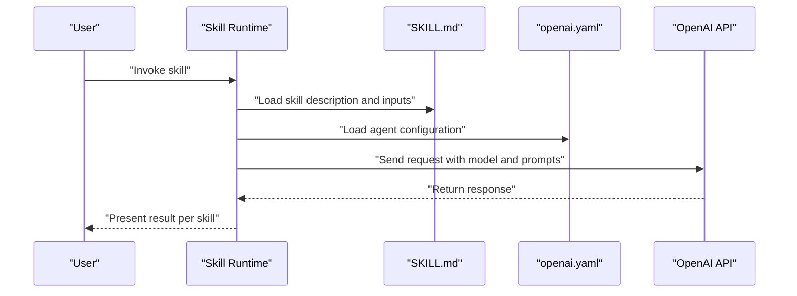
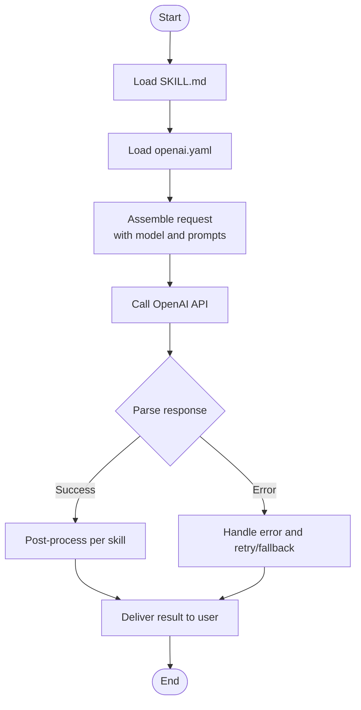
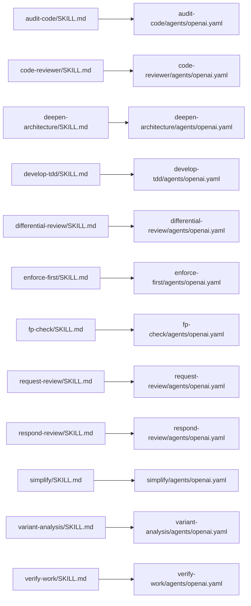

# Agent Framework

<cite>
**Referenced Files in This Document**
- [README.md](file://README.md)
- [skills/README.md](file://skills/README.md)
- [skills/audit-code/SKILL.md](file://skills/audit-code/SKILL.md)
- [skills/audit-code/agents/openai.yaml](file://skills/audit-code/agents/openai.yaml)
- [skills/code-reviewer/SKILL.md](file://skills/code-reviewer/SKILL.md)
- [skills/code-reviewer/agents/openai.yaml](file://skills/code-reviewer/agents/openai.yaml)
- [skills/deepen-architecture/SKILL.md](file://skills/deepen-architecture/SKILL.md)
- [skills/deepen-architecture/agents/openai.yaml](file://skills/deepen-architecture/agents/openai.yaml)
- [skills/develop-tdd/SKILL.md](file://skills/develop-tdd/SKILL.md)
- [skills/develop-tdd/agents/openai.yaml](file://skills/develop-tdd/agents/openai.yaml)
- [skills/differential-review/SKILL.md](file://skills/differential-review/SKILL.md)
- [skills/differential-review/agents/openai.yaml](file://skills/differential-review/agents/openai.yaml)
- [skills/enforce-first/SKILL.md](file://skills/enforce-first/SKILL.md)
- [skills/enforce-first/agents/openai.yaml](file://skills/enforce-first/agents/openai.yaml)
- [skills/fp-check/SKILL.md](file://skills/fp-check/agents/openai.yaml)
- [skills/fp-check/agents/openai.yaml](file://skills/fp-check/agents/openai.yaml)
- [skills/request-review/SKILL.md](file://skills/request-review/SKILL.md)
- [skills/request-review/agents/openai.yaml](file://skills/request-review/agents/openai.yaml)
- [skills/respond-review/SKILL.md](file://skills/respond-review/SKILL.md)
- [skills/respond-review/agents/openai.yaml](file://skills/respond-review/agents/openai.yaml)
- [skills/simplify/SKILL.md](file://skills/simplify/SKILL.md)
- [skills/simplify/agents/openai.yaml](file://skills/simplify/agents/openai.yaml)
- [skills/variant-analysis/SKILL.md](file://skills/variant-analysis/SKILL.md)
- [skills/variant-analysis/agents/openai.yaml](file://skills/variant-analysis/agents/openai.yaml)
- [skills/verify-work/SKILL.md](file://skills/verify-work/SKILL.md)
- [skills/verify-work/agents/openai.yaml](file://skills/verify-work/agents/openai.yaml)
</cite>

## Update Summary
**Changes Made**
- Removed references to pi-lens related skills (pi-lens-ast-grep, pi-lens-lsp-navigation, pi-lens-write-ast-grep-rule, pi-lens-write-tree-sitter-rule) as they are no longer part of the standalone agent framework
- Removed reference to coding-glue.md agent definition which has been dropped
- Updated architecture diagrams to reflect only remaining standalone skills without internal dependencies
- Streamlined examples to focus on core standalone capabilities

## Table of Contents
1. Introduction
2. Project Structure
3. Core Components
4. Architecture Overview
5. Detailed Component Analysis
6. Dependency Analysis
7. Performance Considerations
8. Troubleshooting Guide
9. Conclusion

## Introduction
This document explains the agent framework architecture used to configure, manage, and integrate AI agents with skills. It focuses on OpenAI agent setup, prompt engineering patterns, model selection strategies, communication protocols between skills and agents, response processing, error handling, security considerations, rate limiting, and performance optimization for AI model interactions. The content is derived from the repository's skill definitions and their associated OpenAI agent configuration files.

**Updated** The framework now focuses exclusively on standalone skills without internal dependencies, removing previously included pi-lens related components and coding-glue integration.

## Project Structure
The project organizes capabilities as "skills." Each skill includes:
- A SKILL.md describing purpose, inputs, outputs, and usage.
- An agents/openai.yaml defining how an OpenAI agent is configured for that skill.

```mermaid
graph TB
subgraph "Standalone Skills"
S1["audit-code"]
S2["code-reviewer"]
S3["deepen-architecture"]
S4["develop-tdd"]
S5["differential-review"]
S6["enforce-first"]
S7["fp-check"]
S8["request-review"]
S9["respond-review"]
S10["simplify"]
S11["variant-analysis"]
S12["verify-work"]
end
subgraph "Agent Configurations"
C1["audit-code/agents/openai.yaml"]
C2["code-reviewer/agents/openai.yaml"]
C3["deepen-architecture/agents/openai.yaml"]
C4["develop-tdd/agents/openai.yaml"]
C5["differential-review/agents/openai.yaml"]
C6["enforce-first/agents/openai.yaml"]
C7["fp-check/agents/openai.yaml"]
C8["request-review/agents/openai.yaml"]
C9["respond-review/agents/openai.yaml"]
C10["simplify/agents/openai.yaml"]
C11["variant-analysis/agents/openai.yaml"]
C12["verify-work/agents/openai.yaml"]
end
S1 --> C1
S2 --> C2
S3 --> C3
S4 --> C4
S5 --> C5
S6 --> C6
S7 --> C7
S8 --> C8
S9 --> C9
S10 --> C10
S11 --> C11
S12 --> C12
```

**Diagram sources**
- [skills/README.md](file://skills/README.md)
- [skills/audit-code/agents/openai.yaml](file://skills/audit-code/agents/openai.yaml)
- [skills/code-reviewer/agents/openai.yaml](file://skills/code-reviewer/agents/openai.yaml)
- [skills/deepen-architecture/agents/openai.yaml](file://skills/deepen-architecture/agents/openai.yaml)
- [skills/develop-tdd/agents/openai.yaml](file://skills/develop-tdd/agents/openai.yaml)
- [skills/differential-review/agents/openai.yaml](file://skills/differential-review/agents/openai.yaml)
- [skills/enforce-first/agents/openai.yaml](file://skills/enforce-first/agents/openai.yaml)
- [skills/fp-check/agents/openai.yaml](file://skills/fp-check/agents/openai.yaml)
- [skills/request-review/agents/openai.yaml](file://skills/request-review/agents/openai.yaml)
- [skills/respond-review/agents/openai.yaml](file://skills/respond-review/agents/openai.yaml)
- [skills/simplify/agents/openai.yaml](file://skills/simplify/agents/openai.yaml)
- [skills/variant-analysis/agents/openai.yaml](file://skills/variant-analysis/agents/openai.yaml)
- [skills/verify-work/agents/openai.yaml](file://skills/verify-work/agents/openai.yaml)

**Section sources**
- [README.md](file://README.md)
- [skills/README.md](file://skills/README.md)

## Core Components
- **Skills**: Encapsulate domain-specific workflows (e.g., code review, TDD development, AST rule generation). Each skill defines its intent and expected interaction via a SKILL.md.
- **Agent Configuration**: Each skill ships an agents/openai.yaml that configures an OpenAI agent tailored to the skill's task. These files define model selection, prompts, and behavior parameters.
- **Integration Pattern**: The runtime loads a skill's SKILL.md for user-facing instructions and uses the corresponding openai.yaml to instantiate and run the agent.

Key responsibilities:
- Skill definition: Purpose, inputs, outputs, and usage guidance.
- Agent configuration: Model choice, system prompts, temperature/top_p, and other parameters.
- Orchestration: Invoking the configured agent with context provided by the skill.

**Updated** The framework now emphasizes standalone skills without internal dependencies, focusing on self-contained capabilities rather than integrated tooling components.

**Section sources**
- [skills/audit-code/SKILL.md](file://skills/audit-code/SKILL.md)
- [skills/audit-code/agents/openai.yaml](file://skills/audit-code/agents/openai.yaml)
- [skills/code-reviewer/SKILL.md](file://skills/code-reviewer/SKILL.md)
- [skills/code-reviewer/agents/openai.yaml](file://skills/code-reviewer/agents/openai.yaml)
- [skills/deepen-architecture/SKILL.md](file://skills/deepen-architecture/SKILL.md)
- [skills/deepen-architecture/agents/openai.yaml](file://skills/deepen-architecture/agents/openai.yaml)
- [skills/develop-tdd/SKILL.md](file://skills/develop-tdd/SKILL.md)
- [skills/develop-tdd/agents/openai.yaml](file://skills/develop-tdd/agents/openai.yaml)
- [skills/differential-review/SKILL.md](file://skills/differential-review/SKILL.md)
- [skills/differential-review/agents/openai.yaml](file://skills/differential-review/agents/openai.yaml)
- [skills/enforce-first/SKILL.md](file://skills/enforce-first/SKILL.md)
- [skills/enforce-first/agents/openai.yaml](file://skills/enforce-first/agents/openai.yaml)
- [skills/fp-check/SKILL.md](file://skills/fp-check/SKILL.md)
- [skills/fp-check/agents/openai.yaml](file://skills/fp-check/agents/openai.yaml)
- [skills/request-review/SKILL.md](file://skills/request-review/SKILL.md)
- [skills/request-review/agents/openai.yaml](file://skills/request-review/agents/openai.yaml)
- [skills/respond-review/SKILL.md](file://skills/respond-review/SKILL.md)
- [skills/respond-review/agents/openai.yaml](file://skills/respond-review/agents/openai.yaml)
- [skills/simplify/SKILL.md](file://skills/simplify/SKILL.md)
- [skills/simplify/agents/openai.yaml](file://skills/simplify/agents/openai.yaml)
- [skills/variant-analysis/SKILL.md](file://skills/variant-analysis/SKILL.md)
- [skills/variant-analysis/agents/openai.yaml](file://skills/variant-analysis/agents/openai.yaml)
- [skills/verify-work/SKILL.md](file://skills/verify-work/SKILL.md)
- [skills/verify-work/agents/openai.yaml](file://skills/verify-work/agents/openai.yaml)

## Architecture Overview
The agent framework follows a skill-driven pattern:
- User invokes a skill.
- The runtime reads the skill's SKILL.md for behavior and context.
- The runtime loads the skill's agents/openai.yaml to configure the OpenAI agent.
- The agent executes using the specified model and prompts, returning structured responses consumed by the skill.

**Diagram sources**
- [skills/audit-code/SKILL.md](file://skills/audit-code/SKILL.md)
- [skills/audit-code/agents/openai.yaml](file://skills/audit-code/agents/openai.yaml)
- [skills/code-reviewer/SKILL.md](file://skills/code-reviewer/SKILL.md)
- [skills/code-reviewer/agents/openai.yaml](file://skills/code-reviewer/agents/openai.yaml)
- [skills/variant-analysis/SKILL.md](file://skills/variant-analysis/SKILL.md)
- [skills/variant-analysis/agents/openai.yaml](file://skills/variant-analysis/agents/openai.yaml)

## Detailed Component Analysis

### OpenAI Agent Setup and Model Selection
- Each skill provides an agents/openai.yaml that specifies the OpenAI agent configuration.
- Model selection strategy:
  - Choose models based on capability needs (reasoning depth, speed, cost).
  - Use stronger models for complex analysis (e.g., variant analysis, deepening architecture).
  - Use faster, lighter models for routine tasks (e.g., simple checks, basic reviews).
- Prompt engineering patterns:
  - System-level instructions to constrain output format and scope.
  - Task-specific guidance embedded in prompts or referenced documents.
  - Structured outputs for downstream processing.

Examples across skills:
- Code-focused skills (audit-code, code-reviewer, enforce-first) emphasize precision and consistency.
- Analytical skills (deepen-architecture, differential-review, fp-check) require deeper reasoning and structured evidence.
- Workflow skills (develop-tdd, simplify, verify-work, request-review, respond-review) orchestrate multi-step processes.

**Updated** Examples now focus on standalone capabilities without referencing removed pi-lens tooling components.

**Section sources**
- [skills/audit-code/agents/openai.yaml](file://skills/audit-code/agents/openai.yaml)
- [skills/code-reviewer/agents/openai.yaml](file://skills/code-reviewer/agents/openai.yaml)
- [skills/deepen-architecture/agents/openai.yaml](file://skills/deepen-architecture/agents/openai.yaml)
- [skills/develop-tdd/agents/openai.yaml](file://skills/develop-tdd/agents/openai.yaml)
- [skills/differential-review/agents/openai.yaml](file://skills/differential-review/agents/openai.yaml)
- [skills/enforce-first/agents/openai.yaml](file://skills/enforce-first/agents/openai.yaml)
- [skills/fp-check/agents/openai.yaml](file://skills/fp-check/agents/openai.yaml)
- [skills/request-review/agents/openai.yaml](file://skills/request-review/agents/openai.yaml)
- [skills/respond-review/agents/openai.yaml](file://skills/respond-review/agents/openai.yaml)
- [skills/simplify/agents/openai.yaml](file://skills/simplify/agents/openai.yaml)
- [skills/variant-analysis/agents/openai.yaml](file://skills/variant-analysis/agents/openai.yaml)
- [skills/verify-work/agents/openai.yaml](file://skills/verify-work/agents/openai.yaml)

### Communication Protocol Between Skills and Agents
- Input assembly:
  - The runtime gathers context defined in the SKILL.md (inputs, references, constraints).
  - The runtime merges this context with the agent configuration from openai.yaml.
- Request construction:
  - The runtime builds a request payload including model selection, system/user messages, and parameters.
- Response processing:
  - The runtime parses the response according to the skill's expectations (structured text, artifacts, or tool calls).
  - The skill may post-process results into actionable outputs (reports, diffs, suggestions).

**Diagram sources**
- [skills/audit-code/SKILL.md](file://skills/audit-code/SKILL.md)
- [skills/audit-code/agents/openai.yaml](file://skills/audit-code/agents/openai.yaml)
- [skills/variant-analysis/SKILL.md](file://skills/variant-analysis/SKILL.md)
- [skills/variant-analysis/agents/openai.yaml](file://skills/variant-analysis/agents/openai.yaml)

**Section sources**
- [skills/audit-code/SKILL.md](file://skills/audit-code/SKILL.md)
- [skills/audit-code/agents/openai.yaml](file://skills/audit-code/agents/openai.yaml)
- [skills/variant-analysis/SKILL.md](file://skills/variant-analysis/SKILL.md)
- [skills/variant-analysis/agents/openai.yaml](file://skills/variant-analysis/agents/openai.yaml)

### Error Handling and Retry Strategy
- Common errors:
  - Rate limits, transient network failures, invalid requests, and model unavailability.
- Strategies:
  - Exponential backoff with jitter for retries.
  - Circuit breaker to avoid cascading failures under sustained errors.
  - Fallback to alternative models or reduced-complexity prompts when primary model fails.
- Observability:
  - Log request metadata (model, tokens, latency) without sensitive data.
  - Surface actionable errors to users with clear next steps.

### Security Considerations
- Secrets management:
  - Store API keys securely; never embed secrets in configuration files.
- Data minimization:
  - Send only necessary context to the model; redact sensitive information.
- Output validation:
  - Validate and sanitize model outputs before executing actions or writing files.
- Access control:
  - Restrict which skills can perform write operations or external calls.

### Rate Limiting and Cost Control
- Throttling:
  - Enforce per-user and global rate limits at the runtime layer.
- Budget controls:
  - Track token usage per skill invocation; cap costs per session or project.
- Model tiering:
  - Route low-priority tasks to cheaper models; reserve premium models for high-value work.

### Performance Optimization
- Prompt efficiency:
  - Keep prompts concise; use references and templates to reduce repetition.
- Context window management:
  - Chunk large inputs; summarize prior context when needed.
- Parallelism:
  - Run independent skills concurrently where safe.
- Caching:
  - Cache deterministic results (e.g., static analysis outputs) to avoid redundant model calls.

## Dependency Analysis
The dependency graph shows each skill depending on its own OpenAI agent configuration. There are no cross-skill dependencies in the configuration layer; integration occurs at the runtime level.

**Diagram sources**
- [skills/audit-code/SKILL.md](file://skills/audit-code/SKILL.md)
- [skills/audit-code/agents/openai.yaml](file://skills/audit-code/agents/openai.yaml)
- [skills/code-reviewer/SKILL.md](file://skills/code-reviewer/SKILL.md)
- [skills/code-reviewer/agents/openai.yaml](file://skills/code-reviewer/agents/openai.yaml)
- [skills/deepen-architecture/SKILL.md](file://skills/deepen-architecture/SKILL.md)
- [skills/deepen-architecture/agents/openai.yaml](file://skills/deepen-architecture/agents/openai.yaml)
- [skills/develop-tdd/SKILL.md](file://skills/develop-tdd/SKILL.md)
- [skills/develop-tdd/agents/openai.yaml](file://skills/develop-tdd/agents/openai.yaml)
- [skills/differential-review/SKILL.md](file://skills/differential-review/SKILL.md)
- [skills/differential-review/agents/openai.yaml](file://skills/differential-review/agents/openai.yaml)
- [skills/enforce-first/SKILL.md](file://skills/enforce-first/SKILL.md)
- [skills/enforce-first/agents/openai.yaml](file://skills/enforce-first/agents/openai.yaml)
- [skills/fp-check/SKILL.md](file://skills/fp-check/SKILL.md)
- [skills/fp-check/agents/openai.yaml](file://skills/fp-check/agents/openai.yaml)
- [skills/request-review/SKILL.md](file://skills/request-review/SKILL.md)
- [skills/request-review/agents/openai.yaml](file://skills/request-review/agents/openai.yaml)
- [skills/respond-review/SKILL.md](file://skills/respond-review/SKILL.md)
- [skills/respond-review/agents/openai.yaml](file://skills/respond-review/agents/openai.yaml)
- [skills/simplify/SKILL.md](file://skills/simplify/SKILL.md)
- [skills/simplify/agents/openai.yaml](file://skills/simplify/agents/openai.yaml)
- [skills/variant-analysis/SKILL.md](file://skills/variant-analysis/SKILL.md)
- [skills/variant-analysis/agents/openai.yaml](file://skills/variant-analysis/agents/openai.yaml)
- [skills/verify-work/SKILL.md](file://skills/verify-work/SKILL.md)
- [skills/verify-work/agents/openai.yaml](file://skills/verify-work/agents/openai.yaml)

**Updated** The dependency graph now reflects only standalone skills without internal dependencies, removing all pi-lens related components and coding-glue integration.

**Section sources**
- [skills/README.md](file://skills/README.md)

## Performance Considerations
- Prefer smaller, focused prompts to reduce token consumption and latency.
- Use model tiering to balance quality and cost.
- Implement caching for stable, deterministic outputs.
- Monitor latency and throughput; adjust concurrency and timeouts accordingly.

## Troubleshooting Guide
- Symptom: Frequent rate limit errors
  - Action: Reduce concurrency, implement exponential backoff, and consider switching to a lower-tier model temporarily.
- Symptom: Inconsistent or malformed outputs
  - Action: Strengthen system prompts, enforce structured output formats, and add validation layers.
- Symptom: High latency
  - Action: Shorten context windows, pre-summarize inputs, and cache repeated computations.
- Symptom: Security warnings
  - Action: Redact sensitive data, validate outputs, and restrict write permissions.

## Conclusion
The agent framework leverages a clean separation between skill definitions and OpenAI agent configurations. This design enables consistent prompt engineering, flexible model selection, and robust integration patterns. By focusing on standalone skills without internal dependencies, the framework provides a streamlined approach to AI-assisted development workflows. Teams can scale these capabilities reliably across diverse coding tasks while maintaining security, performance, and cost efficiency.

**Updated** The framework now emphasizes simplicity and independence, making it easier to maintain and extend individual skills without complex interdependencies.