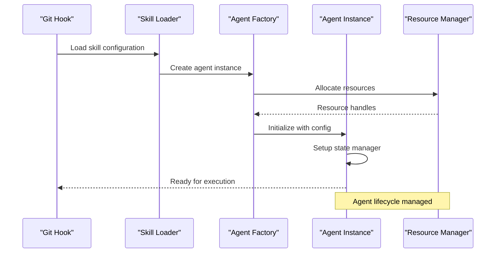
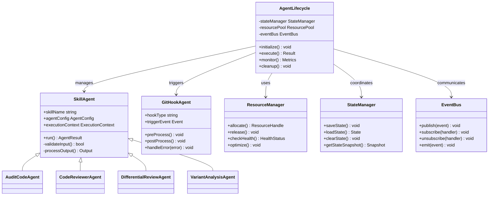
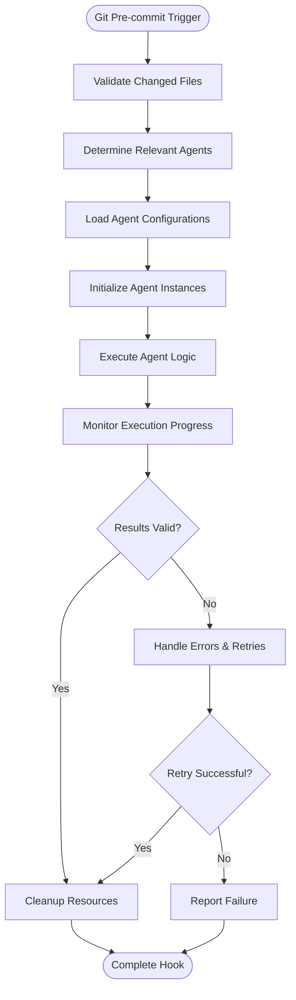
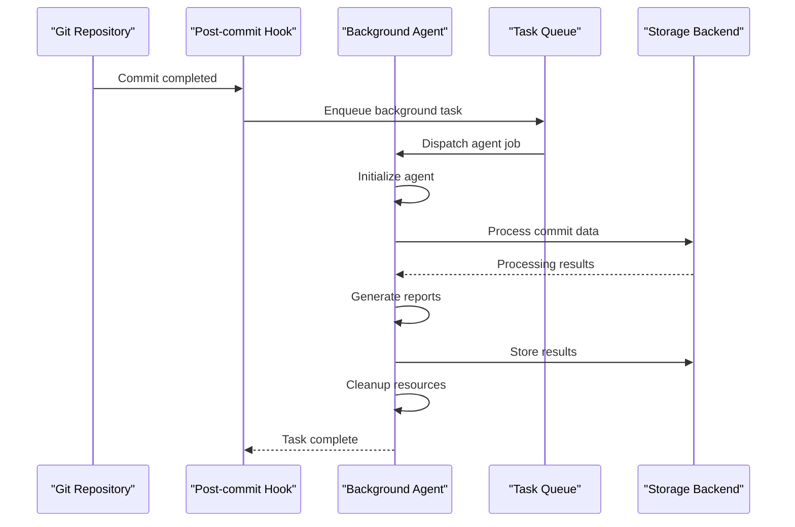
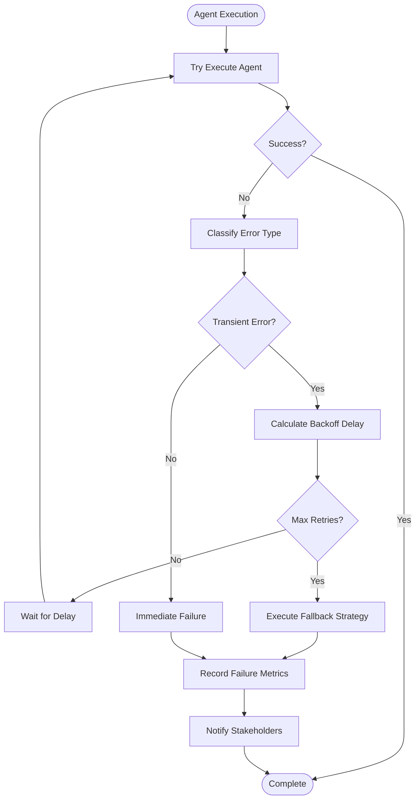
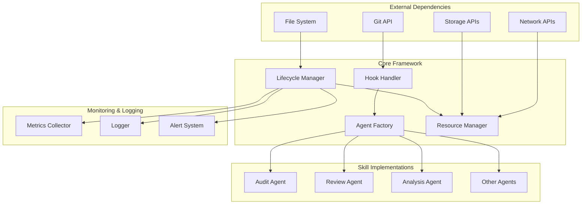

# Agent Lifecycle Management

<cite>
**Referenced Files in This Document**
- [hooks/README.md](file://hooks/README.md)
- [hooks/lens-reminder.mjs](file://hooks/lens-reminder.mjs)
- [hooks/rtk-pretooluse.mjs](file://hooks/rtk-pretooluse.mjs)
- [skills/audit-code/SKILL.md](file://skills/audit-code/SKILL.md)
- [skills/code-reviewer/SKILL.md](file://skills/code-reviewer/SKILL.md)
- [skills/deepen-architecture/SKILL.md](file://skills/deepen-architecture/SKILL.md)
- [skills/develop-tdd/SKILL.md](file://skills/develop-tdd/SKILL.md)
- [skills/differential-review/SKILL.md](file://skills/differential-review/SKILL.md)
- [skills/enforce-first/SKILL.md](file://skills/enforce-first/SKILL.md)
- [skills/fp-check/SKILL.md](file://skills/fp-check/SKILL.md)
- [skills/pi-lens-ast-grep/SKILL.md](file://skills/pi-lens-ast-grep/SKILL.md)
- [skills/pi-lens-lsp-navigation/SKILL.md](file://skills/pi-lens-lsp-navigation/SKILL.md)
- [skills/pi-lens-write-ast-grep-rule/SKILL.md](file://skills/pi-lens-write-ast-grep-rule/SKILL.md)
- [skills/pi-lens-write-tree-sitter-rule/SKILL.md](file://skills/pi-lens-write-tree-sitter-rule/SKILL.md)
- [skills/request-review/SKILL.md](file://skills/request-review/SKILL.md)
- [skills/respond-review/SKILL.md](file://skills/respond-review/SKILL.md)
- [skills/simplify/SKILL.md](file://skills/simplify/SKILL.md)
- [skills/variant-analysis/SKILL.md](file://skills/variant-analysis/SKILL.md)
- [skills/verify-work/SKILL.md](file://skills/verify-work/SKILL.md)
- [skills/simplify/scripts/simplify-context.mjs](file://skills/simplify/scripts/simplify-context.mjs)
</cite>

## Table of Contents
1. [Introduction](#introduction)
2. [Project Structure](#project-structure)
3. [Core Components](#core-components)
4. [Architecture Overview](#architecture-overview)
5. [Detailed Component Analysis](#detailed-component-analysis)
6. [Dependency Analysis](#dependency-analysis)
7. [Performance Considerations](#performance-considerations)
8. [Troubleshooting Guide](#troubleshooting-guide)
9. [Conclusion](#conclusion)

## Introduction

This document provides comprehensive documentation for agent lifecycle management within the Pi Codex Kit framework. It covers the complete lifecycle of agents including initialization, execution, state management, and cleanup processes. The system integrates with Git hooks for automated agent execution and supports event-driven agent activation patterns.

The architecture follows a skill-based approach where each skill defines its own agent configuration and behavior patterns. Agents are instantiated by skills, manage their internal state during execution, and handle proper resource cleanup upon completion.

## Project Structure

The Pi Codex Kit follows a modular architecture organized around skills and hooks:

```mermaid
graph TB
subgraph "Git Hooks Layer"
PreCommit[Pre-commit Hook]
PostCommit[Post-commit Hook]
CustomHooks[Custom Hooks]
end
subgraph "Skills Layer"
AuditCode[Audit Code Skill]
CodeReviewer[Code Reviewer Skill]
DeepenArch[Deepen Architecture Skill]
DevelopTDD[Develop TDD Skill]
DifferentialReview[Differential Review Skill]
EnforceFirst[Enforce First Skill]
FPCheck[FP Check Skill]
PiLensAST[Pi Lens AST Grep Skill]
PiLensLSP[Pi Lens LSP Navigation Skill]
PiLensWriteAST[Pi Lens Write AST Rule Skill]
PiLensWriteTreeSitter[Pi Lens Write Tree Sitter Skill]
RequestReview[Request Review Skill]
RespondReview[Respond Review Skill]
Simplify[Simplify Skill]
VariantAnalysis[Variant Analysis Skill]
VerifyWork[Verify Work Skill]
end
subgraph "Agent Configuration"
OpenAIConfig[OpenAI Agent Config]
SkillDefs[Skill Definitions]
end
subgraph "Execution Engine"
AgentRuntime[Agent Runtime]
StateManager[State Manager]
ResourceCleanup[Resource Cleanup]
end
PreCommit --> SkillsLayer
PostCommit --> SkillsLayer
CustomHooks --> SkillsLayer
SkillsLayer --> AgentRuntime
AgentRuntime --> StateManager
StateManager --> ResourceCleanup
AuditCode --> OpenAIConfig
CodeReviewer --> OpenAIConfig
DeepenArch --> OpenAIConfig
DevelopTDD --> OpenAIConfig
DifferentialReview --> OpenAIConfig
EnforceFirst --> OpenAIConfig
FPCheck --> OpenAIConfig
PiLensAST --> OpenAIConfig
PiLensLSP --> OpenAIConfig
PiLensWriteAST --> OpenAIConfig
PiLensWriteTreeSitter --> OpenAIConfig
RequestReview --> OpenAIConfig
RespondReview --> OpenAIConfig
Simplify --> OpenAIConfig
VariantAnalysis --> OpenAIConfig
VerifyWork --> OpenAIConfig
```

**Diagram sources**
- [hooks/README.md](file://hooks/README.md)
- [skills/audit-code/SKILL.md](file://skills/audit-code/SKILL.md)
- [skills/code-reviewer/SKILL.md](file://skills/code-reviewer/SKILL.md)

## Core Components

### Agent Lifecycle Phases

The agent lifecycle consists of four primary phases:

1. **Initialization Phase**: Agent setup, configuration loading, and resource allocation
2. **Execution Phase**: Core agent logic processing and state management
3. **Monitoring Phase**: Performance tracking and health checks
4. **Cleanup Phase**: Resource deallocation and state persistence

### Skill-Based Agent Instantiation

Each skill in the system defines its own agent configuration through YAML files located in the `agents/` directory. The instantiation process follows these steps:

**Diagram sources**
- [hooks/lens-reminder.mjs](file://hooks/lens-reminder.mjs)
- [hooks/rtk-pretooluse.mjs](file://hooks/rtk-pretooluse.mjs)

### State Management During Execution

Agents maintain their state throughout the execution lifecycle using a hierarchical state management system:

| State Type | Description | Persistence | Scope |
|------------|-------------|-------------|-------|
| Context State | Current execution context | Temporary | Single execution |
| Session State | Multi-step workflow data | In-memory | Agent session |
| Persistent State | Long-term configuration | File-based | Agent lifetime |
| External State | Shared data across agents | Database/Cache | System-wide |

## Architecture Overview

The agent lifecycle management system follows a layered architecture pattern:

**Diagram sources**
- [skills/audit-code/agents/openai.yaml](file://skills/audit-code/agents/openai.yaml)
- [skills/code-reviewer/agents/openai.yaml](file://skills/code-reviewer/agents/openai.yaml)
- [skills/differential-review/agents/openai.yaml](file://skills/differential-review/agents/openai.yaml)
- [skills/variant-analysis/agents/openai.yaml](file://skills/variant-analysis/agents/openai.yaml)

## Detailed Component Analysis

### Git Hook Integration

The system integrates with Git hooks to automate agent execution at key development workflow points:

#### Pre-commit Hook Workflow

**Diagram sources**
- [hooks/rtk-pretooluse.mjs](file://hooks/rtk-pretooluse.mjs)

#### Post-commit Hook Workflow

**Diagram sources**
- [hooks/lens-reminder.mjs](file://hooks/lens-reminder.mjs)

### Event-Driven Agent Activation

The system supports multiple trigger mechanisms for agent activation:

| Trigger Type | Source | Frequency | Use Case |
|--------------|--------|-----------|----------|
| Git Hook Events | Git operations | On-demand | Code validation, reviews |
| File System Events | File changes | Real-time | Auto-formatting, linting |
| Scheduled Triggers | Cron jobs | Periodic | Maintenance tasks, reports |
| API Webhooks | External systems | On-demand | CI/CD integration |
| Manual Invocation | CLI commands | On-demand | Interactive workflows |

### Error Handling and Retry Mechanisms

The agent lifecycle implements comprehensive error handling with exponential backoff retry logic:

**Diagram sources**
- [hooks/rtk-pretooluse.mjs](file://hooks/rtk-pretooluse.mjs)

### Resource Cleanup and Memory Management

Agents implement structured resource cleanup to prevent memory leaks and ensure system stability:

| Resource Type | Allocation Point | Cleanup Strategy | Monitoring |
|---------------|------------------|------------------|------------|
| File Handles | Input/Output operations | Automatic closure | File descriptor count |
| Network Connections | API calls | Connection pooling | Connection pool metrics |
| Memory Buffers | Data processing | Garbage collection | Heap usage monitoring |
| Temporary Files | Intermediate processing | Scheduled cleanup | Disk space monitoring |
| Database Connections | Query operations | Connection recycling | Query performance metrics |

## Dependency Analysis

The agent lifecycle system has well-defined dependency relationships:

**Diagram sources**
- [hooks/README.md](file://hooks/README.md)
- [skills/README.md](file://skills/README.md)

## Performance Considerations

### Agent Execution Optimization

The system implements several optimization strategies for efficient agent lifecycle management:

1. **Connection Pooling**: Reuse network connections between agent executions
2. **Memory Caching**: Cache frequently accessed configuration and data
3. **Parallel Execution**: Run independent agents concurrently when possible
4. **Lazy Loading**: Load agent components only when needed
5. **Resource Recycling**: Reuse expensive resources across agent instances

### Monitoring and Metrics Collection

Key performance metrics tracked during agent lifecycle:

| Metric Category | Specific Metrics | Collection Method | Alert Thresholds |
|-----------------|------------------|-------------------|------------------|
| Execution Time | Total duration, per-phase timing | Timestamp tracking | > 5 minutes total |
| Resource Usage | CPU, memory, disk I/O | System monitoring | > 80% utilization |
| Error Rates | Failure rate, retry frequency | Error logging | > 5% failure rate |
| Throughput | Agents executed per minute | Counter tracking | < 10 agents/min |
| Latency | Response time, queue wait time | Timing instrumentation | > 30 seconds latency |

## Troubleshooting Guide

### Common Agent Lifecycle Issues

#### Initialization Failures
- **Configuration Loading**: Verify YAML syntax and required fields
- **Resource Allocation**: Check system permissions and available resources
- **Dependency Resolution**: Ensure all external dependencies are installed

#### Execution Problems
- **State Corruption**: Clear agent state cache and restart
- **Timeout Errors**: Adjust timeout configurations for large datasets
- **Memory Leaks**: Monitor heap usage and implement proper cleanup

#### Cleanup Issues
- **Resource Leaks**: Verify all allocated resources are properly released
- **State Persistence**: Ensure critical state is saved before cleanup
- **Graceful Shutdown**: Implement proper signal handling for clean termination

### Debugging Tools and Techniques

1. **Verbose Logging**: Enable detailed logging for agent lifecycle events
2. **Performance Profiling**: Use profiling tools to identify bottlenecks
3. **State Inspection**: Examine agent state snapshots during execution
4. **Resource Monitoring**: Track resource allocation and deallocation patterns

## Conclusion

The Pi Codex Kit agent lifecycle management system provides a robust, scalable foundation for automated code analysis and review workflows. The skill-based architecture enables flexible agent composition while maintaining consistent lifecycle management across all agent types.

Key strengths of the system include:
- Comprehensive error handling with retry mechanisms
- Efficient resource management and cleanup
- Flexible trigger mechanisms supporting both hook-based and event-driven activation
- Extensive monitoring and observability features
- Modular design enabling easy extension and customization

The integration with Git hooks ensures seamless automation of development workflows, while the event-driven architecture supports complex multi-stage processing pipelines. The system's focus on proper resource cleanup and state management ensures long-term stability and reliability in production environments.