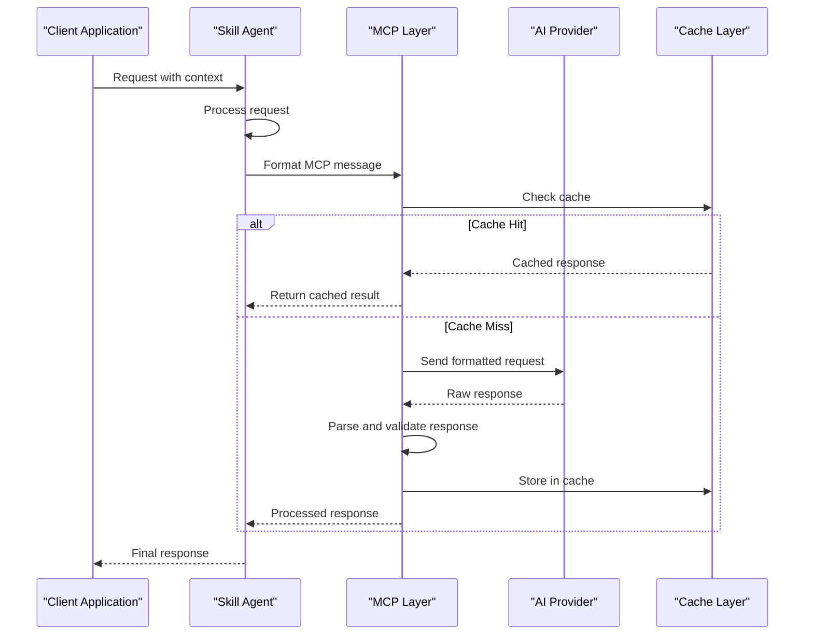
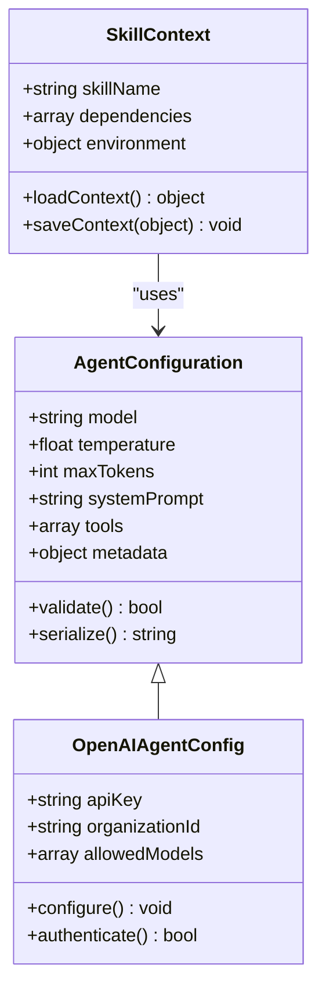
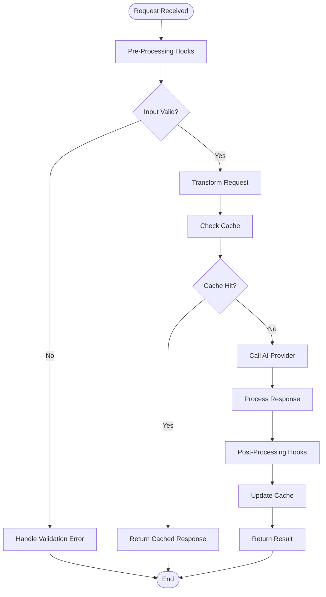
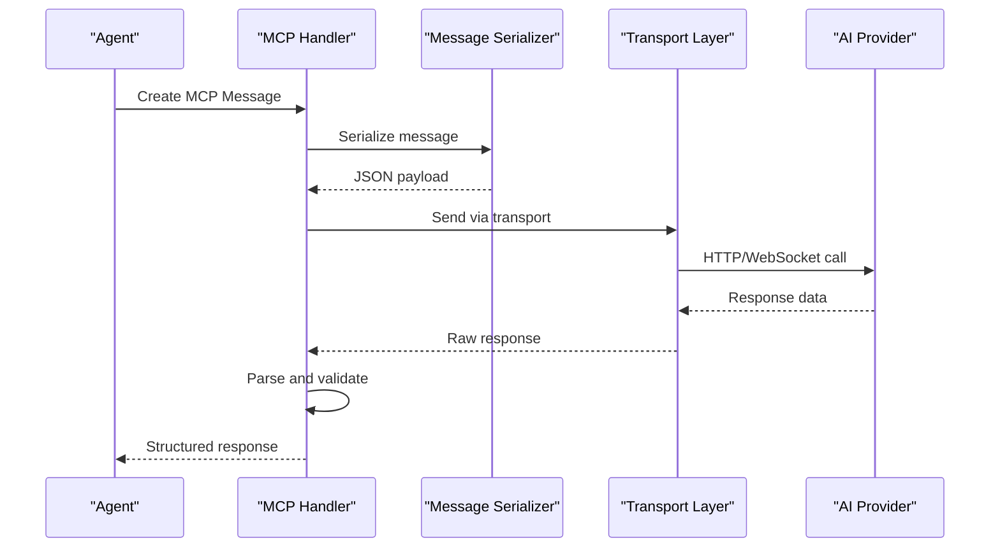
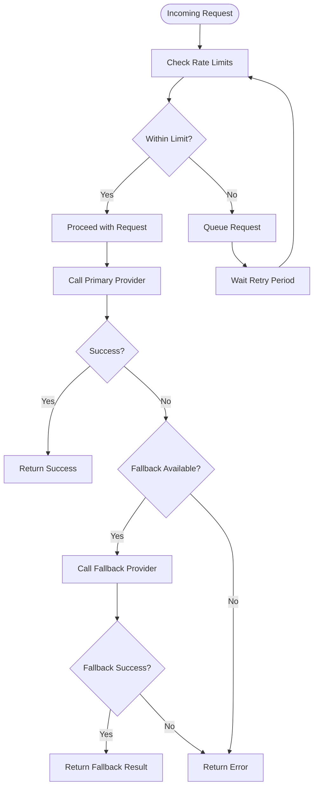
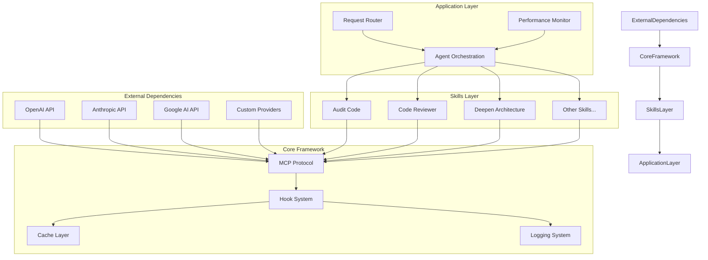

# Model Integration & Communication

<cite>
**Referenced Files in This Document**
- [README.md](file://README.md)
- [mcp-servers/README.md](file://mcp-servers/README.md)
- [skills/audit-code/agents/openai.yaml](file://skills/audit-code/agents/openai.yaml)
- [skills/code-reviewer/agents/openai.yaml](file://skills/code-reviewer/agents/openai.yaml)
- [skills/deepen-architecture/agents/openai.yaml](file://skills/deepen-architecture/agents/openai.yaml)
- [skills/develop-tdd/agents/openai.yaml](file://skills/develop-tdd/agents/openai.yaml)
- [skills/differential-review/agents/openai.yaml](file://skills/differential-review/agents/openai.yaml)
- [skills/enforce-first/agents/openai.yaml](file://skills/enforce-first/agents/openai.yaml)
- [skills/fp-check/agents/openai.yaml](file://skills/fp-check/agents/openai.yaml)
- [skills/pi-lens-ast-grep/agents/openai.yaml](file://skills/pi-lens-ast-grep/agents/openai.yaml)
- [skills/pi-lens-lsp-navigation/agents/openai.yaml](file://skills/pi-lens-lsp-navigation/agents/openai.yaml)
- [skills/pi-lens-write-ast-grep-rule/agents/openai.yaml](file://skills/pi-lens-write-ast-grep-rule/agents/openai.yaml)
- [skills/pi-lens-write-tree-sitter-rule/agents/openai.yaml](file://skills/pi-lens-write-tree-sitter-rule/agents/openai.yaml)
- [skills/request-review/agents/openai.yaml](file://skills/request-review/agents/openai.yaml)
- [skills/respond-review/agents/openai.yaml](file://skills/respond-review/agents/openai.yaml)
- [skills/simplify/agents/openai.yaml](file://skills/simplify/agents/openai.yaml)
- [skills/variant-analysis/agents/openai.yaml](file://skills/variant-analysis/agents/openai.yaml)
- [skills/verify-work/agents/openai.yaml](file://skills/verify-work/agents/openai.yaml)
- [hooks/lens-reminder.mjs](file://hooks/lens-reminder.mjs)
- [hooks/rtk-pretooluse.mjs](file://hooks/rtk-pretooluse.mjs)
</cite>

## Table of Contents
1. [Introduction](#introduction)
2. [Project Structure](#project-structure)
3. [Core Components](#core-components)
4. [Architecture Overview](#architecture-overview)
5. [Detailed Component Analysis](#detailed-component-analysis)
6. [Dependency Analysis](#dependency-analysis)
7. [Performance Considerations](#performance-considerations)
8. [Troubleshooting Guide](#troubleshooting-guide)
9. [Conclusion](#conclusion)

## Introduction

This document provides comprehensive coverage of AI model integration and communication protocols within the Pi Codex Kit ecosystem. The system implements a sophisticated architecture that enables agents to communicate with various AI models through the Model Context Protocol (MCP), providing a unified abstraction layer for switching between different AI providers while maintaining consistent interfaces.

The architecture supports multiple AI providers including OpenAI, Anthropic, Google, and custom implementations, with built-in support for rate limiting, caching mechanisms, request optimization, and performance monitoring. The system is designed to be extensible, allowing developers to integrate new AI providers seamlessly while leveraging shared infrastructure for connection management, message formatting, and response parsing.

## Project Structure

The Pi Codex Kit follows a modular architecture organized around skills and agents, with each skill containing its own agent configuration and supporting resources. The key directories include:

```mermaid
graph TB
subgraph "Core System"
Root[Pi Codex Kit Root]
Hooks[Hooks Layer]
MCP[MCP Servers]
end
subgraph "Skills Layer"
Skills[Skills Directory]
AuditCode[Audit Code Skill]
CodeReviewer[Code Reviewer Skill]
DeepenArch[Deepen Architecture Skill]
DevelopTDD[Develop TDD Skill]
DifferentialReview[Differential Review Skill]
EnforceFirst[Enforce First Skill]
FPCheck[FP Check Skill]
PiLensAST[Pi Lens AST Grep]
PiLensLSP[Pi Lens LSP Navigation]
PiLensWriteAST[Pi Lens Write AST Rule]
PiLensWriteTreeSitter[Pi Lens Write Tree Sitter Rule]
RequestReview[Request Review Skill]
RespondReview[Respond Review Skill]
Simplify[Simplify Skill]
VariantAnalysis[Variant Analysis Skill]
VerifyWork[Verify Work Skill]
end
subgraph "Agent Configurations"
OpenAIConfigs[OpenAI Agent Configs]
end
Root --> Hooks
Root --> MCP
Root --> Skills
Skills --> OpenAIConfigs
Skills --> AuditCode
Skills --> CodeReviewer
Skills --> DeepenArch
Skills --> DevelopTDD
Skills --> DifferentialReview
Skills --> EnforceFirst
Skills --> FPCheck
Skills --> PiLensAST
Skills --> PiLensLSP
Skills --> PiLensWriteAST
Skills --> PiLensWriteTreeSitter
Skills --> RequestReview
Skills --> RespondReview
Skills --> Simplify
Skills --> VariantAnalysis
Skills --> VerifyWork
```

**Diagram sources**
- [README.md](file://README.md)
- [mcp-servers/README.md](file://mcp-servers/README.md)

**Section sources**
- [README.md](file://README.md)
- [mcp-servers/README.md](file://mcp-servers/README.md)

## Core Components

The system's core components are organized around several key architectural patterns:

### Agent Configuration Management
Each skill contains an `agents` directory with provider-specific configurations, primarily using OpenAI YAML files. These configurations define model parameters, system prompts, and communication settings.

### Hook System
The hooks directory contains JavaScript modules that provide pre-processing and post-processing capabilities for AI interactions, enabling request transformation and response handling.

### MCP Server Infrastructure
The mcp-servers directory serves as the foundation for Model Context Protocol implementation, providing standardized communication channels between agents and AI models.

### Skill-Based Organization
Skills represent specialized AI capabilities, each with their own context, tools, and communication patterns. This modular approach allows for independent development and deployment of AI features.

**Section sources**
- [skills/audit-code/agents/openai.yaml](file://skills/audit-code/agents/openai.yaml)
- [skills/code-reviewer/agents/openai.yaml](file://skills/code-reviewer/agents/openai.yaml)
- [hooks/lens-reminder.mjs](file://hooks/lens-reminder.mjs)
- [hooks/rtk-pretooluse.mjs](file://hooks/rtk-pretooluse.mjs)

## Architecture Overview

The system implements a layered architecture that abstracts AI model communications behind consistent interfaces:

**Diagram sources**
- [mcp-servers/README.md](file://mcp-servers/README.md)
- [hooks/lens-reminder.mjs](file://hooks/lens-reminder.mjs)

The architecture follows these key principles:

1. **Abstraction Layer**: Consistent interfaces across different AI providers
2. **Protocol Standardization**: MCP-based communication for interoperability
3. **Caching Strategy**: Intelligent caching to optimize performance
4. **Error Handling**: Comprehensive error recovery and fallback mechanisms
5. **Monitoring**: Built-in performance tracking and metrics collection

## Detailed Component Analysis

### Agent Configuration System

The agent configuration system uses YAML files to define AI model parameters and behavior. Each skill maintains its own configuration, allowing for specialized tuning per use case.

**Diagram sources**
- [skills/audit-code/agents/openai.yaml](file://skills/audit-code/agents/openai.yaml)
- [skills/code-reviewer/agents/openai.yaml](file://skills/code-reviewer/agents/openai.yaml)

**Section sources**
- [skills/audit-code/agents/openai.yaml](file://skills/audit-code/agents/openai.yaml)
- [skills/code-reviewer/agents/openai.yaml](file://skills/code-reviewer/agents/openai.yaml)
- [skills/deepen-architecture/agents/openai.yaml](file://skills/deepen-architecture/agents/openai.yaml)
- [skills/develop-tdd/agents/openai.yaml](file://skills/develop-tdd/agents/openai.yaml)

### Hook Processing Pipeline

The hook system provides middleware-like functionality for request and response processing:

**Diagram sources**
- [hooks/lens-reminder.mjs](file://hooks/lens-reminder.mjs)
- [hooks/rtk-pretooluse.mjs](file://hooks/rtk-pretooluse.mjs)

**Section sources**
- [hooks/lens-reminder.mjs](file://hooks/lens-reminder.mjs)
- [hooks/rtk-pretooluse.mjs](file://hooks/rtk-pretooluse.mjs)

### MCP Protocol Implementation

The Model Context Protocol implementation provides standardized communication between agents and AI models:

**Diagram sources**
- [mcp-servers/README.md](file://mcp-servers/README.md)

**Section sources**
- [mcp-servers/README.md](file://mcp-servers/README.md)

### Rate Limiting and Fallback Strategies

The system implements intelligent rate limiting and fallback mechanisms to ensure reliability:

**Diagram sources**
- [hooks/rtk-pretooluse.mjs](file://hooks/rtk-pretooluse.mjs)

**Section sources**
- [hooks/rtk-pretooluse.mjs](file://hooks/rtk-pretooluse.mjs)

## Dependency Analysis

The system exhibits a well-structured dependency hierarchy with clear separation of concerns:

**Diagram sources**
- [skills/audit-code/agents/openai.yaml](file://skills/audit-code/agents/openai.yaml)
- [mcp-servers/README.md](file://mcp-servers/README.md)

**Section sources**
- [skills/audit-code/agents/openai.yaml](file://skills/audit-code/agents/openai.yaml)
- [mcp-servers/README.md](file://mcp-servers/README.md)

## Performance Considerations

The system incorporates several performance optimization strategies:

### Caching Mechanisms
- **Response Caching**: Intelligent caching of AI responses based on input similarity
- **Connection Pooling**: Reuse connections to reduce overhead
- **Batch Processing**: Group similar requests when possible
- **Lazy Loading**: Load heavy resources only when needed

### Request Optimization
- **Request Deduplication**: Avoid duplicate requests with identical parameters
- **Compression**: Compress large payloads where supported
- **Streaming**: Support streaming responses for long-running operations
- **Timeout Management**: Configurable timeouts per provider and operation type

### Monitoring and Metrics
- **Latency Tracking**: Measure response times across all providers
- **Error Rate Monitoring**: Track failure rates and patterns
- **Usage Analytics**: Monitor token usage and cost optimization
- **Health Checks**: Regular provider availability checks

## Troubleshooting Guide

Common issues and their resolutions:

### Connection Issues
- **Authentication Failures**: Verify API keys and permissions
- **Network Timeouts**: Check network connectivity and adjust timeout settings
- **Rate Limit Errors**: Implement exponential backoff and queue management

### Performance Problems
- **Slow Responses**: Enable caching and optimize request payloads
- **Memory Leaks**: Monitor resource cleanup and implement proper disposal
- **High Latency**: Use connection pooling and request batching

### Provider-Specific Issues
- **Model Compatibility**: Ensure prompt formats match provider requirements
- **Token Limits**: Implement chunking for large inputs
- **Error Handling**: Provide meaningful error messages and fallbacks

**Section sources**
- [hooks/lens-reminder.mjs](file://hooks/lens-reminder.mjs)
- [hooks/rtk-pretooluse.mjs](file://hooks/rtk-pretooluse.mjs)

## Conclusion

The Pi Codex Kit provides a robust and extensible framework for AI model integration through the Model Context Protocol. The architecture successfully abstracts provider-specific details behind consistent interfaces while offering advanced features like caching, rate limiting, and comprehensive monitoring. The skill-based organization enables modular development and easy maintenance of AI capabilities.

Key strengths of the system include its protocol standardization, flexible provider support, and comprehensive error handling. The hook system provides powerful extension points for custom logic, while the caching and optimization strategies ensure efficient operation at scale.

Future enhancements could include additional provider integrations, more sophisticated caching strategies, and enhanced monitoring capabilities. The current architecture provides a solid foundation for these improvements while maintaining backward compatibility and system stability.