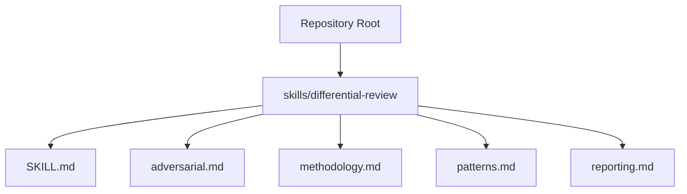
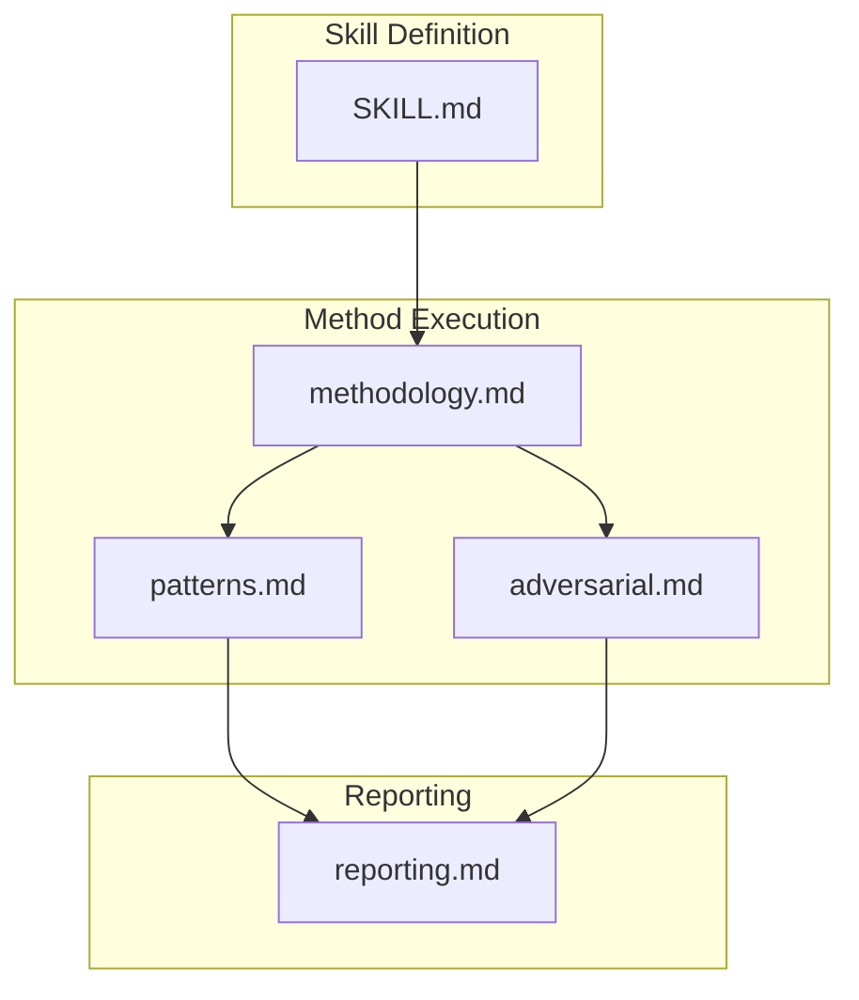
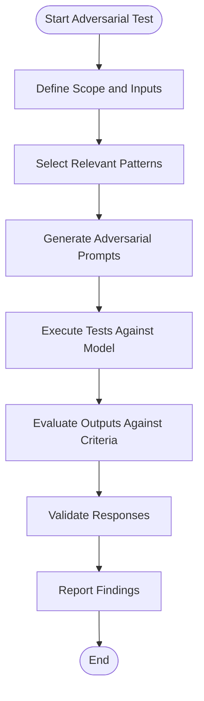
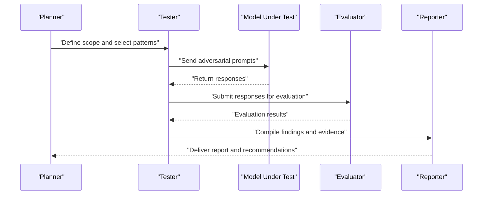
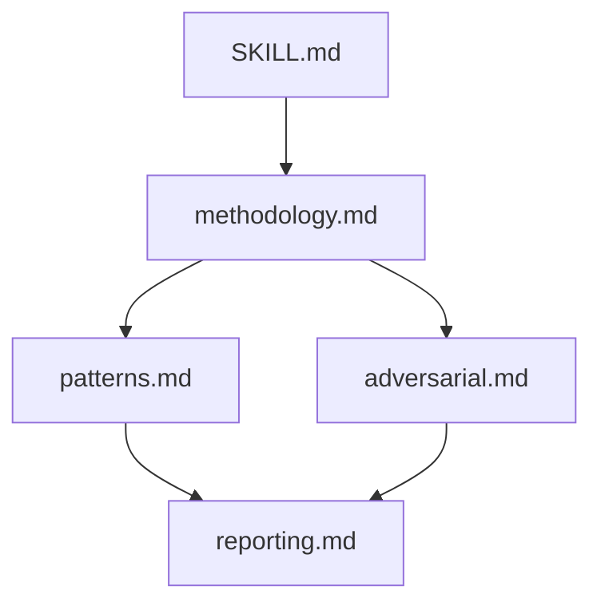

# Adversarial Prompting

<cite>
**Referenced Files in This Document**
- [README.md](file://README.md)
- [SKILL.md](file://skills/differential-review/SKILL.md)
- [adversarial.md](file://skills/differential-review/adversarial.md)
- [methodology.md](file://skills/differential-review/methodology.md)
- [patterns.md](file://skills/differential-review/patterns.md)
- [reporting.md](file://skills/differential-review/reporting.md)
</cite>

## Table of Contents
1. [Introduction](#introduction)
2. [Project Structure](#project-structure)
3. [Core Components](#core-components)
4. [Architecture Overview](#architecture-overview)
5. [Detailed Component Analysis](#detailed-component-analysis)
6. [Dependency Analysis](#dependency-analysis)
7. [Performance Considerations](#performance-considerations)
8. [Troubleshooting Guide](#troubleshooting-guide)
9. [Conclusion](#conclusion)
10. [Appendices](#appendices)

## Introduction
This document provides specialized guidance for adversarial prompting techniques used in differential review and quality assurance. It explains how to craft prompts that challenge AI responses, identify weaknesses, and generate counter-arguments. The methodology covers pattern recognition, edge case exploration, and stress testing of AI outputs. Practical examples include prompt templates, evaluation criteria, and response validation techniques. Safety considerations and ethical guidelines are included to ensure responsible use.

## Project Structure
The repository organizes adversarial prompting content within the differential-review skill. Key files define the skill’s purpose, methodology, patterns, adversarial strategies, and reporting practices.

**Diagram sources**
- [SKILL.md](file://skills/differential-review/SKILL.md)
- [adversarial.md](file://skills/differential-review/adversarial.md)
- [methodology.md](file://skills/differential-review/methodology.md)
- [patterns.md](file://skills/differential-review/patterns.md)
- [reporting.md](file://skills/differential-review/reporting.md)

**Section sources**
- [README.md](file://README.md)
- [SKILL.md](file://skills/differential-review/SKILL.md)

## Core Components
- Differential Review Skill: Defines the scope and objectives for adversarial prompting in code review contexts.
- Methodology: Describes systematic approaches to adversarial testing, including pattern recognition, edge case exploration, and stress testing.
- Patterns: Catalogs common adversarial prompt patterns and their intended effects on model behavior.
- Adversarial Strategies: Provides concrete techniques for crafting challenging prompts and generating counter-arguments.
- Reporting: Standardizes how to document findings, evidence, and remediation recommendations.

These components work together to form a repeatable process for probing model robustness during reviews and ensuring high-quality outputs.

**Section sources**
- [SKILL.md](file://skills/differential-review/SKILL.md)
- [methodology.md](file://skills/differential-review/methodology.md)
- [patterns.md](file://skills/differential-review/patterns.md)
- [adversarial.md](file://skills/differential-review/adversarial.md)
- [reporting.md](file://skills/differential-review/reporting.md)

## Architecture Overview
The adversarial prompting workflow integrates skill definition, method execution, pattern application, strategy selection, and reporting. The following diagram maps these interactions to the corresponding files.

**Diagram sources**
- [SKILL.md](file://skills/differential-review/SKILL.md)
- [methodology.md](file://skills/differential-review/methodology.md)
- [patterns.md](file://skills/differential-review/patterns.md)
- [adversarial.md](file://skills/differential-review/adversarial.md)
- [reporting.md](file://skills/differential-review/reporting.md)

## Detailed Component Analysis

### Differential Review Skill
- Purpose: Establishes the adversarial prompting goals within code review workflows.
- Scope: Covers when and how to apply adversarial tests during review cycles.
- Integration: Coordinates with other skills (e.g., code reviewer, verify-work) to embed adversarial checks into standard processes.

Practical usage includes:
- Triggering adversarial runs before merging changes.
- Using standardized templates to ensure consistency across reviewers.
- Recording outcomes for traceability and continuous improvement.

**Section sources**
- [SKILL.md](file://skills/differential-review/SKILL.md)

### Methodology
- Pattern Recognition: Identifies recurring behaviors and failure modes by analyzing model responses under varied inputs.
- Edge Case Exploration: Systematically probes boundary conditions, unusual formats, and ambiguous instructions.
- Stress Testing: Applies high-load or complex scenarios to evaluate stability and correctness.
- Evaluation Criteria: Defines measurable indicators such as accuracy, robustness, clarity, and safety compliance.
- Response Validation: Uses structured checks to confirm outputs meet expected standards.

Operational flow:

**Diagram sources**
- [methodology.md](file://skills/differential-review/methodology.md)

**Section sources**
- [methodology.md](file://skills/differential-review/methodology.md)

### Patterns
- Common Adversarial Patterns: Includes ambiguity injection, contradictory constraints, domain-specific traps, and format variations.
- Effect Mapping: Documents how each pattern influences model reasoning and potential failure points.
- Selection Guidance: Helps choose appropriate patterns based on context and risk profile.

Usage tips:
- Combine multiple patterns to simulate realistic complexity.
- Rotate patterns to avoid overfitting to specific weaknesses.
- Maintain a curated library of effective patterns for reuse.

**Section sources**
- [patterns.md](file://skills/differential-review/patterns.md)

### Adversarial Strategies
- Crafting Challenging Prompts: Techniques for introducing subtle misdirection, layered requirements, and implicit assumptions.
- Counter-Argument Generation: Methods to elicit alternative viewpoints and expose blind spots.
- Stress Scenarios: Constructing extreme cases to test resilience and maintain correctness.
- Iterative Refinement: Adjusting prompts based on observed failures to deepen coverage.

Best practices:
- Keep prompts focused and reproducible.
- Document rationale behind each adversarial choice.
- Use controlled environments to isolate variables.

**Section sources**
- [adversarial.md](file://skills/differential-review/adversarial.md)

### Reporting
- Findings Documentation: Structured capture of observations, evidence, and impact assessment.
- Evidence Templates: Standardized formats for recording prompts, outputs, and analysis.
- Remediation Recommendations: Actionable steps to address identified weaknesses.
- Traceability: Linking reports back to specific tests and patterns for auditability.

Workflow integration:
- Attach reports to review artifacts.
- Summarize trends across multiple runs.
- Feed insights back into pattern libraries and strategy guides.

**Section sources**
- [reporting.md](file://skills/differential-review/reporting.md)

### Conceptual Overview
Adversarial prompting in differential review follows a disciplined cycle: plan, probe, analyze, validate, and report. The conceptual sequence below illustrates this loop without mapping to specific source files.

[No sources needed since this diagram shows conceptual workflow, not actual code structure]

## Dependency Analysis
The adversarial prompting system depends on clear definitions in the skill file, rigorous methodology, curated patterns, actionable strategies, and standardized reporting. The dependency graph highlights how each component contributes to the overall process.

**Diagram sources**
- [SKILL.md](file://skills/differential-review/SKILL.md)
- [methodology.md](file://skills/differential-review/methodology.md)
- [patterns.md](file://skills/differential-review/patterns.md)
- [adversarial.md](file://skills/differential-review/adversarial.md)
- [reporting.md](file://skills/differential-review/reporting.md)

**Section sources**
- [SKILL.md](file://skills/differential-review/SKILL.md)
- [methodology.md](file://skills/differential-review/methodology.md)
- [patterns.md](file://skills/differential-review/patterns.md)
- [adversarial.md](file://skills/differential-review/adversarial.md)
- [reporting.md](file://skills/differential-review/reporting.md)

## Performance Considerations
- Efficiency: Reuse patterns and templates to reduce setup time.
- Scalability: Batch similar tests and automate where possible.
- Resource Management: Limit concurrent executions to avoid overload.
- Feedback Loops: Continuously refine prompts based on performance metrics.

[No sources needed since this section provides general guidance]

## Troubleshooting Guide
Common issues and resolutions:
- Ambiguous Results: Clarify evaluation criteria and add explicit validation steps.
- Inconsistent Outputs: Standardize input formatting and control randomness parameters.
- Overfitting to Patterns: Diversify pattern selection and introduce novel edge cases.
- Reporting Gaps: Enforce evidence templates and require traceability links.

**Section sources**
- [reporting.md](file://skills/differential-review/reporting.md)
- [methodology.md](file://skills/differential-review/methodology.md)

## Conclusion
Adversarial prompting enhances differential review by systematically challenging AI responses, uncovering weaknesses, and improving robustness. By following the documented methodology, leveraging curated patterns, applying targeted strategies, and maintaining rigorous reporting, teams can achieve higher confidence in model outputs and safer, more reliable code reviews.

[No sources needed since this section summarizes without analyzing specific files]

## Appendices

### Practical Examples Index
- Adversarial Prompt Templates: See [adversarial.md](file://skills/differential-review/adversarial.md)
- Evaluation Criteria: See [methodology.md](file://skills/differential-review/methodology.md)
- Response Validation Techniques: See [methodology.md](file://skills/differential-review/methodology.md)
- Safety and Ethical Guidelines: See [methodology.md](file://skills/differential-review/methodology.md) and [reporting.md](file://skills/differential-review/reporting.md)

[No sources needed since this section references existing sections without new analysis]