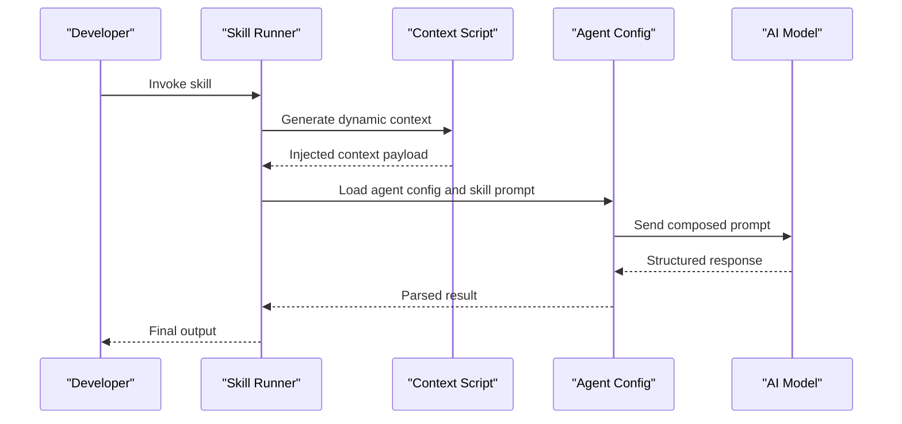
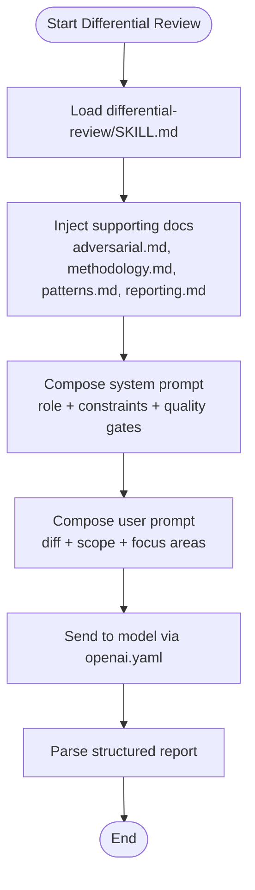
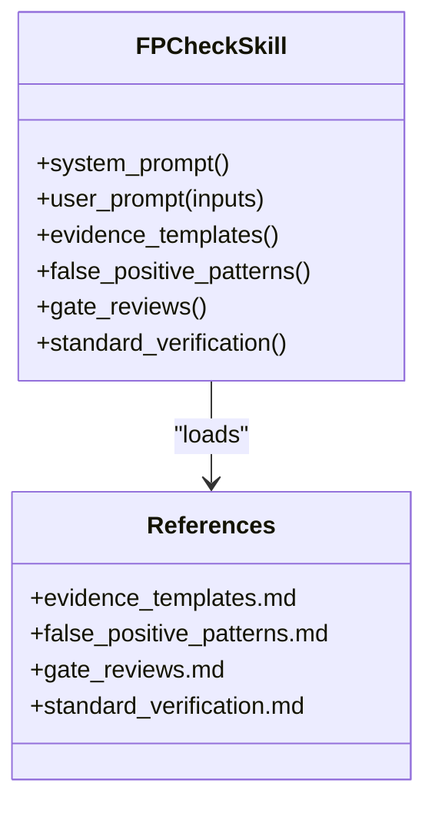
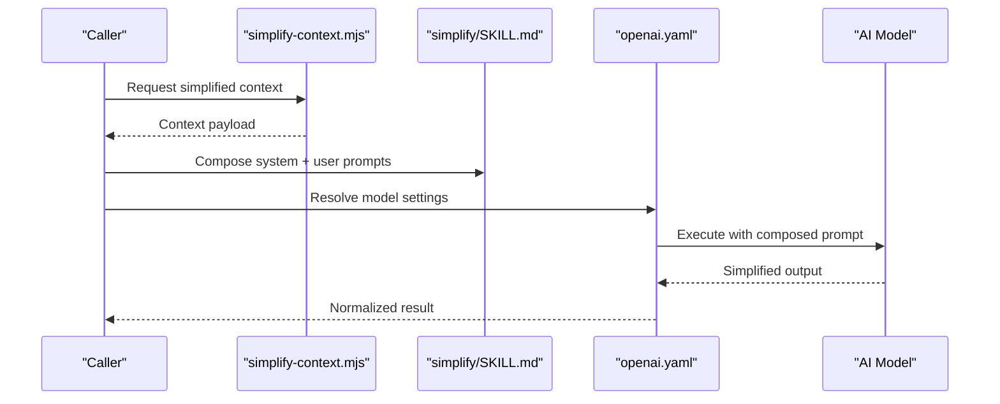
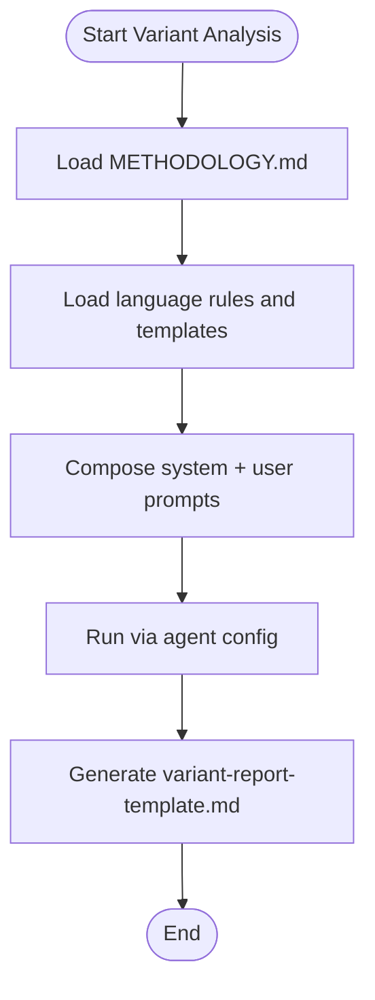
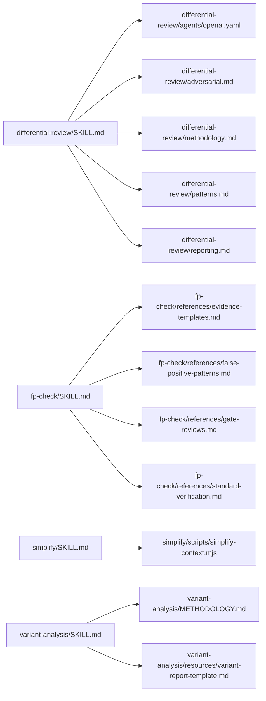

# Prompt Engineering

<cite>
**Referenced Files in This Document**
- [README.md](file://README.md)
- [skills/README.md](file://skills/README.md)
- [skills/differential-review/SKILL.md](file://skills/differential-review/SKILL.md)
- [skills/differential-review/adversarial.md](file://skills/differential-review/adversarial.md)
- [skills/differential-review/methodology.md](file://skills/differential-review/methodology.md)
- [skills/differential-review/patterns.md](file://skills/differential-review/patterns.md)
- [skills/differential-review/reporting.md](file://skills/differential-review/reporting.md)
- [skills/fp-check/SKILL.md](file://skills/fp-check/SKILL.md)
- [skills/fp-check/references/evidence-templates.md](file://skills/fp-check/references/evidence-templates.md)
- [skills/fp-check/references/false-positive-patterns.md](file://skills/fp-check/references/false-positive-patterns.md)
- [skills/fp-check/references/gate-reviews.md](file://skills/fp-check/references/gate-reviews.md)
- [skills/fp-check/references/standard-verification.md](file://skills/fp-check/references/standard-verification.md)
- [skills/simplify/SKILL.md](file://skills/simplify/SKILL.md)
- [skills/simplify/scripts/simplify-context.mjs](file://skills/simplify/scripts/simplify-context.mjs)
- [skills/variant-analysis/SKILL.md](file://skills/variant-analysis/SKILL.md)
- [skills/variant-analysis/METHODOLOGY.md](file://skills/variant-analysis/METHODOLOGY.md)
- [skills/variant-analysis/resources/variant-report-template.md](file://skills/variant-analysis/resources/variant-report-template.md)
- [agents-md/README.md](file://agents-md/README.md)
</cite>

## Table of Contents
1. [Introduction](#introduction)
2. [Project Structure](#project-structure)
3. [Core Components](#core-components)
4. [Architecture Overview](#architecture-overview)
5. [Detailed Component Analysis](#detailed-component-analysis)
6. [Dependency Analysis](#dependency-analysis)
7. [Performance Considerations](#performance-considerations)
8. [Troubleshooting Guide](#troubleshooting-guide)
9. [Conclusion](#conclusion)
10. [Appendices](#appendices)

## Introduction
This document explains prompt engineering patterns and techniques used across the framework’s skills and agents. It focuses on how to craft effective system prompts, user prompts, and response templates; how SKILL.md files relate to agent prompts; how context is injected and parameters are substituted dynamically; and how to implement adversarial prompting, structured outputs, and error recovery. It also covers prompt versioning, testing strategies, and optimization techniques for better AI responses.

## Project Structure
The repository organizes prompt-related content primarily under:
- skills/<skill-name>/SKILL.md: Skill-level instructions that define roles, goals, constraints, workflows, and output formats.
- skills/<skill-name>/agents/openai.yaml: Agent configuration that binds a model to a skill (often referencing or composing SKILL.md).
- skills/<skill-name>/references/* and resources/*: Supporting materials such as evidence templates, methodology, patterns, and report templates.
- scripts/*: Utilities that can generate or inject dynamic context into prompts at runtime.

```mermaid
graph TB
subgraph "Skills"
A["differential-review/SKILL.md"]
B["fp-check/SKILL.md"]
C["simplify/SKILL.md"]
D["variant-analysis/SKILL.md"]
end
subgraph "Agent Configs"
E["differential-review/agents/openai.yaml"]
F["fp-check/agents/openai.yaml"]
G["simplify/agents/openai.yaml"]
H["variant-analysis/agents/openai.yaml"]
end
subgraph "Supporting Docs"
I["differential-review/adversarial.md"]
J["differential-review/methodology.md"]
K["differential-review/patterns.md"]
L["differential-review/reporting.md"]
M["fp-check/references/evidence-templates.md"]
N["fp-check/references/false-positive-patterns.md"]
O["fp-check/references/gate-reviews.md"]
P["fp-check/references/standard-verification.md"]
Q["variant-analysis/METHODOLOGY.md"]
R["variant-analysis/resources/variant-report-template.md"]
end
subgraph "Runtime Helpers"
S["simplify/scripts/simplify-context.mjs"]
end
A --> E
B --> F
C --> G
D --> H
A --> I
A --> J
A --> K
A --> L
B --> M
B --> N
B --> O
B --> P
D --> Q
D --> R
C --> S
```

**Diagram sources**
- [skills/differential-review/SKILL.md](file://skills/differential-review/SKILL.md)
- [skills/differential-review/agents/openai.yaml](file://skills/differential-review/agents/openai.yaml)
- [skills/differential-review/adversarial.md](file://skills/differential-review/adversarial.md)
- [skills/differential-review/methodology.md](file://skills/differential-review/methodology.md)
- [skills/differential-review/patterns.md](file://skills/differential-review/patterns.md)
- [skills/differential-review/reporting.md](file://skills/differential-review/reporting.md)
- [skills/fp-check/SKILL.md](file://skills/fp-check/SKILL.md)
- [skills/fp-check/references/evidence-templates.md](file://skills/fp-check/references/evidence-templates.md)
- [skills/fp-check/references/false-positive-patterns.md](file://skills/fp-check/references/false-positive-patterns.md)
- [skills/fp-check/references/gate-reviews.md](file://skills/fp-check/references/gate-reviews.md)
- [skills/fp-check/references/standard-verification.md](file://skills/fp-check/references/standard-verification.md)
- [skills/simplify/SKILL.md](file://skills/simplify/SKILL.md)
- [skills/simplify/scripts/simplify-context.mjs](file://skills/simplify/scripts/simplify-context.mjs)
- [skills/variant-analysis/SKILL.md](file://skills/variant-analysis/SKILL.md)
- [skills/variant-analysis/METHODOLOGY.md](file://skills/variant-analysis/METHODOLOGY.md)
- [skills/variant-analysis/resources/variant-report-template.md](file://skills/variant-analysis/resources/variant-report-template.md)

**Section sources**
- [README.md](file://README.md)
- [skills/README.md](file://skills/README.md)

## Core Components
- SKILL.md files: Authoritative source of behavior for each skill. They typically include role definition, objectives, constraints, step-by-step procedures, input expectations, and output formatting rules.
- Agent configs (openai.yaml): Bind models to skills and may reference or compose SKILL.md content. They control runtime invocation and parameterization.
- Supporting references and resources: Provide domain knowledge, evidence templates, methodologies, patterns, and report templates that augment prompts with high-quality context.
- Runtime helpers: Scripts that assemble or inject dynamic context into prompts before sending them to the model.

Key responsibilities:
- System prompts: Define identity, scope, safety, and quality standards.
- User prompts: Provide task-specific inputs, constraints, and examples.
- Response templates: Enforce consistent, machine-readable or human-readable structures.

**Section sources**
- [skills/differential-review/SKILL.md](file://skills/differential-review/SKILL.md)
- [skills/fp-check/SKILL.md](file://skills/fp-check/SKILL.md)
- [skills/simplify/SKILL.md](file://skills/simplify/SKILL.md)
- [skills/variant-analysis/SKILL.md](file://skills/variant-analysis/SKILL.md)

## Architecture Overview
The prompt pipeline composes three layers:
- Static skill definitions (SKILL.md)
- Dynamic context injection (scripts and resource files)
- Model execution via agent config (openai.yaml)

[No sources needed since this diagram shows conceptual workflow, not actual code structure]

## Detailed Component Analysis

### Differential Review Skill
Purpose: Coordinate multi-pass review processes, including adversarial checks, methodological rigor, pattern recognition, and standardized reporting.

Prompt engineering highlights:
- System prompt: Establishes reviewer persona, evaluation criteria, and non-negotiable constraints.
- User prompt: Supplies diff/context, target areas, and desired depth.
- Adversarial prompting: Encourages counterfactual reasoning and stress-testing assumptions.
- Structured output: Uses reporting templates to ensure consistency.

**Diagram sources**
- [skills/differential-review/SKILL.md](file://skills/differential-review/SKILL.md)
- [skills/differential-review/adversarial.md](file://skills/differential-review/adversarial.md)
- [skills/differential-review/methodology.md](file://skills/differential-review/methodology.md)
- [skills/differential-review/patterns.md](file://skills/differential-review/patterns.md)
- [skills/differential-review/reporting.md](file://skills/differential-review/reporting.md)
- [skills/differential-review/agents/openai.yaml](file://skills/differential-review/agents/openai.yaml)

**Section sources**
- [skills/differential-review/SKILL.md](file://skills/differential-review/SKILL.md)
- [skills/differential-review/adversarial.md](file://skills/differential-review/adversarial.md)
- [skills/differential-review/methodology.md](file://skills/differential-review/methodology.md)
- [skills/differential-review/patterns.md](file://skills/differential-review/patterns.md)
- [skills/differential-review/reporting.md](file://skills/differential-review/reporting.md)

### FP Check Skill
Purpose: Perform functional programming verification with strong emphasis on evidence-based claims, false positive detection, and gate reviews.

Prompt engineering highlights:
- Evidence-first approach: Requires citing concrete artifacts and reasoning steps.
- False positive mitigation: Explicitly enumerates common pitfalls and anti-patterns.
- Gate reviews: Defines pass/fail criteria and escalation paths.
- Standard verification: Provides a repeatable checklist for correctness.

**Diagram sources**
- [skills/fp-check/SKILL.md](file://skills/fp-check/SKILL.md)
- [skills/fp-check/references/evidence-templates.md](file://skills/fp-check/references/evidence-templates.md)
- [skills/fp-check/references/false-positive-patterns.md](file://skills/fp-check/references/false-positive-patterns.md)
- [skills/fp-check/references/gate-reviews.md](file://skills/fp-check/references/gate-reviews.md)
- [skills/fp-check/references/standard-verification.md](file://skills/fp-check/references/standard-verification.md)

**Section sources**
- [skills/fp-check/SKILL.md](file://skills/fp-check/SKILL.md)
- [skills/fp-check/references/evidence-templates.md](file://skills/fp-check/references/evidence-templates.md)
- [skills/fp-check/references/false-positive-patterns.md](file://skills/fp-check/references/false-positive-patterns.md)
- [skills/fp-check/references/gate-reviews.md](file://skills/fp-check/references/gate-reviews.md)
- [skills/fp-check/references/standard-verification.md](file://skills/fp-check/references/standard-verification.md)

### Simplify Skill
Purpose: Reduce complexity by generating focused context and simplifying code or documentation.

Prompt engineering highlights:
- Dynamic context injection: Uses a script to assemble relevant snippets and metadata.
- Parameterized prompts: Substitutes variables like file paths, scopes, and complexity thresholds.
- Output normalization: Produces concise, actionable suggestions.

**Diagram sources**
- [skills/simplify/SKILL.md](file://skills/simplify/SKILL.md)
- [skills/simplify/scripts/simplify-context.mjs](file://skills/simplify/scripts/simplify-context.mjs)
- [skills/simplify/agents/openai.yaml](file://skills/simplify/agents/openai.yaml)

**Section sources**
- [skills/simplify/SKILL.md](file://skills/simplify/SKILL.md)
- [skills/simplify/scripts/simplify-context.mjs](file://skills/simplify/scripts/simplify-context.mjs)

### Variant Analysis Skill
Purpose: Analyze variants across languages using CodeQL/Semgrep resources and produce standardized reports.

Prompt engineering highlights:
- Methodology-driven prompts: Aligns analysis steps with documented methodology.
- Template-based reporting: Ensures consistent, comparable results across runs.
- Resource-augmented context: Loads language-specific rule sets and templates.

**Diagram sources**
- [skills/variant-analysis/SKILL.md](file://skills/variant-analysis/SKILL.md)
- [skills/variant-analysis/METHODOLOGY.md](file://skills/variant-analysis/METHODOLOGY.md)
- [skills/variant-analysis/resources/variant-report-template.md](file://skills/variant-analysis/resources/variant-report-template.md)
- [skills/variant-analysis/agents/openai.yaml](file://skills/variant-analysis/agents/openai.yaml)

**Section sources**
- [skills/variant-analysis/SKILL.md](file://skills/variant-analysis/SKILL.md)
- [skills/variant-analysis/METHODOLOGY.md](file://skills/variant-analysis/METHODOLOGY.md)
- [skills/variant-analysis/resources/variant-report-template.md](file://skills/variant-analysis/resources/variant-report-template.md)

## Dependency Analysis
Relationships between prompts, references, and agent configurations:

**Diagram sources**
- [skills/differential-review/SKILL.md](file://skills/differential-review/SKILL.md)
- [skills/differential-review/agents/openai.yaml](file://skills/differential-review/agents/openai.yaml)
- [skills/differential-review/adversarial.md](file://skills/differential-review/adversarial.md)
- [skills/differential-review/methodology.md](file://skills/differential-review/methodology.md)
- [skills/differential-review/patterns.md](file://skills/differential-review/patterns.md)
- [skills/differential-review/reporting.md](file://skills/differential-review/reporting.md)
- [skills/fp-check/SKILL.md](file://skills/fp-check/SKILL.md)
- [skills/fp-check/references/evidence-templates.md](file://skills/fp-check/references/evidence-templates.md)
- [skills/fp-check/references/false-positive-patterns.md](file://skills/fp-check/references/false-positive-patterns.md)
- [skills/fp-check/references/gate-reviews.md](file://skills/fp-check/references/gate-reviews.md)
- [skills/fp-check/references/standard-verification.md](file://skills/fp-check/references/standard-verification.md)
- [skills/simplify/SKILL.md](file://skills/simplify/SKILL.md)
- [skills/simplify/scripts/simplify-context.mjs](file://skills/simplify/scripts/simplify-context.mjs)
- [skills/variant-analysis/SKILL.md](file://skills/variant-analysis/SKILL.md)
- [skills/variant-analysis/METHODOLOGY.md](file://skills/variant-analysis/METHODOLOGY.md)
- [skills/variant-analysis/resources/variant-report-template.md](file://skills/variant-analysis/resources/variant-report-template.md)

**Section sources**
- [agents-md/README.md](file://agents-md/README.md)

## Performance Considerations
- Keep system prompts concise and declarative; move detailed examples to user prompts or references.
- Use targeted context injection to reduce token usage and improve relevance.
- Prefer structured output templates to minimize post-processing overhead.
- Cache reusable context payloads generated by helper scripts.
- Tune model parameters via agent configs to balance speed and accuracy per skill.

[No sources needed since this section provides general guidance]

## Troubleshooting Guide
Common issues and remedies:
- Missing or outdated references: Ensure all referenced documents exist and are up-to-date.
- Inconsistent outputs: Validate that response templates are enforced and parsed correctly.
- Overlong prompts: Split large contexts into modular references and inject only what is necessary.
- Parameter substitution errors: Verify that helper scripts produce valid payloads and that placeholders are resolved.

[No sources needed since this section provides general guidance]

## Conclusion
Effective prompt engineering in this framework hinges on clear separation of concerns: static skill definitions, dynamic context assembly, and robust agent configuration. By leveraging structured templates, adversarial techniques, and rigorous verification practices, teams can achieve reliable, repeatable, and high-quality AI outcomes.

[No sources needed since this section summarizes without analyzing specific files]

## Appendices

### Prompt Versioning Strategy
- Maintain semantic versions for SKILL.md and associated references.
- Tag agent configs to pin compatible prompt versions.
- Record changelogs for prompt updates and their impact on outputs.

[No sources needed since this section provides general guidance]

### Testing Strategies
- Unit-style tests for prompt composition: validate placeholders and template rendering.
- Regression suites against golden outputs for key scenarios.
- Adversarial test cases to probe robustness and safety boundaries.

[No sources needed since this section provides general guidance]

### Optimization Techniques
- Chunk and prioritize context to fit within model limits.
- Use few-shot examples sparingly and only when they significantly improve reliability.
- Normalize outputs to deterministic schemas for easier parsing and comparison.

[No sources needed since this section provides general guidance]