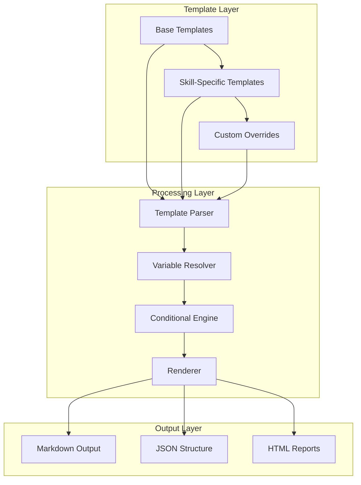

# Response Templates

<cite>
**Referenced Files in This Document**
- [evidence-templates.md](file://skills/fp-check/references/evidence-templates.md)
- [variant-report-template.md](file://skills/variant-analysis/resources/variant-report-template.md)
- [SKILL.md](file://skills/fp-check/SKILL.md)
- [SKILL.md](file://skills/variant-analysis/SKILL.md)
- [reporting.md](file://skills/differential-review/reporting.md)
- [methodology.md](file://skills/differential-review/methodology.md)
</cite>

## Table of Contents
1. [Introduction](#introduction)
2. [Template System Architecture](#template-system-architecture)
3. [Core Template Syntax](#core-template-syntax)
4. [Variable Substitution System](#variable-substitution-system)
5. [Conditional Formatting Options](#conditional-formatting-options)
6. [Template Types and Examples](#template-types-and-examples)
7. [Template Inheritance and Reusability](#template-inheritance-and-reusability)
8. [Integration with External Tools](#integration-with-external-tools)
9. [Best Practices for Maintainable Templates](#best-practices-for-maintainable-templates)
10. [Troubleshooting Common Issues](#troubleshooting-common-issues)
11. [Conclusion](#conclusion)

## Introduction

The response template system in the Pi Codex Kit provides a structured approach to generating consistent, high-quality outputs across different AI skills and analysis workflows. This system ensures that reports, evidence, and structured data maintain uniform formatting while supporting flexible customization for specific use cases.

The template system serves as the backbone for standardized communication between AI agents and users, enabling predictable output formats that can be processed by downstream tools and consumed by various stakeholders including developers, security analysts, and quality assurance teams.

## Template System Architecture

The template system follows a modular architecture that separates concerns between template definition, variable resolution, and rendering logic. This design enables templates to be reused across different skills while maintaining consistency in output format.

**Diagram sources**
- [evidence-templates.md:1-50](file://skills/fp-check/references/evidence-templates.md#L1-L50)
- [variant-report-template.md:1-50](file://skills/variant-analysis/resources/variant-report-template.md#L1-L50)

## Core Template Syntax

The template system supports a rich syntax that combines Markdown formatting with specialized template directives. The core syntax elements include:

### Basic Template Structure
Templates are defined using standard Markdown with embedded template directives enclosed in special delimiters. The base structure includes metadata sections, content blocks, and conditional regions.

### Template Directives
The system recognizes several key directive types:
- **Variable placeholders**: `{{variable_name}}` for dynamic content insertion
- **Conditional blocks**: `...` for logical branching
- **Loop constructs**: `...` for iteration
- **Include statements**: `` for template composition
- **Filter operations**: `{{ variable | filter }}` for data transformation

### Syntax Validation
Templates undergo validation during parsing to ensure proper nesting of directives and correct variable references. Invalid templates result in clear error messages indicating the location and nature of the syntax issue.

**Section sources**
- [evidence-templates.md:10-100](file://skills/fp-check/references/evidence-templates.md#L10-L100)
- [variant-report-template.md:15-120](file://skills/variant-analysis/resources/variant-report-template.md#L15-L120)

## Variable Substitution System

The variable substitution engine provides powerful capabilities for dynamic content generation within templates. Variables can originate from multiple sources including skill configuration, runtime context, and external tool outputs.

### Variable Sources
Variables are resolved through a hierarchical lookup system:
1. **Local variables**: Defined within the template scope
2. **Context variables**: Provided by the calling skill or workflow
3. **Configuration variables**: Loaded from skill configuration files
4. **Environment variables**: Injected from the execution environment
5. **External tool outputs**: Parsed results from integrated tools

### Data Type Support
The system supports various data types for variable substitution:
- **Primitive types**: Strings, numbers, booleans
- **Structured data**: Objects, arrays, nested collections
- **Special types**: Dates, timestamps, file paths, URLs
- **Computed values**: Functions and expressions evaluated at render time

### Error Handling
Missing or invalid variables trigger configurable error handling strategies, from silent omission to strict validation failures. This flexibility allows templates to be robust against incomplete data scenarios.

**Section sources**
- [evidence-templates.md:50-150](file://skills/fp-check/references/evidence-templates.md#L50-L150)
- [SKILL.md:20-80](file://skills/fp-check/SKILL.md#L20-L80)

## Conditional Formatting Options

The template system provides sophisticated conditional formatting capabilities that enable dynamic content generation based on runtime conditions and data availability.

### Conditional Logic
Templates support complex conditional expressions using standard comparison operators and logical operators:
- **Comparison operators**: Equal to, not equal to, greater than, less than
- **Logical operators**: AND, OR, NOT for compound conditions
- **Type checking**: Built-in functions for data type validation
- **Null safety**: Safe navigation operators for optional properties

### Dynamic Content Blocks
Conditional blocks allow entire sections of content to be included or excluded based on evaluation results:
- **Single conditions**: Simple if/else statements for binary decisions
- **Nested conditions**: Complex decision trees for multi-criteria logic
- **Default fallbacks**: Graceful degradation when conditions fail
- **Performance optimization**: Lazy evaluation for expensive operations

### Style Adaptation
Conditional formatting extends beyond content inclusion to visual presentation:
- **Theme switching**: Different styling based on context or user preferences
- **Severity-based formatting**: Color coding and emphasis for critical items
- **Audience adaptation**: Simplified or detailed views based on target audience
- **Localization support**: Language-specific formatting rules

**Section sources**
- [reporting.md:1-200](file://skills/differential-review/reporting.md#L1-200)
- [methodology.md:50-150](file://skills/differential-review/methodology.md#L50-L150)

## Template Types and Examples

The framework provides several specialized template types designed for common use cases in code analysis and reporting workflows.

### Report Templates
Report templates generate comprehensive analysis summaries with standardized sections:
- **Executive summary**: High-level findings and recommendations
- **Technical details**: In-depth analysis with code references
- **Evidence compilation**: Supporting data and proof artifacts
- **Action items**: Specific remediation steps and priorities

### Evidence Templates
Evidence templates capture and format supporting materials for analysis findings:
- **Code snippets**: Highlighted source code with annotations
- **Tool outputs**: Formatted results from static analysis tools
- **Test results**: Pass/fail indicators with detailed logs
- **Reference materials**: Links to relevant documentation and standards

### Structured Output Formats
Structured templates produce machine-readable outputs for integration with other systems:
- **JSON schemas**: Validated data structures for API consumption
- **XML documents**: Standardized formats for enterprise toolchains
- **CSV exports**: Tabular data for spreadsheet analysis
- **Database inserts**: Prepared statements for persistent storage

### Example Template Categories

#### Security Analysis Reports
Templates specifically designed for vulnerability assessment and security scanning results. These include severity classifications, CVSS scores, and remediation guidance.

#### Code Quality Metrics
Templates that aggregate and present code quality measurements, including complexity scores, test coverage percentages, and maintainability indices.

#### Compliance Documentation
Templates for generating audit trails and compliance reports that meet regulatory requirements and organizational standards.

**Section sources**
- [evidence-templates.md:1-300](file://skills/fp-check/references/evidence-templates.md#L1-L300)
- [variant-report-template.md:1-200](file://skills/variant-analysis/resources/variant-report-template.md#L1-L200)
- [SKILL.md:100-200](file://skills/variant-analysis/SKILL.md#L100-L200)

## Template Inheritance and Reusability

The template system supports sophisticated inheritance patterns that promote reusability and reduce duplication across the template ecosystem.

### Base Template Framework
Base templates define common structures and shared functionality that can be extended by specialized templates:
- **Layout definitions**: Page structure, headers, footers, and navigation
- **Styling conventions**: CSS classes, color schemes, and typography rules
- **Behavioral patterns**: Common interactions and user experience flows
- **Validation rules**: Input constraints and error handling patterns

### Extension Mechanisms
Templates can extend base templates through well-defined extension points:
- **Block overrides**: Replace or augment specific sections of parent templates
- **Mixin inclusion**: Import reusable components and partial templates
- **Configuration inheritance**: Merge settings from parent and child templates
- **Runtime composition**: Dynamically assemble templates based on context

### Template Composition
Complex templates can be built by composing simpler, focused templates:
- **Modular design**: Each template handles a single responsibility
- **Dependency management**: Clear relationships between template components
- **Version compatibility**: Backward-compatible template evolution
- **Testing isolation**: Individual testing of template components

### Best Practices for Template Organization
Effective template organization follows established patterns:
- **Naming conventions**: Consistent naming for improved discoverability
- **Directory structure**: Logical grouping by function and domain
- **Documentation standards**: Inline comments and external documentation
- **Version control**: Proper change tracking and rollback capabilities

**Section sources**
- [evidence-templates.md:200-400](file://skills/fp-check/references/evidence-templates.md#L200-L400)
- [SKILL.md:150-250](file://skills/fp-check/SKILL.md#L150-L250)

## Integration with External Tools

The template system is designed to seamlessly integrate with external tools and services, enabling rich data enrichment and automated processing workflows.

### Tool Integration Patterns
Templates can consume outputs from various external tools through standardized interfaces:
- **Static analysis tools**: Results from linters, scanners, and validators
- **Build systems**: Compilation artifacts and dependency information
- **Testing frameworks**: Test results, coverage reports, and performance metrics
- **Version control systems**: Commit history, branch information, and change diffs

### Data Transformation Pipeline
External tool outputs undergo transformation before template rendering:
- **Format normalization**: Conversion to internal data structures
- **Data validation**: Schema enforcement and error detection
- **Enrichment**: Addition of contextual information and metadata
- **Caching**: Performance optimization for repeated lookups

### API Integration
Templates can call external APIs to fetch real-time data:
- **Authentication handling**: Secure credential management
- **Rate limiting**: Respectful API consumption patterns
- **Error recovery**: Graceful handling of service unavailability
- **Response caching**: Intelligent caching strategies for API responses

### Plugin Architecture
The integration system supports plugin-based extensions:
- **Custom connectors**: User-defined integrations for proprietary tools
- **Protocol adapters**: Support for various communication protocols
- **Data mapping**: Flexible schema translation between systems
- **Lifecycle hooks**: Integration points for custom processing logic

**Section sources**
- [SKILL.md:200-300](file://skills/variant-analysis/SKILL.md#L200-L300)
- [methodology.md:100-200](file://skills/differential-review/methodology.md#L100-L200)

## Best Practices for Maintainable Templates

Creating maintainable and reusable templates requires adherence to established best practices and design principles.

### Template Design Principles
Follow these core principles when designing templates:
- **Separation of concerns**: Keep presentation logic separate from business logic
- **Single responsibility**: Each template should have one clear purpose
- **DRY principle**: Avoid duplication through inheritance and composition
- **Fail fast**: Validate inputs early and provide clear error messages
- **Performance awareness**: Optimize for both rendering speed and memory usage

### Naming and Organization
Establish consistent naming and organizational patterns:
- **Descriptive names**: Use clear, self-documenting template names
- **Logical grouping**: Organize templates by function and domain
- **Version management**: Track template versions and compatibility
- **Documentation**: Provide comprehensive inline and external documentation

### Testing Strategies
Implement thorough testing for template reliability:
- **Unit testing**: Test individual template components in isolation
- **Integration testing**: Verify template behavior with real data
- **Regression testing**: Ensure changes don't break existing functionality
- **Performance testing**: Monitor rendering performance under load

### Maintenance Procedures
Establish procedures for ongoing template maintenance:
- **Change review**: Peer review process for template modifications
- **Deprecation policy**: Clear processes for retiring old templates
- **Migration guides**: Step-by-step instructions for template updates
- **Monitoring**: Track template usage and identify improvement opportunities

### Security Considerations
Address security concerns in template development:
- **Input sanitization**: Prevent injection attacks through proper escaping
- **Access control**: Restrict template access based on user permissions
- **Audit logging**: Track template usage and modifications
- **Vulnerability scanning**: Regular security assessments of template code

**Section sources**
- [evidence-templates.md:300-500](file://skills/fp-check/references/evidence-templates.md#L300-L500)
- [reporting.md:150-300](file://skills/differential-review/reporting.md#L150-L300)

## Troubleshooting Common Issues

Common problems encountered when working with templates and their solutions:

### Template Parsing Errors
- **Syntax errors**: Check for missing closing tags or incorrect delimiter usage
- **Variable resolution failures**: Verify variable names and availability in context
- **Circular dependencies**: Identify and break circular template references
- **Memory issues**: Optimize large templates and reduce unnecessary computations

### Rendering Performance Problems
- **Slow template execution**: Profile template rendering to identify bottlenecks
- **Memory leaks**: Monitor resource usage and implement proper cleanup
- **Cache misses**: Optimize caching strategies for frequently used templates
- **I/O bottlenecks**: Minimize disk and network operations during rendering

### Integration Challenges
- **External tool connectivity**: Verify network access and authentication credentials
- **Data format mismatches**: Implement proper data transformation and validation
- **Timeout issues**: Configure appropriate timeout values for external calls
- **Error propagation**: Ensure errors are properly handled and reported

### Debugging Techniques
- **Logging**: Enable detailed logging for template processing pipeline
- **Visualization**: Use debugging tools to inspect template state and variables
- **Isolation testing**: Test templates independently from full application context
- **Performance profiling**: Analyze rendering performance and identify optimization opportunities

**Section sources**
- [SKILL.md:250-350](file://skills/fp-check/SKILL.md#L250-L350)
- [methodology.md:150-250](file://skills/differential-review/methodology.md#L150-L250)

## Conclusion

The response template system in the Pi Codex Kit provides a robust foundation for generating consistent, high-quality outputs across diverse AI analysis workflows. By leveraging advanced template syntax, intelligent variable substitution, and flexible conditional formatting, the system enables teams to create maintainable and reusable templates that adapt to various contexts and requirements.

The modular architecture promotes reusability through inheritance and composition patterns, while seamless integration with external tools enriches template outputs with real-time data and analysis results. Following the established best practices ensures templates remain maintainable, secure, and performant throughout their lifecycle.

As the framework continues to evolve, the template system provides the extensibility needed to accommodate new requirements and integration patterns while maintaining backward compatibility and consistent user experiences.