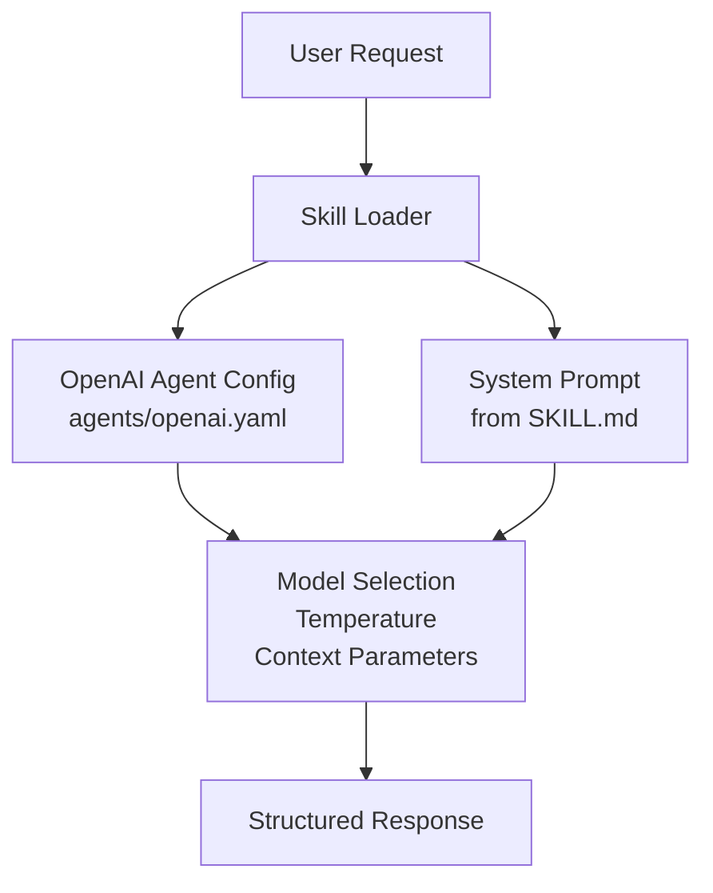
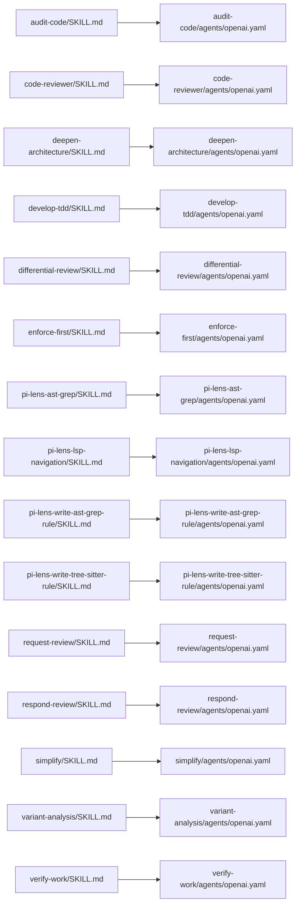

# System Prompts

<cite>
**Referenced Files in This Document**
- [README.md](file://README.md)
- [skills/audit-code/SKILL.md](file://skills/audit-code/SKILL.md)
- [skills/audit-code/agents/openai.yaml](file://skills/audit-code/agents/openai.yaml)
- [skills/code-reviewer/SKILL.md](file://skills/code-reviewer/SKILL.md)
- [skills/code-reviewer/agents/openai.yaml](file://skills/code-reviewer/agents/openai.yaml)
- [skills/deepen-architecture/SKILL.md](file://skills/deepen-architecture/SKILL.md)
- [skills/deepen-architecture/agents/openai.yaml](file://skills/deepen-architecture/agents/openai.yaml)
- [skills/develop-tdd/SKILL.md](file://skills/develop-tdd/SKILL.md)
- [skills/develop-tdd/agents/openai.yaml](file://skills/develop-tdd/agents/openai.yaml)
- [skills/differential-review/SKILL.md](file://skills/differential-review/SKILL.md)
- [skills/differential-review/agents/openai.yaml](file://skills/differential-review/agents/openai.yaml)
- [skills/enforce-first/SKILL.md](file://skills/enforce-first/SKILL.md)
- [skills/enforce-first/agents/openai.yaml](file://skills/enforce-first/agents/openai.yaml)
- [skills/pi-lens-ast-grep/SKILL.md](file://skills/pi-lens-ast-grep/SKILL.md)
- [skills/pi-lens-ast-grep/agents/openai.yaml](file://skills/pi-lens-ast-grep/agents/openai.yaml)
- [skills/pi-lens-lsp-navigation/SKILL.md](file://skills/pi-lens-lsp-navigation/SKILL.md)
- [skills/pi-lens-lsp-navigation/agents/openai.yaml](file://skills/pi-lens-lsp-navigation/agents/openai.yaml)
- [skills/pi-lens-write-ast-grep-rule/SKILL.md](file://skills/pi-lens-write-ast-grep-rule/SKILL.md)
- [skills/pi-lens-write-ast-grep-rule/agents/openai.yaml](file://skills/pi-lens-write-ast-grep-rule/agents/openai.yaml)
- [skills/pi-lens-write-tree-sitter-rule/SKILL.md](file://skills/pi-lens-write-tree-sitter-rule/SKILL.md)
- [skills/pi-lens-write-tree-sitter-rule/agents/openai.yaml](file://skills/pi-lens-write-tree-sitter-rule/agents/openai.yaml)
- [skills/request-review/SKILL.md](file://skills/request-review/SKILL.md)
- [skills/request-review/agents/openai.yaml](file://skills/request-review/agents/openai.yaml)
- [skills/respond-review/SKILL.md](file://skills/respond-review/SKILL.md)
- [skills/respond-review/agents/openai.yaml](file://skills/respond-review/agents/openai.yaml)
- [skills/simplify/SKILL.md](file://skills/simplify/SKILL.md)
- [skills/simplify/agents/openai.yaml](file://skills/simplify/agents/openai.yaml)
- [skills/variant-analysis/SKILL.md](file://skills/variant-analysis/SKILL.md)
- [skills/variant-analysis/agents/openai.yaml](file://skills/variant-analysis/agents/openai.yaml)
- [skills/verify-work/SKILL.md](file://skills/verify-work/SKILL.md)
- [skills/verify-work/agents/openai.yaml](file://skills/verify-work/agents/openai.yaml)
</cite>

## Table of Contents
1. [Introduction](#introduction)
2. [Project Structure](#project-structure)
3. [Core Components](#core-components)
4. [Architecture Overview](#architecture-overview)
5. [Detailed Component Analysis](#detailed-component-analysis)
6. [Dependency Analysis](#dependency-analysis)
7. [Performance Considerations](#performance-considerations)
8. [Troubleshooting Guide](#troubleshooting-guide)
9. [Conclusion](#conclusion)
10. [Appendices](#appendices)

## Introduction
This document explains how system prompts define AI agent behavior, constraints, and response formats within the Pi Codex Kit framework. It focuses on the YAML configuration structure for OpenAI agents (model selection, temperature settings, and context parameters), demonstrates effective prompt patterns across skill types such as code review, architecture analysis, and testing, and provides best practices for clarity, specificity, and avoiding ambiguity. It also covers strategies for versioning and testing system prompts to ensure consistent, reliable agent behavior over time.

## Project Structure
The repository organizes skills under a directory per capability. Each skill typically includes:
- A SKILL.md describing intent, scope, inputs, outputs, and usage guidance.
- An agents/openai.yaml that configures the OpenAI agent, including model, temperature, and context references.

```mermaid
graph TB
subgraph "Skills"
A["audit-code"]
B["code-reviewer"]
C["deepen-architecture"]
D["develop-tdd"]
E["differential-review"]
F["enforce-first"]
G["pi-lens-ast-grep"]
H["pi-lens-lsp-navigation"]
I["pi-lens-write-ast-grep-rule"]
J["pi-lens-write-tree-sitter-rule"]
K["request-review"]
L["respond-review"]
M["simplify"]
N["variant-analysis"]
O["verify-work"]
end
A --> Aa["SKILL.md"]
A --> Ab["agents/openai.yaml"]
B --> Ba["SKILL.md"]
B --> Bb["agents/openai.yaml"]
C --> Ca["SKILL.md"]
C --> Cb["agents/openai.yaml"]
D --> Da["SKILL.md"]
D --> Db["agents/openai.yaml"]
E --> Ea["SKILL.md"]
E --> Eb["agents/openai.yaml"]
F --> Fa["SKILL.md"]
F --> Fb["agents/openai.yaml"]
G --> Ga["SKILL.md"]
G --> Gb["agents/openai.yaml"]
H --> Ha["SKILL.md"]
H --> Hb["agents/openai.yaml"]
I --> Ia["SKILL.md"]
I --> Ib["agents/openai.yaml"]
J --> Ja["SKILL.md"]
J --> Jb["agents/openai.yaml"]
K --> Ka["SKILL.md"]
K --> Kb["agents/openai.yaml"]
L --> La["SKILL.md"]
L --> Lb["agents/openai.yaml"]
M --> Ma["SKILL.md"]
M --> Mb["agents/openai.yaml"]
N --> Na["SKILL.md"]
N --> Nb["agents/openai.yaml"]
O --> Oa["SKILL.md"]
O --> Ob["agents/openai.yaml"]
```

**Diagram sources**
- [skills/audit-code/SKILL.md](file://skills/audit-code/SKILL.md)
- [skills/audit-code/agents/openai.yaml](file://skills/audit-code/agents/openai.yaml)
- [skills/code-reviewer/SKILL.md](file://skills/code-reviewer/SKILL.md)
- [skills/code-reviewer/agents/openai.yaml](file://skills/code-reviewer/agents/openai.yaml)
- [skills/deepen-architecture/SKILL.md](file://skills/deepen-architecture/SKILL.md)
- [skills/deepen-architecture/agents/openai.yaml](file://skills/deepen-architecture/agents/openai.yaml)
- [skills/develop-tdd/SKILL.md](file://skills/develop-tdd/SKILL.md)
- [skills/develop-tdd/agents/openai.yaml](file://skills/develop-tdd/agents/openai.yaml)
- [skills/differential-review/SKILL.md](file://skills/differential-review/SKILL.md)
- [skills/differential-review/agents/openai.yaml](file://skills/differential-review/agents/openai.yaml)
- [skills/enforce-first/SKILL.md](file://skills/enforce-first/SKILL.md)
- [skills/enforce-first/agents/openai.yaml](file://skills/enforce-first/agents/openai.yaml)
- [skills/pi-lens-ast-grep/SKILL.md](file://skills/pi-lens-ast-grep/SKILL.md)
- [skills/pi-lens-ast-grep/agents/openai.yaml](file://skills/pi-lens-ast-grep/agents/openai.yaml)
- [skills/pi-lens-lsp-navigation/SKILL.md](file://skills/pi-lens-lsp-navigation/SKILL.md)
- [skills/pi-lens-lsp-navigation/agents/openai.yaml](file://skills/pi-lens-lsp-navigation/agents/openai.yaml)
- [skills/pi-lens-write-ast-grep-rule/SKILL.md](file://skills/pi-lens-write-ast-grep-rule/SKILL.md)
- [skills/pi-lens-write-ast-grep-rule/agents/openai.yaml](file://skills/pi-lens-write-ast-grep-rule/agents/openai.yaml)
- [skills/pi-lens-write-tree-sitter-rule/SKILL.md](file://skills/pi-lens-write-tree-sitter-rule/SKILL.md)
- [skills/pi-lens-write-tree-sitter-rule/agents/openai.yaml](file://skills/pi-lens-write-tree-sitter-rule/agents/openai.yaml)
- [skills/request-review/SKILL.md](file://skills/request-review/SKILL.md)
- [skills/request-review/agents/openai.yaml](file://skills/request-review/agents/openai.yaml)
- [skills/respond-review/SKILL.md](file://skills/respond-review/SKILL.md)
- [skills/respond-review/agents/openai.yaml](file://skills/respond-review/agents/openai.yaml)
- [skills/simplify/SKILL.md](file://skills/simplify/SKILL.md)
- [skills/simplify/agents/openai.yaml](file://skills/simplify/agents/openai.yaml)
- [skills/variant-analysis/SKILL.md](file://skills/variant-analysis/SKILL.md)
- [skills/variant-analysis/agents/openai.yaml](file://skills/variant-analysis/agents/openai.yaml)
- [skills/verify-work/SKILL.md](file://skills/verify-work/SKILL.md)
- [skills/verify-work/agents/openai.yaml](file://skills/verify-work/agents/openai.yaml)

**Section sources**
- [README.md](file://README.md)

## Core Components
- System Prompt Definition: The system prompt establishes the agent’s role, objectives, constraints, and expected output format. In this framework, it is typically authored alongside the SKILL.md and referenced by the OpenAI agent configuration.
- OpenAI Agent Configuration: The agents/openai.yaml file specifies runtime parameters such as model selection, temperature, and context references used when invoking the model.
- Skill Documentation: SKILL.md files describe the purpose, inputs, outputs, and workflow for each skill, providing context for the system prompt and configuration.

Key responsibilities:
- Behavior definition: Role, goals, and boundaries.
- Constraint specification: What not to do, safety rules, and compliance requirements.
- Response formatting: Structured outputs, sections, and required fields.
- Context binding: References to additional materials or tools via configuration.

**Section sources**
- [skills/audit-code/SKILL.md](file://skills/audit-code/SKILL.md)
- [skills/audit-code/agents/openai.yaml](file://skills/audit-code/agents/openai.yaml)
- [skills/code-reviewer/SKILL.md](file://skills/code-reviewer/SKILL.md)
- [skills/code-reviewer/agents/openai.yaml](file://skills/code-reviewer/SKILL.md)
- [skills/deepen-architecture/SKILL.md](file://skills/deepen-architecture/SKILL.md)
- [skills/deepen-architecture/agents/openai.yaml](file://skills/deepen-architecture/agents/openai.yaml)
- [skills/develop-tdd/SKILL.md](file://skills/develop-tdd/SKILL.md)
- [skills/develop-tdd/agents/openai.yaml](file://skills/develop-tdd/agents/openai.yaml)
- [skills/differential-review/SKILL.md](file://skills/differential-review/SKILL.md)
- [skills/differential-review/agents/openai.yaml](file://skills/differential-review/agents/openai.yaml)
- [skills/enforce-first/SKILL.md](file://skills/enforce-first/SKILL.md)
- [skills/enforce-first/agents/openai.yaml](file://skills/enforce-first/agents/openai.yaml)
- [skills/pi-lens-ast-grep/SKILL.md](file://skills/pi-lens-ast-grep/SKILL.md)
- [skills/pi-lens-ast-grep/agents/openai.yaml](file://skills/pi-lens-ast-grep/agents/openai.yaml)
- [skills/pi-lens-lsp-navigation/SKILL.md](file://skills/pi-lens-lsp-navigation/SKILL.md)
- [skills/pi-lens-lsp-navigation/agents/openai.yaml](file://skills/pi-lens-lsp-navigation/agents/openai.yaml)
- [skills/pi-lens-write-ast-grep-rule/SKILL.md](file://skills/pi-lens-write-ast-grep-rule/SKILL.md)
- [skills/pi-lens-write-ast-grep-rule/agents/openai.yaml](file://skills/pi-lens-write-ast-grep-rule/agents/openai.yaml)
- [skills/pi-lens-write-tree-sitter-rule/SKILL.md](file://skills/pi-lens-write-tree-sitter-rule/SKILL.md)
- [skills/pi-lens-write-tree-sitter-rule/agents/openai.yaml](file://skills/pi-lens-write-tree-sitter-rule/agents/openai.yaml)
- [skills/request-review/SKILL.md](file://skills/request-review/SKILL.md)
- [skills/request-review/agents/openai.yaml](file://skills/request-review/agents/openai.yaml)
- [skills/respond-review/SKILL.md](file://skills/respond-review/SKILL.md)
- [skills/respond-review/agents/openai.yaml](file://skills/respond-review/agents/openai.yaml)
- [skills/simplify/SKILL.md](file://skills/simplify/SKILL.md)
- [skills/simplify/agents/openai.yaml](file://skills/simplify/agents/openai.yaml)
- [skills/variant-analysis/SKILL.md](file://skills/variant-analysis/SKILL.md)
- [skills/variant-analysis/agents/openai.yaml](file://skills/variant-analysis/agents/openai.yaml)
- [skills/verify-work/SKILL.md](file://skills/verify-work/SKILL.md)
- [skills/verify-work/agents/openai.yaml](file://skills/verify-work/agents/openai.yaml)

## Architecture Overview
At a high level, each skill encapsulates:
- Intent and instructions (SKILL.md).
- Runtime configuration for the OpenAI agent (agents/openai.yaml).
- Optional supporting documents or resources.

[No sources needed since this diagram shows conceptual workflow, not actual code structure]

## Detailed Component Analysis

### YAML Configuration Structure for OpenAI Agents
Commonly used keys observed across skills include:
- model: Selects the target model variant.
- temperature: Controls randomness and creativity in responses.
- context: References to additional materials or tool integrations.

These keys are present in each skill’s agents/openai.yaml. Use them to tune behavior:
- Lower temperature for deterministic, structured outputs (e.g., reports).
- Higher temperature for exploratory tasks (e.g., brainstorming).
- Context parameters to bind external knowledge or tool capabilities.

Examples of where these configurations appear:
- [skills/audit-code/agents/openai.yaml](file://skills/audit-code/agents/openai.yaml)
- [skills/code-reviewer/agents/openai.yaml](file://skills/code-reviewer/agents/openai.yaml)
- [skills/deepen-architecture/agents/openai.yaml](file://skills/deepen-architecture/agents/openai.yaml)
- [skills/develop-tdd/agents/openai.yaml](file://skills/develop-tdd/agents/openai.yaml)
- [skills/differential-review/agents/openai.yaml](file://skills/differential-review/agents/openai.yaml)
- [skills/enforce-first/agents/openai.yaml](file://skills/enforce-first/agents/openai.yaml)
- [skills/pi-lens-ast-grep/agents/openai.yaml](file://skills/pi-lens-ast-grep/agents/openai.yaml)
- [skills/pi-lens-lsp-navigation/agents/openai.yaml](file://skills/pi-lens-lsp-navigation/agents/openai.yaml)
- [skills/pi-lens-write-ast-grep-rule/agents/openai.yaml](file://skills/pi-lens-write-ast-grep-rule/agents/openai.yaml)
- [skills/pi-lens-write-tree-sitter-rule/agents/openai.yaml](file://skills/pi-lens-write-tree-sitter-rule/agents/openai.yaml)
- [skills/request-review/agents/openai.yaml](file://skills/request-review/agents/openai.yaml)
- [skills/respond-review/agents/openai.yaml](file://skills/respond-review/agents/openai.yaml)
- [skills/simplify/agents/openai.yaml](file://skills/simplify/agents/openai.yaml)
- [skills/variant-analysis/agents/openai.yaml](file://skills/variant-analysis/agents/openai.yaml)
- [skills/verify-work/agents/openai.yaml](file://skills/verify-work/agents/openai.yaml)

**Section sources**
- [skills/audit-code/agents/openai.yaml](file://skills/audit-code/agents/openai.yaml)
- [skills/code-reviewer/agents/openai.yaml](file://skills/code-reviewer/agents/openai.yaml)
- [skills/deepen-architecture/agents/openai.yaml](file://skills/deepen-architecture/agents/openai.yaml)
- [skills/develop-tdd/agents/openai.yaml](file://skills/develop-tdd/agents/openai.yaml)
- [skills/differential-review/agents/openai.yaml](file://skills/differential-review/agents/openai.yaml)
- [skills/enforce-first/agents/openai.yaml](file://skills/enforce-first/agents/openai.yaml)
- [skills/pi-lens-ast-grep/agents/openai.yaml](file://skills/pi-lens-ast-grep/agents/openai.yaml)
- [skills/pi-lens-lsp-navigation/agents/openai.yaml](file://skills/pi-lens-lsp-navigation/agents/openai.yaml)
- [skills/pi-lens-write-ast-grep-rule/agents/openai.yaml](file://skills/pi-lens-write-ast-grep-rule/agents/openai.yaml)
- [skills/pi-lens-write-tree-sitter-rule/agents/openai.yaml](file://skills/pi-lens-write-tree-sitter-rule/agents/openai.yaml)
- [skills/request-review/agents/openai.yaml](file://skills/request-review/agents/openai.yaml)
- [skills/respond-review/agents/openai.yaml](file://skills/respond-review/agents/openai.yaml)
- [skills/simplify/agents/openai.yaml](file://skills/simplify/agents/openai.yaml)
- [skills/variant-analysis/agents/openai.yaml](file://skills/variant-analysis/agents/openai.yaml)
- [skills/verify-work/agents/openai.yaml](file://skills/verify-work/agents/openai.yaml)

### Effective System Prompt Patterns by Skill Type

#### Code Review
- Role and Scope: Define reviewer persona, focus areas, and standards.
- Constraints: Emphasize constructive feedback, severity levels, and actionable suggestions.
- Response Format: Require structured sections (e.g., issues, rationale, suggested fixes).
- Examples:
  - [skills/code-reviewer/SKILL.md](file://skills/code-reviewer/SKILL.md)
  - [skills/audit-code/SKILL.md](file://skills/audit-code/SKILL.md)
  - [skills/differential-review/SKILL.md](file://skills/differential-review/SKILL.md)

**Section sources**
- [skills/code-reviewer/SKILL.md](file://skills/code-reviewer/SKILL.md)
- [skills/audit-code/SKILL.md](file://skills/audit-code/SKILL.md)
- [skills/differential-review/SKILL.md](file://skills/differential-review/SKILL.md)

#### Architecture Analysis
- Role and Scope: Architectural reviewer focusing on design principles, trade-offs, and scalability.
- Constraints: Encourage evidence-based reasoning and reference established patterns.
- Response Format: Sections for findings, risks, recommendations, and diagrams if applicable.
- Example:
  - [skills/deepen-architecture/SKILL.md](file://skills/deepen-architecture/SKILL.md)

**Section sources**
- [skills/deepen-architecture/SKILL.md](file://skills/deepen-architecture/SKILL.md)

#### Testing (TDD)
- Role and Scope: Test-driven development assistant guiding test creation and validation.
- Constraints: Prioritize coverage, edge cases, and maintainability.
- Response Format: Step-by-step plan, test scenarios, and verification criteria.
- Example:
  - [skills/develop-tdd/SKILL.md](file://skills/develop-tdd/SKILL.md)

**Section sources**
- [skills/develop-tdd/SKILL.md](file://skills/develop-tdd/SKILL.md)

#### Variant Analysis
- Role and Scope: Security-focused analysis using rule sets and methodologies.
- Constraints: Evidence-backed claims, reproducible steps, and clear reporting.
- Response Format: Findings with severity, affected artifacts, and remediation guidance.
- Example:
  - [skills/variant-analysis/SKILL.md](file://skills/variant-analysis/SKILL.md)

**Section sources**
- [skills/variant-analysis/SKILL.md](file://skills/variant-analysis/SKILL.md)

#### Simplification and Refactoring
- Role and Scope: Identify opportunities to reduce complexity while preserving behavior.
- Constraints: Maintain correctness, avoid breaking changes, and document rationale.
- Response Format: Before/after comparisons, change summary, and risk assessment.
- Example:
  - [skills/simplify/SKILL.md](file://skills/simplify/SKILL.md)

**Section sources**
- [skills/simplify/SKILL.md](file://skills/simplify/SKILL.md)

#### Tool Integration Skills (AST-Grep, LSP Navigation, Tree-Sitter Rules)
- Role and Scope: Assist with writing and applying AST-Grep rules, navigating codebases via LSP, and authoring Tree-Sitter rules.
- Constraints: Provide precise examples, validate syntax, and explain matching logic.
- Response Format: Rule snippets, explanations, and test cases.
- Examples:
  - [skills/pi-lens-ast-grep/SKILL.md](file://skills/pi-lens-ast-grep/SKILL.md)
  - [skills/pi-lens-lsp-navigation/SKILL.md](file://skills/pi-lens-lsp-navigation/SKILL.md)
  - [skills/pi-lens-write-ast-grep-rule/SKILL.md](file://skills/pi-lens-write-ast-grep-rule/SKILL.md)
  - [skills/pi-lens-write-tree-sitter-rule/SKILL.md](file://skills/pi-lens-write-tree-sitter-rule/SKILL.md)

**Section sources**
- [skills/pi-lens-ast-grep/SKILL.md](file://skills/pi-lens-ast-grep/SKILL.md)
- [skills/pi-lens-lsp-navigation/SKILL.md](file://skills/pi-lens-lsp-navigation/SKILL.md)
- [skills/pi-lens-write-ast-grep-rule/SKILL.md](file://skills/pi-lens-write-ast-grep-rule/SKILL.md)
- [skills/pi-lens-write-tree-sitter-rule/SKILL.md](file://skills/pi-lens-write-tree-sitter-rule/SKILL.md)

#### Workflow and Collaboration Skills (Request/Respond Review, Enforce First, Verify Work)
- Role and Scope: Orchestrate review workflows, enforce policies, and verify outcomes.
- Constraints: Clear handoffs, auditability, and traceability.
- Response Format: Status updates, action items, and verification results.
- Examples:
  - [skills/request-review/SKILL.md](file://skills/request-review/SKILL.md)
  - [skills/respond-review/SKILL.md](file://skills/respond-review/SKILL.md)
  - [skills/enforce-first/SKILL.md](file://skills/enforce-first/SKILL.md)
  - [skills/verify-work/SKILL.md](file://skills/verify-work/SKILL.md)

**Section sources**
- [skills/request-review/SKILL.md](file://skills/request-review/SKILL.md)
- [skills/respond-review/SKILL.md](file://skills/respond-review/SKILL.md)
- [skills/enforce-first/SKILL.md](file://skills/enforce-first/SKILL.md)
- [skills/verify-work/SKILL.md](file://skills/verify-work/SKILL.md)

### Best Practices for Prompt Clarity, Specificity, and Avoiding Ambiguity
- Define explicit roles and scope boundaries.
- Specify input expectations and output schemas.
- Enumerate constraints and non-goals.
- Provide examples of desired outputs.
- Use consistent terminology and avoid vague adjectives.
- Separate concerns: keep system prompts focused; move detailed references into context parameters.

[No sources needed since this section provides general guidance]

### Prompt Versioning Strategies
- Semantic versioning for prompts: Treat prompts like code—use major/minor/patch versions aligned with behavioral changes.
- Change logs: Record modifications, rationale, and impact assessments.
- Branching and PR reviews: Apply standard code review processes to prompt changes.
- Rollback plans: Keep prior versions accessible for quick recovery.

[No sources needed since this section provides general guidance]

### Testing Approaches for System Prompts
- Unit-style tests: Validate outputs against expected structures and content checks.
- Regression suites: Re-run historical prompts on stable datasets to detect drift.
- A/B comparisons: Compare variants side-by-side for quality metrics.
- Human-in-the-loop evaluation: Periodic expert reviews for nuanced judgments.
- Automated linting: Check for forbidden phrases, missing sections, or schema violations.

[No sources needed since this section provides general guidance]

## Dependency Analysis
Each skill depends on:
- Its SKILL.md for intent and instructions.
- Its agents/openai.yaml for runtime configuration.

**Diagram sources**
- [skills/audit-code/SKILL.md](file://skills/audit-code/SKILL.md)
- [skills/audit-code/agents/openai.yaml](file://skills/audit-code/agents/openai.yaml)
- [skills/code-reviewer/SKILL.md](file://skills/code-reviewer/SKILL.md)
- [skills/code-reviewer/agents/openai.yaml](file://skills/code-reviewer/agents/openai.yaml)
- [skills/deepen-architecture/SKILL.md](file://skills/deepen-architecture/SKILL.md)
- [skills/deepen-architecture/agents/openai.yaml](file://skills/deepen-architecture/agents/openai.yaml)
- [skills/develop-tdd/SKILL.md](file://skills/develop-tdd/SKILL.md)
- [skills/develop-tdd/agents/openai.yaml](file://skills/develop-tdd/agents/openai.yaml)
- [skills/differential-review/SKILL.md](file://skills/differential-review/SKILL.md)
- [skills/differential-review/agents/openai.yaml](file://skills/differential-review/agents/openai.yaml)
- [skills/enforce-first/SKILL.md](file://skills/enforce-first/SKILL.md)
- [skills/enforce-first/agents/openai.yaml](file://skills/enforce-first/agents/openai.yaml)
- [skills/pi-lens-ast-grep/SKILL.md](file://skills/pi-lens-ast-grep/SKILL.md)
- [skills/pi-lens-ast-grep/agents/openai.yaml](file://skills/pi-lens-ast-grep/agents/openai.yaml)
- [skills/pi-lens-lsp-navigation/SKILL.md](file://skills/pi-lens-lsp-navigation/SKILL.md)
- [skills/pi-lens-lsp-navigation/agents/openai.yaml](file://skills/pi-lens-lsp-navigation/agents/openai.yaml)
- [skills/pi-lens-write-ast-grep-rule/SKILL.md](file://skills/pi-lens-write-ast-grep-rule/SKILL.md)
- [skills/pi-lens-write-ast-grep-rule/agents/openai.yaml](file://skills/pi-lens-write-ast-grep-rule/agents/openai.yaml)
- [skills/pi-lens-write-tree-sitter-rule/SKILL.md](file://skills/pi-lens-write-tree-sitter-rule/SKILL.md)
- [skills/pi-lens-write-tree-sitter-rule/agents/openai.yaml](file://skills/pi-lens-write-tree-sitter-rule/agents/openai.yaml)
- [skills/request-review/SKILL.md](file://skills/request-review/SKILL.md)
- [skills/request-review/agents/openai.yaml](file://skills/request-review/agents/openai.yaml)
- [skills/respond-review/SKILL.md](file://skills/respond-review/SKILL.md)
- [skills/respond-review/agents/openai.yaml](file://skills/respond-review/agents/openai.yaml)
- [skills/simplify/SKILL.md](file://skills/simplify/SKILL.md)
- [skills/simplify/agents/openai.yaml](file://skills/simplify/agents/openai.yaml)
- [skills/variant-analysis/SKILL.md](file://skills/variant-analysis/SKILL.md)
- [skills/variant-analysis/agents/openai.yaml](file://skills/variant-analysis/agents/openai.yaml)
- [skills/verify-work/SKILL.md](file://skills/verify-work/SKILL.md)
- [skills/verify-work/agents/openai.yaml](file://skills/verify-work/agents/openai.yaml)

**Section sources**
- [skills/audit-code/SKILL.md](file://skills/audit-code/SKILL.md)
- [skills/audit-code/agents/openai.yaml](file://skills/audit-code/agents/openai.yaml)
- [skills/code-reviewer/SKILL.md](file://skills/code-reviewer/SKILL.md)
- [skills/code-reviewer/agents/openai.yaml](file://skills/code-reviewer/agents/openai.yaml)
- [skills/deepen-architecture/SKILL.md](file://skills/deepen-architecture/SKILL.md)
- [skills/deepen-architecture/agents/openai.yaml](file://skills/deepen-architecture/agents/openai.yaml)
- [skills/develop-tdd/SKILL.md](file://skills/develop-tdd/SKILL.md)
- [skills/develop-tdd/agents/openai.yaml](file://skills/develop-tdd/agents/openai.yaml)
- [skills/differential-review/SKILL.md](file://skills/differential-review/SKILL.md)
- [skills/differential-review/agents/openai.yaml](file://skills/differential-review/agents/openai.yaml)
- [skills/enforce-first/SKILL.md](file://skills/enforce-first/SKILL.md)
- [skills/enforce-first/agents/openai.yaml](file://skills/enforce-first/agents/openai.yaml)
- [skills/pi-lens-ast-grep/SKILL.md](file://skills/pi-lens-ast-grep/SKILL.md)
- [skills/pi-lens-ast-grep/agents/openai.yaml](file://skills/pi-lens-ast-grep/agents/openai.yaml)
- [skills/pi-lens-lsp-navigation/SKILL.md](file://skills/pi-lens-lsp-navigation/SKILL.md)
- [skills/pi-lens-lsp-navigation/agents/openai.yaml](file://skills/pi-lens-lsp-navigation/agents/openai.yaml)
- [skills/pi-lens-write-ast-grep-rule/SKILL.md](file://skills/pi-lens-write-ast-grep-rule/SKILL.md)
- [skills/pi-lens-write-ast-grep-rule/agents/openai.yaml](file://skills/pi-lens-write-ast-grep-rule/agents/openai.yaml)
- [skills/pi-lens-write-tree-sitter-rule/SKILL.md](file://skills/pi-lens-write-tree-sitter-rule/SKILL.md)
- [skills/pi-lens-write-tree-sitter-rule/agents/openai.yaml](file://skills/pi-lens-write-tree-sitter-rule/agents/openai.yaml)
- [skills/request-review/SKILL.md](file://skills/request-review/SKILL.md)
- [skills/request-review/agents/openai.yaml](file://skills/request-review/agents/openai.yaml)
- [skills/respond-review/SKILL.md](file://skills/respond-review/SKILL.md)
- [skills/respond-review/agents/openai.yaml](file://skills/respond-review/agents/openai.yaml)
- [skills/simplify/SKILL.md](file://skills/simplify/SKILL.md)
- [skills/simplify/agents/openai.yaml](file://skills/simplify/agents/openai.yaml)
- [skills/variant-analysis/SKILL.md](file://skills/variant-analysis/SKILL.md)
- [skills/variant-analysis/agents/openai.yaml](file://skills/variant-analysis/agents/openai.yaml)
- [skills/verify-work/SKILL.md](file://skills/verify-work/SKILL.md)
- [skills/verify-work/agents/openai.yaml](file://skills/verify-work/agents/openai.yaml)

## Performance Considerations
- Temperature tuning: Lower values improve consistency for structured outputs; higher values aid creative exploration.
- Context size management: Keep context concise and relevant to reduce latency and cost.
- Model selection: Choose models based on task complexity and budget constraints.
- Batch processing: Group similar requests to optimize throughput.

[No sources needed since this section provides general guidance]

## Troubleshooting Guide
- Symptom: Unstructured or inconsistent outputs.
  - Action: Strengthen response format specifications in the system prompt and validate via automated checks.
- Symptom: Overly verbose or off-topic responses.
  - Action: Tighten constraints and scope definitions; remove ambiguous language.
- Symptom: High variability between runs.
  - Action: Reduce temperature; add deterministic elements (e.g., enumerated options).
- Symptom: Missing required sections in outputs.
  - Action: Add explicit field requirements and run post-processing validators.

[No sources needed since this section provides general guidance]

## Conclusion
System prompts in the Pi Codex Kit framework are central to defining agent behavior, constraints, and output formats. By pairing well-crafted prompts with precise OpenAI agent configurations, teams can achieve reliable, repeatable, and high-quality results across diverse skills. Adopting versioning and testing practices ensures long-term stability and continuous improvement.

[No sources needed since this section summarizes without analyzing specific files]

## Appendices

### Appendix A: YAML Keys Reference
- model: Specifies the target model variant.
- temperature: Controls randomness and creativity.
- context: Binds additional materials or tool integrations.

**Section sources**
- [skills/audit-code/agents/openai.yaml](file://skills/audit-code/agents/openai.yaml)
- [skills/code-reviewer/agents/openai.yaml](file://skills/code-reviewer/agents/openai.yaml)
- [skills/deepen-architecture/agents/openai.yaml](file://skills/deepen-architecture/agents/openai.yaml)
- [skills/develop-tdd/agents/openai.yaml](file://skills/develop-tdd/agents/openai.yaml)
- [skills/differential-review/agents/openai.yaml](file://skills/differential-review/agents/openai.yaml)
- [skills/enforce-first/agents/openai.yaml](file://skills/enforce-first/agents/openai.yaml)
- [skills/pi-lens-ast-grep/agents/openai.yaml](file://skills/pi-lens-ast-grep/agents/openai.yaml)
- [skills/pi-lens-lsp-navigation/agents/openai.yaml](file://skills/pi-lens-lsp-navigation/agents/openai.yaml)
- [skills/pi-lens-write-ast-grep-rule/agents/openai.yaml](file://skills/pi-lens-write-ast-grep-rule/agents/openai.yaml)
- [skills/pi-lens-write-tree-sitter-rule/agents/openai.yaml](file://skills/pi-lens-write-tree-sitter-rule/agents/openai.yaml)
- [skills/request-review/agents/openai.yaml](file://skills/request-review/agents/openai.yaml)
- [skills/respond-review/agents/openai.yaml](file://skills/respond-review/agents/openai.yaml)
- [skills/simplify/agents/openai.yaml](file://skills/simplify/agents/openai.yaml)
- [skills/variant-analysis/agents/openai.yaml](file://skills/variant-analysis/agents/openai.yaml)
- [skills/verify-work/agents/openai.yaml](file://skills/verify-work/agents/openai.yaml)