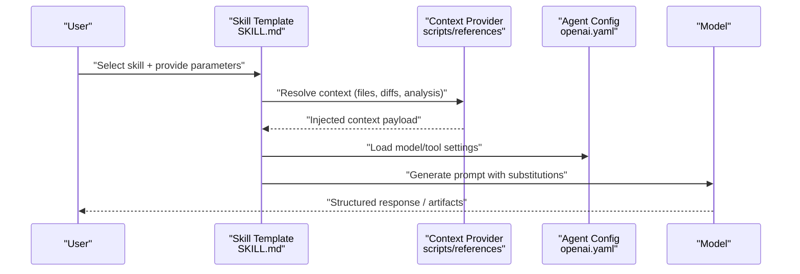
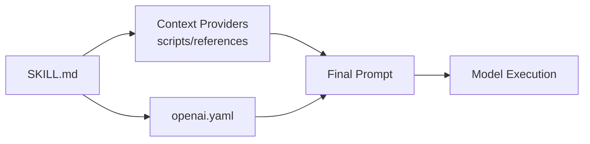
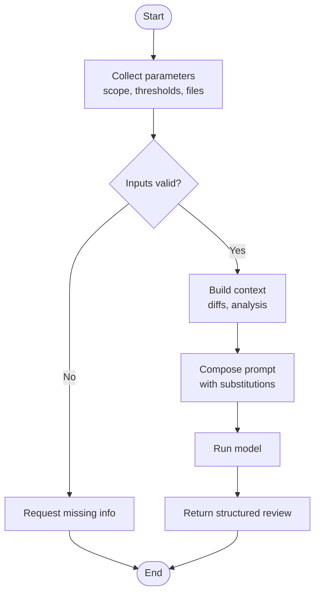
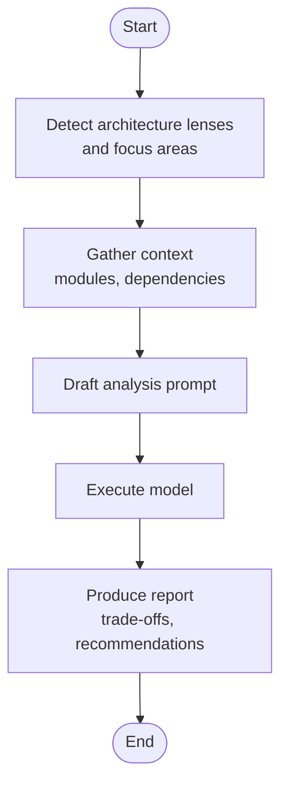
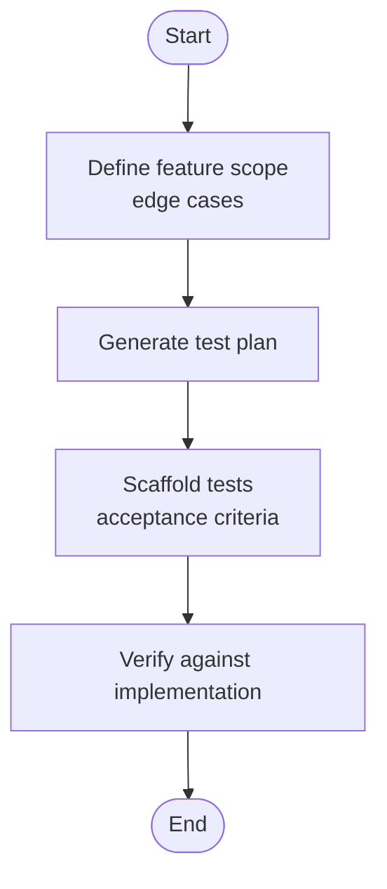

# User Prompts

<cite>
**Referenced Files in This Document**
- [README.md](file://README.md)
- [skills/README.md](file://skills/README.md)
- [skills/code-reviewer/SKILL.md](file://skills/code-reviewer/SKILL.md)
- [skills/deepen-architecture/SKILL.md](file://skills/deepen-architecture/SKILL.md)
- [skills/differential-review/SKILL.md](file://skills/differential-review/SKILL.md)
- [skills/develop-tdd/SKILL.md](file://skills/develop-tdd/SKILL.md)
- [skills/simplify/SKILL.md](file://skills/simplify/SKILL.md)
- [skills/simplify/scripts/simplify-context.mjs](file://skills/simplify/scripts/simplify-context.mjs)
- [skills/variant-analysis/SKILL.md](file://skills/variant-analysis/SKILL.md)
- [skills/audit-code/SKILL.md](file://skills/audit-code/SKILL.md)
- [skills/enforce-first/SKILL.md](file://skills/enforce-first/SKILL.md)
- [skills/fp-check/SKILL.md](file://skills/fp-check/SKILL.md)
- [skills/pi-lens-ast-grep/SKILL.md](file://skills/pi-lens-ast-grep/SKILL.md)
- [skills/pi-lens-lsp-navigation/SKILL.md](file://skills/pi-lens-lsp-navigation/SKILL.md)
- [skills/pi-lens-write-ast-grep-rule/SKILL.md](file://skills/pi-lens-write-ast-grep-rule/SKILL.md)
- [skills/pi-lens-write-tree-sitter-rule/SKILL.md](file://skills/pi-lens-write-tree-sitter-rule/SKILL.md)
- [skills/request-review/SKILL.md](file://skills/request-review/SKILL.md)
- [skills/respond-review/SKILL.md](file://skills/respond-review/SKILL.md)
- [skills/verify-work/SKILL.md](file://skills/verify-work/SKILL.md)
</cite>

## Table of Contents
1. [Introduction](#introduction)
2. [Project Structure](#project-structure)
3. [Core Components](#core-components)
4. [Architecture Overview](#architecture-overview)
5. [Detailed Component Analysis](#detailed-component-analysis)
6. [Dependency Analysis](#dependency-analysis)
7. [Performance Considerations](#performance-considerations)
8. [Troubleshooting Guide](#troubleshooting-guide)
9. [Conclusion](#conclusion)
10. [Appendices](#appendices)

## Introduction
This document explains how user prompts are engineered within the framework using SKILL.md templates. It covers parameter substitution, context injection, dynamic prompt generation from code analysis results and file contexts, structured prompt templates for common scenarios (code review, architecture analysis, testing), prompt chaining, conditional logic, and error handling strategies. The goal is to help authors create reliable, reusable, and maintainable prompts that adapt to real-world inputs while preserving clarity and safety.

## Project Structure
The repository organizes domain-specific capabilities as “skills.” Each skill typically includes:
- A SKILL.md template describing the user-facing prompt behavior and parameters
- An agents/openai.yaml configuration defining model settings and tool usage
- Optional supporting files such as methodology references, scripts, or resources

```mermaid
graph TB
subgraph "Skills"
CR["code-reviewer/SKILL.md"]
DA["deepen-architecture/SKILL.md"]
DR["differential-review/SKILL.md"]
TDD["develop-tdd/SKILL.md"]
SIM["simplify/SKILL.md"]
VA["variant-analysis/SKILL.md"]
AC["audit-code/SKILL.md"]
EF["enforce-first/SKILL.md"]
FP["fp-check/SKILL.md"]
LSP["pi-lens-lsp-navigation/SKILL.md"]
ASTG["pi-lens-ast-grep/SKILL.md"]
WAGR["pi-lens-write-ast-grep-rule/SKILL.md"]
WTST["pi-lens-write-tree-sitter-rule/SKILL.md"]
RR["request-review/SKILL.md"]
RSR["respond-review/SKILL.md"]
VW["verify-work/SKILL.md"]
end
subgraph "Support"
SR["simplify/scripts/simplify-context.mjs"]
AG["*/agents/openai.yaml"]
end
CR --> AG
DA --> AG
DR --> AG
TDD --> AG
SIM --> AG
VA --> AG
AC --> AG
EF --> AG
FP --> AG
LSP --> AG
ASTG --> AG
WAGR --> AG
WTST --> AG
RR --> AG
RSR --> AG
VW --> AG
SIM --> SR
```

**Diagram sources**
- [skills/code-reviewer/SKILL.md](file://skills/code-reviewer/SKILL.md)
- [skills/deepen-architecture/SKILL.md](file://skills/deepen-architecture/SKILL.md)
- [skills/differential-review/SKILL.md](file://skills/differential-review/SKILL.md)
- [skills/develop-tdd/SKILL.md](file://skills/develop-tdd/SKILL.md)
- [skills/simplify/SKILL.md](file://skills/simplify/SKILL.md)
- [skills/simplify/scripts/simplify-context.mjs](file://skills/simplify/scripts/simplify-context.mjs)
- [skills/variant-analysis/SKILL.md](file://skills/variant-analysis/SKILL.md)
- [skills/audit-code/SKILL.md](file://skills/audit-code/SKILL.md)
- [skills/enforce-first/SKILL.md](file://skills/enforce-first/SKILL.md)
- [skills/fp-check/SKILL.md](file://skills/fp-check/SKILL.md)
- [skills/pi-lens-lsp-navigation/SKILL.md](file://skills/pi-lens-lsp-navigation/SKILL.md)
- [skills/pi-lens-ast-grep/SKILL.md](file://skills/pi-lens-ast-grep/SKILL.md)
- [skills/pi-lens-write-ast-grep-rule/SKILL.md](file://skills/pi-lens-write-ast-grep-rule/SKILL.md)
- [skills/pi-lens-write-tree-sitter-rule/SKILL.md](file://skills/pi-lens-write-tree-sitter-rule/SKILL.md)
- [skills/request-review/SKILL.md](file://skills/request-review/SKILL.md)
- [skills/respond-review/SKILL.md](file://skills/respond-review/SKILL.md)
- [skills/verify-work/SKILL.md](file://skills/verify-work/SKILL.md)

**Section sources**
- [skills/README.md](file://skills/README.md)

## Core Components
- SKILL.md templates: Author-defined prompt blueprints that describe goals, inputs, constraints, outputs, and optional steps. They act as the primary interface between users and AI agents.
- Agent configurations: Per-skill agent definitions (e.g., openai.yaml) that bind models, tools, and runtime options to a SKILL.md.
- Context providers: Scripts and references that enrich prompts with code analysis results, file contents, diffs, and environment metadata.
- Supporting references: Methodology documents, patterns, evidence templates, and report formats used to shape prompt content and output structure.

Key responsibilities:
- Parameterization: Define clear input variables (e.g., target paths, scopes, thresholds).
- Context injection: Attach relevant code artifacts, diffs, and analysis summaries into prompts.
- Dynamic generation: Compose prompts at runtime based on detected language features, repository structure, and prior analysis results.
- Chaining and conditionals: Orchestrate multi-step workflows where one step’s output becomes another step’s input, with branching based on conditions.
- Error handling: Provide fallbacks, validation messages, and recovery instructions when inputs are missing or analysis fails.

**Section sources**
- [skills/simplify/SKILL.md](file://skills/simplify/SKILL.md)
- [skills/simplify/scripts/simplify-context.mjs](file://skills/simplify/scripts/simplify-context.mjs)
- [skills/differential-review/SKILL.md](file://skills/differential-review/SKILL.md)
- [skills/variant-analysis/SKILL.md](file://skills/variant-analysis/SKILL.md)

## Architecture Overview
The prompt engineering pipeline connects user intent to model execution through templated SKILL.md prompts, enriched by contextual data and controlled by agent configurations.

**Diagram sources**
- [skills/simplify/SKILL.md](file://skills/simplify/SKILL.md)
- [skills/simplify/scripts/simplify-context.mjs](file://skills/simplify/scripts/simplify-context.mjs)
- [skills/code-reviewer/SKILL.md](file://skills/code-reviewer/SKILL.md)
- [skills/deepen-architecture/SKILL.md](file://skills/deepen-architecture/SKILL.md)

## Detailed Component Analysis

### Prompt Templates and Parameter Substitution
- Purpose: Standardize how user inputs map into prompts via named parameters and placeholders.
- Typical parameters:
  - Target scope (paths, modules, languages)
  - Focus areas (security, performance, readability)
  - Output format (summary, checklist, diff annotations)
  - Constraints (max length, depth of traversal)
- Substitution strategy:
  - Replace placeholders with validated values before sending to the model.
  - Sanitize and truncate large inputs to fit model limits.
  - Provide defaults for optional parameters to reduce friction.

Best practices:
- Keep parameter names stable across versions.
- Validate required fields early and return actionable errors.
- Use explicit sections in templates to separate instructions, context, and expected output.

**Section sources**
- [skills/code-reviewer/SKILL.md](file://skills/code-reviewer/SKILL.md)
- [skills/audit-code/SKILL.md](file://skills/audit-code/SKILL.md)
- [skills/enforce-first/SKILL.md](file://skills/enforce-first/SKILL.md)

### Context Injection Mechanisms
- Sources:
  - File contents and diffs
  - Code analysis results (AST grep rules, tree-sitter queries)
  - LSP navigation data (symbol usages, call graphs)
  - Reference materials (methodologies, patterns, evidence templates)
- Injection points:
  - Pre-prompt preamble for background
  - In-line context blocks for specific tasks
  - Post-processing notes for follow-up actions
- Safety:
  - Filter sensitive data
  - Limit size and relevance
  - Tag provenance for traceability

Example integration point:
- A script prepares a concise context payload that is embedded into the final prompt just before model invocation.

**Section sources**
- [skills/simplify/scripts/simplify-context.mjs](file://skills/simplify/scripts/simplify-context.mjs)
- [skills/pi-lens-ast-grep/SKILL.md](file://skills/pi-lens-ast-grep/SKILL.md)
- [skills/pi-lens-write-ast-grep-rule/SKILL.md](file://skills/pi-lens-write-ast-grep-rule/SKILL.md)
- [skills/pi-lens-write-tree-sitter-rule/SKILL.md](file://skills/pi-lens-write-tree-sitter-rule/SKILL.md)
- [skills/pi-lens-lsp-navigation/SKILL.md](file://skills/pi-lens-lsp-navigation/SKILL.md)

### Dynamic Prompt Generation Based on Analysis Results
- Inputs:
  - Language detection and feature flags
  - Repository structure and dependency graph hints
  - Prior analysis outputs (findings, metrics, gaps)
- Logic:
  - Choose relevant sections of the template based on detected concerns
  - Inject targeted examples and constraints derived from findings
  - Adjust verbosity and depth according to complexity signals

Outcome:
- Tailored prompts that focus on high-value areas without overwhelming the model.

**Section sources**
- [skills/differential-review/SKILL.md](file://skills/differential-review/SKILL.md)
- [skills/variant-analysis/SKILL.md](file://skills/variant-analysis/SKILL.md)

### Structured Prompt Templates for Common Scenarios

#### Code Review Requests
- Goals: Identify risks, suggest improvements, validate adherence to standards.
- Parameters: Scope, severity thresholds, style guides, affected files.
- Context: Diff highlights, recent changes, known hotspots.
- Output: Actionable items, prioritized list, references to guidelines.

**Section sources**
- [skills/code-reviewer/SKILL.md](file://skills/code-reviewer/SKILL.md)
- [skills/differential-review/SKILL.md](file://skills/differential-review/SKILL.md)

#### Architecture Analysis Queries
- Goals: Understand design, identify coupling, assess scalability and security posture.
- Parameters: Architectural lenses (layers, boundaries, data flow), risk domains.
- Context: Module map, key interfaces, external dependencies.
- Output: Diagrammatic descriptions, trade-offs, recommended refactors.

**Section sources**
- [skills/deepen-architecture/SKILL.md](file://skills/deepen-architecture/SKILL.md)

#### Testing Instructions (TDD)
- Goals: Generate test plans, scaffold tests, define acceptance criteria.
- Parameters: Feature scope, edge cases, coverage targets, frameworks.
- Context: Implementation snippets, failing specs, historical defects.
- Output: Test matrix, example cases, verification steps.

**Section sources**
- [skills/develop-tdd/SKILL.md](file://skills/develop-tdd/SKILL.md)

### Prompt Chaining and Conditional Logic
- Chaining:
  - Step 1: Discover and summarize changes or architecture.
  - Step 2: Generate focused review or analysis based on summary.
  - Step 3: Produce reports, checklists, or remediation plans.
- Conditionals:
  - If no changes detected, skip heavy analysis and provide status.
  - If critical findings exist, escalate to detailed reporting and mitigation steps.
  - If context is insufficient, request additional inputs or narrow scope.

Implementation tips:
- Pass structured intermediate outputs between steps.
- Use deterministic gates (e.g., presence of findings) to branch flows.
- Preserve provenance links so each step can be audited.

**Section sources**
- [skills/differential-review/SKILL.md](file://skills/differential-review/SKILL.md)
- [skills/variant-analysis/SKILL.md](file://skills/variant-analysis/SKILL.md)

### Error Handling in User Prompts
- Validation:
  - Check required parameters and file existence.
  - Reject ambiguous scopes and ask for clarification.
- Fallbacks:
  - Reduce scope automatically if too broad.
  - Provide minimal viable prompt when context is partial.
- Recovery:
  - Offer next best actions and links to references.
  - Log failures with enough detail to reproduce.

**Section sources**
- [skills/simplify/SKILL.md](file://skills/simplify/SKILL.md)
- [skills/simplify/scripts/simplify-context.mjs](file://skills/simplify/scripts/simplify-context.mjs)

## Dependency Analysis
Prompt composition depends on:
- Skill templates (SKILL.md) for instruction sets and output contracts
- Agent configs (openai.yaml) for model selection and tool bindings
- Context providers (scripts and references) for dynamic enrichment
- Supporting methodologies and templates for consistent outputs

**Diagram sources**
- [skills/simplify/SKILL.md](file://skills/simplify/SKILL.md)
- [skills/simplify/scripts/simplify-context.mjs](file://skills/simplify/scripts/simplify-context.mjs)
- [skills/code-reviewer/SKILL.md](file://skills/code-reviewer/SKILL.md)

**Section sources**
- [skills/README.md](file://skills/README.md)

## Performance Considerations
- Minimize injected context size; prefer summaries and targeted excerpts.
- Cache reusable context payloads (e.g., module maps) to avoid recomputation.
- Use progressive disclosure: start with high-level prompts, drill down only when needed.
- Batch related operations to reduce round-trips and token overhead.
- Prefer deterministic pre-processing over verbose instructions to the model.

[No sources needed since this section provides general guidance]

## Troubleshooting Guide
Common issues and resolutions:
- Missing parameters: Ensure all required fields are provided; use defaults where safe.
- Excessive context: Truncate or summarize large inputs; split into multiple steps.
- Ambiguous scope: Ask for precise paths or modules; auto-narrow when possible.
- Tool/model misconfiguration: Verify agent config matches intended capabilities.
- Inconsistent outputs: Align templates with reference methodologies and evidence templates.

**Section sources**
- [skills/simplify/SKILL.md](file://skills/simplify/SKILL.md)
- [skills/simplify/scripts/simplify-context.mjs](file://skills/simplify/scripts/simplify-context.mjs)

## Conclusion
By treating SKILL.md as the single source of truth for user interactions, and by combining robust parameterization, careful context injection, and dynamic generation, the framework enables precise, repeatable, and scalable prompt engineering. Chaining and conditionals allow complex workflows to remain simple for users, while strong error handling ensures reliability under varying inputs and environments.

[No sources needed since this section summarizes without analyzing specific files]

## Appendices

### Example Scenario Flows

#### Code Review Flow

**Diagram sources**
- [skills/code-reviewer/SKILL.md](file://skills/code-reviewer/SKILL.md)
- [skills/differential-review/SKILL.md](file://skills/differential-review/SKILL.md)

#### Architecture Analysis Flow

**Diagram sources**
- [skills/deepen-architecture/SKILL.md](file://skills/deepen-architecture/SKILL.md)

#### Testing (TDD) Flow

**Diagram sources**
- [skills/develop-tdd/SKILL.md](file://skills/develop-tdd/SKILL.md)