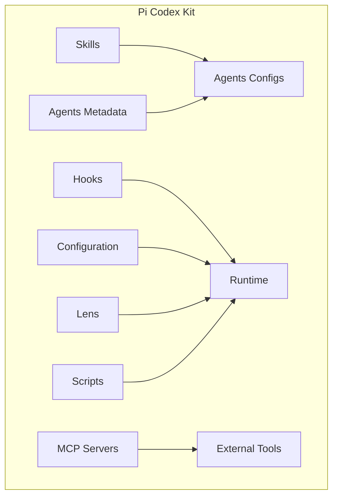
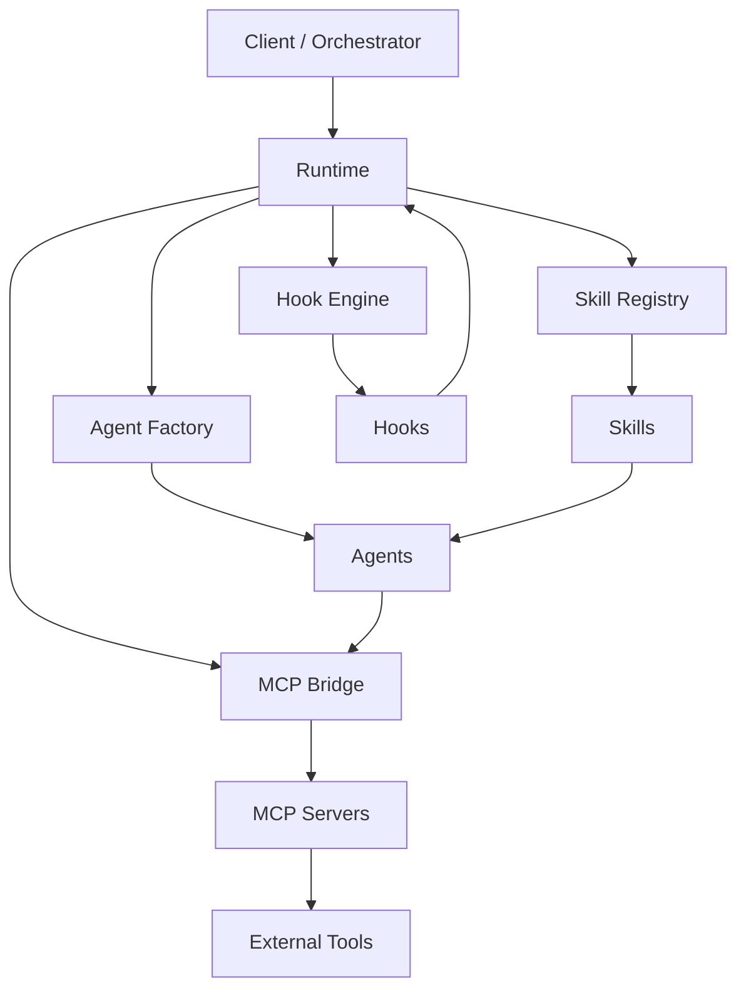
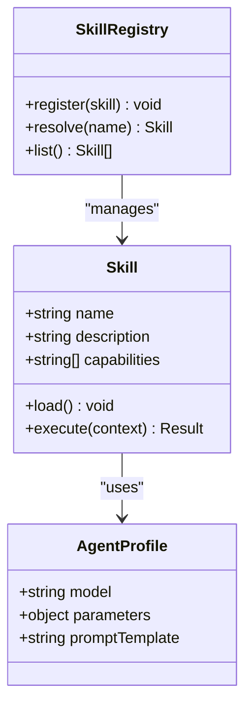
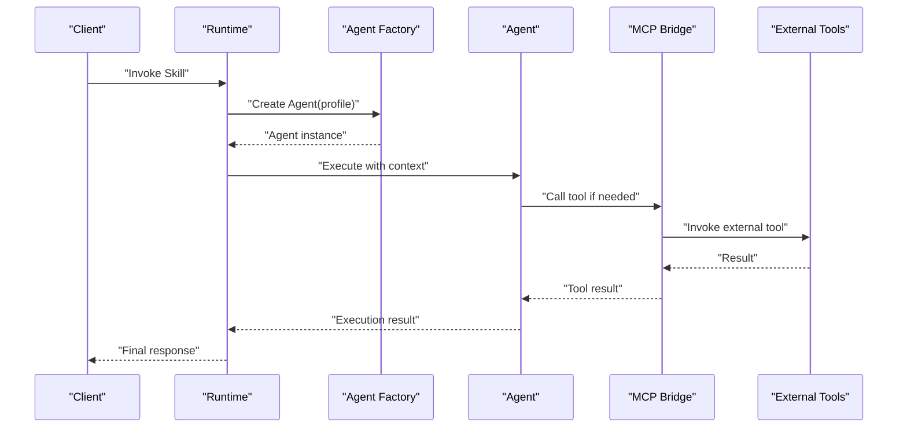
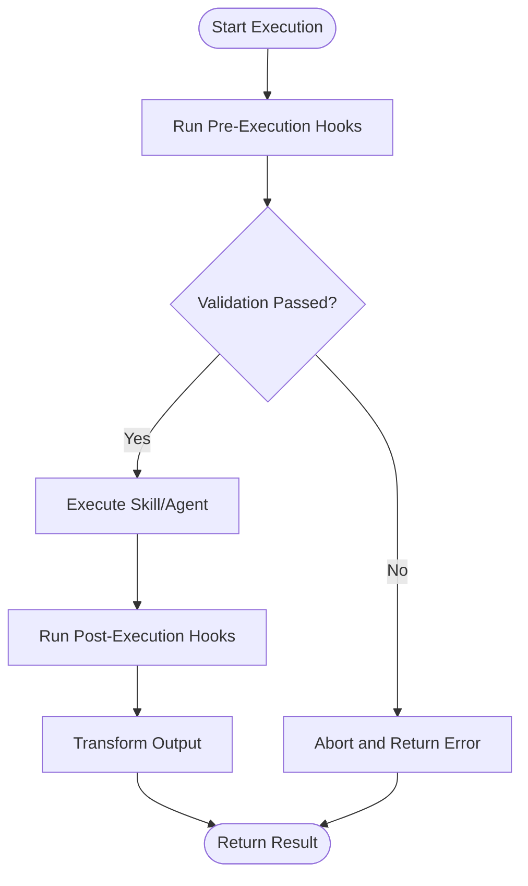
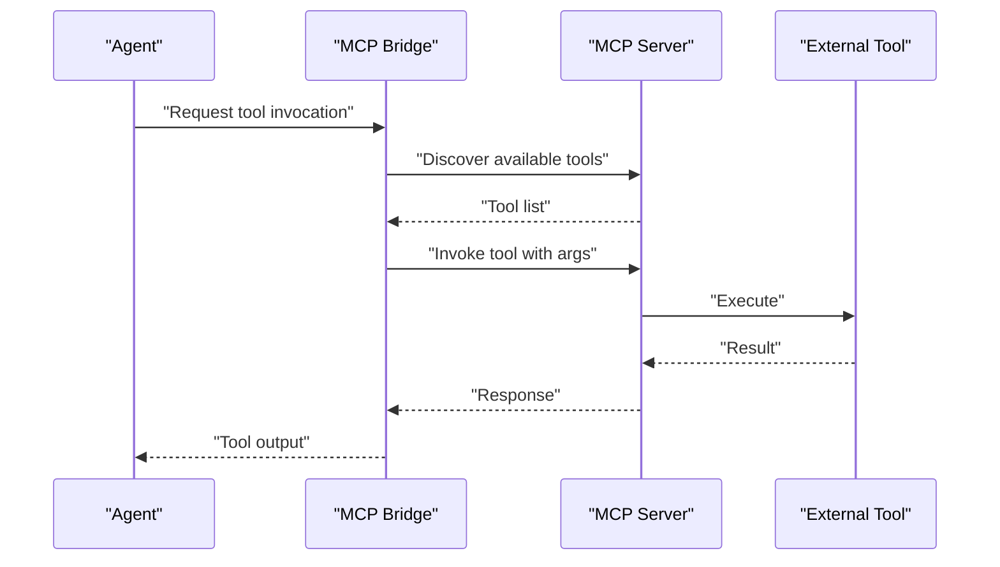
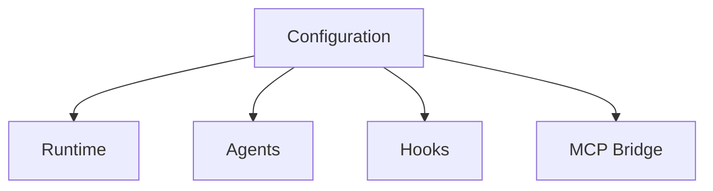
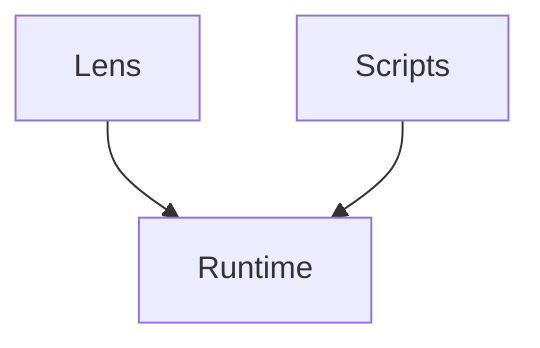
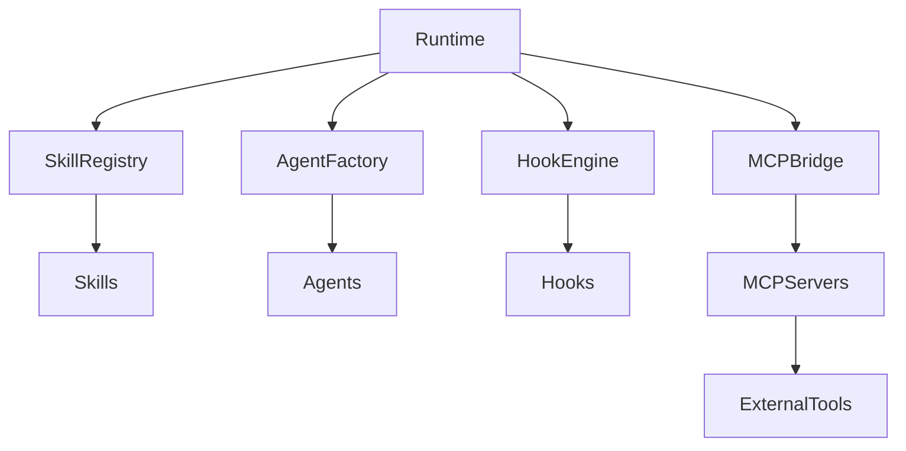
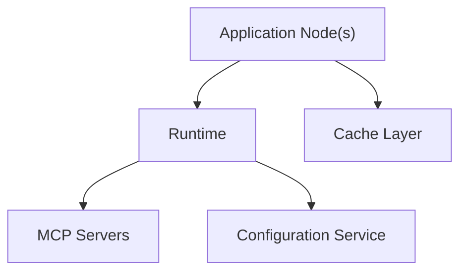

# Core Architecture

<cite>
**Referenced Files in This Document**
- [README.md](file://README.md)
- [skills/README.md](file://skills/README.md)
- [hooks/README.md](file://hooks/README.md)
- [mcp-servers/README.md](file://mcp-servers/README.md)
- [codex-config/README.md](file://codex-config/README.md)
- [agents-md/README.md](file://agents-md/README.md)
- [pi-lens/README.md](file://pi-lens/README.md)
- [scripts/README.md](file://scripts/README.md)
</cite>

## Table of Contents
1. [Introduction](#introduction)
2. [Project Structure](#project-structure)
3. [Core Components](#core-components)
4. [Architecture Overview](#architecture-overview)
5. [Detailed Component Analysis](#detailed-component-analysis)
6. [Dependency Analysis](#dependency-analysis)
7. [Performance Considerations](#performance-considerations)
8. [Troubleshooting Guide](#troubleshooting-guide)
9. [Conclusion](#conclusion)
10. [Appendices](#appendices)

## Introduction
This document describes the core architecture of the Pi Codex Kit, focusing on its skill-based modular design, agent framework, hook system, and MCP server integration. It explains how skills encapsulate domain-specific capabilities, how agents are configured per skill, how hooks provide extensibility points, and how MCP servers integrate external tools. The goal is to provide a clear mental model for developers integrating new skills, agents, or integrations while understanding data flows, boundaries, and scalability considerations.

## Project Structure
The repository organizes functionality into feature-oriented directories:
- Skills: Each skill defines its purpose, instructions, and an associated agent configuration.
- Hooks: Pluggable scripts that intercept or extend execution at specific points.
- MCP Servers: External tooling integrated via the Model Context Protocol (MCP).
- Agents Metadata: Shared definitions or references for agent configurations.
- Configuration: Centralized settings for runtime behavior.
- Lens: Domain-specific tooling and extensions.
- Scripts: Utility automation and helper tasks.

[No sources needed since this diagram shows conceptual structure]

**Section sources**
- [README.md](file://README.md)
- [skills/README.md](file://skills/README.md)
- [hooks/README.md](file://hooks/README.md)
- [mcp-servers/README.md](file://mcp-servers/README.md)
- [codex-config/README.md](file://codex-config/README.md)
- [agents-md/README.md](file://agents-md/README.md)
- [pi-lens/README.md](file://pi-lens/README.md)
- [scripts/README.md](file://scripts/README.md)

## Core Components
- Skill Module: Encapsulates a focused capability with documentation and an agent profile. Skills act as the primary unit of extensibility.
- Agent Framework: Provides a standardized way to configure and invoke AI agents per skill. Agent profiles define model parameters and prompts.
- Hook System: Offers lifecycle interception points to modify inputs, outputs, or orchestration flow without changing core logic.
- MCP Server Integration: Connects external tools and services through a protocol-driven interface, enabling dynamic tool discovery and invocation.
- Configuration: Centralizes environment-specific settings and feature toggles.
- Lens: Specialized tooling that augments analysis and navigation within the ecosystem.
- Scripts: Automation utilities supporting development, testing, and deployment workflows.

Key architectural patterns:
- Strategy Pattern: Skills implement interchangeable strategies for different tasks; agents select appropriate strategies based on context.
- Factory Pattern: Runtime constructs skills, agents, and hooks from declarative metadata and configuration.
- Observer Pattern: Hooks subscribe to events in the execution pipeline to observe and mutate state.

**Section sources**
- [skills/README.md](file://skills/README.md)
- [hooks/README.md](file://hooks/README.md)
- [mcp-servers/README.md](file://mcp-servers/README.md)
- [codex-config/README.md](file://codex-config/README.md)
- [agents-md/README.md](file://agents-md/README.md)
- [pi-lens/README.md](file://pi-lens/README.md)
- [scripts/README.md](file://scripts/README.md)

## Architecture Overview
The system follows a modular, plugin-like architecture where skills are first-class components orchestrated by a runtime. Agents are configured per skill and can be swapped or extended. Hooks provide observability and transformation points. MCP servers integrate external systems as tools available to agents and skills.

**Diagram sources**
- [skills/README.md](file://skills/README.md)
- [hooks/README.md](file://hooks/README.md)
- [mcp-servers/README.md](file://mcp-servers/README.md)
- [agents-md/README.md](file://agents-md/README.md)
- [codex-config/README.md](file://codex-config/README.md)

**Section sources**
- [README.md](file://README.md)
- [skills/README.md](file://skills/README.md)
- [hooks/README.md](file://hooks/README.md)
- [mcp-servers/README.md](file://mcp-servers/README.md)
- [agents-md/README.md](file://agents-md/README.md)
- [codex-config/README.md](file://codex-config/README.md)

## Detailed Component Analysis

### Skill-Based Modular Design
Skills are self-contained modules describing their purpose, usage, and agent configuration. They enable composability and reuse across workflows.

**Diagram sources**
- [skills/README.md](file://skills/README.md)
- [agents-md/README.md](file://agents-md/README.md)

**Section sources**
- [skills/README.md](file://skills/README.md)
- [agents-md/README.md](file://agents-md/README.md)

### Agent Framework
Agents are configured per skill and abstract model selection, prompting, and invocation. The factory pattern constructs agents dynamically based on skill requirements and runtime configuration.

**Diagram sources**
- [agents-md/README.md](file://agents-md/README.md)
- [mcp-servers/README.md](file://mcp-servers/README.md)

**Section sources**
- [agents-md/README.md](file://agents-md/README.md)
- [mcp-servers/README.md](file://mcp-servers/README.md)

### Hook System
Hooks provide observer-style extension points to intercept and transform data during execution. They support pre/post processing, validation, logging, and side effects.

**Diagram sources**
- [hooks/README.md](file://hooks/README.md)

**Section sources**
- [hooks/README.md](file://hooks/README.md)

### MCP Server Integration
MCP servers expose external tools via a standard protocol. The bridge component discovers, invokes, and returns results to agents and skills.

**Diagram sources**
- [mcp-servers/README.md](file://mcp-servers/README.md)

**Section sources**
- [mcp-servers/README.md](file://mcp-servers/README.md)

### Configuration and Environment
Centralized configuration controls runtime behavior, feature flags, and integration endpoints. It supports environment-specific overrides and safe defaults.

**Diagram sources**
- [codex-config/README.md](file://codex-config/README.md)

**Section sources**
- [codex-config/README.md](file://codex-config/README.md)

### Lens and Scripts
Lens provides specialized analysis and navigation features, while scripts automate common tasks and support development workflows.

**Diagram sources**
- [pi-lens/README.md](file://pi-lens/README.md)
- [scripts/README.md](file://scripts/README.md)

**Section sources**
- [pi-lens/README.md](file://pi-lens/README.md)
- [scripts/README.md](file://scripts/README.md)

## Dependency Analysis
The system exhibits low coupling between skills and the runtime through well-defined interfaces. Agents depend on configuration and MCP bridge. Hooks observe runtime events without modifying core logic. MCP servers are external dependencies accessed via the bridge.

**Diagram sources**
- [skills/README.md](file://skills/README.md)
- [hooks/README.md](file://hooks/README.md)
- [mcp-servers/README.md](file://mcp-servers/README.md)
- [agents-md/README.md](file://agents-md/README.md)
- [codex-config/README.md](file://codex-config/README.md)

**Section sources**
- [skills/README.md](file://skills/README.md)
- [hooks/README.md](file://hooks/README.md)
- [mcp-servers/README.md](file://mcp-servers/README.md)
- [agents-md/README.md](file://agents-md/README.md)
- [codex-config/README.md](file://codex-config/README.md)

## Performance Considerations
- Concurrency: Parallelize independent skill executions and agent calls where safe.
- Caching: Cache MCP tool results and agent responses when idempotent.
- Backpressure: Implement rate limiting for external tool invocations.
- Resource Limits: Enforce timeouts and memory caps for long-running operations.
- Streaming: Stream large outputs to reduce latency and memory pressure.

[No sources needed since this section provides general guidance]

## Troubleshooting Guide
- Hook Failures: Inspect hook logs and error payloads; ensure hooks return expected shapes.
- Agent Errors: Validate agent profiles and model parameters; check MCP tool availability.
- MCP Connectivity: Verify server endpoints and authentication; test tool discovery.
- Configuration Issues: Review environment overrides and default values; validate schema.

**Section sources**
- [hooks/README.md](file://hooks/README.md)
- [mcp-servers/README.md](file://mcp-servers/README.md)
- [codex-config/README.md](file://codex-config/README.md)

## Conclusion
The Pi Codex Kit’s architecture emphasizes modularity, extensibility, and clean separation of concerns. Skills encapsulate domain logic, agents provide flexible model orchestration, hooks offer powerful extension points, and MCP integration enables seamless tool connectivity. The use of Strategy, Factory, and Observer patterns ensures maintainability and scalability. With proper configuration and operational safeguards, the system can scale horizontally and adapt to evolving requirements.

[No sources needed since this section summarizes without analyzing specific files]

## Appendices

### Deployment Topology
A typical deployment includes:
- Application nodes hosting the runtime, skill registry, hook engine, and agent factory.
- MCP server instances providing external tool access.
- Configuration service or environment variables for centralized settings.
- Optional caching layer for tool and agent responses.

[No sources needed since this diagram shows conceptual topology]

### Infrastructure Requirements
- Language runtime compatible with skill and hook implementations.
- Network access to MCP servers and external tools.
- Secure storage for credentials and configuration.
- Monitoring and logging infrastructure for observability.

[No sources needed since this section provides general guidance]