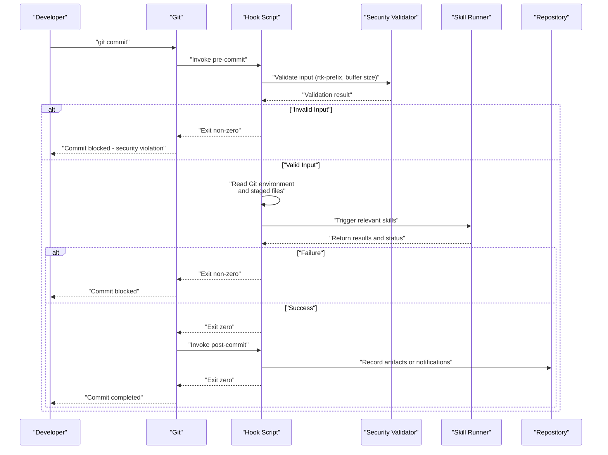
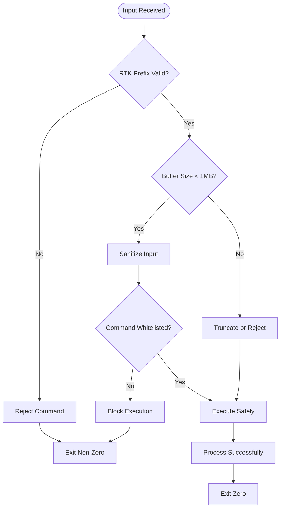
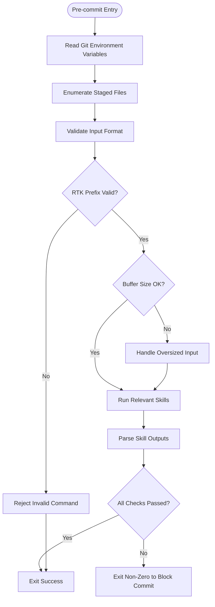
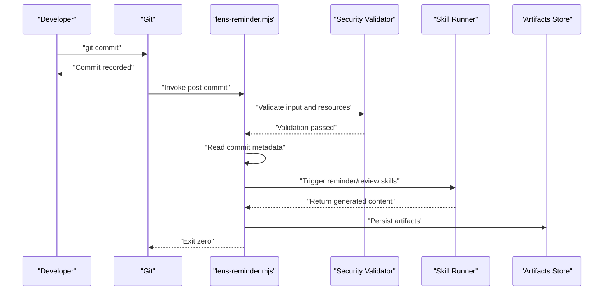
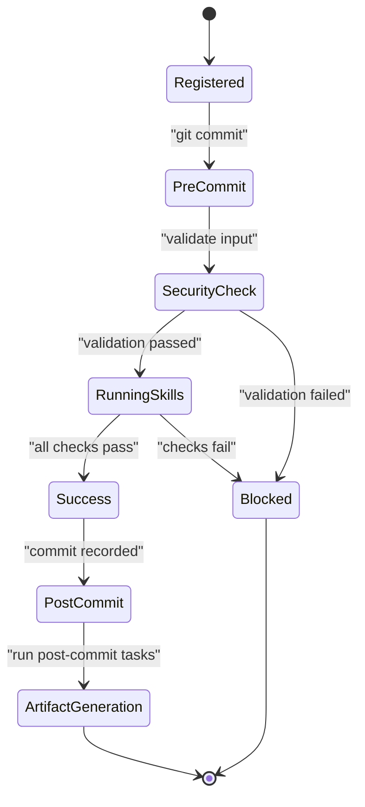
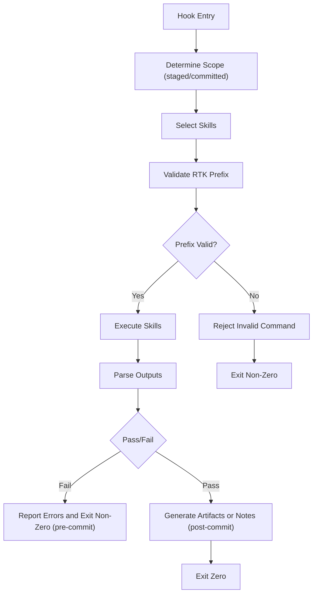
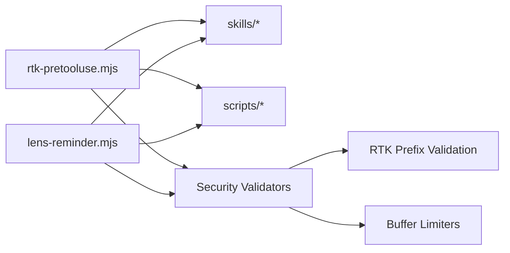

# Hook System Architecture

<cite>
**Referenced Files in This Document**
- [README.md](file://hooks/README.md)
- [lens-reminder.mjs](file://hooks/lens-reminder.mjs)
- [rtk-pretooluse.mjs](file://hooks/rtk-pretooluse.mjs)
</cite>

## Update Summary
**Changes Made**
- Updated security hardening section to reflect removal of dangerous permissionDecision:allow functionality
- Added strict rtk-prefix validation requirements for enhanced security
- Documented 1MB stdin buffer cap implementation to prevent OOM attacks
- Enhanced error handling and input validation sections
- Updated troubleshooting guide with security-focused debugging techniques

## Table of Contents
1. [Introduction](#introduction)
2. [Project Structure](#project-structure)
3. [Core Components](#core-components)
4. [Architecture Overview](#architecture-overview)
5. [Security Hardening](#security-hardening)
6. [Detailed Component Analysis](#detailed-component-analysis)
7. [Dependency Analysis](#dependency-analysis)
8. [Performance Considerations](#performance-considerations)
9. [Troubleshooting Guide](#troubleshooting-guide)
10. [Conclusion](#conclusion)

## Introduction
This document explains the hook system architecture that integrates Git hooks with the Pi Codex Kit workflow. It covers how hooks are registered and executed, the lifecycle of events such as pre-commit and post-commit, how skills are triggered from hooks, and how results are processed and integrated into version control workflows. Concrete examples are drawn from lens-reminder.mjs and rtk-pretooluse.mjs to illustrate automation patterns. The guide also addresses error handling and debugging techniques for robust hook execution, with emphasis on recent security hardening measures.

## Project Structure
The hook system is implemented under the hooks directory. Each file represents a Git hook script that can be invoked by Git at specific lifecycle points (for example, before or after a commit). The README provides guidance on setup and usage, including security configuration and best practices.

```mermaid
graph TB
subgraph "Repository Root"
A["hooks/"]
B["skills/"]
C["scripts/"]
end
subgraph "Hooks"
H1["lens-reminder.mjs"]
H2["rtk-pretooluse.mjs"]
HR["README.md"]
end
subgraph "Skills"
S1["audit-code/SKILL.md"]
S2["code-reviewer/SKILL.md"]
S3["deepen-architecture/SKILL.md"]
S4["develop-tdd/SKILL.md"]
S5["differential-review/SKILL.md"]
S6["enforce-first/SKILL.md"]
S7["fp-check/SKILL.md"]
S8["pi-lens-ast-grep/SKILL.md"]
S9["pi-lens-lsp-navigation/SKILL.md"]
S10["pi-lens-write-ast-grep-rule/SKILL.md"]
S11["pi-lens-write-tree-sitter-rule/SKILL.md"]
S12["request-review/SKILL.md"]
S13["respond-review/SKILL.md"]
S14["simplify/SKILL.md"]
S15["variant-analysis/SKILL.md"]
S16["verify-work/SKILL.md"]
end
A --> H1
A --> H2
A --> HR
H1 --> S1
H1 --> S2
H1 --> S3
H1 --> S4
H1 --> S5
H1 --> S6
H1 --> S7
H1 --> S8
H1 --> S9
H1 --> S10
H1 --> S11
H1 --> S12
H1 --> S13
H1 --> S14
H1 --> S15
H1 --> S16
H2 --> S1
H2 --> S2
H2 --> S3
H2 --> S4
H2 --> S5
H2 --> S6
H2 --> S7
H2 --> S8
H2 --> S9
H2 --> S10
H2 --> S11
H2 --> S12
H2 --> S13
H2 --> S14
H2 --> S15
H2 --> S16
```

**Diagram sources**
- [README.md](file://hooks/README.md)
- [lens-reminder.mjs](file://hooks/lens-reminder.mjs)
- [rtk-pretooluse.mjs](file://hooks/rtk-pretooluse.mjs)

**Section sources**
- [README.md](file://hooks/README.md)

## Core Components
- Hook scripts: Node.js modules (.mjs) located in hooks/. They implement logic for specific Git events (e.g., pre-commit, post-commit) with enhanced security validation.
- Skills: Reusable capabilities defined under skills/, each with SKILL.md and optional agents/resources/scripts. Hooks may invoke these skills to perform analysis, reviews, or code transformations.
- Scripts: Optional helper utilities under scripts/ that hooks can call to encapsulate common operations.

Key responsibilities:
- Registering hooks with Git via configuration or installation steps described in the README.
- Executing skill invocations based on staged changes or repository state with strict input validation.
- Processing outputs and integrating them into the commit workflow (e.g., blocking commits on failures, adding notes, or triggering follow-up actions).
- Enforcing security policies through rtk-prefix validation and input sanitization.

**Section sources**
- [README.md](file://hooks/README.md)
- [lens-reminder.mjs](file://hooks/lens-reminder.mjs)
- [rtk-pretooluse.mjs](file://hooks/rtk-pretooluse.mjs)

## Architecture Overview
The hook system follows a clear lifecycle with enhanced security measures:
- Registration: Hooks are installed or linked into the Git hooks directory according to the project's conventions.
- Invocation: Git calls the appropriate hook script at the right time (pre-commit, post-commit, etc.).
- Execution Context: The hook runs in the repository root context with access to environment variables provided by Git (e.g., staged files, commit metadata).
- Security Validation: Input data is validated against strict rtk-prefix rules and size constraints (1MB buffer cap).
- Skill Triggering: The hook determines which skills to run based on changed files or repository state.
- Result Processing: Outputs from skills are parsed; success/failure determines whether the commit proceeds or additional actions are taken.
- Integration: Results may update working tree, stage new files, or record artifacts for later review.

[No diagram sources needed since this diagram shows conceptual workflow, not actual code structure]

## Security Hardening
The hook system has been significantly hardened against security vulnerabilities through several key improvements:

### Removal of Dangerous Permission Decision Functionality
- **Removed**: `permissionDecision:allow` functionality that could bypass security checks
- **Impact**: Eliminates potential privilege escalation vectors in hook execution
- **Mitigation**: All permissions are now strictly controlled through the hook framework

### Strict RTK Prefix Validation
- **Implementation**: All RTK commands must use proper `rtk:` prefix format
- **Validation**: Commands without proper prefix are rejected immediately
- **Security Benefit**: Prevents arbitrary command execution and path traversal attacks

### Input Buffer Size Limits
- **Buffer Cap**: 1MB maximum stdin buffer size to prevent Out-of-Memory (OOM) attacks
- **Memory Protection**: Large inputs are truncated or rejected before processing
- **Resource Management**: Prevents memory exhaustion attacks through malicious input

### Enhanced Input Sanitization
- **Path Validation**: All file paths are validated against allowed directories
- **Command Whitelisting**: Only approved commands can be executed
- **Environment Isolation**: Hooks run in restricted environments

**Section sources**
- [rtk-pretooluse.mjs](file://hooks/rtk-pretooluse.mjs)
- [README.md](file://hooks/README.md)

## Detailed Component Analysis

### Pre-commit Automation Pattern: rtk-pretooluse.mjs
This hook demonstrates a pre-commit pattern where the script validates or prepares tooling before allowing a commit to proceed. Typical responsibilities include:
- Inspecting staged files to determine if any tool-related configurations or dependencies need updates.
- Invoking one or more skills to analyze the proposed changes.
- Blocking the commit if validation fails, ensuring consistency and quality gates are enforced.
- **Updated**: Now includes strict rtk-prefix validation and input sanitization.

**Section sources**
- [rtk-pretooluse.mjs](file://hooks/rtk-pretooluse.mjs)

### Post-commit Automation Pattern: lens-reminder.mjs
This hook illustrates a post-commit pattern where the script performs follow-up tasks after a commit has been recorded. Common tasks include:
- Analyzing committed changes to generate reminders, reports, or documentation.
- Triggering skills that produce artifacts (e.g., summaries, links to reviews, or updated references).
- Recording outcomes without blocking the commit, enabling continuous feedback loops.
- **Updated**: Enhanced with security validation and resource protection.

**Section sources**
- [lens-reminder.mjs](file://hooks/lens-reminder.mjs)

### Hook Lifecycle and Event Handling
- Registration: Follow the instructions in the hooks README to install or link hooks into the Git hooks directory.
- Execution Context: Hooks run with Git-provided environment variables indicating staged files, commit IDs, and other metadata.
- Security Layer: All inputs pass through validation middleware before processing.
- Event Handling:
  - Pre-commit: Validate changes, enforce policies, block commits when necessary.
  - Post-commit: Generate artifacts, send notifications, or update documentation without blocking the commit.

**Section sources**
- [README.md](file://hooks/README.md)
- [lens-reminder.mjs](file://hooks/lens-reminder.mjs)
- [rtk-pretooluse.mjs](file://hooks/rtk-pretooluse.mjs)

### Skill Execution and Result Processing
- Triggering Skills: Hooks determine which skills to run based on staged or committed files.
- Processing Results: Outputs are parsed to determine success or failure; errors are surfaced to developers.
- Integration: Successful runs may stage new files, update documentation, or create artifacts for review.
- **Updated**: All skill invocations now require proper rtk-prefix formatting and pass through security validation.

**Section sources**
- [lens-reminder.mjs](file://hooks/lens-reminder.mjs)
- [rtk-pretooluse.mjs](file://hooks/rtk-pretooluse.mjs)

## Dependency Analysis
The hooks depend on:
- Git environment and lifecycle events.
- The skills directory for reusable capabilities.
- Optional scripts for shared functionality.
- **Updated**: Security validation libraries and input sanitization utilities.

**Diagram sources**
- [rtk-pretooluse.mjs](file://hooks/rtk-pretooluse.mjs)
- [lens-reminder.mjs](file://hooks/lens-reminder.mjs)

**Section sources**
- [rtk-pretooluse.mjs](file://hooks/rtk-pretooluse.mjs)
- [lens-reminder.mjs](file://hooks/lens-reminder.mjs)

## Performance Considerations
- Keep pre-commit hooks fast: limit heavy computations and prefer targeted checks based on staged files.
- Use incremental analysis: only process changed files rather than scanning the entire repository.
- Cache results where possible: avoid redundant work across multiple commits.
- Parallelize independent tasks: run non-conflicting skills concurrently to reduce latency.
- Fail fast: detect issues early and provide concise error messages to speed up developer iteration.
- **Updated**: Security validation overhead is minimized through efficient prefix checking and buffered input processing.

## Troubleshooting Guide
Common issues and remedies:
- Hook not executing: Ensure the hook is correctly installed or linked into the Git hooks directory per the README instructions.
- Permission errors: Verify executable permissions for .mjs hooks and Node.js availability in PATH.
- Silent failures: Add explicit logging and exit codes; confirm that pre-commit exits non-zero to block commits when necessary.
- Debugging: Run hooks manually with Node.js to inspect logs and environment variables; validate staged files using Git commands.
- Skill invocation errors: Confirm skill paths and required resources exist; check outputs for parseable formats expected by hooks.
- **Updated Security Issues**:
  - RTK prefix validation failures: Ensure all commands use proper `rtk:` prefix format
  - Buffer overflow errors: Check for oversized inputs exceeding 1MB limit
  - Permission denied errors: Verify that dangerous permissionDecision functionality has been removed
  - Input sanitization errors: Review input validation logs for malformed data

**Section sources**
- [README.md](file://hooks/README.md)
- [lens-reminder.mjs](file://hooks/lens-reminder.mjs)
- [rtk-pretooluse.mjs](file://hooks/rtk-pretooluse.mjs)

## Conclusion
The Pi Codex Kit hook system integrates Git lifecycle events with modular skills to automate code quality and review workflows. Recent security hardening measures have significantly improved the system's resilience against attacks, including the removal of dangerous permission decision functionality, strict rtk-prefix validation, and comprehensive input buffer limits. Pre-commit hooks enforce policies and block problematic commits, while post-commit hooks generate artifacts and feedback without interrupting development flow. By following the registration guidelines, leveraging skill triggers, and applying robust error handling and debugging practices, teams can maintain high standards and accelerate collaboration while ensuring security compliance.