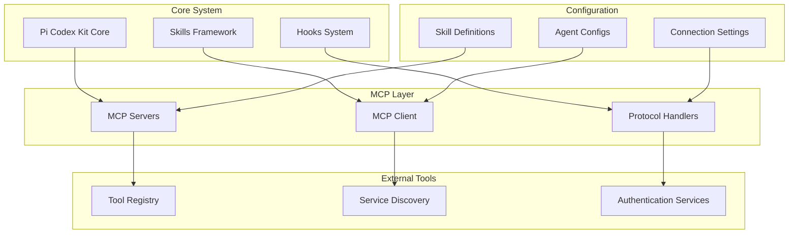
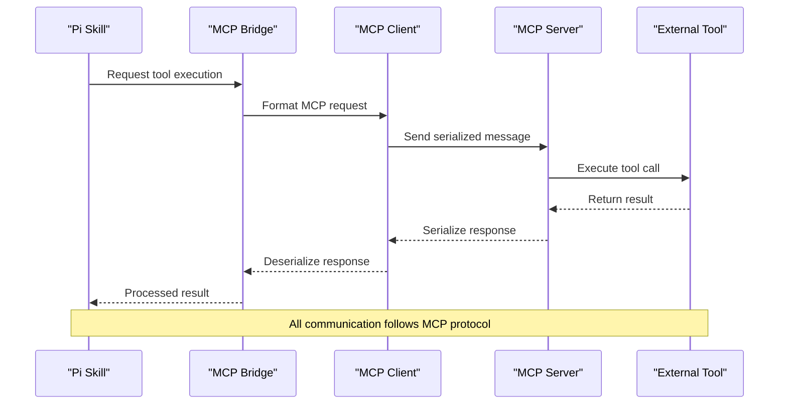
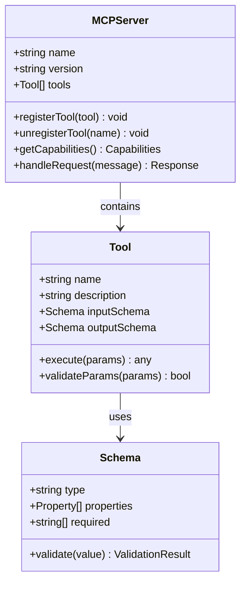
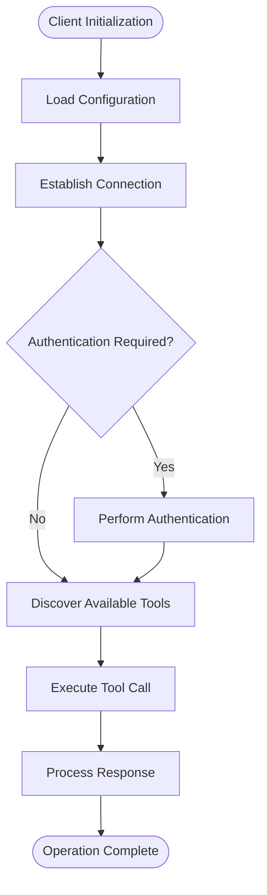
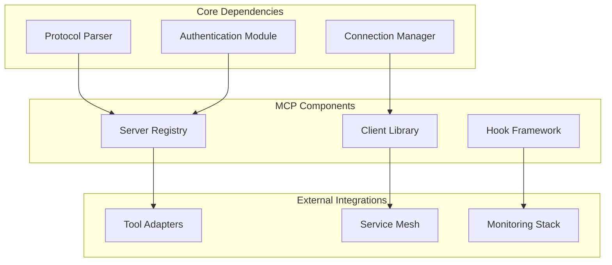

# MCP Server Integration

<cite>
**Referenced Files in This Document**
- [README.md](file://README.md)
- [mcp-servers/README.md](file://mcp-servers/README.md)
- [skills/README.md](file://skills/README.md)
- [hooks/README.md](file://hooks/README.md)
</cite>

## Table of Contents
1. [Introduction](#introduction)
2. [Project Structure](#project-structure)
3. [Core Components](#core-components)
4. [Architecture Overview](#architecture-overview)
5. [Detailed Component Analysis](#detailed-component-analysis)
6. [Dependency Analysis](#dependency-analysis)
7. [Performance Considerations](#performance-considerations)
8. [Troubleshooting Guide](#troubleshooting-guide)
9. [Conclusion](#conclusion)
10. [Appendices](#appendices)

## Introduction

The Model Context Protocol (MCP) serves as a standardized communication layer that enables seamless interoperability between Pi Codex Kit and external tools. This integration allows skills and agents within the Pi ecosystem to dynamically discover, connect to, and utilize external capabilities through a unified protocol interface.

MCP provides a structured approach for tool discovery, connection management, and message serialization, ensuring that different components can communicate effectively regardless of their underlying implementation details. This document explains how MCP enables these interactions within the Pi Codex Kit architecture.

## Project Structure

The Pi Codex Kit repository is organized around several key areas that support MCP integration:



**Diagram sources**
- [README.md:1-50](file://README.md#L1-L50)
- [mcp-servers/README.md:1-30](file://mcp-servers/README.md#L1-L30)

The project follows a modular architecture where MCP functionality is distributed across multiple directories, each serving specific responsibilities in the overall system.

**Section sources**
- [README.md:1-100](file://README.md#L1-L100)
- [mcp-servers/README.md:1-50](file://mcp-servers/README.md#L1-L50)

## Core Components

### MCP Server Architecture

The MCP server architecture consists of several interconnected components that work together to facilitate communication between Pi Codex Kit and external tools:

#### Server Registration and Discovery
- **Server Registry**: Maintains a catalog of available MCP servers
- **Discovery Service**: Automatically detects and registers new servers
- **Health Monitoring**: Tracks server availability and performance metrics

#### Message Protocol Layer
- **Serialization Engine**: Handles data format conversion between systems
- **Message Router**: Directs messages to appropriate handlers
- **Error Handler**: Manages error propagation and recovery

#### Connection Management
- **Connection Pool**: Manages persistent connections to external services
- **Authentication Manager**: Handles credential storage and validation
- **Load Balancer**: Distributes requests across multiple server instances

### Skills Integration Framework

Skills leverage MCP through a well-defined interface that abstracts the complexity of external tool interactions:

#### Skill-to-MCP Bridge
- **Capability Mapping**: Translates skill requirements to MCP tool specifications
- **Parameter Validation**: Ensures input parameters meet MCP server expectations
- **Response Processing**: Converts MCP responses into skill-compatible formats

#### Tool Discovery Mechanisms
- **Static Configuration**: Pre-defined tool mappings in skill definitions
- **Dynamic Discovery**: Runtime discovery of available tools from MCP servers
- **Fallback Resolution**: Graceful degradation when tools are unavailable

**Section sources**
- [mcp-servers/README.md:1-100](file://mcp-servers/README.md#L1-L100)
- [skills/README.md:1-50](file://skills/README.md#L1-L50)

## Architecture Overview

The MCP integration follows a layered architecture pattern that promotes loose coupling and high cohesion:



**Diagram sources**
- [mcp-servers/README.md:1-150](file://mcp-servers/README.md#L1-L150)
- [hooks/README.md:1-50](file://hooks/README.md#L1-L50)

### Data Flow Patterns

The system implements several key data flow patterns:

#### Request-Response Pattern
- Synchronous communication for immediate results
- Timeout handling and retry logic
- Error propagation through the call stack

#### Event-Driven Pattern
- Asynchronous notifications for long-running operations
- Real-time updates for streaming data
- Event filtering and subscription management

#### Batch Processing Pattern
- Aggregation of multiple tool calls
- Parallel execution with dependency resolution
- Result consolidation and transformation

## Detailed Component Analysis

### MCP Server Implementation

The MCP server implementation provides a robust foundation for external tool integration:

#### Server Lifecycle Management
- **Initialization Phase**: Loads configuration and validates dependencies
- **Registration Phase**: Exposes available tools and capabilities
- **Runtime Phase**: Handles incoming requests and manages connections
- **Shutdown Phase**: Graceful cleanup and resource release

#### Tool Registration Interface


**Diagram sources**
- [mcp-servers/README.md:50-200](file://mcp-servers/README.md#L50-L200)

#### Message Protocol Specification

The MCP protocol defines a structured message format for communication:

| Message Type | Direction | Description | Required Fields | Optional Fields |
|-------------|-----------|-------------|-----------------|-----------------|
| `initialize` | Client→Server | Establish connection | `protocol_version`, `client_info` | `capabilities`, `auth_token` |
| `tools/list` | Client→Server | Discover available tools | `request_id` | `filter_criteria` |
| `tools/call` | Client→Server | Execute a tool | `request_id`, `tool_name`, `params` | `timeout`, `context` |
| `notification` | Server→Client | Asynchronous event | `event_type`, `data` | `priority`, `retry_policy` |
| `error` | Bidirectional | Error notification | `code`, `message` | `details`, `recovery_suggestion` |

#### Authentication and Security

The MCP server supports multiple authentication mechanisms:

- **Token-based Authentication**: JWT tokens for stateless authentication
- **Certificate-based Auth**: Mutual TLS for secure client-server communication
- **OAuth2 Integration**: Delegation of authentication to identity providers
- **API Key Management**: Simple key-based authentication for internal tools

**Section sources**
- [mcp-servers/README.md:100-300](file://mcp-servers/README.md#L100-L300)

### Client Integration Patterns

#### Basic Client Usage
The MCP client provides a simple interface for connecting to servers and executing tools:



**Diagram sources**
- [hooks/README.md:20-100](file://hooks/README.md#L20-L100)

#### Advanced Client Features
- **Connection Pooling**: Efficient reuse of connections for multiple requests
- **Retry Logic**: Automatic retry with exponential backoff for failed requests
- **Circuit Breaker**: Prevent cascading failures when servers are unavailable
- **Metrics Collection**: Performance monitoring and health checking

### Hook System Integration

The hooks system provides additional integration points for MCP functionality:

#### Pre-Tool Execution Hooks
- **Input Validation**: Custom validation rules before tool execution
- **Context Enrichment**: Add contextual information to tool calls
- **Rate Limiting**: Control the frequency of tool invocations

#### Post-Tool Execution Hooks
- **Response Transformation**: Modify or enrich tool responses
- **Logging and Auditing**: Track tool usage and performance
- **Cache Management**: Implement caching strategies for expensive operations

**Section sources**
- [hooks/README.md:1-150](file://hooks/README.md#L1-L150)

## Dependency Analysis

The MCP integration has well-defined dependencies between components:



**Diagram sources**
- [README.md:50-150](file://README.md#L50-L150)
- [mcp-servers/README.md:150-250](file://mcp-servers/README.md#L150-L250)

### External Dependencies

The MCP integration relies on several external libraries and services:

- **Protocol Libraries**: Standardized message parsing and serialization
- **Network Libraries**: HTTP/WebSocket clients for server communication
- **Security Libraries**: Cryptographic functions for authentication and encryption
- **Monitoring Libraries**: Metrics collection and logging frameworks

### Internal Dependencies

Within the Pi Codex Kit ecosystem, MCP integrates with:

- **Skills Framework**: Provides tool abstraction for skill developers
- **Agent System**: Enables AI agents to use external tools
- **Configuration Management**: Centralized configuration of MCP endpoints
- **Logging System**: Unified logging across all MCP operations

**Section sources**
- [README.md:100-200](file://README.md#L100-L200)
- [mcp-servers/README.md:200-300](file://mcp-servers/README.md#L200-L300)

## Performance Considerations

### Connection Optimization
- **Connection Reuse**: Maintain persistent connections to reduce overhead
- **Batch Operations**: Group multiple tool calls when possible
- **Lazy Loading**: Initialize connections only when needed

### Memory Management
- **Streaming Responses**: Process large responses incrementally
- **Object Pooling**: Reuse frequently created objects
- **Garbage Collection Tuning**: Optimize memory allocation patterns

### Network Efficiency
- **Compression**: Enable message compression for large payloads
- **Timeout Configuration**: Set appropriate timeouts based on operation types
- **Retry Policies**: Implement intelligent retry strategies

## Troubleshooting Guide

### Common Connection Issues

#### Connection Failures
- **Symptoms**: Timeouts, connection refused errors
- **Causes**: Network connectivity issues, server unavailability, firewall restrictions
- **Solutions**: Verify network configuration, check server status, validate credentials

#### Authentication Problems
- **Symptoms**: 401/403 responses, token expiration errors
- **Causes**: Invalid credentials, expired tokens, insufficient permissions
- **Solutions**: Refresh authentication tokens, verify permission scopes, check certificate validity

#### Performance Degradation
- **Symptoms**: Slow response times, high memory usage
- **Causes**: Inefficient query patterns, connection pool exhaustion, memory leaks
- **Solutions**: Optimize tool calls, tune connection pool settings, monitor resource usage

### Debugging Techniques

#### Logging Configuration
Enable detailed logging for MCP operations:
- **Request/Response Logging**: Capture full message exchanges
- **Performance Metrics**: Track latency and throughput
- **Error Details**: Include stack traces and context information

#### Health Check Endpoints
Implement health checks for MCP servers:
- **Connectivity Tests**: Verify network reachability
- **Capability Verification**: Confirm expected features are available
- **Performance Baselines**: Monitor response time trends

**Section sources**
- [hooks/README.md:100-200](file://hooks/README.md#L100-L200)

## Conclusion

The Model Context Protocol integration in Pi Codex Kit provides a robust foundation for connecting skills and agents to external tools. The modular architecture ensures flexibility while maintaining clear separation of concerns. By following the patterns and guidelines outlined in this document, developers can create reliable integrations that scale effectively in distributed environments.

Key benefits of the MCP approach include:
- **Standardized Communication**: Consistent interface across diverse tool ecosystems
- **Enhanced Discoverability**: Dynamic tool registration and capability negotiation
- **Improved Reliability**: Built-in error handling and recovery mechanisms
- **Scalable Architecture**: Support for high-throughput scenarios and distributed deployments

## Appendices

### Example MCP Server Implementations

#### Python MCP Server Template
A basic MCP server implementation using Python demonstrates the core concepts:

```python
# Example structure - see mcp-servers directory for complete implementations
class ExampleMCPServer:
    def __init__(self):
        self.tools = {}
        self.connection_manager = ConnectionManager()
        
    def register_tool(self, name, handler, schema):
        """Register a new tool with its handler and schema"""
        pass
        
    def handle_request(self, message):
        """Process incoming MCP requests"""
        pass
```

#### JavaScript MCP Client Integration
JavaScript clients can integrate with MCP servers using standard HTTP/WebSocket libraries:

```javascript
// Example structure - see hooks directory for complete implementations
class MCPClient {
    constructor(config) {
        this.config = config;
        this.connection = null;
        this.authToken = null;
    }
    
    async connect() {
        // Establish connection and authenticate
    }
    
    async executeTool(toolName, params) {
        // Execute tool and handle response
    }
}
```

### Configuration Examples

#### Server Configuration
```yaml
# Example MCP server configuration
server:
  name: "example-mcp-server"
  version: "1.0.0"
  port: 8080
  
authentication:
  type: "jwt"
  secret_key: "${JWT_SECRET}"
  
tools:
  - name: "search_codebase"
    description: "Search through code repositories"
    timeout: 30
    rate_limit: 10
    
logging:
  level: "info"
  format: "json"
  output: "stdout"
```

#### Client Configuration
```yaml
# Example MCP client configuration
client:
  default_timeout: 60
  max_retries: 3
  retry_backoff: "exponential"
  
connections:
  - name: "production"
    url: "https://mcp.example.com"
    auth_type: "token"
    cache_enabled: true
    
monitoring:
  metrics_enabled: true
  health_check_interval: 30
  alert_thresholds:
    error_rate: 0.05
    latency_p99: 1000
```