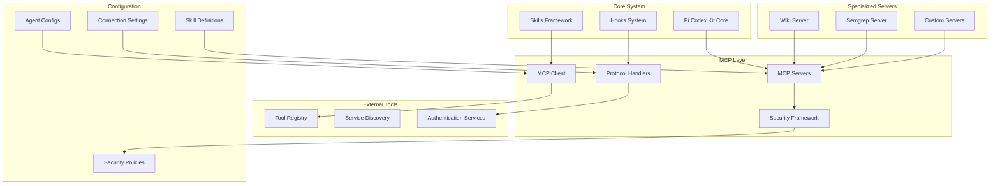
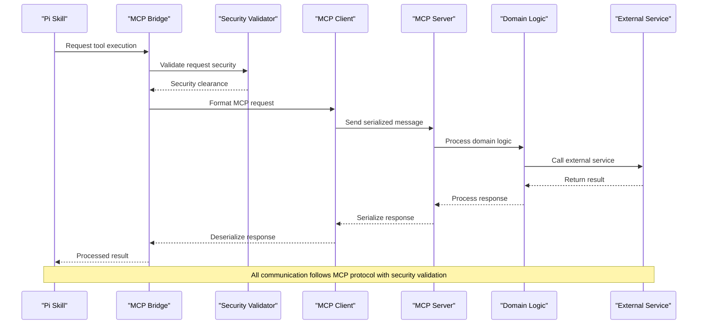
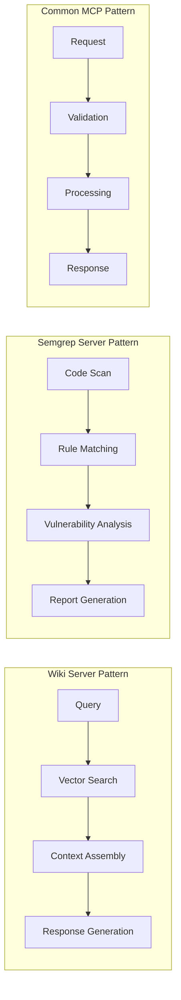
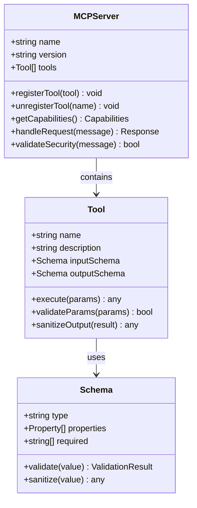
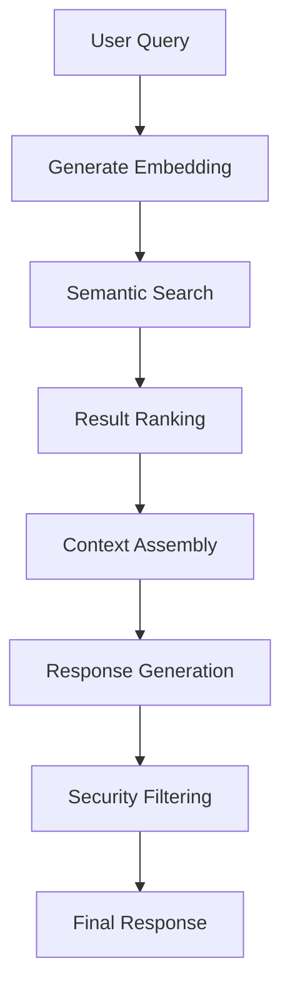
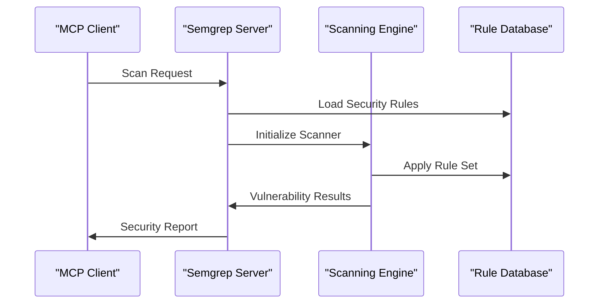
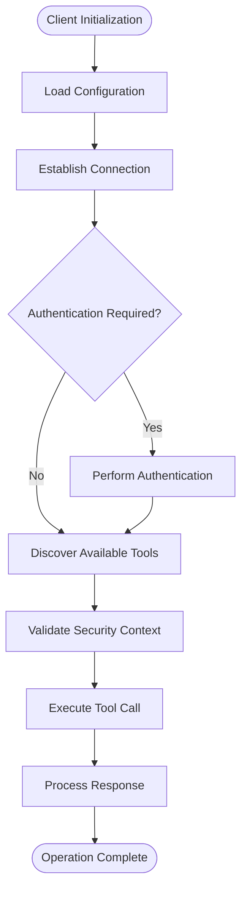
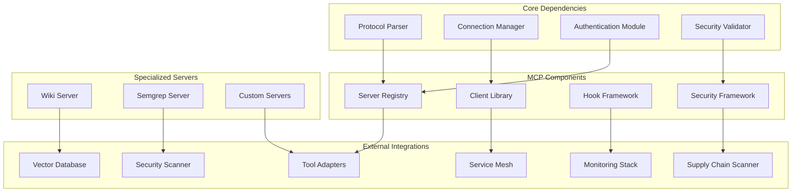

# MCP Server Integration

<cite>
**Referenced Files in This Document**
- [README.md](file://README.md)
- [mcp-servers/README.md](file://mcp-servers/README.md)
- [mcp-servers/SECURITY.md](file://mcp-servers/SECURITY.md)
- [mcp-servers/wiki-server/README.md](file://mcp-servers/wiki-server/README.md)
- [mcp-servers/wiki-server/server.mjs](file://mcp-servers/wiki-server/server.mjs)
- [mcp-servers/wiki-server/lib/tools.mjs](file://mcp-servers/wiki-server/lib/tools.mjs)
- [mcp-servers/wiki-server/lib/db.mjs](file://mcp-servers/wiki-server/lib/db.mjs)
- [mcp-servers/wiki-server/lib/embeddings.mjs](file://mcp-servers/wiki-server/lib/embeddings.mjs)
- [mcp-servers/semgrep-server/README.md](file://mcp-servers/semgrep-server/README.md)
- [mcp-servers/semgrep-server/server.mjs](file://mcp-servers/semgrep-server/server.mjs)
- [mcp-servers/semgrep-server/lib/tools.mjs](file://mcp-servers/semgrep-server/lib/tools.mjs)
- [mcp-servers/semgrep-server/lib/scanner.mjs](file://mcp-servers/semgrep-server/lib/scanner.mjs)
- [skills/README.md](file://skills/README.md)
- [skills/verify-work/SKILL.md](file://skills/verify-work/SKILL.md)
- [hooks/README.md](file://hooks/README.md)
</cite>

## Update Summary
**Changes Made**
- Added comprehensive documentation for new Wiki Server implementation with knowledge base capabilities
- Added detailed coverage of Semgrep Server integration for security scanning
- Enhanced mcp-servers ecosystem overview with expanded server catalog
- Updated security documentation to cover new server implementations
- Added practical examples of specialized MCP server architectures

## Table of Contents
1. [Introduction](#introduction)
2. [Project Structure](#project-structure)
3. [Core Components](#core-components)
4. [Architecture Overview](#architecture-overview)
5. [Security Guidelines](#security-guidelines)
6. [MCP Server Ecosystem](#mcp-server-ecosystem)
7. [Detailed Component Analysis](#detailed-component-analysis)
8. [Dependency Analysis](#dependency-analysis)
9. [Performance Considerations](#performance-considerations)
10. [Troubleshooting Guide](#troubleshooting-guide)
11. [Conclusion](#conclusion)
12. [Appendices](#appendices)

## Introduction

The Model Context Protocol (MCP) serves as a standardized communication layer that enables seamless interoperability between Pi Codex Kit and external tools. This integration allows skills and agents within the Pi ecosystem to dynamically discover, connect to, and utilize external capabilities through a unified protocol interface.

MCP provides a structured approach for tool discovery, connection management, and message serialization, ensuring that different components can communicate effectively regardless of their underlying implementation details. The expanded MCP server ecosystem now includes specialized servers for knowledge management and security scanning, demonstrating the protocol's versatility in handling diverse use cases.

This document explains how MCP enables these interactions within the Pi Codex Kit architecture, with enhanced security considerations, cross-platform compatibility, and comprehensive coverage of the growing server ecosystem including the new Wiki Server and Semgrep Server implementations.

## Project Structure

The Pi Codex Kit repository is organized around several key areas that support MCP integration, with a significantly expanded server ecosystem:



**Diagram sources**
- [README.md:1-50](file://README.md#L1-L50)
- [mcp-servers/README.md:1-30](file://mcp-servers/README.md#L1-L30)
- [mcp-servers/wiki-server/README.md:1-30](file://mcp-servers/wiki-server/README.md#L1-L30)
- [mcp-servers/semgrep-server/README.md:1-30](file://mcp-servers/semgrep-server/README.md#L1-L30)

The project follows a modular architecture where MCP functionality is distributed across multiple directories, each serving specific responsibilities in the overall system. The addition of specialized servers demonstrates the protocol's extensibility for domain-specific use cases.

**Section sources**
- [README.md:1-100](file://README.md#L1-L100)
- [mcp-servers/README.md:1-50](file://mcp-servers/README.md#L1-L50)

## Core Components

### MCP Server Architecture

The MCP server architecture consists of several interconnected components that work together to facilitate communication between Pi Codex Kit and external tools:

#### Server Registration and Discovery
- **Server Registry**: Maintains a catalog of available MCP servers including specialized implementations
- **Discovery Service**: Automatically detects and registers new servers with capability negotiation
- **Health Monitoring**: Tracks server availability and performance metrics across all server types

#### Message Protocol Layer
- **Serialization Engine**: Handles data format conversion between systems with type safety
- **Message Router**: Directs messages to appropriate handlers based on server capabilities
- **Error Handler**: Manages error propagation and recovery with context preservation

#### Connection Management
- **Connection Pool**: Manages persistent connections to external services with load balancing
- **Authentication Manager**: Handles credential storage and validation with multi-factor support
- **Load Balancer**: Distributes requests across multiple server instances with failover support

### Specialized Server Implementations

The MCP ecosystem now includes purpose-built servers for specific domains:

#### Wiki Server Architecture
- **Knowledge Base Integration**: Connects to semantic search and vector databases
- **Embedding Generation**: Processes and indexes content for intelligent retrieval
- **Context-Aware Responses**: Provides relevant information based on query context

#### Semgrep Server Architecture  
- **Security Scanning Engine**: Integrates with Semgrep for static analysis
- **Rule Management**: Handles custom security rules and pattern matching
- **Vulnerability Reporting**: Structured output of security findings and recommendations

### Skills Integration Framework

Skills leverage MCP through a well-defined interface that abstracts the complexity of external tool interactions:

#### Skill-to-MCP Bridge
- **Capability Mapping**: Translates skill requirements to MCP tool specifications
- **Parameter Validation**: Ensures input parameters meet MCP server expectations
- **Response Processing**: Converts MCP responses into skill-compatible formats

#### Tool Discovery Mechanisms
- **Static Configuration**: Pre-defined tool mappings in skill definitions
- **Dynamic Discovery**: Runtime discovery of available tools from MCP servers
- **Fallback Resolution**: Graceful degradation when tools are unavailable

#### Cross-Platform Compatibility
- **Universal Port Management**: Uses `npx kill-port` for consistent port cleanup across platforms
- **Platform Detection**: Automatic detection of operating system environment
- **Graceful Degradation**: Fallback mechanisms when platform-specific features are unavailable

**Updated** Enhanced verify-work skill now uses `npx kill-port` instead of `pkill` for better cross-platform compatibility, ensuring consistent behavior across Windows, macOS, and Linux environments.

**Section sources**
- [mcp-servers/README.md:1-100](file://mcp-servers/README.md#L1-L100)
- [skills/README.md:1-50](file://skills/README.md#L1-L50)
- [skills/verify-work/SKILL.md:1-100](file://skills/verify-work/SKILL.md#L1-L100)

## Architecture Overview

The MCP integration follows a layered architecture pattern that promotes loose coupling and high cohesion:



**Diagram sources**
- [mcp-servers/README.md:1-150](file://mcp-servers/README.md#L1-L150)
- [hooks/README.md:1-50](file://hooks/README.md#L1-L50)

### Data Flow Patterns

The system implements several key data flow patterns:

#### Request-Response Pattern
- Synchronous communication for immediate results
- Timeout handling and retry logic
- Error propagation through the call stack

#### Event-Driven Pattern
- Asynchronous notifications for long-running operations
- Real-time updates for streaming data
- Event filtering and subscription management

#### Batch Processing Pattern
- Aggregation of multiple tool calls
- Parallel execution with dependency resolution
- Result consolidation and transformation

## Security Guidelines

**New Section** Comprehensive security guidelines have been added to ensure safe MCP server implementations and usage patterns across the expanded server ecosystem.

### Supply Chain Security

MCP servers must implement robust supply chain security measures to prevent malicious code injection and unauthorized modifications:

#### Dependency Verification
- **Package Integrity**: Verify cryptographic signatures of all dependencies
- **Vulnerability Scanning**: Regular automated scanning for known vulnerabilities
- **Version Pinning**: Lock dependency versions to prevent unexpected updates
- **Source Verification**: Validate source repositories for authenticity

#### Code Review Requirements
- **Automated Analysis**: Static analysis tools for security vulnerability detection
- **Peer Review**: Mandatory code review for all MCP server implementations
- **Security Testing**: Penetration testing and security assessment procedures
- **Audit Trails**: Complete logging of all code changes and deployments

### Prompt Injection Prevention

MCP servers must implement comprehensive prompt injection prevention mechanisms:

#### Input Validation
- **Schema Validation**: Strict schema validation for all incoming parameters
- **Content Filtering**: Sanitization of user-provided content
- **Context Isolation**: Separation of control and data contexts
- **Length Limiting**: Prevent buffer overflow attacks through size constraints

#### Output Sanitization
- **Response Filtering**: Sanitize all outgoing data before transmission
- **Format Validation**: Ensure responses conform to expected formats
- **Encoding Safety**: Proper encoding to prevent injection attacks
- **Metadata Stripping**: Remove potentially dangerous metadata from responses

### Authentication and Authorization

Enhanced authentication mechanisms for secure MCP server access:

#### Multi-Factor Authentication
- **Token-based Auth**: JWT tokens with short expiration times
- **Certificate-based Auth**: Mutual TLS for client-server verification
- **OAuth2 Integration**: Delegation to trusted identity providers
- **Session Management**: Secure session handling with proper cleanup

#### Access Control
- **Role-based Permissions**: Granular access control based on user roles
- **Resource-level Security**: Fine-grained permissions for specific tools
- **Rate Limiting**: Protection against abuse and denial-of-service attacks
- **Audit Logging**: Comprehensive logging of all access attempts

### Network Security

Secure communication protocols and network configurations:

#### Transport Security
- **TLS Encryption**: Mandatory encryption for all communications
- **Certificate Management**: Automated certificate rotation and validation
- **Protocol Versioning**: Support for latest secure protocol versions
- **Cipher Suite Selection**: Use of strong, up-to-date cipher suites

#### Firewall and Network Policies
- **Network Segmentation**: Isolation of MCP servers from other network segments
- **Access Control Lists**: Restrictive firewall rules for MCP traffic
- **VPN Requirements**: VPN or secure tunneling for remote access
- **Monitoring**: Continuous monitoring for suspicious network activity

**Section sources**
- [mcp-servers/SECURITY.md:1-200](file://mcp-servers/SECURITY.md#L1-L200)

## MCP Server Ecosystem

The MCP server ecosystem has expanded significantly with specialized implementations for different domains:

### Server Catalog Overview

The current MCP server ecosystem includes:

#### Core Infrastructure Servers
- **Base Server Framework**: Foundation for building custom MCP servers
- **Authentication Server**: Centralized authentication and authorization
- **Configuration Server**: Dynamic configuration management

#### Domain-Specific Servers

##### Wiki Server
- **Purpose**: Knowledge base and documentation management
- **Key Features**: Semantic search, vector embeddings, context-aware retrieval
- **Use Cases**: Technical documentation, code reference, team knowledge sharing
- **Integration Points**: Vector databases, search engines, content management systems

##### Semgrep Server
- **Purpose**: Security scanning and vulnerability detection
- **Key Features**: Static analysis, custom rule support, vulnerability reporting
- **Use Cases**: Code security auditing, compliance checking, development workflow integration
- **Integration Points**: CI/CD pipelines, code repositories, security dashboards

### Server Communication Patterns

Each server type implements specific communication patterns optimized for its domain:



**Diagram sources**
- [mcp-servers/wiki-server/server.mjs:1-50](file://mcp-servers/wiki-server/server.mjs#L1-L50)
- [mcp-servers/semgrep-server/server.mjs:1-50](file://mcp-servers/semgrep-server/server.mjs#L1-L50)

### Server Discovery and Registration

The expanded ecosystem requires sophisticated server discovery mechanisms:

#### Capability Negotiation
- **Feature Detection**: Automatic discovery of server capabilities
- **Version Compatibility**: Negotiation of supported protocol versions
- **Resource Availability**: Dynamic resource requirement assessment

#### Health and Status Monitoring
- **Server Health Checks**: Regular connectivity and functionality verification
- **Performance Metrics**: Response time and throughput monitoring
- **Error Rate Tracking**: Alerting on degraded service conditions

**Updated** The MCP server ecosystem now supports specialized implementations for knowledge management and security scanning, demonstrating the protocol's flexibility for domain-specific use cases.

**Section sources**
- [mcp-servers/README.md:1-100](file://mcp-servers/README.md#L1-L100)
- [mcp-servers/wiki-server/README.md:1-100](file://mcp-servers/wiki-server/README.md#L1-L100)
- [mcp-servers/semgrep-server/README.md:1-100](file://mcp-servers/semgrep-server/README.md#L1-L100)

## Detailed Component Analysis

### MCP Server Implementation

The MCP server implementation provides a robust foundation for external tool integration with enhanced security measures:

#### Server Lifecycle Management
- **Initialization Phase**: Loads configuration and validates dependencies
- **Registration Phase**: Exposes available tools and capabilities
- **Runtime Phase**: Handles incoming requests and manages connections
- **Shutdown Phase**: Graceful cleanup and resource release

#### Tool Registration Interface


**Diagram sources**
- [mcp-servers/README.md:50-200](file://mcp-servers/README.md#L50-L200)

#### Message Protocol Specification

The MCP protocol defines a structured message format for communication with enhanced security fields:

| Message Type | Direction | Description | Required Fields | Optional Fields |
|-------------|-----------|-------------|-----------------|-----------------|
| `initialize` | Client→Server | Establish connection | `protocol_version`, `client_info` | `capabilities`, `auth_token`, `security_context` |
| `tools/list` | Client→Server | Discover available tools | `request_id` | `filter_criteria`, `security_level` |
| `tools/call` | Client→Server | Execute a tool | `request_id`, `tool_name`, `params` | `timeout`, `context`, `audit_id` |
| `notification` | Server→Client | Asynchronous event | `event_type`, `data` | `priority`, `retry_policy`, `security_clearance` |
| `error` | Bidirectional | Error notification | `code`, `message` | `details`, `recovery_suggestion`, `security_impact` |

#### Authentication and Security

The MCP server supports multiple authentication mechanisms with enhanced security controls:

- **Token-based Authentication**: JWT tokens with short expiration and refresh mechanisms
- **Certificate-based Auth**: Mutual TLS for secure client-server communication
- **OAuth2 Integration**: Delegation of authentication to trusted identity providers
- **API Key Management**: Simple key-based authentication with rotation policies
- **Multi-factor Authentication**: Additional verification layers for sensitive operations

**Updated** Enhanced security framework now includes comprehensive supply-chain and prompt-injection prevention measures as outlined in the security guidelines.

**Section sources**
- [mcp-servers/README.md:100-300](file://mcp-servers/README.md#L100-L300)
- [mcp-servers/SECURITY.md:1-200](file://mcp-servers/SECURITY.md#L1-L200)

### Specialized Server Implementations

#### Wiki Server Architecture

The Wiki Server provides knowledge base capabilities with semantic search and context-aware responses:

##### Core Components
- **Database Layer**: Persistent storage for wiki content and metadata
- **Embedding Engine**: Vector representation generation for semantic search
- **Search Index**: Optimized indexing for fast retrieval operations
- **Context Manager**: Maintains conversation context for coherent responses

##### Tool Interface


**Diagram sources**
- [mcp-servers/wiki-server/server.mjs:1-100](file://mcp-servers/wiki-server/server.mjs#L1-L100)
- [mcp-servers/wiki-server/lib/tools.mjs:1-100](file://mcp-servers/wiki-server/lib/tools.mjs#L1-L100)

#### Semgrep Server Architecture

The Semgrep Server integrates security scanning capabilities into the MCP ecosystem:

##### Core Components
- **Scanner Engine**: Integration with Semgrep for static analysis
- **Rule Manager**: Custom security rule definition and management
- **Report Generator**: Structured vulnerability reports and recommendations
- **Pipeline Integration**: CI/CD pipeline hooks and webhook support

##### Security Scanning Workflow


**Diagram sources**
- [mcp-servers/semgrep-server/server.mjs:1-100](file://mcp-servers/semgrep-server/server.mjs#L1-L100)
- [mcp-servers/semgrep-server/lib/scanner.mjs:1-100](file://mcp-servers/semgrep-server/lib/scanner.mjs#L1-L100)

### Client Integration Patterns

#### Basic Client Usage
The MCP client provides a simple interface for connecting to servers and executing tools with built-in security validation:



**Diagram sources**
- [hooks/README.md:20-100](file://hooks/README.md#L20-L100)

#### Advanced Client Features
- **Connection Pooling**: Efficient reuse of connections for multiple requests
- **Retry Logic**: Automatic retry with exponential backoff for failed requests
- **Circuit Breaker**: Prevent cascading failures when servers are unavailable
- **Metrics Collection**: Performance monitoring and health checking
- **Security Context Propagation**: Maintain security context across distributed calls

### Hook System Integration

The hooks system provides additional integration points for MCP functionality with enhanced security controls:

#### Pre-Tool Execution Hooks
- **Input Validation**: Custom validation rules before tool execution
- **Context Enrichment**: Add contextual information to tool calls
- **Rate Limiting**: Control the frequency of tool invocations
- **Security Scanning**: Pre-execution security checks and sanitization

#### Post-Tool Execution Hooks
- **Response Transformation**: Modify or enrich tool responses
- **Logging and Auditing**: Track tool usage and performance
- **Cache Management**: Implement caching strategies for expensive operations
- **Output Sanitization**: Clean and validate outgoing data

**Section sources**
- [hooks/README.md:1-150](file://hooks/README.md#L1-L150)

## Dependency Analysis

The MCP integration has well-defined dependencies between components with enhanced security dependencies:



**Diagram sources**
- [README.md:50-150](file://README.md#L50-L150)
- [mcp-servers/README.md:150-250](file://mcp-servers/README.md#L150-L250)

### External Dependencies

The MCP integration relies on several external libraries and services with security-focused selections:

- **Protocol Libraries**: Standardized message parsing and serialization with security validation
- **Network Libraries**: HTTP/WebSocket clients with TLS support and certificate validation
- **Security Libraries**: Cryptographic functions for authentication and encryption
- **Monitoring Libraries**: Metrics collection and logging frameworks with audit capabilities
- **Supply Chain Tools**: Dependency scanning and vulnerability assessment tools
- **Vector Databases**: Semantic search and similarity matching for knowledge bases
- **Security Scanners**: Static analysis tools for code vulnerability detection

### Internal Dependencies

Within the Pi Codex Kit ecosystem, MCP integrates with:

- **Skills Framework**: Provides tool abstraction for skill developers with security context
- **Agent System**: Enables AI agents to use external tools with proper authorization
- **Configuration Management**: Centralized configuration of MCP endpoints with security policies
- **Logging System**: Unified logging across all MCP operations with audit trails

**Updated** Enhanced cross-platform compatibility ensures consistent behavior across different operating systems, particularly in the verify-work skill which now uses `npx kill-port` for universal port management.

**Section sources**
- [README.md:100-200](file://README.md#L100-L200)
- [mcp-servers/README.md:200-300](file://mcp-servers/README.md#L200-L300)
- [skills/verify-work/SKILL.md:1-100](file://skills/verify-work/SKILL.md#L1-L100)

## Performance Considerations

### Connection Optimization
- **Connection Reuse**: Maintain persistent connections to reduce overhead
- **Batch Operations**: Group multiple tool calls when possible
- **Lazy Loading**: Initialize connections only when needed
- **Security Overhead Minimization**: Optimize security checks without compromising safety

### Memory Management
- **Streaming Responses**: Process large responses incrementally
- **Object Pooling**: Reuse frequently created objects
- **Garbage Collection Tuning**: Optimize memory allocation patterns
- **Security Context Cleanup**: Proper disposal of security-related resources

### Network Efficiency
- **Compression**: Enable message compression for large payloads
- **Timeout Configuration**: Set appropriate timeouts based on operation types
- **Retry Policies**: Implement intelligent retry strategies
- **Security Check Caching**: Cache security validation results where appropriate

### Specialized Server Performance

#### Wiki Server Optimization
- **Vector Index Caching**: Pre-compute and cache embedding vectors
- **Query Optimization**: Intelligent query routing and result caching
- **Memory Management**: Efficient handling of large knowledge bases
- **Concurrent Processing**: Parallel processing of multiple queries

#### Semgrep Server Optimization
- **Incremental Scanning**: Only scan changed files for improved performance
- **Rule Compilation**: Pre-compile security rules for faster execution
- **Parallel Analysis**: Concurrent scanning of multiple codebases
- **Result Deduplication**: Eliminate duplicate vulnerability reports

## Troubleshooting Guide

### Common Connection Issues

#### Connection Failures
- **Symptoms**: Timeouts, connection refused errors
- **Causes**: Network connectivity issues, server unavailability, firewall restrictions
- **Solutions**: Verify network configuration, check server status, validate credentials

#### Authentication Problems
- **Symptoms**: 401/403 responses, token expiration errors
- **Causes**: Invalid credentials, expired tokens, insufficient permissions
- **Solutions**: Refresh authentication tokens, verify permission scopes, check certificate validity

#### Security Validation Errors
- **Symptoms**: Security context rejection, prompt injection warnings
- **Causes**: Malformed inputs, suspicious patterns, insufficient security clearance
- **Solutions**: Validate input schemas, sanitize user data, review security policies

#### Performance Degradation
- **Symptoms**: Slow response times, high memory usage
- **Causes**: Inefficient query patterns, connection pool exhaustion, memory leaks
- **Solutions**: Optimize tool calls, tune connection pool settings, monitor resource usage

### Specialized Server Issues

#### Wiki Server Troubleshooting
- **Vector Search Failures**: Check database connectivity and index integrity
- **Embedding Generation Errors**: Verify model availability and memory allocation
- **Context Loss**: Review conversation state management and timeout settings

#### Semgrep Server Troubleshooting
- **Scan Failures**: Validate codebase accessibility and scanner configuration
- **Rule Loading Errors**: Check rule syntax and dependency availability
- **Performance Issues**: Monitor scanner resource usage and optimize rule sets

### Platform-Specific Issues

#### Cross-Platform Compatibility
- **Port Management**: Use `npx kill-port` instead of platform-specific commands like `pkill`
- **File Path Handling**: Normalize paths across different operating systems
- **Environment Variables**: Ensure consistent environment variable handling
- **Process Management**: Use universal process termination methods

### Debugging Techniques

#### Logging Configuration
Enable detailed logging for MCP operations:
- **Request/Response Logging**: Capture full message exchanges with security context
- **Performance Metrics**: Track latency and throughput
- **Error Details**: Include stack traces and context information
- **Security Audit Logs**: Record all security-related events and decisions

#### Health Check Endpoints
Implement health checks for MCP servers:
- **Connectivity Tests**: Verify network reachability
- **Capability Verification**: Confirm expected features are available
- **Performance Baselines**: Monitor response time trends
- **Security Status**: Validate security configurations and certificates

**Updated** Enhanced troubleshooting now includes platform-specific guidance for cross-platform compatibility issues, particularly related to port management and process termination, as well as specialized troubleshooting for Wiki and Semgrep servers.

**Section sources**
- [hooks/README.md:100-200](file://hooks/README.md#L100-L200)
- [skills/verify-work/SKILL.md:1-100](file://skills/verify-work/SKILL.md#L1-L100)

## Conclusion

The Model Context Protocol integration in Pi Codex Kit provides a robust foundation for connecting skills and agents to external tools with enhanced security and cross-platform compatibility. The expanded MCP server ecosystem, including specialized implementations for knowledge management and security scanning, demonstrates the protocol's versatility and extensibility.

The modular architecture ensures flexibility while maintaining clear separation of concerns. By following the patterns and guidelines outlined in this document, including the comprehensive security guidelines, cross-platform best practices, and specialized server implementations, developers can create reliable integrations that scale effectively in distributed environments.

Key benefits of the MCP approach include:
- **Standardized Communication**: Consistent interface across diverse tool ecosystems
- **Enhanced Discoverability**: Dynamic tool registration and capability negotiation
- **Improved Reliability**: Built-in error handling and recovery mechanisms
- **Scalable Architecture**: Support for high-throughput scenarios and distributed deployments
- **Comprehensive Security**: Robust protection against supply-chain attacks and prompt injection
- **Cross-Platform Compatibility**: Consistent behavior across different operating systems
- **Domain-Specific Optimization**: Purpose-built servers for specialized use cases
- **Extensible Ecosystem**: Easy integration of new server implementations

## Appendices

### Example MCP Server Implementations

#### Python MCP Server Template
A basic MCP server implementation using Python demonstrates the core concepts with security considerations:

```python
# Example structure - see mcp-servers directory for complete implementations
class ExampleMCPServer:
    def __init__(self):
        self.tools = {}
        self.connection_manager = ConnectionManager()
        self.security_validator = SecurityValidator()
        
    def register_tool(self, name, handler, schema):
        """Register a new tool with its handler and schema"""
        pass
        
    def handle_request(self, message):
        """Process incoming MCP requests with security validation"""
        pass
```

#### JavaScript MCP Client Integration
JavaScript clients can integrate with MCP servers using standard HTTP/WebSocket libraries with cross-platform compatibility:

```javascript
// Example structure - see hooks directory for complete implementations
class MCPClient {
    constructor(config) {
        this.config = config;
        this.connection = null;
        this.authToken = null;
        this.platform = detectPlatform(); // Cross-platform detection
    }
    
    async connect() {
        // Establish connection and authenticate
    }
    
    async executeTool(toolName, params) {
        // Execute tool and handle response with security validation
    }
}
```

### Specialized Server Examples

#### Wiki Server Configuration
```yaml
# Wiki Server Configuration
server:
  name: "wiki-mcp-server"
  version: "1.0.0"
  port: 8081
  
database:
  type: "vector"
  host: "${VECTOR_DB_HOST}"
  port: 6379
  index_name: "knowledge_base"
  
embedding:
  model: "text-embedding-ada-002"
  dimension: 1536
  batch_size: 100
  
search:
  max_results: 10
  similarity_threshold: 0.7
  context_window: 5
```

#### Semgrep Server Configuration
```yaml
# Semgrep Server Configuration
server:
  name: "semgrep-mcp-server"
  version: "1.0.0"
  port: 8082
  
scanner:
  engine: "semgrep"
  version: "latest"
  timeout: 300
  max_files: 10000
  
rules:
  custom_rules_path: "./custom-rules"
  default_rule_sets: ["owasp-top-ten", "security-extended"]
  rule_update_interval: 86400
  
reporting:
  format: "json"
  severity_levels: ["info", "low", "medium", "high", "critical"]
  output_directory: "./reports"
```

### Configuration Examples

#### Server Configuration
```yaml
# Example MCP server configuration with security settings
server:
  name: "example-mcp-server"
  version: "1.0.0"
  port: 8080
  
authentication:
  type: "jwt"
  secret_key: "${JWT_SECRET}"
  token_expiry: 3600
  
security:
  supply_chain_scanning: true
  prompt_injection_protection: true
  rate_limiting: true
  
tools:
  - name: "search_codebase"
    description: "Search through code repositories"
    timeout: 30
    rate_limit: 10
    
logging:
  level: "info"
  format: "json"
  output: "stdout"
  audit_enabled: true
```

#### Client Configuration
```yaml
# Example MCP client configuration with security settings
client:
  default_timeout: 60
  max_retries: 3
  retry_backoff: "exponential"
  
connections:
  - name: "production"
    url: "https://mcp.example.com"
    auth_type: "token"
    cache_enabled: true
    tls_enabled: true
    
monitoring:
  metrics_enabled: true
  health_check_interval: 30
  alert_thresholds:
    error_rate: 0.05
    latency_p99: 1000
    
security:
  validate_inputs: true
  sanitize_outputs: true
  audit_logging: true
```

### Cross-Platform Compatibility Guide

#### Port Management
For consistent port management across platforms:
- **Use Universal Commands**: Prefer `npx kill-port` over platform-specific commands
- **Fallback Strategies**: Implement graceful fallbacks when universal tools are unavailable
- **Environment Detection**: Automatically detect operating system and adjust behavior accordingly

#### Process Termination
- **Windows**: Use `taskkill` or PowerShell commands
- **macOS/Linux**: Use `kill` command with appropriate signals
- **Universal Approach**: Leverage Node.js child process management for cross-platform compatibility

### Server Development Guide

#### Creating Custom MCP Servers
1. **Define Server Interface**: Implement MCP server protocol handlers
2. **Register Tools**: Define tool schemas and execution logic
3. **Add Security**: Implement authentication and authorization
4. **Testing**: Create comprehensive test suites for all endpoints
5. **Documentation**: Provide clear API documentation and usage examples

#### Best Practices
- **Error Handling**: Implement comprehensive error handling with meaningful messages
- **Performance**: Optimize for concurrent requests and large datasets
- **Security**: Follow security guidelines and conduct regular audits
- **Monitoring**: Implement health checks and performance metrics
- **Documentation**: Maintain up-to-date API documentation and examples

**Updated** Enhanced appendices now include comprehensive cross-platform compatibility guidance, updated security configuration examples reflecting the new security guidelines, and detailed examples of specialized server implementations for Wiki and Semgrep servers.

**Section sources**
- [mcp-servers/SECURITY.md:1-200](file://mcp-servers/SECURITY.md#L1-L200)
- [skills/verify-work/SKILL.md:1-100](file://skills/verify-work/SKILL.md#L1-L100)
- [mcp-servers/wiki-server/README.md:1-100](file://mcp-servers/wiki-server/README.md#L1-L100)
- [mcp-servers/semgrep-server/README.md:1-100](file://mcp-servers/semgrep-server/README.md#L1-L100)