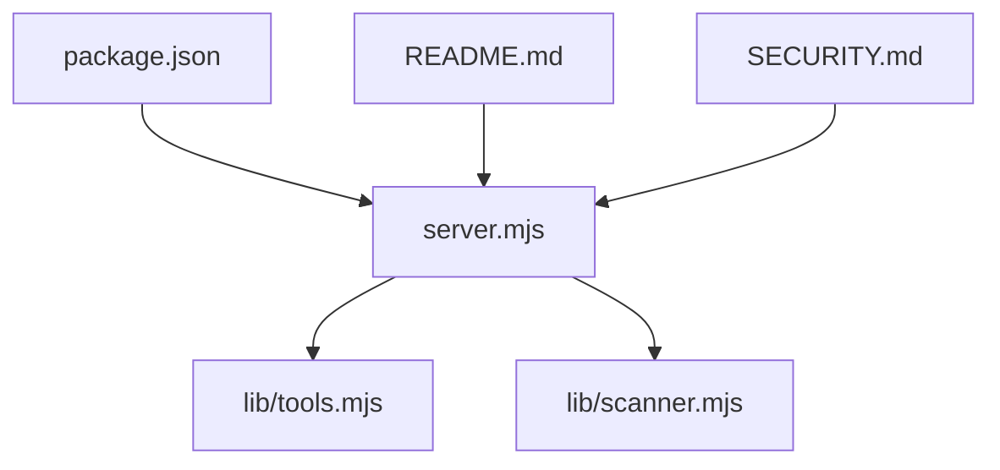
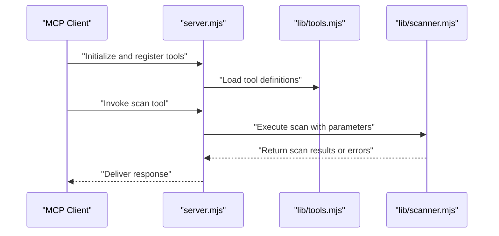
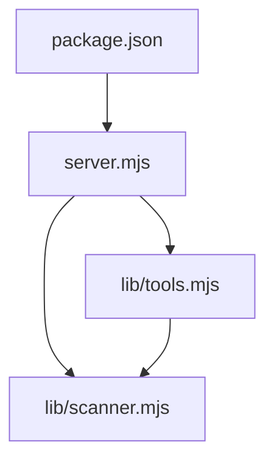

# Semgrep Server

<cite>
**Referenced Files in This Document**
- [server.mjs](file://mcp-servers/semgrep-server/server.mjs)
- [scanner.mjs](file://mcp-servers/semgrep-server/lib/scanner.mjs)
- [tools.mjs](file://mcp-servers/semgrep-server/lib/tools.mjs)
- [package.json](file://mcp-servers/semgrep-server/package.json)
- [README.md](file://mcp-servers/semgrep-server/README.md)
- [SECURITY.md](file://mcp-servers/semgrep-server/SECURITY.md)
</cite>

## Table of Contents
1. [Introduction](#introduction)
2. [Project Structure](#project-structure)
3. [Core Components](#core-components)
4. [Architecture Overview](#architecture-overview)
5. [Detailed Component Analysis](#detailed-component-analysis)
6. [Dependency Analysis](#dependency-analysis)
7. [Performance Considerations](#performance-considerations)
8. [Troubleshooting Guide](#troubleshooting-guide)
9. [Conclusion](#conclusion)

## Introduction
This document describes the Semgrep Server component within the repository. It is an MCP server that exposes scanning capabilities powered by Semgrep, enabling clients to run security and code quality checks against codebases through a standardized interface. The implementation is organized as a Node.js application with a clear separation between the server entrypoint, core scanning logic, and tool definitions.

## Project Structure
The Semgrep Server resides under mcp-servers/semgrep-server and follows a minimal, focused layout:
- server.mjs: Entry point that initializes and runs the MCP server.
- lib/scanner.mjs: Core scanning orchestration and integration with Semgrep.
- lib/tools.mjs: Tool definitions exposed to MCP clients.
- package.json: Dependencies and scripts for running the server.
- README.md: Usage and setup instructions.
- SECURITY.md: Security considerations and reporting guidance.

**Diagram sources**
- [server.mjs](file://mcp-servers/semgrep-server/server.mjs)
- [tools.mjs](file://mcp-servers/semgrep-server/lib/tools.mjs)
- [scanner.mjs](file://mcp-servers/semgrep-server/lib/scanner.mjs)
- [package.json](file://mcp-servers/semgrep-server/package.json)
- [README.md](file://mcp-servers/semgrep-server/README.md)
- [SECURITY.md](file://mcp-servers/semgrep-server/SECURITY.md)

**Section sources**
- [server.mjs](file://mcp-servers/semgrep-server/server.mjs)
- [scanner.mjs](file://mcp-servers/semgrep-server/lib/scanner.mjs)
- [tools.mjs](file://mcp-servers/semgrep-server/lib/tools.mjs)
- [package.json](file://mcp-servers/semgrep-server/package.json)
- [README.md](file://mcp-servers/semgrep-server/README.md)
- [SECURITY.md](file://mcp-servers/semgrep-server/SECURITY.md)

## Core Components
- Server Entrypoint (server.mjs): Initializes the MCP server, registers tools, and starts request handling.
- Scanner Module (lib/scanner.mjs): Encapsulates scanning workflows, including configuration resolution, invocation of Semgrep, and result aggregation.
- Tools Module (lib/tools.mjs): Defines MCP tools that clients can call to trigger scans and retrieve results.
- Package Configuration (package.json): Declares runtime dependencies and provides scripts to start the server.
- Documentation (README.md, SECURITY.md): Provides usage guidance and security posture information.

Key responsibilities:
- Expose a stable set of tools for scanning operations.
- Orchestrate scanning execution and error handling.
- Provide clear interfaces for MCP clients to interact with Semgrep.

**Section sources**
- [server.mjs](file://mcp-servers/semgrep-server/server.mjs)
- [scanner.mjs](file://mcp-servers/semgrep-server/lib/scanner.mjs)
- [tools.mjs](file://mcp-servers/semgrep-server/lib/tools.mjs)
- [package.json](file://mcp-servers/semgrep-server/package.json)
- [README.md](file://mcp-servers/semgrep-server/README.md)
- [SECURITY.md](file://mcp-servers/semgrep-server/SECURITY.md)

## Architecture Overview
At a high level, the Semgrep Server acts as an MCP server that translates client requests into scanning operations using Semgrep. The server registers tools defined in the tools module and delegates execution to the scanner module.

**Diagram sources**
- [server.mjs](file://mcp-servers/semgrep-server/server.mjs)
- [tools.mjs](file://mcp-servers/semgrep-server/lib/tools.mjs)
- [scanner.mjs](file://mcp-servers/semgrep-server/lib/scanner.mjs)

## Detailed Component Analysis

### Server Entrypoint (server.mjs)
Responsibilities:
- Initialize the MCP server instance.
- Register tools from the tools module.
- Start listening for incoming requests.

Operational notes:
- Ensures proper startup sequence before accepting requests.
- Delegates tool registration to a dedicated module for clarity and testability.

**Section sources**
- [server.mjs](file://mcp-servers/semgrep-server/server.mjs)

### Scanner Module (lib/scanner.mjs)
Responsibilities:
- Resolve scanning configuration (rules, targets, options).
- Execute Semgrep invocations and capture outputs.
- Aggregate and normalize results for consumption by tools.

Operational notes:
- Centralizes all scanning-related logic, making it easier to maintain and extend.
- Handles errors from external processes and returns structured responses.

**Section sources**
- [scanner.mjs](file://mcp-servers/semgrep-server/lib/scanner.mjs)

### Tools Module (lib/tools.mjs)
Responsibilities:
- Define MCP tools available to clients (e.g., scan endpoints).
- Map tool parameters to scanner inputs.
- Format responses for consistent client consumption.

Operational notes:
- Keeps tool contracts explicit and decoupled from scanning internals.
- Facilitates future expansion by adding new tools without altering core scanning logic.

**Section sources**
- [tools.mjs](file://mcp-servers/semgrep-server/lib/tools.mjs)

### Package Configuration (package.json)
Responsibilities:
- Declare runtime dependencies required by the server and scanner.
- Provide scripts to start the server and manage development tasks.

Operational notes:
- Centralizes dependency management for reproducible builds.
- Simplifies onboarding via documented scripts.

**Section sources**
- [package.json](file://mcp-servers/semgrep-server/package.json)

### Documentation (README.md, SECURITY.md)
Responsibilities:
- README.md: Setup, configuration, and usage examples for the Semgrep Server.
- SECURITY.md: Security considerations, vulnerability reporting, and best practices.

Operational notes:
- Guides users through installation and common workflows.
- Establishes security expectations and responsible disclosure channels.

**Section sources**
- [README.md](file://mcp-servers/semgrep-server/README.md)
- [SECURITY.md](file://mcp-servers/semgrep-server/SECURITY.md)

## Dependency Analysis
The Semgrep Server has a small, focused dependency graph centered around the MCP server runtime and Semgrep integration.

**Diagram sources**
- [package.json](file://mcp-servers/semgrep-server/package.json)
- [server.mjs](file://mcp-servers/semgrep-server/server.mjs)
- [tools.mjs](file://mcp-servers/semgrep-server/lib/tools.mjs)
- [scanner.mjs](file://mcp-servers/semgrep-server/lib/scanner.mjs)

**Section sources**
- [package.json](file://mcp-servers/semgrep-server/package.json)
- [server.mjs](file://mcp-servers/semgrep-server/server.mjs)
- [tools.mjs](file://mcp-servers/semgrep-server/lib/tools.mjs)
- [scanner.mjs](file://mcp-servers/semgrep-server/lib/scanner.mjs)

## Performance Considerations
- Scanning Scope: Limit target directories and rule sets to reduce execution time.
- Rule Optimization: Prefer targeted rules over broad patterns to minimize false positives and processing overhead.
- Concurrency: Avoid launching multiple scans concurrently unless resource capacity allows; consider queuing strategies if needed.
- Output Handling: Stream or paginate large result sets where possible to prevent memory pressure.
- Resource Limits: Configure timeouts and process limits to protect the host system during long-running scans.

[No sources needed since this section provides general guidance]

## Troubleshooting Guide
Common issues and resolutions:
- Missing Dependencies: Ensure all packages listed in package.json are installed before starting the server.
- Semgrep Availability: Verify that Semgrep is installed and accessible in the environment used by the scanner.
- Permission Errors: Confirm read access to target directories and write permissions for any temporary artifacts.
- Configuration Problems: Validate rule paths and target paths referenced by tools and scanner configurations.
- Error Reporting: Consult SECURITY.md for reporting vulnerabilities and operational incidents.

**Section sources**
- [package.json](file://mcp-servers/semgrep-server/package.json)
- [scanner.mjs](file://mcp-servers/semgrep-server/lib/scanner.mjs)
- [SECURITY.md](file://mcp-servers/semgrep-server/SECURITY.md)

## Conclusion
The Semgrep Server provides a clean, modular MCP-based interface to perform code scanning with Semgrep. Its architecture separates concerns across server initialization, tool definitions, and scanning orchestration, facilitating maintainability and extensibility. By following the performance and troubleshooting recommendations, teams can integrate reliable and efficient scanning workflows into their development pipelines.