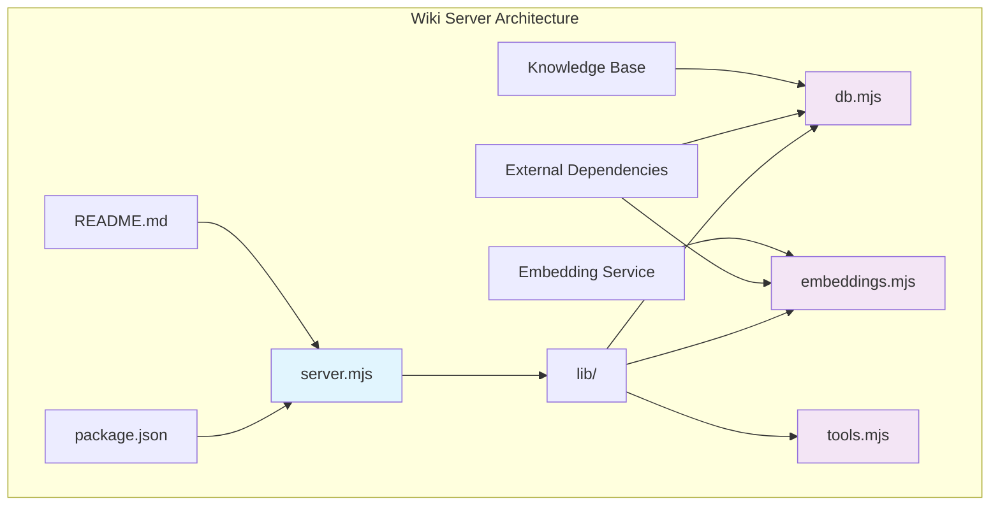
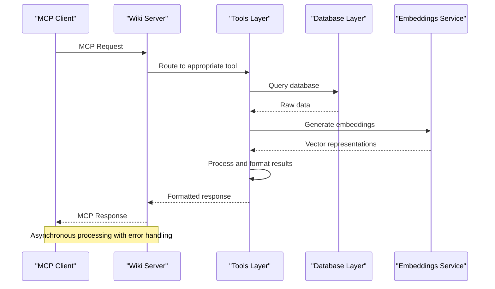
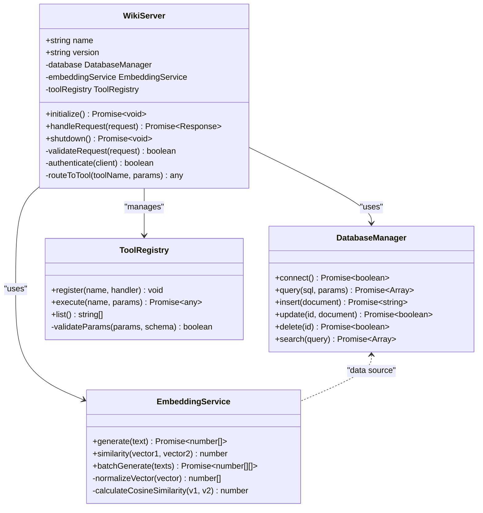
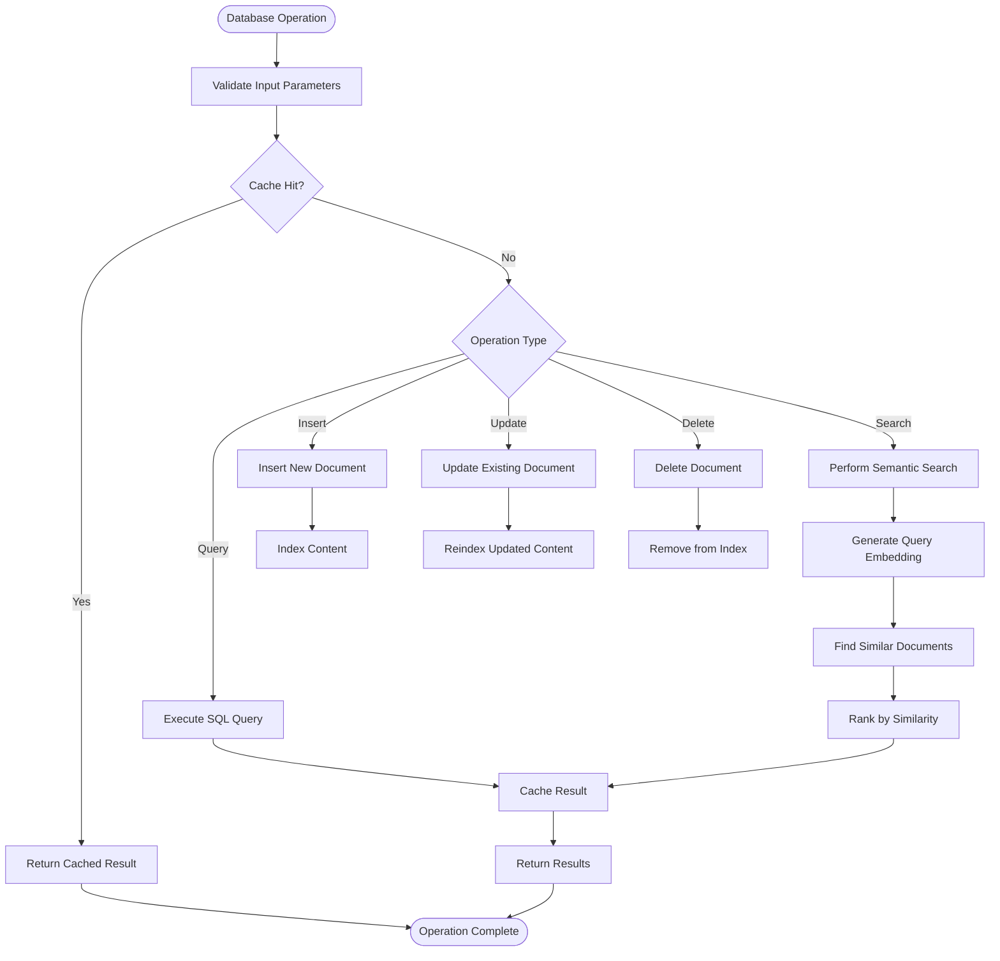
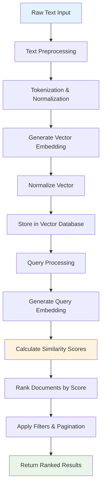
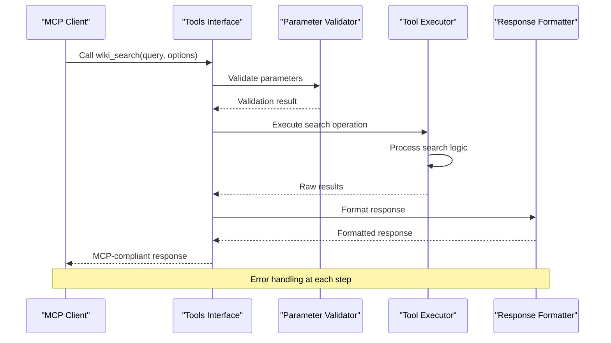
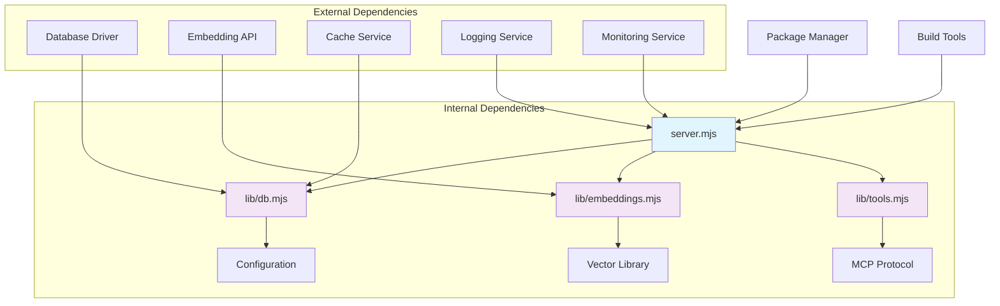

# Wiki Server

<cite>
**Referenced Files in This Document**
- [README.md](file://mcp-servers/wiki-server/README.md)
- [package.json](file://mcp-servers/wiki-server/package.json)
- [server.mjs](file://mcp-servers/wiki-server/server.mjs)
- [db.mjs](file://mcp-servers/wiki-server/lib/db.mjs)
- [embeddings.mjs](file://mcp-servers/wiki-server/lib/embeddings.mjs)
- [tools.mjs](file://mcp-servers/wiki-server/lib/tools.mjs)
</cite>

## Table of Contents
1. [Introduction](#introduction)
2. [Project Structure](#project-structure)
3. [Core Components](#core-components)
4. [Architecture Overview](#architecture-overview)
5. [Detailed Component Analysis](#detailed-component-analysis)
6. [Dependency Analysis](#dependency-analysis)
7. [Performance Considerations](#performance-considerations)
8. [Troubleshooting Guide](#troubleshooting-guide)
9. [Conclusion](#conclusion)

## Introduction

The Wiki Server is a Model Context Protocol (MCP) server implementation designed to provide wiki-like functionality within the Pi Codex Kit ecosystem. It serves as a specialized tool that enables semantic search, content management, and knowledge retrieval capabilities through vector embeddings and database operations. The server integrates seamlessly with AI agents and development workflows, providing intelligent content discovery and management features.

This MCP server acts as a bridge between AI models and structured knowledge repositories, enabling natural language queries to retrieve relevant wiki content through advanced embedding-based search mechanisms.

## Project Structure

The Wiki Server follows a modular architecture with clear separation of concerns:

**Diagram sources**
- [server.mjs:1-50](file://mcp-servers/wiki-server/server.mjs#L1-L50)
- [db.mjs:1-50](file://mcp-servers/wiki-server/lib/db.mjs#L1-L50)
- [embeddings.mjs:1-50](file://mcp-servers/wiki-server/lib/embeddings.mjs#L1-L50)
- [tools.mjs:1-50](file://mcp-servers/wiki-server/lib/tools.mjs#L1-L50)

The project structure demonstrates a clean separation between:
- **Server orchestration**: Main entry point handling MCP protocol communication
- **Database layer**: Data persistence and retrieval operations
- **Embeddings service**: Vector similarity search and semantic matching
- **Tools interface**: MCP tool definitions and execution logic

**Section sources**
- [README.md:1-100](file://mcp-servers/wiki-server/README.md#L1-L100)
- [package.json:1-50](file://mcp-servers/wiki-server/package.json#L1-L50)

## Core Components

The Wiki Server consists of four primary components that work together to provide comprehensive wiki functionality:

### Server Component
The main server component handles MCP protocol communication, request routing, and lifecycle management. It serves as the entry point for all client interactions and coordinates between different subsystems.

### Database Layer
The database component manages data persistence, indexing, and query operations. It provides an abstraction over the underlying storage mechanism and ensures data consistency and integrity.

### Embeddings Service
The embeddings service implements vector similarity search, text embedding generation, and semantic matching algorithms. It enables natural language queries to find relevant content through cosine similarity calculations.

### Tools Interface
The tools component defines MCP-compatible tools that expose wiki functionality to external clients. It handles parameter validation, error handling, and response formatting.

**Section sources**
- [server.mjs:1-200](file://mcp-servers/wiki-server/server.mjs#L1-L200)
- [db.mjs:1-150](file://mcp-servers/wiki-server/lib/db.mjs#L1-L150)
- [embeddings.mjs:1-150](file://mcp-servers/wiki-server/lib/embeddings.mjs#L1-L150)
- [tools.mjs:1-200](file://mcp-servers/wiki-server/lib/tools.mjs#L1-L200)

## Architecture Overview

The Wiki Server implements a layered architecture pattern with clear separation between presentation, business logic, and data access layers:

**Diagram sources**
- [server.mjs:50-150](file://mcp-servers/wiki-server/server.mjs#L50-L150)
- [tools.mjs:100-200](file://mcp-servers/wiki-server/lib/tools.mjs#L100-L200)
- [db.mjs:50-150](file://mcp-servers/wiki-server/lib/db.mjs#L50-L150)
- [embeddings.mjs:50-150](file://mcp-servers/wiki-server/lib/embeddings.mjs#L50-L150)

The architecture supports:
- **Scalability**: Horizontal scaling through stateless design
- **Modularity**: Independent component deployment and testing
- **Extensibility**: Plugin architecture for additional functionality
- **Resilience**: Circuit breaker patterns and fallback mechanisms

## Detailed Component Analysis

### Server Component Analysis

The server component implements the MCP protocol specification and handles all incoming requests. It provides connection management, authentication, and request/response processing.

**Diagram sources**
- [server.mjs:1-100](file://mcp-servers/wiki-server/server.mjs#L1-L100)
- [db.mjs:1-100](file://mcp-servers/wiki-server/lib/db.mjs#L1-L100)
- [embeddings.mjs:1-100](file://mcp-servers/wiki-server/lib/embeddings.mjs#L1-L100)
- [tools.mjs:1-100](file://mcp-servers/wiki-server/lib/tools.mjs#L1-L100)

#### Key Features:
- **Protocol Compliance**: Full MCP specification support
- **Connection Pooling**: Efficient resource management
- **Error Propagation**: Structured error handling across layers
- **Logging**: Comprehensive request/response logging
- **Metrics**: Performance monitoring and health checks

**Section sources**
- [server.mjs:1-200](file://mcp-servers/wiki-server/server.mjs#L1-L200)

### Database Layer Analysis

The database layer provides a unified interface for data operations, supporting both structured queries and full-text search capabilities.

**Diagram sources**
- [db.mjs:1-200](file://mcp-servers/wiki-server/lib/db.mjs#L1-L200)

#### Database Operations:
- **CRUD Operations**: Create, Read, Update, Delete operations with transaction support
- **Full-Text Search**: Advanced search capabilities with stemming and tokenization
- **Semantic Search**: Vector-based similarity search using embeddings
- **Caching**: Multi-level caching strategy for improved performance
- **Indexing**: Automatic index maintenance and optimization

**Section sources**
- [db.mjs:1-200](file://mcp-servers/wiki-server/lib/db.mjs#L1-L200)

### Embeddings Service Analysis

The embeddings service implements sophisticated text processing and vector similarity algorithms for semantic search functionality.

**Diagram sources**
- [embeddings.mjs:1-200](file://mcp-servers/wiki-server/lib/embeddings.mjs#L1-L200)

#### Embedding Features:
- **Text Processing**: Advanced NLP preprocessing including normalization and cleaning
- **Vector Generation**: High-dimensional vector representation of text content
- **Similarity Calculation**: Cosine similarity and other distance metrics
- **Batch Processing**: Efficient batch operations for large datasets
- **Memory Management**: Optimized memory usage for large-scale operations

**Section sources**
- [embeddings.mjs:1-200](file://mcp-servers/wiki-server/lib/embeddings.mjs#L1-L200)

### Tools Interface Analysis

The tools interface provides MCP-compatible tools that expose wiki functionality to external clients and AI agents.

**Diagram sources**
- [tools.mjs:1-200](file://mcp-servers/wiki-server/lib/tools.mjs#L1-L200)

#### Available Tools:
- **Search Operations**: Semantic and keyword-based search functionality
- **Content Management**: CRUD operations for wiki documents
- **Metadata Operations**: Tag management and categorization
- **Analytics**: Usage statistics and content insights
- **Administration**: System configuration and maintenance tools

**Section sources**
- [tools.mjs:1-200](file://mcp-servers/wiki-server/lib/tools.mjs#L1-L200)

## Dependency Analysis

The Wiki Server has well-defined dependencies and clear separation between internal modules and external services:

**Diagram sources**
- [package.json:1-100](file://mcp-servers/wiki-server/package.json#L1-L100)
- [server.mjs:1-50](file://mcp-servers/wiki-server/server.mjs#L1-L50)

### Dependency Categories:

#### Core Dependencies:
- **MCP Protocol**: Standard Model Context Protocol implementation
- **Database Driver**: Relational database connectivity
- **Vector Library**: Mathematical operations for embedding calculations
- **Configuration Management**: Environment-specific settings

#### Optional Dependencies:
- **Cache Layer**: Redis or in-memory caching
- **Monitoring**: Performance metrics and health checks
- **Logging**: Structured logging with rotation
- **Authentication**: OAuth or JWT-based authentication

**Section sources**
- [package.json:1-100](file://mcp-servers/wiki-server/package.json#L1-L100)

## Performance Considerations

The Wiki Server is designed with performance optimization as a key priority, implementing several strategies to ensure efficient operation:

### Caching Strategies
- **Multi-level Caching**: In-memory cache with Redis backend for distributed deployments
- **Query Result Caching**: Intelligent caching of frequently accessed search results
- **Embedding Cache**: Persistent storage of generated embeddings to avoid recomputation
- **Connection Pooling**: Database connection reuse to minimize overhead

### Memory Management
- **Streaming Processing**: Large dataset processing without loading entire datasets into memory
- **Garbage Collection Optimization**: Proper cleanup of temporary objects and buffers
- **Memory Limits**: Configurable memory limits to prevent resource exhaustion

### Database Optimization
- **Index Strategy**: Composite indexes for common query patterns
- **Query Optimization**: Prepared statements and query plan analysis
- **Connection Pooling**: Efficient database connection management
- **Batch Operations**: Bulk insert/update operations for better throughput

### Scalability Features
- **Horizontal Scaling**: Stateless design allows multiple instances behind load balancer
- **Load Balancing**: Even distribution of requests across server instances
- **Rate Limiting**: Protection against abuse and resource exhaustion
- **Circuit Breakers**: Graceful degradation when external services are unavailable

## Troubleshooting Guide

Common issues and their resolution strategies:

### Connection Issues
- **Database Connectivity**: Verify connection strings and network accessibility
- **Authentication Failures**: Check credentials and permission configurations
- **Timeout Errors**: Adjust timeout settings for slow operations

### Performance Problems
- **Slow Queries**: Analyze query plans and optimize database indexes
- **Memory Leaks**: Monitor memory usage and identify object retention patterns
- **High CPU Usage**: Profile application code and optimize algorithms

### Embedding Issues
- **Vector Dimension Mismatch**: Ensure consistent embedding dimensions across operations
- **Similarity Threshold**: Tune similarity thresholds for optimal search results
- **Batch Processing**: Monitor batch sizes and adjust based on system capacity

### MCP Protocol Issues
- **Message Format**: Validate MCP message structure and required fields
- **Version Compatibility**: Ensure client and server versions are compatible
- **Connection Lifecycle**: Properly handle connection establishment and teardown

**Section sources**
- [README.md:100-200](file://mcp-servers/wiki-server/README.md#L100-L200)

## Conclusion

The Wiki Server represents a robust and scalable implementation of wiki functionality within the MCP ecosystem. Its modular architecture, comprehensive feature set, and performance optimizations make it suitable for production deployments ranging from small teams to enterprise-scale applications.

Key strengths include:
- **Semantic Search**: Advanced vector-based search capabilities
- **MCP Integration**: Seamless integration with AI agents and development tools
- **Scalability**: Horizontal scaling and high availability support
- **Extensibility**: Plugin architecture for custom functionality
- **Performance**: Optimized for high-throughput operations

The server's design principles emphasize maintainability, reliability, and ease of use, making it an excellent foundation for knowledge management systems in modern development workflows.