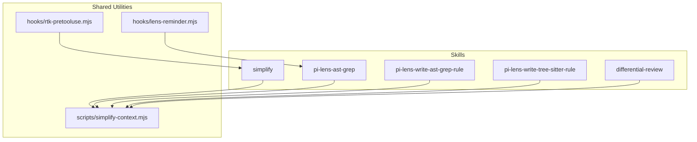
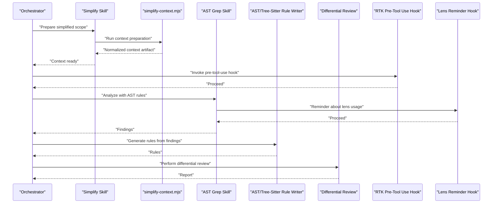
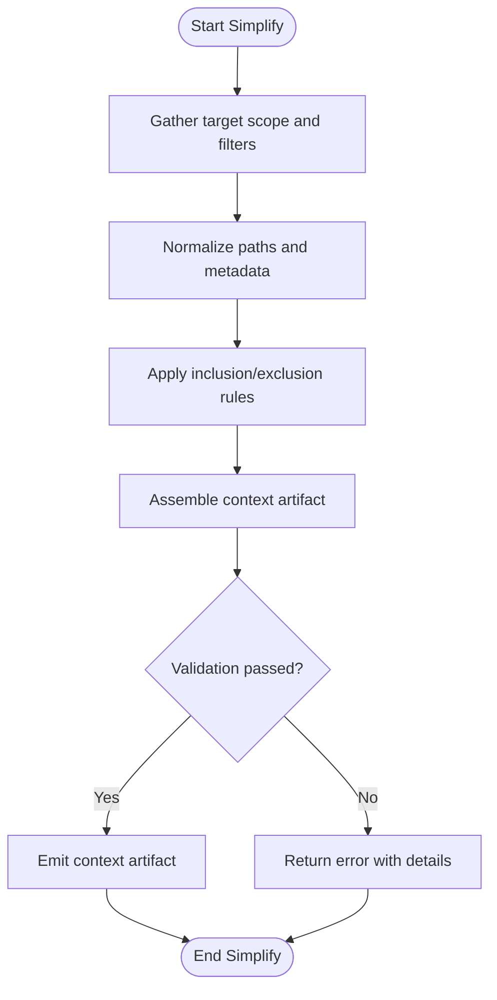
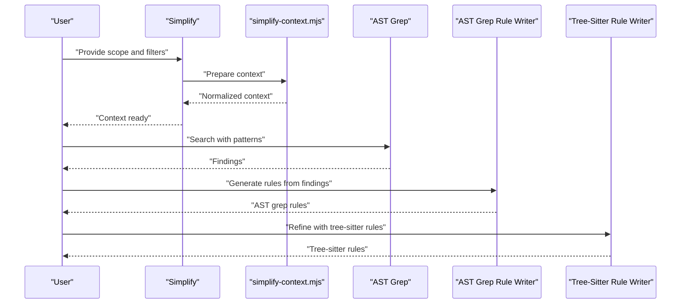
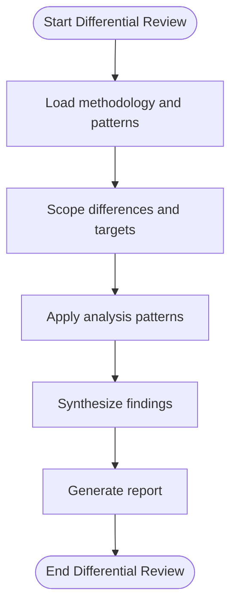
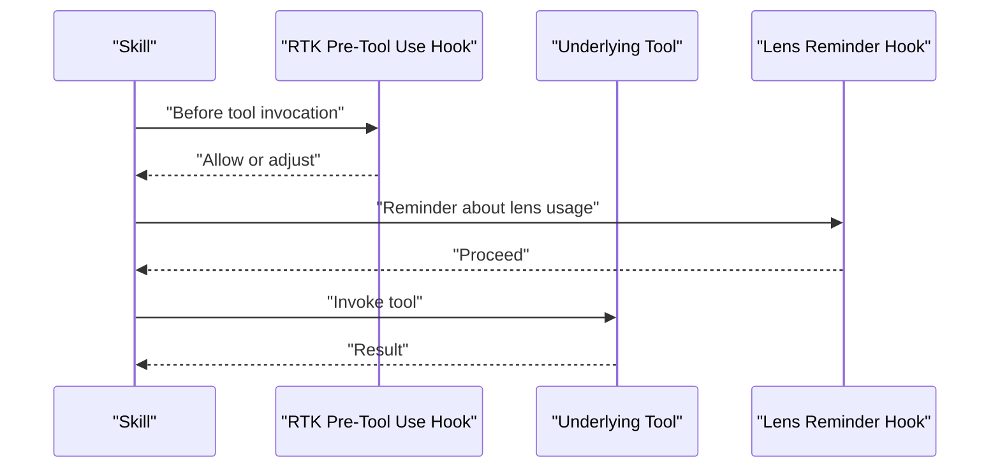
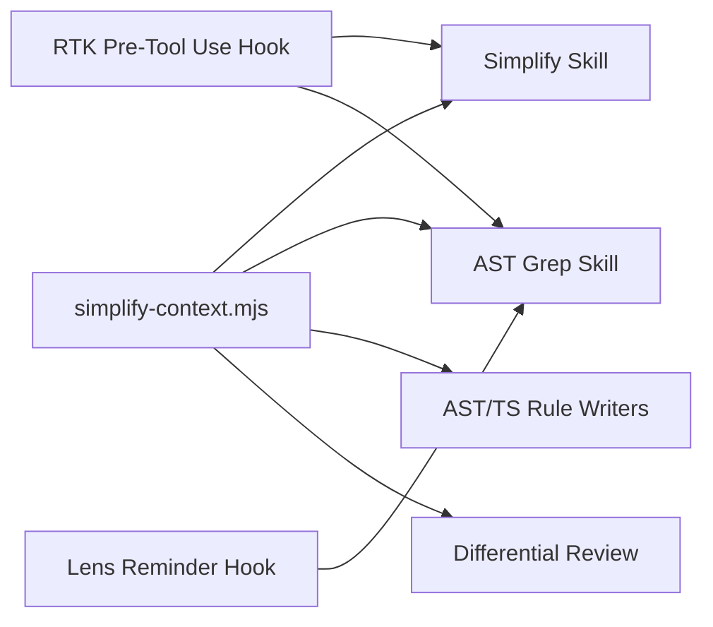

# Skill Composition & Orchestration

<cite>
**Referenced Files in This Document**
- [README.md](file://README.md)
- [skills/README.md](file://skills/README.md)
- [skills/simplify/SKILL.md](file://skills/simplify/SKILL.md)
- [skills/simplify/scripts/simplify-context.mjs](file://skills/simplify/scripts/simplify-context.mjs)
- [skills/pi-lens-ast-grep/SKILL.md](file://skills/pi-lens-ast-grep/SKILL.md)
- [skills/pi-lens-write-ast-grep-rule/SKILL.md](file://skills/pi-lens-write-ast-grep-rule/SKILL.md)
- [skills/pi-lens-write-tree-sitter-rule/SKILL.md](file://skills/pi-lens-write-tree-sitter-rule/SKILL.md)
- [skills/differential-review/SKILL.md](file://skills/differential-review/SKILL.md)
- [skills/differential-review/methodology.md](file://skills/differential-review/methodology.md)
- [skills/differential-review/patterns.md](file://skills/differential-review/patterns.md)
- [skills/differential-review/reporting.md](file://skills/differential-review/adversarial.md)
- [hooks/rtk-pretooluse.mjs](file://hooks/rtk-pretooluse.mjs)
- [hooks/lens-reminder.mjs](file://hooks/lens-reminder.mjs)
</cite>

## Table of Contents
1. [Introduction](#introduction)
2. [Project Structure](#project-structure)
3. [Core Components](#core-components)
4. [Architecture Overview](#architecture-overview)
5. [Detailed Component Analysis](#detailed-component-analysis)
6. [Dependency Analysis](#dependency-analysis)
7. [Performance Considerations](#performance-considerations)
8. [Troubleshooting Guide](#troubleshooting-guide)
9. [Conclusion](#conclusion)
10. [Appendices](#appendices)

## Introduction
This document explains how multiple skills can be composed and orchestrated to build complex, reusable workflows. It focuses on:
- Combining AST-related skills for code analysis pipelines
- Sharing context between skills using scripts such as simplify-context.mjs
- Passing data between skills and dependency injection patterns
- Practical orchestration strategies for multi-step analysis

The goal is to provide a practical guide for building robust, composable skill chains that are easy to maintain and extend.

## Project Structure
At a high level, the repository organizes capabilities as “skills,” each with its own SKILL.md describing purpose, inputs, outputs, and usage. Supporting artifacts include:
- Scripts for context preparation and transformation (e.g., simplify-context.mjs)
- Hooks for pre-processing or reminders around tool use
- Reference materials and methodologies for review and analysis workflows

**Diagram sources**
- [skills/simplify/SKILL.md](file://skills/simplify/SKILL.md)
- [skills/pi-lens-ast-grep/SKILL.md](file://skills/pi-lens-ast-grep/SKILL.md)
- [skills/pi-lens-write-ast-grep-rule/SKILL.md](file://skills/pi-lens-write-ast-grep-rule/SKILL.md)
- [skills/pi-lens-write-tree-sitter-rule/SKILL.md](file://skills/pi-lens-write-tree-sitter-rule/SKILL.md)
- [skills/differential-review/SKILL.md](file://skills/differential-review/SKILL.md)
- [skills/simplify/scripts/simplify-context.mjs](file://skills/simplify/scripts/simplify-context.mjs)
- [hooks/rtk-pretooluse.mjs](file://hooks/rtk-pretooluse.mjs)
- [hooks/lens-reminder.mjs](file://hooks/lens-reminder.mjs)

**Section sources**
- [README.md](file://README.md)
- [skills/README.md](file://skills/README.md)

## Core Components
- Skills: Self-contained units of capability described by SKILL.md files. They define inputs, expected outputs, and recommended usage. Examples include AST grep, rule writing, simplification, and differential review.
- Context script: A shared utility that prepares and normalizes context for downstream skills. The simplify-context.mjs script centralizes context assembly so that multiple skills can consume consistent inputs.
- Hooks: Pre-tool-use hooks that can inject reminders or perform preparatory steps before invoking tools. These help standardize behavior across skills.

Key responsibilities:
- Simplify skill: Prepares a focused, minimal context for analysis using simplify-context.mjs.
- AST skills: Provide pattern matching and rule generation capabilities over codebases.
- Differential review skill: Orchestrates comparative analysis and reporting based on methodology and patterns.

**Section sources**
- [skills/simplify/SKILL.md](file://skills/simplify/SKILL.md)
- [skills/pi-lens-ast-grep/SKILL.md](file://skills/pi-lens-ast-grep/SKILL.md)
- [skills/pi-lens-write-ast-grep-rule/SKILL.md](file://skills/pi-lens-write-ast-grep-rule/SKILL.md)
- [skills/pi-lens-write-tree-sitter-rule/SKILL.md](file://skills/pi-lens-write-tree-sitter-rule/SKILL.md)
- [skills/differential-review/SKILL.md](file://skills/differential-review/SKILL.md)
- [skills/simplify/scripts/simplify-context.mjs](file://skills/simplify/scripts/simplify-context.mjs)
- [hooks/rtk-pretooluse.mjs](file://hooks/rtk-pretooluse.mjs)
- [hooks/lens-reminder.mjs](file://hooks/lens-reminder.mjs)

## Architecture Overview
The composition model centers on a shared context artifact produced by simplify-context.mjs. Downstream AST and review skills consume this normalized context to perform targeted operations. Hooks augment the workflow by injecting reminders or performing pre-checks before tool invocations.

**Diagram sources**
- [skills/simplify/SKILL.md](file://skills/simplify/SKILL.md)
- [skills/simplify/scripts/simplify-context.mjs](file://skills/simplify/scripts/simplify-context.mjs)
- [skills/pi-lens-ast-grep/SKILL.md](file://skills/pi-lens-ast-grep/SKILL.md)
- [skills/pi-lens-write-ast-grep-rule/SKILL.md](file://skills/pi-lens-write-ast-grep-rule/SKILL.md)
- [skills/pi-lens-write-tree-sitter-rule/SKILL.md](file://skills/pi-lens-write-tree-sitter-rule/SKILL.md)
- [skills/differential-review/SKILL.md](file://skills/differential-review/SKILL.md)
- [hooks/rtk-pretooluse.mjs](file://hooks/rtk-pretooluse.mjs)
- [hooks/lens-reminder.mjs](file://hooks/lens-reminder.mjs)

## Detailed Component Analysis

### Simplify Skill and Context Sharing
The simplify skill orchestrates context preparation via simplify-context.mjs. Its role is to produce a focused, normalized context artifact that downstream skills can reliably consume. This ensures consistency across analyses and reduces duplication of setup logic.

- Inputs: Target scope, filters, and optional constraints
- Outputs: Normalized context artifact consumed by other skills
- Shared mechanism: simplify-context.mjs centralizes context assembly and transformation

**Diagram sources**
- [skills/simplify/SKILL.md](file://skills/simplify/SKILL.md)
- [skills/simplify/scripts/simplify-context.mjs](file://skills/simplify/scripts/simplify-context.mjs)

**Section sources**
- [skills/simplify/SKILL.md](file://skills/simplify/SKILL.md)
- [skills/simplify/scripts/simplify-context.mjs](file://skills/simplify/scripts/simplify-context.mjs)

### AST-Related Skills Composition
AST-related skills form a pipeline for code analysis:
- pi-lens-ast-grep: Executes AST-based pattern searches against the provided context
- pi-lens-write-ast-grep-rule: Generates AST grep rules derived from findings or specifications
- pi-lens-write-tree-sitter-rule: Produces tree-sitter rules for deeper structural queries

Composition strategy:
- Use simplify-context.mjs to prepare a stable input set
- Run AST grep to identify patterns and potential issues
- Generate rules to codify findings for reuse
- Optionally refine with tree-sitter rules for precise structural matches

**Diagram sources**
- [skills/pi-lens-ast-grep/SKILL.md](file://skills/pi-lens-ast-grep/SKILL.md)
- [skills/pi-lens-write-ast-grep-rule/SKILL.md](file://skills/pi-lens-write-ast-grep-rule/SKILL.md)
- [skills/pi-lens-write-tree-sitter-rule/SKILL.md](file://skills/pi-lens-write-tree-sitter-rule/SKILL.md)
- [skills/simplify/SKILL.md](file://skills/simplify/SKILL.md)
- [skills/simplify/scripts/simplify-context.mjs](file://skills/simplify/scripts/simplify-context.mjs)

**Section sources**
- [skills/pi-lens-ast-grep/SKILL.md](file://skills/pi-lens-ast-grep/SKILL.md)
- [skills/pi-lens-write-ast-grep-rule/SKILL.md](file://skills/pi-lens-write-ast-grep-rule/SKILL.md)
- [skills/pi-lens-write-tree-sitter-rule/SKILL.md](file://skills/pi-lens-write-tree-sitter-rule/SKILL.md)
- [skills/simplify/SKILL.md](file://skills/simplify/SKILL.md)
- [skills/simplify/scripts/simplify-context.mjs](file://skills/simplify/scripts/simplify-context.mjs)

### Differential Review Orchestration
The differential-review skill coordinates comparative analysis and reporting. It leverages methodology, patterns, and adversarial perspectives to produce comprehensive reports.

- Methodology: Defines step-by-step approach for comparing changes and identifying risks
- Patterns: Provides common analysis patterns to apply consistently
- Reporting: Structures output for clarity and actionability

**Diagram sources**
- [skills/differential-review/SKILL.md](file://skills/differential-review/SKILL.md)
- [skills/differential-review/methodology.md](file://skills/differential-review/methodology.md)
- [skills/differential-review/patterns.md](file://skills/differential-review/patterns.md)
- [skills/differential-review/reporting.md](file://skills/differential-review/reporting.md)
- [skills/differential-review/adversarial.md](file://skills/differential-review/adversarial.md)

**Section sources**
- [skills/differential-review/SKILL.md](file://skills/differential-review/SKILL.md)
- [skills/differential-review/methodology.md](file://skills/differential-review/methodology.md)
- [skills/differential-review/patterns.md](file://skills/differential-review/patterns.md)
- [skills/differential-review/reporting.md](file://skills/differential-review/reporting.md)
- [skills/differential-review/adversarial.md](file://skills/differential-review/adversarial.md)

### Hooks and Dependency Injection
Hooks enable pre-tool-use behaviors and reminders that standardize interactions across skills. They act as lightweight dependency injection points to enforce policies, log actions, or prompt users before invoking tools.

- rtk-pretooluse.mjs: Pre-tool-use hook for standardized checks or prompts
- lens-reminder.mjs: Reminder hook to guide proper usage of lens features

**Diagram sources**
- [hooks/rtk-pretooluse.mjs](file://hooks/rtk-pretooluse.mjs)
- [hooks/lens-reminder.mjs](file://hooks/lens-reminder.mjs)

**Section sources**
- [hooks/rtk-pretooluse.mjs](file://hooks/rtk-pretooluse.mjs)
- [hooks/lens-reminder.mjs](file://hooks/lens-reminder.mjs)

## Dependency Analysis
Skills depend on shared context artifacts and hooks. The simplify-context.mjs script is a central dependency for AST and review skills. Hooks provide cross-cutting concerns like reminders and pre-checks.

**Diagram sources**
- [skills/simplify/scripts/simplify-context.mjs](file://skills/simplify/scripts/simplify-context.mjs)
- [skills/simplify/SKILL.md](file://skills/simplify/SKILL.md)
- [skills/pi-lens-ast-grep/SKILL.md](file://skills/pi-lens-ast-grep/SKILL.md)
- [skills/pi-lens-write-ast-grep-rule/SKILL.md](file://skills/pi-lens-write-ast-grep-rule/SKILL.md)
- [skills/pi-lens-write-tree-sitter-rule/SKILL.md](file://skills/pi-lens-write-tree-sitter-rule/SKILL.md)
- [skills/differential-review/SKILL.md](file://skills/differential-review/SKILL.md)
- [hooks/rtk-pretooluse.mjs](file://hooks/rtk-pretooluse.mjs)
- [hooks/lens-reminder.mjs](file://hooks/lens-reminder.mjs)

**Section sources**
- [skills/simplify/scripts/simplify-context.mjs](file://skills/simplify/scripts/simplify-context.mjs)
- [skills/simplify/SKILL.md](file://skills/simplify/SKILL.md)
- [skills/pi-lens-ast-grep/SKILL.md](file://skills/pi-lens-ast-grep/SKILL.md)
- [skills/pi-lens-write-ast-grep-rule/SKILL.md](file://skills/pi-lens-write-ast-grep-rule/SKILL.md)
- [skills/pi-lens-write-tree-sitter-rule/SKILL.md](file://skills/pi-lens-write-tree-sitter-rule/SKILL.md)
- [skills/differential-review/SKILL.md](file://skills/differential-review/SKILL.md)
- [hooks/rtk-pretooluse.mjs](file://hooks/rtk-pretooluse.mjs)
- [hooks/lens-reminder.mjs](file://hooks/lens-reminder.mjs)

## Performance Considerations
- Prefer narrow scopes: Use simplify-context.mjs to limit the analysis surface area and reduce processing time.
- Cache intermediate artifacts: Reuse normalized context and generated rules to avoid redundant work.
- Parallelize independent steps: Where possible, run non-dependent tasks concurrently (e.g., generating multiple rule sets).
- Incremental updates: For large repositories, focus on changed files or modules to minimize overhead.
- Rule optimization: Keep AST and tree-sitter rules specific to reduce false positives and improve speed.

[No sources needed since this section provides general guidance]

## Troubleshooting Guide
Common issues and resolutions:
- Context preparation failures: Validate inputs and filters used by simplify-context.mjs; ensure paths exist and match inclusion rules.
- Hook interruptions: Check pre-tool-use hook logs to understand why invocations were blocked or adjusted.
- Rule generation mismatches: Refine patterns and ensure they align with the current codebase structure; consider adding more specific constraints.
- Differential review inconsistencies: Confirm methodology and patterns are up-to-date; verify that change scoping matches expectations.

**Section sources**
- [skills/simplify/scripts/simplify-context.mjs](file://skills/simplify/scripts/simplify-context.mjs)
- [hooks/rtk-pretooluse.mjs](file://hooks/rtk-pretooluse.mjs)
- [skills/differential-review/methodology.md](file://skills/differential-review/methodology.md)
- [skills/differential-review/patterns.md](file://skills/differential-review/patterns.md)

## Conclusion
By composing skills around a shared context artifact and leveraging hooks for dependency injection, you can build robust, scalable analysis pipelines. The simplify skill and simplify-context.mjs provide a reliable foundation for AST-related skills and differential review. Following the orchestration strategies outlined here will help you create maintainable workflows that are both powerful and efficient.

[No sources needed since this section summarizes without analyzing specific files]

## Appendices
- Practical example: Build an AST analysis pipeline
  - Step 1: Use simplify skill to prepare a focused context
  - Step 2: Run AST grep to find patterns
  - Step 3: Generate AST grep rules from findings
  - Step 4: Refine with tree-sitter rules for precision
  - Step 5: Perform differential review to assess impact and generate a report

[No sources needed since this section provides conceptual guidance]