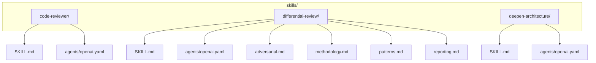
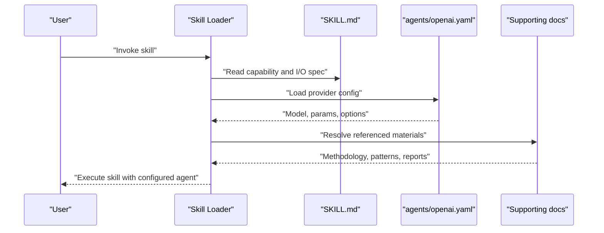
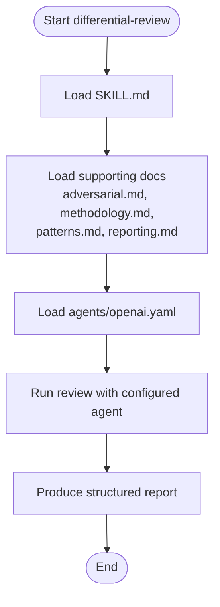
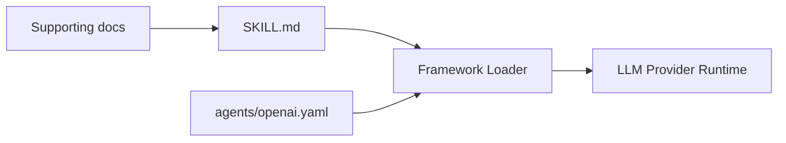

# Skill Definition & Configuration

<cite>
**Referenced Files in This Document**
- [skills/README.md](file://skills/README.md)
- [skills/code-reviewer/SKILL.md](file://skills/code-reviewer/SKILL.md)
- [skills/differential-review/SKILL.md](file://skills/differential-review/SKILL.md)
- [skills/deepen-architecture/SKILL.md](file://skills/deepen-architecture/SKILL.md)
- [skills/code-reviewer/agents/openai.yaml](file://skills/code-reviewer/agents/openai.yaml)
- [skills/differential-review/agents/openai.yaml](file://skills/differential-review/agents/openai.yaml)
- [skills/deepen-architecture/agents/openai.yaml](file://skills/deepen-architecture/agents/openai.yaml)
- [skills/differential-review/adversarial.md](file://skills/differential-review/adversarial.md)
- [skills/differential-review/methodology.md](file://skills/differential-review/methodology.md)
- [skills/differential-review/patterns.md](file://skills/differential-review/patterns.md)
- [skills/differential-review/reporting.md](file://skills/differential-review/reporting.md)
</cite>

## Table of Contents
1. [Introduction](#introduction)
2. [Project Structure](#project-structure)
3. [Core Components](#core-components)
4. [Architecture Overview](#architecture-overview)
5. [Detailed Component Analysis](#detailed-component-analysis)
6. [Dependency Analysis](#dependency-analysis)
7. [Performance Considerations](#performance-considerations)
8. [Troubleshooting Guide](#troubleshooting-guide)
9. [Conclusion](#conclusion)

## Introduction

This document explains how to define and configure skills in the Pi Codex Kit framework. It covers:
- The SKILL.md file structure and conventions
- YAML configuration schema for agents
- Agent setup patterns and execution parameters
- How skills declare capabilities, dependencies, and inputs/outputs
- Integration points with the broader framework
- Examples from code-reviewer, differential-review, and deepen-architecture skills

The goal is to help you author consistent, maintainable skills that integrate cleanly with the platform’s runtime and tooling.

## Project Structure

Skills are organized as feature directories under skills/. Each skill typically includes:
- A SKILL.md describing purpose, inputs, outputs, usage, and references
- An agents/ folder with provider-specific configuration (e.g., openai.yaml)
- Optional supporting documents (methodologies, patterns, reporting templates)
- Optional scripts or resources used at runtime

**Diagram sources**
- [skills/code-reviewer/SKILL.md](file://skills/code-reviewer/SKILL.md)
- [skills/code-reviewer/agents/openai.yaml](file://skills/code-reviewer/agents/openai.yaml)
- [skills/differential-review/SKILL.md](file://skills/differential-review/SKILL.md)
- [skills/differential-review/agents/openai.yaml](file://skills/differential-review/agents/openai.yaml)
- [skills/differential-review/adversarial.md](file://skills/differential-review/adversarial.md)
- [skills/differential-review/methodology.md](file://skills/differential-review/methodology.md)
- [skills/differential-review/patterns.md](file://skills/differential-review/patterns.md)
- [skills/differential-review/reporting.md](file://skills/differential-review/reporting.md)
- [skills/deepen-architecture/SKILL.md](file://skills/deepen-architecture/SKILL.md)
- [skills/deepen-architecture/agents/openai.yaml](file://skills/deepen-architecture/agents/openai.yaml)

**Section sources**
- [skills/README.md](file://skills/README.md)

## Core Components

A skill consists of two primary artifacts:
- SKILL.md: Human-readable specification of capability, inputs, outputs, usage, and references
- agents/openai.yaml: Provider-specific configuration that binds the skill to an LLM provider and defines execution parameters

Key responsibilities:
- SKILL.md declares what the skill does, when to use it, required inputs, expected outputs, and any constraints or references
- agents/openai.yaml configures model selection, temperature, max tokens, and other runtime behavior
- Supporting documents provide methodology, patterns, and reporting guidance consumed by the skill

**Section sources**
- [skills/code-reviewer/SKILL.md](file://skills/code-reviewer/SKILL.md)
- [skills/differential-review/SKILL.md](file://skills/differential-review/SKILL.md)
- [skills/deepen-architecture/SKILL.md](file://skills/deepen-architecture/SKILL.md)
- [skills/code-reviewer/agents/openai.yaml](file://skills/code-reviewer/agents/openai.yaml)
- [skills/differential-review/agents/openai.yaml](file://skills/differential-review/agents/openai.yaml)
- [skills/deepen-architecture/agents/openai.yaml](file://skills/deepen-architecture/agents/openai.yaml)

## Architecture Overview

At a high level, the framework loads a skill by reading its SKILL.md and associated agent configuration. The agent configuration determines which model and parameters to use. The skill may reference additional documents that inform its behavior.

[No diagram sources needed since this diagram shows conceptual workflow, not actual code structure]

## Detailed Component Analysis

### SKILL.md Structure and Conventions

A well-formed SKILL.md should include:
- Title and short description
- Purpose and scope
- When to use (trigger conditions)
- Inputs (types, formats, examples)
- Outputs (deliverables, format, where they are written)
- Dependencies (tools, external services, prerequisites)
- Execution notes (constraints, safety considerations)
- References to methodology, patterns, and reporting templates

Best practices:
- Keep descriptions concise and actionable
- Explicitly list required inputs and their formats
- Define clear output contracts and locations
- Link to supporting documents for deeper guidance
- Avoid embedding large prompts; keep SKILL.md focused on intent and contract

Example skill definitions:
- code-reviewer: Focuses on reviewing diffs and code changes
- differential-review: Adds adversarial review, methodology, patterns, and reporting
- deepen-architecture: Emphasizes architectural analysis and deepening understanding

**Section sources**
- [skills/code-reviewer/SKILL.md](file://skills/code-reviewer/SKILL.md)
- [skills/differential-review/SKILL.md](file://skills/differential-review/SKILL.md)
- [skills/deepen-architecture/SKILL.md](file://skills/deepen-architecture/SKILL.md)

### YAML Configuration Schema (agents/openai.yaml)

The agent configuration binds a skill to a specific provider and model. Typical fields include:
- provider: e.g., openai
- model: model identifier
- temperature: creativity vs determinism
- max_tokens: output length cap
- system prompt or instructions: optional behavioral guidance
- tools or function calling: optional integration with external tools
- retries/backoff: optional resilience settings

Guidelines:
- Pin models explicitly for reproducibility
- Tune temperature per skill (lower for deterministic tasks like reviews)
- Set max_tokens aligned with expected output size
- Use separate configs per provider if needed

Examples:
- code-reviewer agent configuration
- differential-review agent configuration
- deepen-architecture agent configuration

**Section sources**
- [skills/code-reviewer/agents/openai.yaml](file://skills/code-reviewer/agents/openai.yaml)
- [skills/differential-review/agents/openai.yaml](file://skills/differential-review/agents/openai.yaml)
- [skills/deepen-architecture/agents/openai.yaml](file://skills/deepen-architecture/agents/openai.yaml)

### Agent Setup Patterns

Common patterns observed across skills:
- One agent config per provider inside agents/
- Consistent naming: openai.yaml for OpenAI-compatible providers
- Minimal, explicit parameters to reduce drift
- Clear separation between skill intent (SKILL.md) and runtime behavior (openai.yaml)

Operational tips:
- Version your agent configs alongside skills
- Validate configs before deployment
- Centralize shared parameters via environment variables if supported

**Section sources**
- [skills/code-reviewer/agents/openai.yaml](file://skills/code-reviewer/agents/openai.yaml)
- [skills/differential-review/agents/openai.yaml](file://skills/differential-review/agents/openai.yaml)
- [skills/deepen-architecture/agents/openai.yaml](file://skills/deepen-architecture/agents/openai.yaml)

### Capability Declaration and Dependencies

Capabilities are declared in SKILL.md through:
- Purpose statements
- Trigger conditions (“when to use”)
- Input/output contracts
- Tooling requirements (e.g., diff access, repository context)

Dependencies include:
- External tools (linters, analyzers)
- Data sources (diffs, PR metadata, repo state)
- Reference materials (methodology, patterns, reporting)

Integration points:
- The framework reads SKILL.md to understand invocation semantics
- The agent config controls model selection and runtime behavior
- Supporting documents inform reasoning and output formatting

**Section sources**
- [skills/code-reviewer/SKILL.md](file://skills/code-reviewer/SKILL.md)
- [skills/differential-review/SKILL.md](file://skills/differential-review/SKILL.md)
- [skills/deepen-architecture/SKILL.md](file://skills/deepen-architecture/SKILL.md)

### Input/Output Specifications

Inputs:
- Code diffs or change sets
- Repository context or file paths
- Review criteria or focus areas
- Prior feedback or comments

Outputs:
- Structured review findings
- Actionable recommendations
- Reports or summaries
- Links to relevant files or sections

Contract guidelines:
- Specify exact input formats and validation rules
- Define output schemas or templates
- Indicate where outputs are persisted (files, artifacts)

**Section sources**
- [skills/code-reviewer/SKILL.md](file://skills/code-reviewer/SKILL.md)
- [skills/differential-review/SKILL.md](file://skills/differential-review/SKILL.md)
- [skills/deepen-architecture/SKILL.md](file://skills/deepen-architecture/SKILL.md)

### Example: Differential-Review Skill Composition

The differential-review skill demonstrates composition of multiple supporting documents to guide behavior:
- adversarial.md: adversarial critique strategies
- methodology.md: step-by-step review process
- patterns.md: anti-patterns and best practices
- reporting.md: report structure and deliverables

**Diagram sources**
- [skills/differential-review/SKILL.md](file://skills/differential-review/SKILL.md)
- [skills/differential-review/adversarial.md](file://skills/differential-review/adversarial.md)
- [skills/differential-review/methodology.md](file://skills/differential-review/methodology.md)
- [skills/differential-review/patterns.md](file://skills/differential-review/patterns.md)
- [skills/differential-review/reporting.md](file://skills/differential-review/reporting.md)
- [skills/differential-review/agents/openai.yaml](file://skills/differential-review/agents/openai.yaml)

**Section sources**
- [skills/differential-review/SKILL.md](file://skills/differential-review/SKILL.md)
- [skills/differential-review/adversarial.md](file://skills/differential-review/adversarial.md)
- [skills/differential-review/methodology.md](file://skills/differential-review/methodology.md)
- [skills/differential-review/patterns.md](file://skills/differential-review/patterns.md)
- [skills/differential-review/reporting.md](file://skills/differential-review/reporting.md)
- [skills/differential-review/agents/openai.yaml](file://skills/differential-review/agents/openai.yaml)

### Example: Code-Reviewer and Deepen-Architecture Skills

- code-reviewer: Concise review-focused skill with straightforward inputs (diffs) and outputs (findings). Its agent config emphasizes determinism and clarity.
- deepen-architecture: Broader analytical skill focusing on architectural insights, trade-offs, and long-term implications. May rely on richer context and longer outputs.

Both follow the same pattern:
- SKILL.md defines intent and contracts
- agents/openai.yaml configures model and parameters
- Optional references enrich reasoning and reporting

**Section sources**
- [skills/code-reviewer/SKILL.md](file://skills/code-reviewer/SKILL.md)
- [skills/code-reviewer/agents/openai.yaml](file://skills/code-reviewer/agents/openai.yaml)
- [skills/deepen-architecture/SKILL.md](file://skills/deepen-architecture/SKILL.md)
- [skills/deepen-architecture/agents/openai.yaml](file://skills/deepen-architecture/agents/openai.yaml)

## Dependency Analysis

Relationships among components:
- SKILL.md depends on no runtime code but may reference supporting documents
- agents/openai.yaml depends on the provider’s configuration schema
- The framework orchestrates loading both artifacts and executing the skill

[No diagram sources needed since this diagram shows conceptual relationships, not direct code mappings]

**Section sources**
- [skills/code-reviewer/SKILL.md](file://skills/code-reviewer/SKILL.md)
- [skills/differential-review/SKILL.md](file://skills/differential-review/SKILL.md)
- [skills/deepen-architecture/SKILL.md](file://skills/deepen-architecture/SKILL.md)
- [skills/code-reviewer/agents/openai.yaml](file://skills/code-reviewer/agents/openai.yaml)
- [skills/differential-review/agents/openai.yaml](file://skills/differential-review/agents/openai.yaml)
- [skills/deepen-architecture/agents/openai.yaml](file://skills/deepen-architecture/agents/openai.yaml)

## Performance Considerations

- Prefer lower temperature for deterministic tasks (reviews, audits)
- Cap max_tokens to control cost and latency
- Minimize unnecessary context in prompts
- Cache or reuse stable parts of context when possible
- Separate heavy analysis into dedicated skills to avoid bloating single prompts

[No sources needed since this section provides general guidance]

## Troubleshooting Guide

Common issues and resolutions:
- Missing or malformed agent config: validate YAML syntax and required fields
- Unexpected model behavior: adjust temperature and max_tokens; pin model versions
- Incomplete outputs: increase max_tokens or split tasks into smaller steps
- Missing references: ensure all linked supporting docs exist and are accessible
- Permission errors: verify read/write permissions for output locations

Validation checklist:
- SKILL.md contains purpose, inputs, outputs, and references
- agents/openai.yaml has valid provider and model fields
- All referenced supporting docs are present
- Output paths are writable and consistent

**Section sources**
- [skills/code-reviewer/agents/openai.yaml](file://skills/code-reviewer/agents/openai.yaml)
- [skills/differential-review/agents/openai.yaml](file://skills/differential-review/agents/openai.yaml)
- [skills/deepen-architecture/agents/openai.yaml](file://skills/deepen-architecture/agents/openai.yaml)

## Conclusion

By following these patterns—clear SKILL.md contracts, minimal and explicit agent configurations, and modular supporting documents—you can build reliable, composable skills that integrate seamlessly with the framework. Use the examples from code-reviewer, differential-review, and deepen-architecture as templates for defining capabilities, dependencies, and execution parameters consistently across your toolkit.