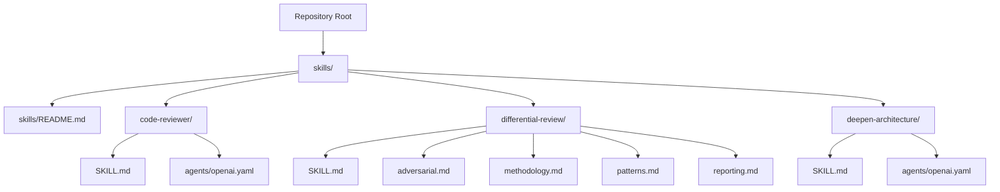
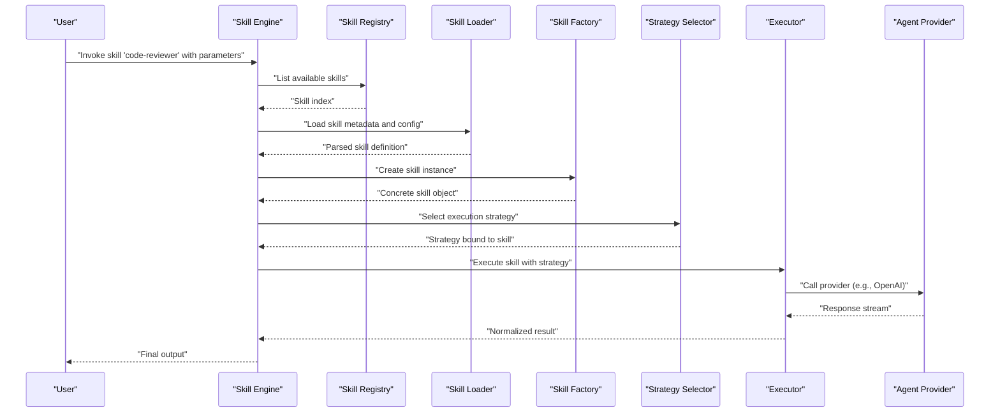
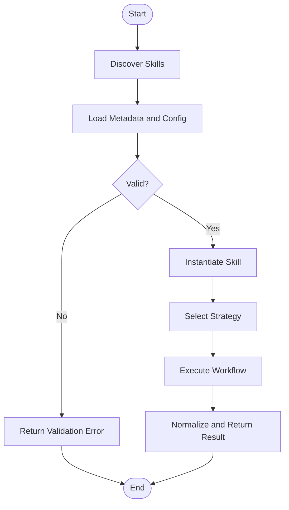
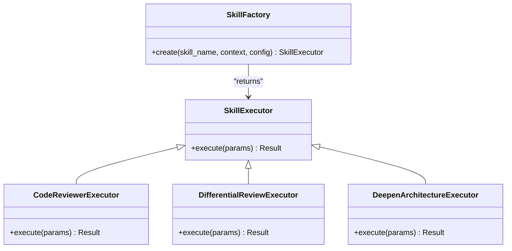
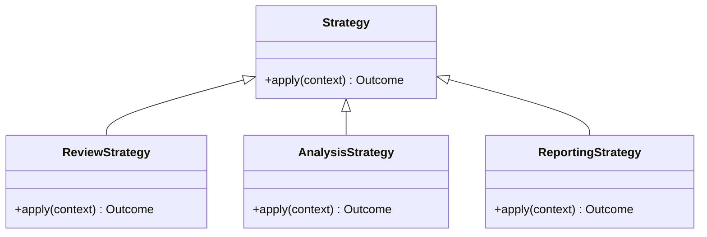
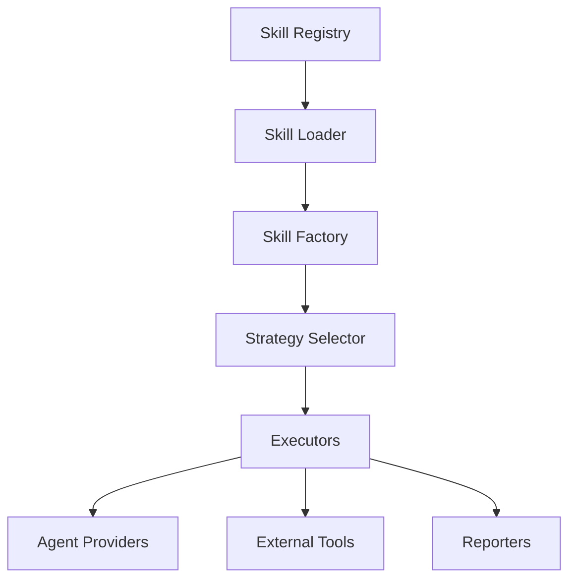

# Skill Engine Architecture

<cite>
**Referenced Files in This Document**
- [skills/README.md](file://skills/README.md)
- [skills/code-reviewer/SKILL.md](file://skills/code-reviewer/SKILL.md)
- [skills/code-reviewer/agents/openai.yaml](file://skills/code-reviewer/agents/openai.yaml)
- [skills/differential-review/SKILL.md](file://skills/differential-review/SKILL.md)
- [skills/differential-review/adversarial.md](file://skills/differential-review/adversarial.md)
- [skills/differential-review/methodology.md](file://skills/differential-review/methodology.md)
- [skills/differential-review/patterns.md](file://skills/differential-review/patterns.md)
- [skills/differential-review/reporting.md](file://skills/differential-review/reporting.md)
- [skills/deepen-architecture/SKILL.md](file://skills/deepen-architecture/SKILL.md)
- [skills/deepen-architecture/agents/openai.yaml](file://skills/deepen-architecture/agents/openai.yaml)
</cite>

## Table of Contents
1. [Introduction](#introduction)
2. [Project Structure](#project-structure)
3. [Core Components](#core-components)
4. [Architecture Overview](#architecture-overview)
5. [Detailed Component Analysis](#detailed-component-analysis)
6. [Dependency Analysis](#dependency-analysis)
7. [Performance Considerations](#performance-considerations)
8. [Troubleshooting Guide](#troubleshooting-guide)
9. [Conclusion](#conclusion)

## Introduction
This document explains the skill engine architecture as implemented by the repository’s skills directory. It focuses on how skills are defined, loaded, and executed, with emphasis on:
- The skill interface and configuration schema
- Execution lifecycle from discovery to runtime
- Concrete examples using code-reviewer, differential-review, and deepen-architecture skills
- Patterns for dynamic instantiation (factory) and behavior selection (strategy)
- Composition, dependency management, and error handling strategies

The goal is to provide both a conceptual overview and a practical guide for extending or integrating new skills into the system.

## Project Structure
Skills are organized as feature folders under the skills directory. Each skill typically includes:
- A SKILL.md describing purpose, inputs, outputs, and usage
- An agents subdirectory containing provider-specific agent configuration (e.g., openai.yaml)
- Optional additional documents that define methodology, patterns, or reporting guidelines

**Diagram sources**
- [skills/README.md](file://skills/README.md)
- [skills/code-reviewer/SKILL.md](file://skills/code-reviewer/SKILL.md)
- [skills/code-reviewer/agents/openai.yaml](file://skills/code-reviewer/agents/openai.yaml)
- [skills/differential-review/SKILL.md](file://skills/differential-review/SKILL.md)
- [skills/differential-review/adversarial.md](file://skills/differential-review/adversarial.md)
- [skills/differential-review/methodology.md](file://skills/differential-review/methodology.md)
- [skills/differential-review/patterns.md](file://skills/differential-review/patterns.md)
- [skills/differential-review/reporting.md](file://skills/differential-review/reporting.md)
- [skills/deepen-architecture/SKILL.md](file://skills/deepen-architecture/SKILL.md)
- [skills/deepen-architecture/agents/openai.yaml](file://skills/deepen-architecture/agents/openai.yaml)

**Section sources**
- [skills/README.md](file://skills/README.md)

## Core Components
At a high level, the skill engine comprises:
- Skill Registry: Discovers and indexes available skills by scanning the skills directory structure.
- Skill Loader: Parses each skill’s metadata and configuration files (e.g., SKILL.md and agents/openai.yaml).
- Skill Factory: Instantiates a concrete skill executor based on the selected skill name and environment context.
- Strategy Selector: Chooses execution strategy based on skill type and configuration (e.g., review vs. analysis).
- Executor: Runs the skill workflow, orchestrating prompts, tool calls, and output generation.
- Error Handler: Normalizes errors across providers and surfaces actionable diagnostics.

Key responsibilities:
- Define a consistent skill interface so all skills can be invoked uniformly.
- Provide a configuration schema for provider settings and skill options.
- Enforce an execution lifecycle: discover -> load -> validate -> instantiate -> execute -> report.

[No sources needed since this section provides general guidance]

## Architecture Overview
The following diagram shows the end-to-end flow from user request to skill execution and result delivery.

**Diagram sources**
- [skills/code-reviewer/SKILL.md](file://skills/code-reviewer/SKILL.md)
- [skills/code-reviewer/agents/openai.yaml](file://skills/code-reviewer/agents/openai.yaml)
- [skills/differential-review/SKILL.md](file://skills/differential-review/SKILL.md)
- [skills/deepen-architecture/SKILL.md](file://skills/deepen-architecture/SKILL.md)
- [skills/deepen-architecture/agents/openai.yaml](file://skills/deepen-architecture/agents/openai.yaml)

## Detailed Component Analysis

### Skill Interface and Configuration Schema
A skill is defined by:
- A descriptive SKILL.md that specifies purpose, inputs, outputs, and usage notes.
- An agents/provider configuration file (e.g., openai.yaml) that binds the skill to a specific provider and model settings.

Common fields in the configuration schema include:
- provider: The agent provider identifier (e.g., openai).
- model: Model identifier or family.
- temperature, max_tokens, top_p: Generation controls.
- system_prompt_ref: Reference to a prompt template or policy.
- tools: Optional tool bindings for external capabilities.
- tags: Classification labels for filtering and composition.

Validation rules:
- Required fields must be present and non-empty.
- Numeric ranges must be within provider limits.
- References must resolve to existing resources.

Error handling:
- Missing or invalid configuration yields a validation error with field-level details.
- Provider connectivity issues are normalized into structured errors with retry hints.

**Section sources**
- [skills/code-reviewer/SKILL.md](file://skills/code-reviewer/SKILL.md)
- [skills/code-reviewer/agents/openai.yaml](file://skills/code-reviewer/agents/openai.yaml)
- [skills/deepen-architecture/SKILL.md](file://skills/deepen-architecture/SKILL.md)
- [skills/deepen-architecture/agents/openai.yaml](file://skills/deepen-architecture/agents/openai.yaml)

### Execution Lifecycle
The lifecycle ensures deterministic and observable execution:
1. Discovery: Scan skills directory for valid skill folders.
2. Load: Parse SKILL.md and provider config; build a normalized skill descriptor.
3. Validate: Check required fields and constraints; fail fast on invalid configs.
4. Instantiate: Use the factory to create a concrete skill executor.
5. Select Strategy: Choose strategy based on skill type and configuration.
6. Execute: Run the workflow, invoking provider APIs and tools as needed.
7. Report: Normalize results and return structured output.

**Diagram sources**
- [skills/code-reviewer/SKILL.md](file://skills/code-reviewer/SKILL.md)
- [skills/differential-review/SKILL.md](file://skills/differential-review/SKILL.md)
- [skills/deepen-architecture/SKILL.md](file://skills/deepen-architecture/SKILL.md)

### Factory Pattern for Dynamic Instantiation
The factory maps a skill name to a concrete implementation at runtime:
- Input: skill_name, environment context, resolved configuration.
- Output: a skill executor implementing the common interface.
- Behavior:
  - Validates skill_name against registry.
  - Loads provider-specific configuration.
  - Returns a strategy-bound executor.

Benefits:
- Decouples invocation from implementation.
- Enables hot-swapping strategies without changing callers.
- Centralizes instantiation logic for consistent initialization.

**Diagram sources**
- [skills/code-reviewer/SKILL.md](file://skills/code-reviewer/SKILL.md)
- [skills/differential-review/SKILL.md](file://skills/differential-review/SKILL.md)
- [skills/deepen-architecture/SKILL.md](file://skills/deepen-architecture/SKILL.md)

**Section sources**
- [skills/code-reviewer/SKILL.md](file://skills/code-reviewer/SKILL.md)
- [skills/differential-review/SKILL.md](file://skills/differential-review/SKILL.md)
- [skills/deepen-architecture/SKILL.md](file://skills/deepen-architecture/SKILL.md)

### Strategy Pattern for Different Behaviors
Strategies encapsulate distinct execution behaviors:
- ReviewStrategy: Focuses on code quality, standards, and feedback generation.
- AnalysisStrategy: Emphasizes architectural insights and structural recommendations.
- ReportingStrategy: Formats findings into standardized reports.

Selection criteria:
- Skill type inferred from configuration tags or explicit strategy field.
- Environment overrides (e.g., CI vs. interactive).
- Feature flags for optional modules.

**Diagram sources**
- [skills/code-reviewer/SKILL.md](file://skills/code-reviewer/SKILL.md)
- [skills/differential-review/SKILL.md](file://skills/differential-review/SKILL.md)
- [skills/deepen-architecture/SKILL.md](file://skills/deepen-architecture/SKILL.md)

**Section sources**
- [skills/code-reviewer/SKILL.md](file://skills/code-reviewer/SKILL.md)
- [skills/differential-review/SKILL.md](file://skills/differential-review/SKILL.md)
- [skills/deepen-architecture/SKILL.md](file://skills/deepen-architecture/SKILL.md)

### Concrete Skill Examples

#### code-reviewer
Purpose:
- Provides automated code review guidance aligned with project standards.

Inputs:
- Code diffs or file paths.
- Optional reviewer focus areas (e.g., security, performance).

Outputs:
- Structured review comments and suggestions.

Configuration highlights:
- Provider binding via agents/openai.yaml.
- Tags indicating review-oriented behavior.

Execution notes:
- Uses ReviewStrategy to generate feedback.
- Integrates with provider models for natural language explanations.

**Section sources**
- [skills/code-reviewer/SKILL.md](file://skills/code-reviewer/SKILL.md)
- [skills/code-reviewer/agents/openai.yaml](file://skills/code-reviewer/agents/openai.yaml)

#### differential-review
Purpose:
- Performs focused reviews on changesets, emphasizing impact and risk.

Inputs:
- Change sets, affected files, and change rationale.

Outputs:
- Targeted findings, risk assessments, and remediation steps.

Additional documents:
- adversarial.md: Adversarial testing considerations.
- methodology.md: Step-by-step review methodology.
- patterns.md: Common patterns to watch for.
- reporting.md: Standardized report format.

Execution notes:
- Combines ReviewStrategy with ReportingStrategy for structured outputs.
- Leverages methodology and patterns to guide analysis.

**Section sources**
- [skills/differential-review/SKILL.md](file://skills/differential-review/SKILL.md)
- [skills/differential-review/adversarial.md](file://skills/differential-review/adversarial.md)
- [skills/differential-review/methodology.md](file://skills/differential-review/methodology.md)
- [skills/differential-review/patterns.md](file://skills/differential-review/patterns.md)
- [skills/differential-review/reporting.md](file://skills/differential-review/reporting.md)

#### deepen-architecture
Purpose:
- Analyzes and improves architectural design, identifying cohesion, coupling, and scalability concerns.

Inputs:
- Repository structure, key modules, and architectural documentation.

Outputs:
- Architectural recommendations, refactoring plans, and risk mitigations.

Configuration highlights:
- Provider binding via agents/openai.yaml.
- Tags indicating analysis-oriented behavior.

Execution notes:
- Uses AnalysisStrategy to produce deep insights.
- May integrate with static analysis tools referenced in methodology.

**Section sources**
- [skills/deepen-architecture/SKILL.md](file://skills/deepen-architecture/SKILL.md)
- [skills/deepen-architecture/agents/openai.yaml](file://skills/deepen-architecture/agents/openai.yaml)

### Skill Composition and Dependency Management
Composition:
- Skills can be composed by chaining executors (e.g., code-reviewer followed by differential-review).
- Shared strategies (ReportingStrategy) reduce duplication across skills.

Dependencies:
- External dependencies are declared in provider configurations (e.g., model families, API keys).
- Tool integrations are specified per skill where applicable.

Management:
- The registry maintains versioned skill descriptors.
- Dependency resolution ensures compatible combinations before execution.

Error handling:
- Composition failures are reported with clear lineage (which step failed).
- Partial successes are captured with warnings and continue-on-error policies when safe.

**Section sources**
- [skills/code-reviewer/SKILL.md](file://skills/code-reviewer/SKILL.md)
- [skills/differential-review/SKILL.md](file://skills/differential-review/SKILL.md)
- [skills/deepen-architecture/SKILL.md](file://skills/deepen-architecture/SKILL.md)

## Dependency Analysis
The following diagram illustrates relationships between core components and their interactions.

**Diagram sources**
- [skills/code-reviewer/SKILL.md](file://skills/code-reviewer/SKILL.md)
- [skills/differential-review/SKILL.md](file://skills/differential-review/SKILL.md)
- [skills/deepen-architecture/SKILL.md](file://skills/deepen-architecture/SKILL.md)

**Section sources**
- [skills/code-reviewer/SKILL.md](file://skills/code-reviewer/SKILL.md)
- [skills/differential-review/SKILL.md](file://skills/differential-review/SKILL.md)
- [skills/deepen-architecture/SKILL.md](file://skills/deepen-architecture/SKILL.md)

## Performance Considerations
- Caching: Cache provider responses for identical inputs to reduce latency.
- Batching: Group related operations (e.g., multiple file reviews) to minimize round-trips.
- Streaming: Stream provider responses to improve perceived responsiveness.
- Resource Limits: Enforce token and rate limits per provider to avoid throttling.
- Parallelism: Execute independent tasks concurrently while respecting provider quotas.

[No sources needed since this section provides general guidance]

## Troubleshooting Guide
Common issues and resolutions:
- Invalid configuration: Ensure required fields exist and values are within allowed ranges.
- Provider errors: Verify credentials, network access, and model availability.
- Strategy mismatch: Confirm strategy selection aligns with skill intent and environment.
- Composition failures: Inspect step-level logs to identify failing links in the chain.

Diagnostic tips:
- Enable verbose logging for loader and factory phases.
- Export normalized skill descriptors for inspection.
- Capture provider request/response envelopes for analysis.

**Section sources**
- [skills/code-reviewer/SKILL.md](file://skills/code-reviewer/SKILL.md)
- [skills/differential-review/SKILL.md](file://skills/differential-review/SKILL.md)
- [skills/deepen-architecture/SKILL.md](file://skills/deepen-architecture/SKILL.md)

## Conclusion
The skill engine architecture leverages a registry, loader, factory, and strategy pattern to deliver a flexible and extensible framework for executing diverse skills. By standardizing definitions through SKILL.md and provider configurations, the system supports dynamic instantiation and behavior selection. Concrete examples—code-reviewer, differential-review, and deepen-architecture—illustrate how different strategies and compositions meet varied needs. With robust error handling and performance considerations, the engine scales to accommodate new skills and evolving requirements.