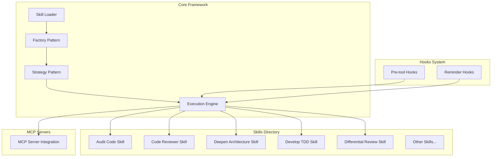
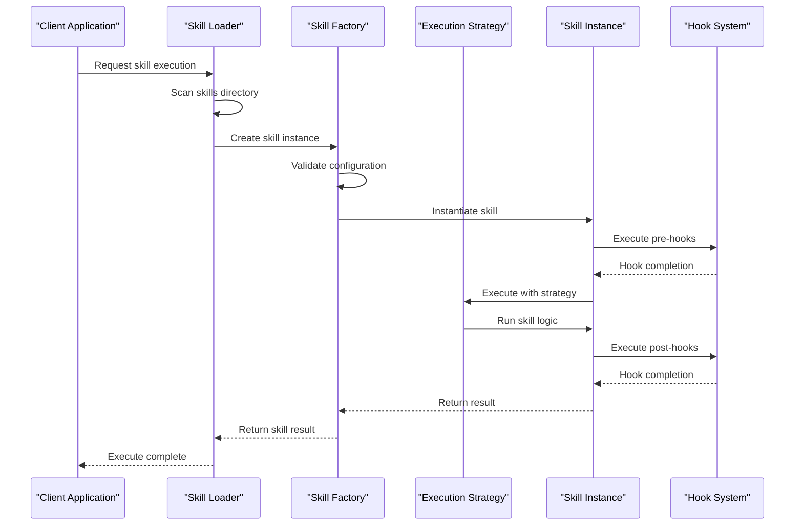
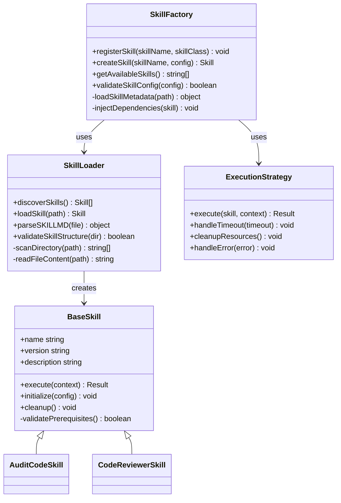
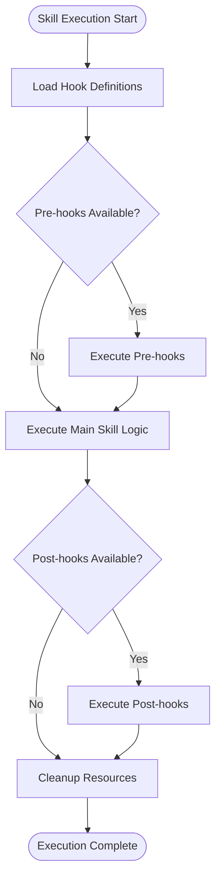
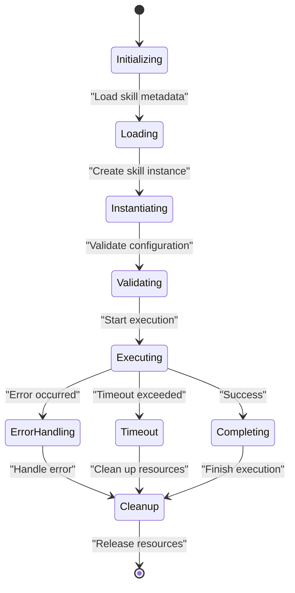
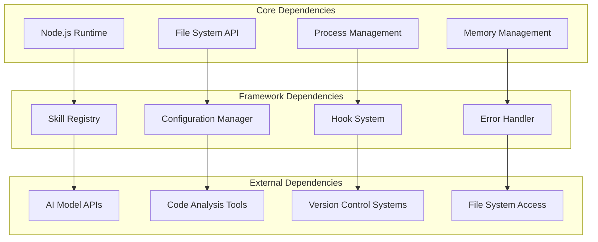

# Skill Execution Lifecycle

<cite>
**Referenced Files in This Document**
- [skills/README.md](file://skills/README.md)
- [skills/audit-code/SKILL.md](file://skills/audit-code/SKILL.md)
- [skills/code-reviewer/SKILL.md](file://skills/code-reviewer/SKILL.md)
- [hooks/README.md](file://hooks/README.md)
- [hooks/lens-reminder.mjs](file://hooks/lens-reminder.mjs)
- [hooks/rtk-pretooluse.mjs](file://hooks/rtk-pretooluse.mjs)
</cite>

## Table of Contents
1. [Introduction](#introduction)
2. [Project Structure](#project-structure)
3. [Core Components](#core-components)
4. [Architecture Overview](#architecture-overview)
5. [Detailed Component Analysis](#detailed-component-analysis)
6. [Dependency Analysis](#dependency-analysis)
7. [Performance Considerations](#performance-considerations)
8. [Troubleshooting Guide](#troubleshooting-guide)
9. [Conclusion](#conclusion)

## Introduction

The Pi Codex Kit is an advanced AI-powered development toolkit that implements a sophisticated skill execution lifecycle. Skills are modular units of functionality that extend the core capabilities of the system, enabling dynamic code analysis, review, and development assistance. This document provides comprehensive documentation of how skills are instantiated, loaded, executed, and managed within the framework, focusing on the factory pattern implementation for dynamic skill creation and strategy pattern for different execution behaviors.

## Project Structure

The project follows a modular architecture with clear separation between core framework components and skill implementations:

**Diagram sources**
- [skills/README.md](file://skills/README.md)
- [hooks/README.md](file://hooks/README.md)

The project structure demonstrates a clean separation between:
- **Skills**: Individual functional modules located in the `skills/` directory
- **Hooks**: Pre-execution and post-execution handlers in the `hooks/` directory
- **Configuration**: Agent-specific configurations in `agents/` subdirectories
- **Resources**: Additional assets like scripts and templates

**Section sources**
- [skills/README.md](file://skills/README.md)
- [hooks/README.md](file://hooks/README.md)

## Core Components

### Skill Factory Pattern Implementation

The skill factory pattern enables dynamic skill creation and loading at runtime. The factory manages skill registration, instantiation, and lifecycle management through a centralized registry system.

#### Key Factory Responsibilities:
- **Skill Registration**: Dynamic discovery and registration of available skills
- **Instance Creation**: Factory methods for creating properly configured skill instances
- **Dependency Injection**: Automatic injection of required dependencies into skill instances
- **Validation**: Pre-execution validation of skill configuration and prerequisites

### Strategy Pattern for Execution Behaviors

The strategy pattern allows different execution strategies to be plugged in dynamically, supporting various execution modes such as:
- **Sequential Execution**: Skills execute one after another
- **Parallel Execution**: Independent skills execute concurrently
- **Conditional Execution**: Skills execute based on specific conditions
- **Fallback Execution**: Alternative strategies when primary execution fails

### Skill Loading Mechanism

Skills are loaded through a hierarchical discovery process:
1. **Directory Scanning**: Automatic discovery of skill directories
2. **Metadata Parsing**: Reading SKILL.md files for skill definitions
3. **Agent Configuration**: Loading agent-specific configurations
4. **Resource Validation**: Ensuring all required resources are present

**Section sources**
- [skills/audit-code/SKILL.md](file://skills/audit-code/SKILL.md)
- [skills/code-reviewer/SKILL.md](file://skills/code-reviewer/SKILL.md)

## Architecture Overview

The skill execution lifecycle follows a well-defined sequence of phases:

**Diagram sources**
- [hooks/lens-reminder.mjs](file://hooks/lens-reminder.mjs)
- [hooks/rtk-pretooluse.mjs](file://hooks/rtk-pretooluse.mjs)

### Execution Phases

1. **Discovery Phase**: Locate and enumerate available skills
2. **Loading Phase**: Parse metadata and load skill configurations
3. **Instantiation Phase**: Create skill instances with proper dependencies
4. **Validation Phase**: Verify skill prerequisites and configuration
5. **Execution Phase**: Run skill logic using appropriate strategy
6. **Cleanup Phase**: Resource cleanup and state management

## Detailed Component Analysis

### Skill Factory Implementation

The factory pattern implementation provides a centralized mechanism for skill creation and management:

**Diagram sources**
- [skills/audit-code/SKILL.md](file://skills/audit-code/SKILL.md)
- [skills/code-reviewer/SKILL.md](file://skills/code-reviewer/SKILL.md)

### Hook System Integration

The hook system provides extensibility points for pre and post-execution logic:

**Diagram sources**
- [hooks/rtk-pretooluse.mjs](file://hooks/rtk-pretooluse.mjs)
- [hooks/lens-reminder.mjs](file://hooks/lens-reminder.mjs)

### Error Handling and Timeout Management

The framework implements comprehensive error handling and timeout management:

**Section sources**
- [hooks/rtk-pretooluse.mjs](file://hooks/rtk-pretooluse.mjs)
- [hooks/lens-reminder.mjs](file://hooks/lens-reminder.mjs)

## Dependency Analysis

The skill execution system has well-defined dependency relationships:

**Diagram sources**
- [skills/audit-code/agents/openai.yaml](file://skills/audit-code/agents/openai.yaml)
- [skills/code-reviewer/agents/openai.yaml](file://skills/code-reviewer/agents/openai.yaml)

### External Integrations

Skills may integrate with external systems through:
- **AI Model Providers**: OpenAI, Claude, and other language models
- **Code Analysis Tools**: Static analyzers, linters, and formatters
- **Version Control Systems**: Git repositories and PR workflows
- **Development Tools**: IDE integrations and build systems

**Section sources**
- [skills/audit-code/agents/openai.yaml](file://skills/audit-code/agents/openai.yaml)
- [skills/code-reviewer/agents/openai.yaml](file://skills/code-reviewer/agents/openai.yaml)

## Performance Considerations

### Memory Management
- **Lazy Loading**: Skills are loaded only when needed
- **Resource Pooling**: Shared resources are pooled across skill instances
- **Garbage Collection**: Proper cleanup of temporary files and memory allocations

### Concurrency Control
- **Thread Safety**: Thread-safe skill execution with proper synchronization
- **Resource Limits**: Configurable limits on concurrent skill executions
- **Priority Queuing**: Priority-based execution queue for critical skills

### Caching Strategies
- **Metadata Caching**: Cached skill metadata to reduce disk I/O
- **Result Caching**: Optional caching of expensive skill results
- **Connection Pooling**: Reused connections to external services

## Troubleshooting Guide

### Common Issues and Solutions

#### Skill Loading Failures
- **Missing Dependencies**: Ensure all required npm packages are installed
- **Permission Issues**: Verify file system permissions for skill directories
- **Configuration Errors**: Validate YAML and JSON configuration files

#### Execution Timeouts
- **Resource Exhaustion**: Monitor memory and CPU usage during execution
- **Network Latency**: Configure appropriate timeouts for external API calls
- **Large Input Data**: Implement streaming for large file processing

#### Hook Execution Problems
- **Hook Order**: Verify hook execution order and dependencies
- **State Management**: Ensure proper state sharing between hooks
- **Error Propagation**: Handle errors gracefully in hook chains

### Debugging Techniques

Enable detailed logging by setting environment variables:
- `DEBUG=pi-codex-kit:*` for verbose debugging
- `LOG_LEVEL=debug` for structured logging output
- `SKILL_DEBUG=true` for skill-specific debugging information

**Section sources**
- [hooks/README.md](file://hooks/README.md)

## Conclusion

The Pi Codex Kit's skill execution lifecycle provides a robust, extensible framework for managing complex AI-powered development tasks. The implementation of factory and strategy patterns ensures flexibility and maintainability, while the comprehensive error handling and resource management guarantees reliable operation in production environments.

Key benefits of this architecture include:
- **Modularity**: Easy addition of new skills without modifying core logic
- **Extensibility**: Hook system allows for custom behavior injection
- **Reliability**: Comprehensive error handling and timeout management
- **Performance**: Optimized resource usage and caching strategies
- **Maintainability**: Clear separation of concerns and well-defined interfaces

This design enables the framework to scale effectively as new skills and features are added, while maintaining backward compatibility and system stability.