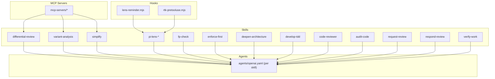
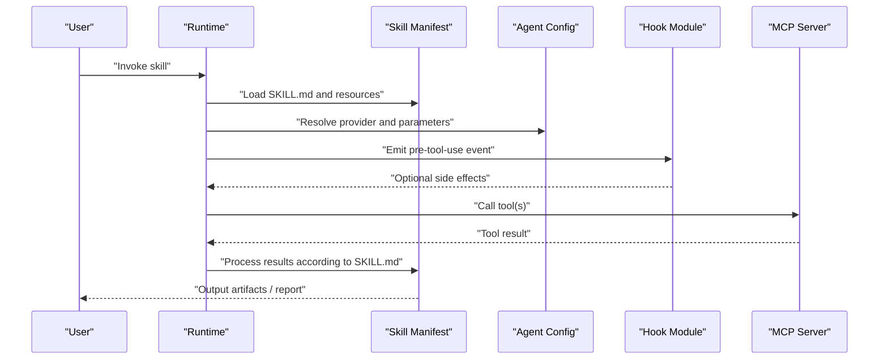
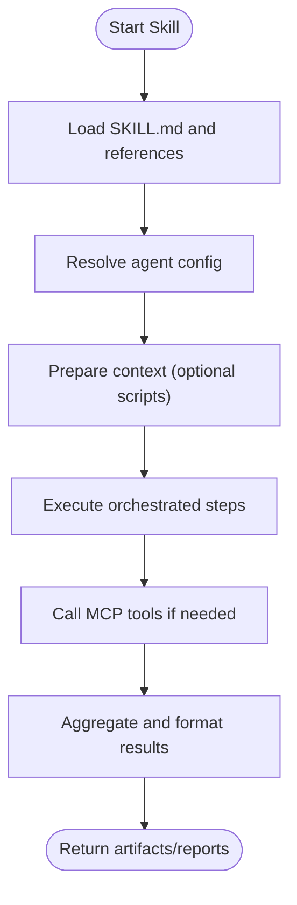
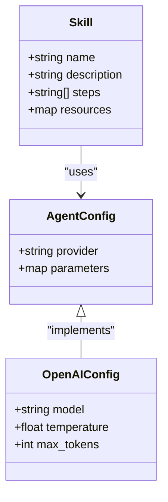
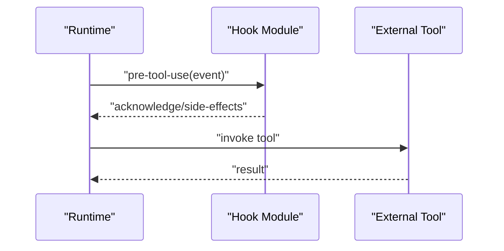
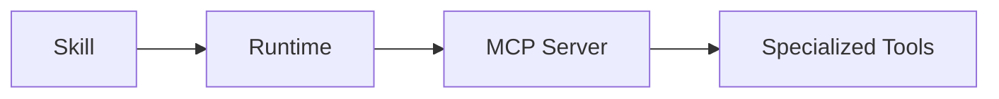
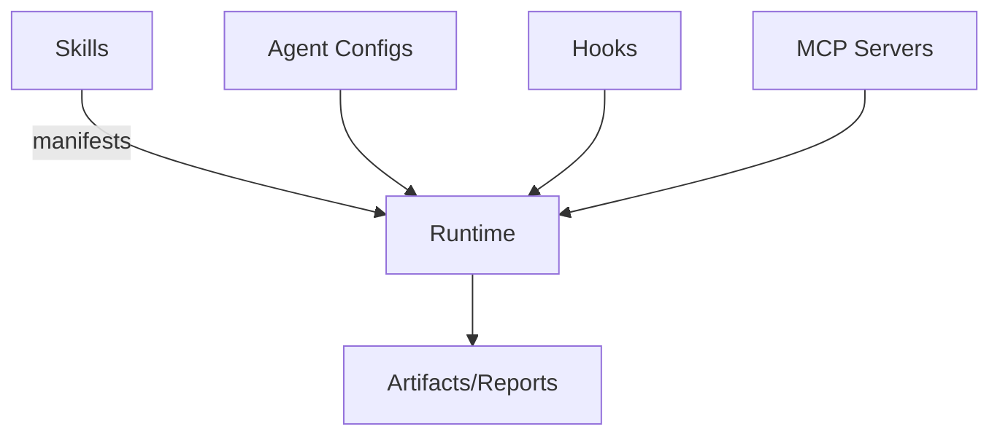

# System Overview

<cite>
**Referenced Files in This Document**
- [README.md](file://README.md)
- [skills/README.md](file://skills/README.md)
- [hooks/README.md](file://hooks/README.md)
- [mcp-servers/README.md](file://mcp-servers/README.md)
- [skills/differential-review/SKILL.md](file://skills/differential-review/SKILL.md)
- [skills/differential-review/adversarial.md](file://skills/differential-review/adversarial.md)
- [skills/differential-review/methodology.md](file://skills/differential-review/methodology.md)
- [skills/differential-review/patterns.md](file://skills/differential-review/patterns.md)
- [skills/differential-review/reporting.md](file://skills/differential-review/reporting.md)
- [skills/variant-analysis/SKILL.md](file://skills/variant-analysis/SKILL.md)
- [skills/variant-analysis/METHODOLOGY.md](file://skills/variant-analysis/METHODOLOGY.md)
- [skills/simplify/SKILL.md](file://skills/simplify/SKILL.md)
- [skills/pi-lens-write-tree-sitter-rule/SKILL.md](file://skills/pi-lens-write-tree-sitter-rule/SKILL.md)
- [skills/pi-lens-write-ast-grep-rule/SKILL.md](file://skills/pi-lens-write-ast-grep-rule/SKILL.md)
- [skills/pi-lens-lsp-navigation/SKILL.md](file://skills/pi-lens-lsp-navigation/SKILL.md)
- [skills/pi-lens-ast-grep/SKILL.md](file://skills/pi-lens-ast-grep/SKILL.md)
- [skills/fp-check/SKILL.md](file://skills/fp-check/SKILL.md)
- [skills/enforce-first/SKILL.md](file://skills/enforce-first/SKILL.md)
- [skills/deepen-architecture/SKILL.md](file://skills/deepen-architecture/SKILL.md)
- [skills/develop-tdd/SKILL.md](file://skills/develop-tdd/SKILL.md)
- [skills/code-reviewer/SKILL.md](file://skills/code-reviewer/SKILL.md)
- [skills/audit-code/SKILL.md](file://skills/audit-code/SKILL.md)
- [skills/request-review/SKILL.md](file://skills/request-review/SKILL.md)
- [skills/respond-review/SKILL.md](file://skills/respond-review/SKILL.md)
- [skills/verify-work/SKILL.md](file://skills/verify-work/SKILL.md)
- [skills/simplify/scripts/simplify-context.mjs](file://skills/simplify/scripts/simplify-context.mjs)
- [hooks/lens-reminder.mjs](file://hooks/lens-reminder.mjs)
- [hooks/rtk-pretooluse.mjs](file://hooks/rtk-pretooluse.mjs)
</cite>

## Table of Contents
1. [Introduction](#introduction)
2. [Project Structure](#project-structure)
3. [Core Components](#core-components)
4. [Architecture Overview](#architecture-overview)
5. [Detailed Component Analysis](#detailed-component-analysis)
6. [Dependency Analysis](#dependency-analysis)
7. [Performance Considerations](#performance-considerations)
8. [Troubleshooting Guide](#troubleshooting-guide)
9. [Conclusion](#conclusion)

## Introduction
This section presents the high-level architecture and design philosophy of the Pi Codex Kit, a skill-based modular system that provides AI-powered development assistance. The system is organized around composable skills, agents, hooks, and MCP servers to deliver extensible, plugin-like capabilities for code analysis, review, generation, and workflow automation.

The design emphasizes:
- Modularity: Each capability is encapsulated as a skill with its own configuration and documentation.
- Extensibility: New skills can be added without modifying core logic.
- Composability: Skills can coordinate via shared context and hooks.
- Tool integration: Agents and MCP servers provide access to external tools and services.

## Project Structure
At a high level, the repository organizes functionality into:
- Skills: Feature packages describing behavior, prompts, references, and optional scripts or agent configurations.
- Hooks: Small executable modules that integrate with the runtime lifecycle (e.g., reminders, pre-tool-use).
- MCP Servers: External tool integrations exposed through the Model Context Protocol.
- Agents: Per-skill agent definitions that configure model providers and parameters.

**Diagram sources**
- [skills/README.md](file://skills/README.md)
- [hooks/README.md](file://hooks/README.md)
- [mcp-servers/README.md](file://mcp-servers/README.md)
- [skills/differential-review/agents/openai.yaml](file://skills/differential-review/agents/openai.yaml)
- [skills/variant-analysis/agents/openai.yaml](file://skills/variant-analysis/agents/openai.yaml)
- [skills/simplify/agents/openai.yaml](file://skills/simplify/agents/openai.yaml)
- [skills/pi-lens-write-tree-sitter-rule/agents/openai.yaml](file://skills/pi-lens-write-tree-sitter-rule/agents/openai.yaml)
- [skills/pi-lens-write-ast-grep-rule/agents/openai.yaml](file://skills/pi-lens-write-ast-grep-rule/agents/openai.yaml)
- [skills/pi-lens-lsp-navigation/agents/openai.yaml](file://skills/pi-lens-lsp-navigation/agents/openai.yaml)
- [skills/pi-lens-ast-grep/agents/openai.yaml](file://skills/pi-lens-ast-grep/agents/openai.yaml)
- [skills/fp-check/agents/openai.yaml](file://skills/fp-check/agents/openai.yaml)
- [skills/enforce-first/agents/openai.yaml](file://skills/enforce-first/agents/openai.yaml)
- [skills/deepen-architecture/agents/openai.yaml](file://skills/deepen-architecture/agents/openai.yaml)
- [skills/develop-tdd/agents/openai.yaml](file://skills/develop-tdd/agents/openai.yaml)
- [skills/code-reviewer/agents/openai.yaml](file://skills/code-reviewer/agents/openai.yaml)
- [skills/audit-code/agents/openai.yaml](file://skills/audit-code/agents/openai.yaml)
- [skills/request-review/agents/openai.yaml](file://skills/request-review/agents/openai.yaml)
- [skills/respond-review/agents/openai.yaml](file://skills/respond-review/agents/openai.yaml)
- [skills/verify-work/agents/openai.yaml](file://skills/verify-work/agents/openai.yaml)

**Section sources**
- [README.md](file://README.md)
- [skills/README.md](file://skills/README.md)
- [hooks/README.md](file://hooks/README.md)
- [mcp-servers/README.md](file://mcp-servers/README.md)

## Core Components
- Skills: Self-contained units of capability defined by a SKILL.md manifest and optional supporting files (references, scripts, agent configs). They describe intent, inputs, outputs, and orchestration steps.
- Agents: Provider-specific configurations (e.g., openai.yaml) per skill that select models and parameters used during execution.
- Hooks: Executable modules that integrate with the runtime lifecycle to inject behavior before or after tool usage, or to provide reminders and environment setup.
- MCP Servers: External tool integrations accessed via the Model Context Protocol, enabling skills to call out to specialized services (e.g., static analysis engines, LSP servers).

Design philosophy:
- Strategy pattern: Different strategies are implemented by swapping skills or their agent configurations without changing the runtime.
- Factory pattern: The system constructs skill instances from manifests and agent configs at runtime.
- Observer pattern: Hooks observe lifecycle events (e.g., pre-tool-use) and react accordingly.

Extensibility model:
- Add a new directory under skills with a SKILL.md and optional resources; register it with the runtime.
- Provide an agents/openai.yaml to tailor model behavior per skill.
- Use hooks to extend behavior globally or per-skill.
- Integrate MCP servers to expose additional tools to skills.

**Section sources**
- [skills/README.md](file://skills/README.md)
- [hooks/README.md](file://hooks/README.md)
- [mcp-servers/README.md](file://mcp-servers/README.md)

## Architecture Overview
The system orchestrates skills, agents, hooks, and MCP servers to deliver AI-powered workflows. Skills define what to do; agents define how to run them; hooks observe and augment execution; MCP servers provide external capabilities.

**Diagram sources**
- [skills/differential-review/SKILL.md](file://skills/differential-review/SKILL.md)
- [skills/variant-analysis/SKILL.md](file://skills/variant-analysis/SKILL.md)
- [skills/simplify/SKILL.md](file://skills/simplify/SKILL.md)
- [hooks/rtk-pretooluse.mjs](file://hooks/rtk-pretooluse.mjs)
- [hooks/lens-reminder.mjs](file://hooks/lens-reminder.mjs)
- [mcp-servers/README.md](file://mcp-servers/README.md)

## Detailed Component Analysis

### Skills
Skills encapsulate domain-specific workflows such as differential review, variant analysis, simplification, AST/LSP navigation, functional programming checks, enforcement, architectural deepening, TDD development, code review, auditing, request/response flows, and verification. Each skill includes:
- A SKILL.md manifest defining purpose, inputs, outputs, and steps.
- Optional references and methodology documents guiding behavior.
- Optional scripts for context preparation or post-processing.
- An agents/openai.yaml for provider-specific settings.

Examples of richly documented skills include:
- Differential review: adversarial strategy, methodology, patterns, and reporting guidance.
- Variant analysis: methodology and language-specific rule sets.
- Simplify: context preparation script and focused reduction workflow.
- Pi Lens skills: AST grep, tree-sitter rule writing, LSP navigation.

**Diagram sources**
- [skills/differential-review/SKILL.md](file://skills/differential-review/SKILL.md)
- [skills/differential-review/adversarial.md](file://skills/differential-review/adversarial.md)
- [skills/differential-review/methodology.md](file://skills/differential-review/methodology.md)
- [skills/differential-review/patterns.md](file://skills/differential-review/patterns.md)
- [skills/differential-review/reporting.md](file://skills/differential-review/reporting.md)
- [skills/variant-analysis/SKILL.md](file://skills/variant-analysis/SKILL.md)
- [skills/variant-analysis/METHODOLOGY.md](file://skills/variant-analysis/METHODOLOGY.md)
- [skills/simplify/SKILL.md](file://skills/simplify/SKILL.md)
- [skills/simplify/scripts/simplify-context.mjs](file://skills/simplify/scripts/simplify-context.mjs)
- [skills/pi-lens-write-tree-sitter-rule/SKILL.md](file://skills/pi-lens-write-tree-sitter-rule/SKILL.md)
- [skills/pi-lens-write-ast-grep-rule/SKILL.md](file://skills/pi-lens-write-ast-grep-rule/SKILL.md)
- [skills/pi-lens-lsp-navigation/SKILL.md](file://skills/pi-lens-lsp-navigation/SKILL.md)
- [skills/pi-lens-ast-grep/SKILL.md](file://skills/pi-lens-ast-grep/SKILL.md)
- [skills/fp-check/SKILL.md](file://skills/fp-check/SKILL.md)
- [skills/enforce-first/SKILL.md](file://skills/enforce-first/SKILL.md)
- [skills/deepen-architecture/SKILL.md](file://skills/deepen-architecture/SKILL.md)
- [skills/develop-tdd/SKILL.md](file://skills/develop-tdd/SKILL.md)
- [skills/code-reviewer/SKILL.md](file://skills/code-reviewer/SKILL.md)
- [skills/audit-code/SKILL.md](file://skills/audit-code/SKILL.md)
- [skills/request-review/SKILL.md](file://skills/request-review/SKILL.md)
- [skills/respond-review/SKILL.md](file://skills/respond-review/SKILL.md)
- [skills/verify-work/SKILL.md](file://skills/verify-work/SKILL.md)

**Section sources**
- [skills/README.md](file://skills/README.md)
- [skills/differential-review/SKILL.md](file://skills/differential-review/SKILL.md)
- [skills/variant-analysis/SKILL.md](file://skills/variant-analysis/SKILL.md)
- [skills/simplify/SKILL.md](file://skills/simplify/SKILL.md)
- [skills/pi-lens-write-tree-sitter-rule/SKILL.md](file://skills/pi-lens-write-tree-sitter-rule/SKILL.md)
- [skills/pi-lens-write-ast-grep-rule/SKILL.md](file://skills/pi-lens-write-ast-grep-rule/SKILL.md)
- [skills/pi-lens-lsp-navigation/SKILL.md](file://skills/pi-lens-lsp-navigation/SKILL.md)
- [skills/pi-lens-ast-grep/SKILL.md](file://skills/pi-lens-ast-grep/SKILL.md)
- [skills/fp-check/SKILL.md](file://skills/fp-check/SKILL.md)
- [skills/enforce-first/SKILL.md](file://skills/enforce-first/SKILL.md)
- [skills/deepen-architecture/SKILL.md](file://skills/deepen-architecture/SKILL.md)
- [skills/develop-tdd/SKILL.md](file://skills/develop-tdd/SKILL.md)
- [skills/code-reviewer/SKILL.md](file://skills/code-reviewer/SKILL.md)
- [skills/audit-code/SKILL.md](file://skills/audit-code/SKILL.md)
- [skills/request-review/SKILL.md](file://skills/request-review/SKILL.md)
- [skills/respond-review/SKILL.md](file://skills/respond-review/SKILL.md)
- [skills/verify-work/SKILL.md](file://skills/verify-work/SKILL.md)

### Agents
Agents define provider-specific parameters for each skill, typically using an openai.yaml file. This enables:
- Strategy selection: Choose different models or parameter sets per skill.
- Decoupling: Change model behavior without altering skill manifests.
- Consistency: Centralize provider configuration alongside skill definitions.

**Diagram sources**
- [skills/differential-review/agents/openai.yaml](file://skills/differential-review/agents/openai.yaml)
- [skills/variant-analysis/agents/openai.yaml](file://skills/variant-analysis/agents/openai.yaml)
- [skills/simplify/agents/openai.yaml](file://skills/simplify/agents/openai.yaml)
- [skills/pi-lens-write-tree-sitter-rule/agents/openai.yaml](file://skills/pi-lens-write-tree-sitter-rule/agents/openai.yaml)
- [skills/pi-lens-write-ast-grep-rule/agents/openai.yaml](file://skills/pi-lens-write-ast-grep-rule/agents/openai.yaml)
- [skills/pi-lens-lsp-navigation/agents/openai.yaml](file://skills/pi-lens-lsp-navigation/agents/openai.yaml)
- [skills/pi-lens-ast-grep/agents/openai.yaml](file://skills/pi-lens-ast-grep/agents/openai.yaml)
- [skills/fp-check/agents/openai.yaml](file://skills/fp-check/agents/openai.yaml)
- [skills/enforce-first/agents/openai.yaml](file://skills/enforce-first/agents/openai.yaml)
- [skills/deepen-architecture/agents/openai.yaml](file://skills/deepen-architecture/agents/openai.yaml)
- [skills/develop-tdd/agents/openai.yaml](file://skills/develop-tdd/agents/openai.yaml)
- [skills/code-reviewer/agents/openai.yaml](file://skills/code-reviewer/agents/openai.yaml)
- [skills/audit-code/agents/openai.yaml](file://skills/audit-code/agents/openai.yaml)
- [skills/request-review/agents/openai.yaml](file://skills/request-review/agents/openai.yaml)
- [skills/respond-review/agents/openai.yaml](file://skills/respond-review/agents/openai.yaml)
- [skills/verify-work/agents/openai.yaml](file://skills/verify-work/agents/openai.yaml)

**Section sources**
- [skills/differential-review/agents/openai.yaml](file://skills/differential-review/agents/openai.yaml)
- [skills/variant-analysis/agents/openai.yaml](file://skills/variant-analysis/agents/openai.yaml)
- [skills/simplify/agents/openai.yaml](file://skills/simplify/agents/openai.yaml)
- [skills/pi-lens-write-tree-sitter-rule/agents/openai.yaml](file://skills/pi-lens-write-tree-sitter-rule/agents/openai.yaml)
- [skills/pi-lens-write-ast-grep-rule/agents/openai.yaml](file://skills/pi-lens-write-ast-grep-rule/agents/openai.yaml)
- [skills/pi-lens-lsp-navigation/agents/openai.yaml](file://skills/pi-lens-lsp-navigation/agents/openai.yaml)
- [skills/pi-lens-ast-grep/agents/openai.yaml](file://skills/pi-lens-ast-grep/agents/openai.yaml)
- [skills/fp-check/agents/openai.yaml](file://skills/fp-check/agents/openai.yaml)
- [skills/enforce-first/agents/openai.yaml](file://skills/enforce-first/agents/openai.yaml)
- [skills/deepen-architecture/agents/openai.yaml](file://skills/deepen-architecture/agents/openai.yaml)
- [skills/develop-tdd/agents/openai.yaml](file://skills/develop-tdd/agents/openai.yaml)
- [skills/code-reviewer/agents/openai.yaml](file://skills/code-reviewer/agents/openai.yaml)
- [skills/audit-code/agents/openai.yaml](file://skills/audit-code/agents/openai.yaml)
- [skills/request-review/agents/openai.yaml](file://skills/request-review/agents/openai.yaml)
- [skills/respond-review/agents/openai.yaml](file://skills/respond-review/agents/openai.yaml)
- [skills/verify-work/agents/openai.yaml](file://skills/verify-work/agents/openai.yaml)

### Hooks
Hooks are small executable modules that integrate with the runtime lifecycle. Examples include:
- lens-reminder.mjs: Provides reminders related to Pi Lens features.
- rtk-pretooluse.mjs: Executes actions before tool use, enabling preconditions or logging.

**Diagram sources**
- [hooks/lens-reminder.mjs](file://hooks/lens-reminder.mjs)
- [hooks/rtk-pretooluse.mjs](file://hooks/rtk-pretooluse.mjs)

**Section sources**
- [hooks/README.md](file://hooks/README.md)
- [hooks/lens-reminder.mjs](file://hooks/lens-reminder.mjs)
- [hooks/rtk-pretooluse.mjs](file://hooks/rtk-pretooluse.mjs)

### MCP Servers
MCP servers expose external tool capabilities to skills via the Model Context Protocol. Skills can call these tools to perform specialized tasks such as static analysis, code search, or LSP operations.

**Diagram sources**
- [mcp-servers/README.md](file://mcp-servers/README.md)

**Section sources**
- [mcp-servers/README.md](file://mcp-servers/README.md)

## Dependency Analysis
The system exhibits low coupling between components:
- Skills depend on manifests and agent configs rather than hard-coded logic.
- Hooks observe lifecycle events without direct ties to specific skills.
- MCP servers are invoked through a protocol abstraction, allowing replacement or addition without changes to skills.

[No diagram sources since this diagram shows conceptual relationships]

**Section sources**
- [skills/README.md](file://skills/README.md)
- [hooks/README.md](file://hooks/README.md)
- [mcp-servers/README.md](file://mcp-servers/README.md)

## Performance Considerations
- Prefer lightweight skills and minimal context to reduce token usage and latency.
- Cache repeated MCP tool results where appropriate.
- Use targeted agent parameters (temperature, max tokens) aligned with task complexity.
- Batch operations when possible to reduce round-trips to MCP servers.

[No sources needed since this section provides general guidance]

## Troubleshooting Guide
Common issues and resolutions:
- Missing or malformed SKILL.md: Ensure the manifest exists and follows expected structure.
- Agent misconfiguration: Validate provider and parameters in agents/openai.yaml.
- Hook failures: Check hook module logs and ensure pre-tool-use handlers complete successfully.
- MCP server connectivity: Verify server availability and credentials.

**Section sources**
- [hooks/README.md](file://hooks/README.md)
- [mcp-servers/README.md](file://mcp-servers/README.md)

## Conclusion
The Pi Codex Kit’s skill-based modular architecture delivers flexible, extensible AI-powered development assistance. By separating concerns across skills, agents, hooks, and MCP servers, the system supports rapid iteration, clear extensibility, and robust integration with external tools. Adopting Strategy, Factory, and Observer patterns ensures maintainable and scalable growth as new capabilities are introduced.

[No sources needed since this section summarizes without analyzing specific files]