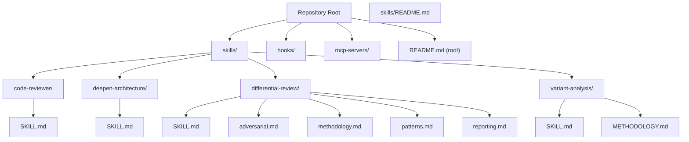
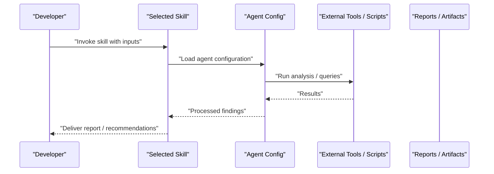
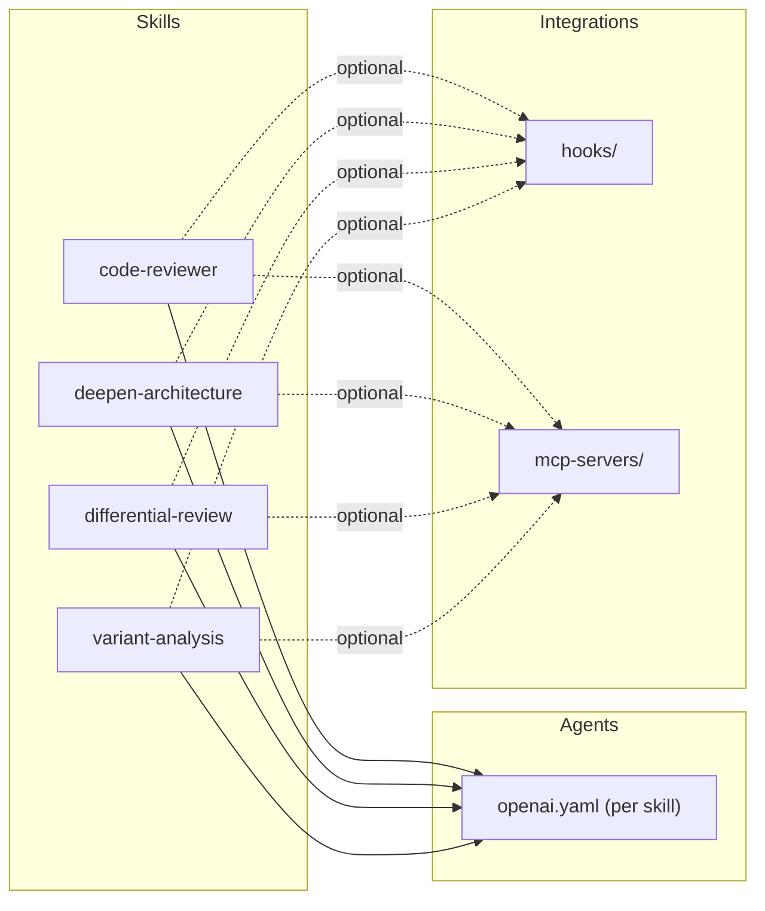

# Getting Started

<cite>
**Referenced Files in This Document**
- [README.md](file://README.md)
- [skills/README.md](file://skills/README.md)
- [skills/code-reviewer/SKILL.md](file://skills/code-reviewer/SKILL.md)
- [skills/deepen-architecture/SKILL.md](file://skills/deepen-architecture/SKILL.md)
- [skills/differential-review/SKILL.md](file://skills/differential-review/SKILL.md)
- [skills/differential-review/adversarial.md](file://skills/differential-review/adversarial.md)
- [skills/differential-review/methodology.md](file://skills/differential-review/methodology.md)
- [skills/differential-review/patterns.md](file://skills/differential-review/patterns.md)
- [skills/differential-review/reporting.md](file://skills/differential-review/reporting.md)
- [skills/variant-analysis/SKILL.md](file://skills/variant-analysis/SKILL.md)
- [skills/variant-analysis/METHODOLOGY.md](file://skills/variant-analysis/METHODOLOGY.md)
- [hooks/README.md](file://hooks/README.md)
- [mcp-servers/README.md](file://mcp-servers/README.md)
</cite>

## Update Summary
**Changes Made**
- Updated installation section to reflect removal of installation infrastructure (install.ps1, install.sh, scripts/, codex-config/)
- Revised project structure to emphasize pure reference implementation approach
- Updated prerequisites and setup instructions for the new reference-only model
- Removed references to installation tools and configuration management
- Enhanced focus on clean, auditable code as the primary value proposition

## Table of Contents
1. [Introduction](#introduction)
2. [Project Structure](#project-structure)
3. [Core Components](#core-components)
4. [Architecture Overview](#architecture-overview)
5. [Detailed Component Analysis](#detailed-component-analysis)
6. [Dependency Analysis](#dependency-analysis)
7. [Performance Considerations](#performance-considerations)
8. [Troubleshooting Guide](#troubleshooting-guide)
9. [Conclusion](#conclusion)
10. [Appendices](#appendices)

## Introduction
Pi Codex Kit is a pure reference implementation of an AI-powered development toolkit that helps you analyze code, review changes, and automate parts of your development workflow using skills and agents. As version 1.0.0, it provides a collection of ready-to-use skills for tasks such as code review, architecture deepening, differential review, and variant analysis. The kit integrates with external tools and services to streamline common developer workflows and improve code quality.

This getting started guide explains what the kit is, how it works at a high level, prerequisites, setup requirements, and a quick start to run your first skill. It also includes examples of common workflows like code review and architecture analysis.

**Updated** The project has evolved into a pure reference implementation focused on providing clean, auditable code rather than installation tools or configuration management utilities.

## Project Structure
The repository is organized around reusable "skills," each describing its purpose, inputs, outputs, and agent configuration. Supporting directories include hooks, MCP servers, and scripts that extend or integrate with the skills. The current structure emphasizes simplicity and clarity over complex installation infrastructure.

**Diagram sources**
- [README.md](file://README.md)
- [skills/README.md](file://skills/README.md)
- [skills/code-reviewer/SKILL.md](file://skills/code-reviewer/SKILL.md)
- [skills/deepen-architecture/SKILL.md](file://skills/deepen-architecture/SKILL.md)
- [skills/differential-review/SKILL.md](file://skills/differential-review/SKILL.md)
- [skills/differential-review/adversarial.md](file://skills/differential-review/adversarial.md)
- [skills/differential-review/methodology.md](file://skills/differential-review/methodology.md)
- [skills/differential-review/patterns.md](file://skills/differential-review/patterns.md)
- [skills/differential-review/reporting.md](file://skills/differential-review/reporting.md)
- [skills/variant-analysis/SKILL.md](file://skills/variant-analysis/SKILL.md)
- [skills/variant-analysis/METHODOLOGY.md](file://skills/variant-analysis/METHODOLOGY.md)

**Section sources**
- [README.md](file://README.md)
- [skills/README.md](file://skills/README.md)

## Core Components
- Skills: Each skill encapsulates a specific workflow (e.g., code review, architecture deepening). A skill typically includes a SKILL.md describing usage and an agents/openai.yaml defining the agent configuration.
- Hooks: Optional integrations that can be triggered during development workflows.
- MCP Servers: External server integrations referenced by the kit.

Key skills for getting started:
- Code Reviewer: Reviews code changes and provides feedback.
- Deepen Architecture: Helps explore and refine system design.
- Differential Review: Analyzes diffs with structured methodology and reporting.
- Variant Analysis: Runs static analysis queries across variants.

**Section sources**
- [skills/code-reviewer/SKILL.md](file://skills/code-reviewer/SKILL.md)
- [skills/deepen-architecture/SKILL.md](file://skills/deepen-architecture/SKILL.md)
- [skills/differential-review/SKILL.md](file://skills/differential-review/SKILL.md)
- [skills/variant-analysis/SKILL.md](file://skills/variant-analysis/SKILL.md)

## Architecture Overview
At a high level, Pi Codex Kit orchestrates skills and agents to perform tasks. You provide context (e.g., code paths, diffs), the selected skill defines the process, and the configured agent executes steps and produces outputs (reports, suggestions, artifacts).

[No sources needed since this diagram shows conceptual workflow, not actual code structure]

## Detailed Component Analysis

### Prerequisites and Setup
**Updated** The project now follows a pure reference implementation approach without installation infrastructure.

- Node.js: Ensure Node.js is installed on your system before using the kit.
- OpenAI API Key: Configure your OpenAI API key so that agents can call the model service.
- Repository Access: Clone or open the repository in your preferred editor or terminal.

Initial setup steps:
- Set environment variables for the OpenAI API key as required by the agent configuration files under each skill's agents directory.
- Verify that any optional integrations (hooks, MCP servers) are available if you plan to use them.
- No installation scripts or configuration management tools are provided - simply clone and configure.

**Section sources**
- [README.md](file://README.md)
- [skills/code-reviewer/agents/openai.yaml](file://skills/code-reviewer/agents/openai.yaml)
- [skills/deepen-architecture/agents/openai.yaml](file://skills/deepen-architecture/agents/openai.yaml)
- [skills/differential-review/agents/openai.yaml](file://skills/differential-review/agents/openai.yaml)
- [skills/variant-analysis/agents/openai.yaml](file://skills/variant-analysis/agents/openai.yaml)

### Quick Start: Your First Skill
Use the code reviewer skill to get immediate value:
- Choose a pull request or set of changed files.
- Invoke the code reviewer skill with the relevant context (paths, PR number, or diff).
- Review the generated feedback and apply suggested improvements.

For more details on how to invoke the skill and what inputs it expects, see the skill documentation.

**Section sources**
- [skills/code-reviewer/SKILL.md](file://skills/code-reviewer/SKILL.md)

### Common Workflow: Code Review
- Inputs: Changed files, PR metadata, or diff content.
- Process: The skill loads its agent configuration and runs analysis steps to identify issues, style violations, and potential risks.
- Outputs: A structured review report with actionable items and references to affected code.

To learn the exact invocation pattern and expected inputs, consult the skill's documentation.

**Section sources**
- [skills/code-reviewer/SKILL.md](file://skills/code-reviewer/SKILL.md)

### Common Workflow: Architecture Analysis
- Inputs: System overview, component diagrams, or source tree.
- Process: The skill guides exploration of architectural decisions, identifies cohesion/coupling concerns, and suggests refinements.
- Outputs: An architecture analysis report with observations and improvement recommendations.

See the skill documentation for detailed instructions.

**Section sources**
- [skills/deepen-architecture/SKILL.md](file://skills/deepen-architecture/SKILL.md)

### Advanced Workflow: Differential Review
Differential review focuses on analyzing diffs with a structured approach:
- Methodology: Follow the documented methodology to scope and evaluate changes.
- Adversarial Thinking: Use adversarial patterns to challenge assumptions and uncover edge cases.
- Patterns: Apply known patterns to detect recurring issues.
- Reporting: Produce consistent reports summarizing findings and next steps.

**Section sources**
- [skills/differential-review/SKILL.md](file://skills/differential-review/SKILL.md)
- [skills/differential-review/methodology.md](file://skills/differential-review/methodology.md)
- [skills/differential-review/adversarial.md](file://skills/differential-review/adversarial.md)
- [skills/differential-review/patterns.md](file://skills/differential-review/patterns.md)
- [skills/differential-review/reporting.md](file://skills/differential-review/reporting.md)

### Advanced Workflow: Variant Analysis
Variant analysis runs static analysis queries across multiple language variants:
- Methodology: Understand the overall approach and scope.
- Queries: Language-specific queries are provided for popular languages.
- Reporting: Generate consolidated reports from query results.

**Section sources**
- [skills/variant-analysis/SKILL.md](file://skills/variant-analysis/SKILL.md)
- [skills/variant-analysis/METHODOLOGY.md](file://skills/variant-analysis/METHODOLOGY.md)

## Dependency Analysis
Skills depend on:
- Agent configurations (OpenAI) for orchestration and reasoning.
- Optional hooks and MCP servers for extended integrations.

**Diagram sources**
- [skills/code-reviewer/agents/openai.yaml](file://skills/code-reviewer/agents/openai.yaml)
- [skills/deepen-architecture/agents/openai.yaml](file://skills/deepen-architecture/agents/openai.yaml)
- [skills/differential-review/agents/openai.yaml](file://skills/differential-review/agents/openai.yaml)
- [skills/variant-analysis/agents/openai.yaml](file://skills/variant-analysis/agents/openai.yaml)
- [hooks/README.md](file://hooks/README.md)
- [mcp-servers/README.md](file://mcp-servers/README.md)

**Section sources**
- [hooks/README.md](file://hooks/README.md)
- [mcp-servers/README.md](file://mcp-servers/README.md)

## Performance Considerations
- Scope inputs carefully: Limit file sets and diffs to reduce processing time.
- Prefer targeted queries: For variant analysis, select only necessary language-specific queries.
- Cache repeated contexts: Reuse previously gathered context when running related analyses.
- Monitor agent calls: Be mindful of API usage and rate limits when invoking models.

[No sources needed since this section provides general guidance]

## Troubleshooting Guide
- OpenAI API Key errors: Ensure the API key is correctly set in your environment and accessible to the agent configuration.
- Missing dependencies: If using hooks or MCP servers, verify they are installed and reachable.
- Permission issues: Confirm read access to the target repositories or directories used by skills.
- Large diffs: Break down large changes into smaller scopes to avoid timeouts or resource constraints.
- Installation issues: Since this is a pure reference implementation, there are no installation scripts to troubleshoot - simply clone and configure directly.

**Section sources**
- [skills/code-reviewer/agents/openai.yaml](file://skills/code-reviewer/agents/openai.yaml)
- [hooks/README.md](file://hooks/README.md)
- [mcp-servers/README.md](file://mcp-servers/README.md)

## Conclusion
You now have the essentials to start using Pi Codex Kit: set up prerequisites, configure your OpenAI API key, and run your first skill. The project's evolution into a pure reference implementation means you can focus directly on the valuable skills and workflows without dealing with installation complexity. Use code review and architecture analysis to quickly gain insights, then expand to differential review and variant analysis as your needs grow. Refer to each skill's documentation for precise inputs, outputs, and advanced options.

## Appendices

### Appendix A: Skill Index
- Code Reviewer: [skills/code-reviewer/SKILL.md](file://skills/code-reviewer/SKILL.md)
- Deepen Architecture: [skills/deepen-architecture/SKILL.md](file://skills/deepen-architecture/SKILL.md)
- Differential Review: [skills/differential-review/SKILL.md](file://skills/differential-review/SKILL.md)
- Variant Analysis: [skills/variant-analysis/SKILL.md](file://skills/variant-analysis/SKILL.md)

### Appendix B: Integrations
- Hooks: [hooks/README.md](file://hooks/README.md)
- MCP Servers: [mcp-servers/README.md](file://mcp-servers/README.md)