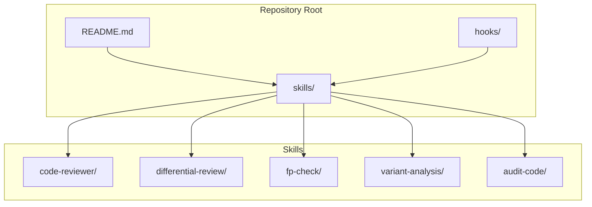
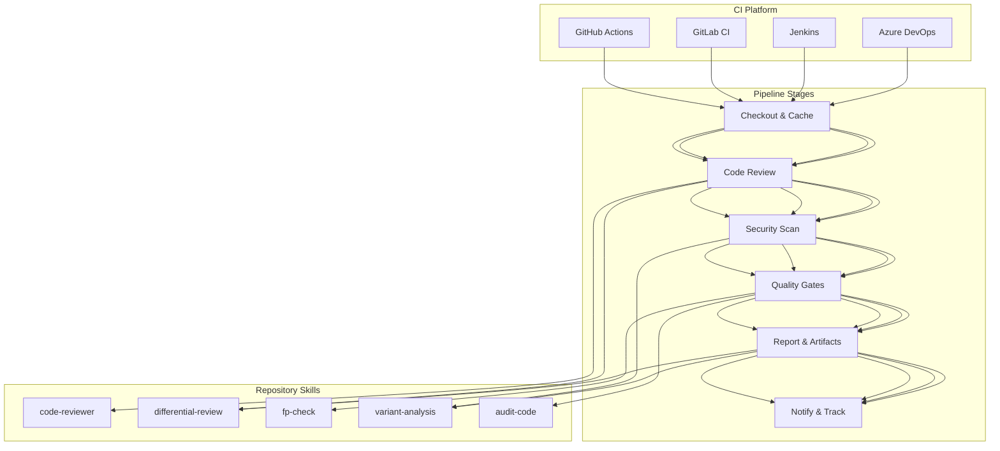
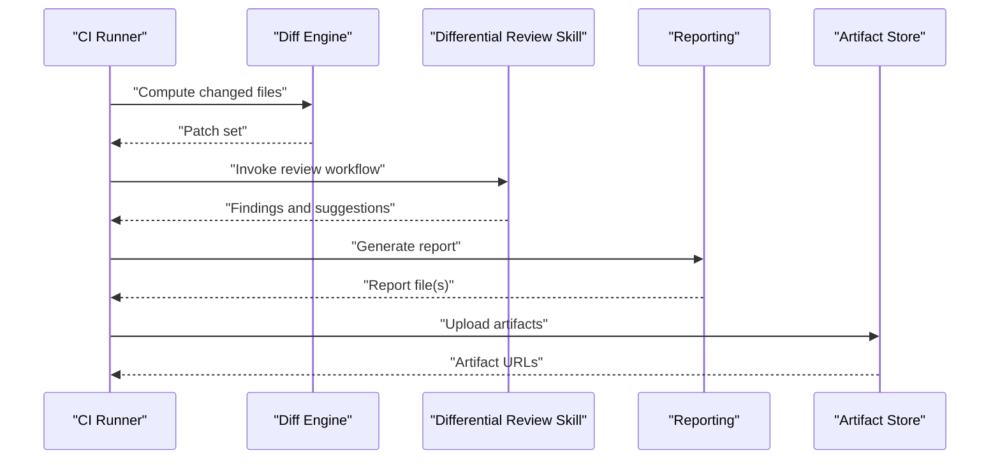
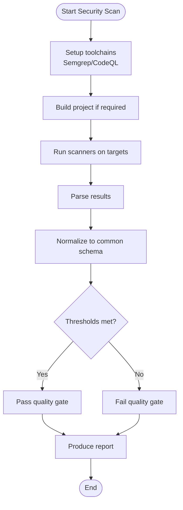
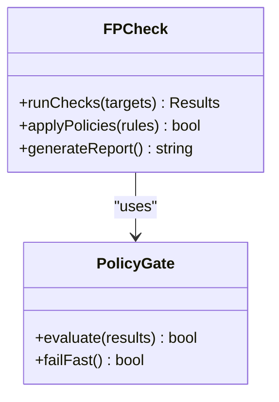
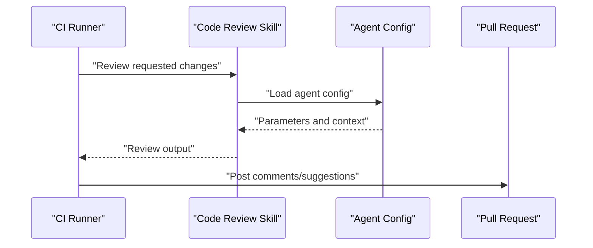
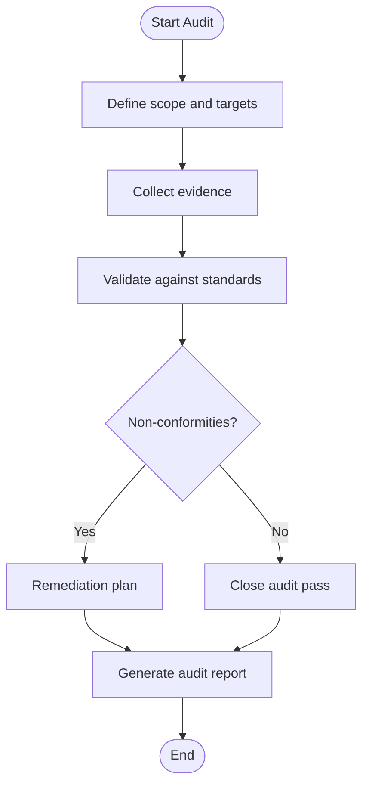
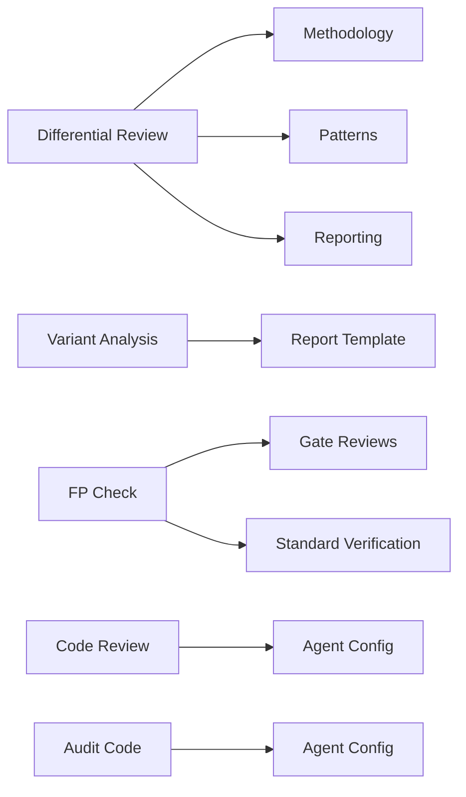

# CI/CD Pipeline Integration

<cite>
**Referenced Files in This Document**
- [README.md](file://README.md)
- [skills/README.md](file://skills/README.md)
- [skills/differential-review/SKILL.md](file://skills/differential-review/SKILL.md)
- [skills/differential-review/methodology.md](file://skills/differential-review/methodology.md)
- [skills/differential-review/patterns.md](file://skills/differential-review/patterns.md)
- [skills/differential-review/reporting.md](file://skills/differential-review/reporting.md)
- [skills/fp-check/SKILL.md](file://skills/fp-check/SKILL.md)
- [skills/fp-check/references/gate-reviews.md](file://skills/fp-check/references/gate-reviews.md)
- [skills/fp-check/references/standard-verification.md](file://skills/fp-check/references/standard-verification.md)
- [skills/variant-analysis/SKILL.md](file://skills/variant-analysis/SKILL.md)
- [skills/variant-analysis/resources/variant-report-template.md](file://skills/variant-analysis/resources/variant-report-template.md)
- [skills/code-reviewer/SKILL.md](file://skills/code-reviewer/SKILL.md)
- [skills/audit-code/SKILL.md](file://skills/audit-code/SKILL.md)
- [hooks/README.md](file://hooks/README.md)
</cite>

## Table of Contents
1. [Introduction](#introduction)
2. [Project Structure](#project-structure)
3. [Core Components](#core-components)
4. [Architecture Overview](#architecture-overview)
5. [Detailed Component Analysis](#detailed-component-analysis)
6. [Dependency Analysis](#dependency-analysis)
7. [Performance Considerations](#performance-considerations)
8. [Troubleshooting Guide](#troubleshooting-guide)
9. [Conclusion](#conclusion)
10. [Appendices](#appendices)

## Introduction
This document provides a comprehensive guide to integrating automated code quality and review processes into CI/CD pipelines across popular platforms (GitHub Actions, GitLab CI, Jenkins, Azure DevOps). It focuses on leveraging the repository’s built-in skills for code review, differential analysis, functional programming checks, variant analysis, and audit workflows. The guidance covers pipeline configuration strategies, artifact handling, reporting mechanisms, parallelization, caching, failure handling, notifications, and issue tracking integrations.

## Project Structure
The repository organizes reusable automation logic as “skills” under the skills directory. Each skill encapsulates methodology, agent configurations, and references needed for specific tasks such as differential review, security scanning, and verification. Hooks provide pre-commit or pre-tool-use behaviors that can be invoked from local development or CI environments.

**Diagram sources**
- [README.md:1-200](file://README.md#L1-L200)
- [skills/README.md:1-200](file://skills/README.md#L1-L200)

**Section sources**
- [README.md:1-200](file://README.md#L1-L200)
- [skills/README.md:1-200](file://skills/README.md#L1-L200)

## Core Components
- Code Review Skill: Provides structured prompts and agent configuration for automated code reviews.
- Differential Review Skill: Defines methodology, patterns, and reporting for comparing changes and generating actionable feedback.
- FP Check Skill: Encapsulates functional programming verification rules and gate policies.
- Variant Analysis Skill: Integrates static analysis tools (e.g., Semgrep, CodeQL) with standardized reporting templates.
- Audit Code Skill: Offers auditing procedures and agent configuration for compliance and risk assessment.
- Hooks: Local hooks for pre-commit or pre-tool-use steps that can be mirrored in CI stages.

These components are designed to be orchestrated by CI/CD pipelines to enforce quality gates, produce reports, and integrate with issue trackers.

**Section sources**
- [skills/code-reviewer/SKILL.md:1-200](file://skills/code-reviewer/SKILL.md#L1-L200)
- [skills/differential-review/SKILL.md:1-200](file://skills/differential-review/SKILL.md#L1-L200)
- [skills/fp-check/SKILL.md:1-200](file://skills/fp-check/SKILL.md#L1-L200)
- [skills/variant-analysis/SKILL.md:1-200](file://skills/variant-analysis/SKILL.md#L1-L200)
- [skills/audit-code/SKILL.md:1-200](file://skills/audit-code/SKILL.md#L1-L200)
- [hooks/README.md:1-200](file://hooks/README.md#L1-L200)

## Architecture Overview
The CI/CD architecture integrates platform-specific runners with the repository’s skills to execute code review, security scanning, and quality gates. Pipelines orchestrate parallel jobs, cache dependencies, collect artifacts, and publish reports. Notifications and issue tracking integrations close the loop by surfacing findings to teams.

[No diagram sources since this is a conceptual architecture overview]

## Detailed Component Analysis

### Differential Review Pipeline Stage
This stage compares diffs, applies review methodologies, and generates reports suitable for PR comments or dashboard consumption.

**Diagram sources**
- [skills/differential-review/SKILL.md:1-200](file://skills/differential-review/SKILL.md#L1-L200)
- [skills/differential-review/methodology.md:1-200](file://skills/differential-review/methodology.md#L1-L200)
- [skills/differential-review/patterns.md:1-200](file://skills/differential-review/patterns.md#L1-L200)
- [skills/differential-review/reporting.md:1-200](file://skills/differential-review/reporting.md#L1-L200)

**Section sources**
- [skills/differential-review/SKILL.md:1-200](file://skills/differential-review/SKILL.md#L1-L200)
- [skills/differential-review/methodology.md:1-200](file://skills/differential-review/methodology.md#L1-L200)
- [skills/differential-review/patterns.md:1-200](file://skills/differential-review/patterns.md#L1-L200)
- [skills/differential-review/reporting.md:1-200](file://skills/differential-review/reporting.md#L1-L200)

### Security Scanning with Variant Analysis
This stage runs static analysis tools and produces standardized reports consumed by quality gates.

**Diagram sources**
- [skills/variant-analysis/SKILL.md:1-200](file://skills/variant-analysis/SKILL.md#L1-L200)
- [skills/variant-analysis/resources/variant-report-template.md:1-200](file://skills/variant-analysis/resources/variant-report-template.md#L1-L200)

**Section sources**
- [skills/variant-analysis/SKILL.md:1-200](file://skills/variant-analysis/SKILL.md#L1-L200)
- [skills/variant-analysis/resources/variant-report-template.md:1-200](file://skills/variant-analysis/resources/variant-report-template.md#L1-L200)

### Functional Programming Checks and Gates
This stage enforces FP standards and policy gates based on defined rules.

**Diagram sources**
- [skills/fp-check/SKILL.md:1-200](file://skills/fp-check/SKILL.md#L1-L200)
- [skills/fp-check/references/gate-reviews.md:1-200](file://skills/fp-check/references/gate-reviews.md#L1-L200)
- [skills/fp-check/references/standard-verification.md:1-200](file://skills/fp-check/references/standard-verification.md#L1-L200)

**Section sources**
- [skills/fp-check/SKILL.md:1-200](file://skills/fp-check/SKILL.md#L1-L200)
- [skills/fp-check/references/gate-reviews.md:1-200](file://skills/fp-check/references/gate-reviews.md#L1-L200)
- [skills/fp-check/references/standard-verification.md:1-200](file://skills/fp-check/references/standard-verification.md#L1-L200)

### Code Review Orchestration
Automated code review uses agent configurations and skill prompts to generate actionable feedback.

**Diagram sources**
- [skills/code-reviewer/SKILL.md:1-200](file://skills/code-reviewer/SKILL.md#L1-L200)

**Section sources**
- [skills/code-reviewer/SKILL.md:1-200](file://skills/code-reviewer/SKILL.md#L1-L200)

### Audit Workflow Integration
Audit skills provide structured procedures and agent setups for compliance checks.

**Diagram sources**
- [skills/audit-code/SKILL.md:1-200](file://skills/audit-code/SKILL.md#L1-L200)

**Section sources**
- [skills/audit-code/SKILL.md:1-200](file://skills/audit-code/SKILL.md#L1-L200)

## Dependency Analysis
Skills depend on shared methodologies, agent configurations, and reference materials. Pipelines must ensure consistent versions and environment setup across stages.

**Diagram sources**
- [skills/differential-review/methodology.md:1-200](file://skills/differential-review/methodology.md#L1-L200)
- [skills/differential-review/patterns.md:1-200](file://skills/differential-review/patterns.md#L1-L200)
- [skills/differential-review/reporting.md:1-200](file://skills/differential-review/reporting.md#L1-L200)
- [skills/variant-analysis/resources/variant-report-template.md:1-200](file://skills/variant-analysis/resources/variant-report-template.md#L1-L200)
- [skills/fp-check/references/gate-reviews.md:1-200](file://skills/fp-check/references/gate-reviews.md#L1-L200)
- [skills/fp-check/references/standard-verification.md:1-200](file://skills/fp-check/references/standard-verification.md#L1-L200)
- [skills/code-reviewer/SKILL.md:1-200](file://skills/code-reviewer/SKILL.md#L1-L200)
- [skills/audit-code/SKILL.md:1-200](file://skills/audit-code/SKILL.md#L1-L200)

**Section sources**
- [skills/differential-review/methodology.md:1-200](file://skills/differential-review/methodology.md#L1-L200)
- [skills/differential-review/patterns.md:1-200](file://skills/differential-review/patterns.md#L1-L200)
- [skills/differential-review/reporting.md:1-200](file://skills/differential-review/reporting.md#L1-L200)
- [skills/variant-analysis/resources/variant-report-template.md:1-200](file://skills/variant-analysis/resources/variant-report-template.md#L1-L200)
- [skills/fp-check/references/gate-reviews.md:1-200](file://skills/fp-check/references/gate-reviews.md#L1-L200)
- [skills/fp-check/references/standard-verification.md:1-200](file://skills/fp-check/references/standard-verification.md#L1-L200)
- [skills/code-reviewer/SKILL.md:1-200](file://skills/code-reviewer/SKILL.md#L1-L200)
- [skills/audit-code/SKILL.md:1-200](file://skills/audit-code/SKILL.md#L1-L200)

## Performance Considerations
- Parallel Processing: Run independent skills (code review, security scan, FP checks) concurrently to reduce total pipeline time.
- Caching Dependencies: Cache language runtimes, package managers, and scanner binaries; reuse build artifacts where possible.
- Incremental Scans: Limit diff-based scans to changed files using differential review outputs.
- Artifact Minimization: Upload only necessary reports and logs; compress large outputs.
- Resource Allocation: Use larger runners for heavy scans; scale concurrency per job type.
- Early Failures: Configure fail-fast gates for critical issues to avoid unnecessary downstream work.

[No sources needed since this section provides general guidance]

## Troubleshooting Guide
Common issues and resolutions:
- Missing Toolchains: Ensure scanners and languages are installed and version-pinned in each runner image.
- Permission Errors: Verify read/write access to repositories, artifact stores, and notification endpoints.
- Timeouts: Increase timeouts for long-running scans; split large repos into focused jobs.
- Report Parsing Failures: Validate output schemas against expected formats; normalize results before gating.
- Notification Delivery: Check webhook configurations and API keys for Slack, email, or issue trackers.

[No sources needed since this section provides general guidance]

## Conclusion
By orchestrating the repository’s skills within CI/CD pipelines, teams can automate code review, security scanning, and quality gates consistently across platforms. Leveraging parallel execution, caching, and robust reporting ensures fast, reliable feedback loops while integrating seamlessly with issue tracking and team workflows.

[No sources needed since this section summarizes without analyzing specific files]

## Appendices

### GitHub Actions Example Strategy
- Checkout and cache dependencies.
- Run code review and differential review in parallel.
- Execute security scans and FP checks concurrently.
- Publish reports as artifacts and post summaries to PRs.
- Trigger notifications and create issues on failures.

[No sources needed since this section provides general guidance]

### GitLab CI Example Strategy
- Define stages mirroring the pipeline architecture.
- Use CI variables for secrets and thresholds.
- Leverage GitLab’s built-in artifact storage and merge request annotations.
- Integrate with GitLab Issues for tracking.

[No sources needed since this section provides general guidance]

### Jenkins Example Strategy
- Use declarative pipelines with parallel stages.
- Manage tool installations via plugins or Docker images.
- Archive reports and send notifications via email or chat.
- Create Jira tickets on gate failures.

[No sources needed since this section provides general guidance]

### Azure DevOps Example Strategy
- Define multi-stage pipelines with jobs for each skill.
- Use variable groups for secrets and thresholds.
- Publish test and security reports to Azure DevOps dashboards.
- Integrate with Azure Boards for issue tracking.

[No sources needed since this section provides general guidance]