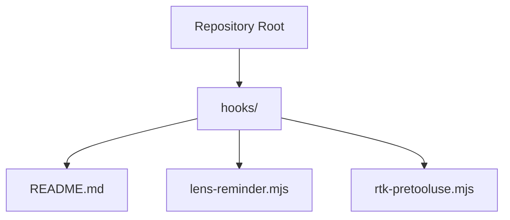
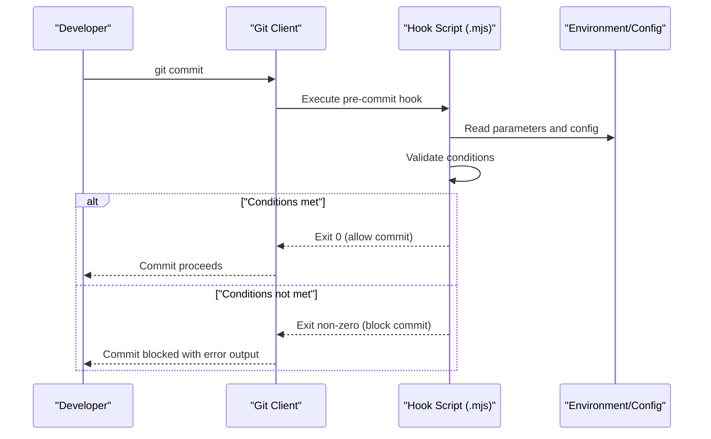
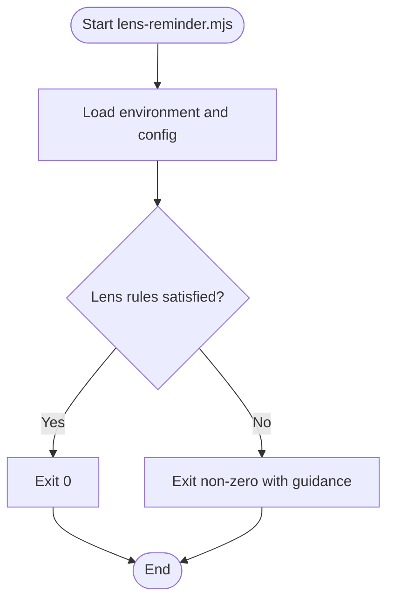
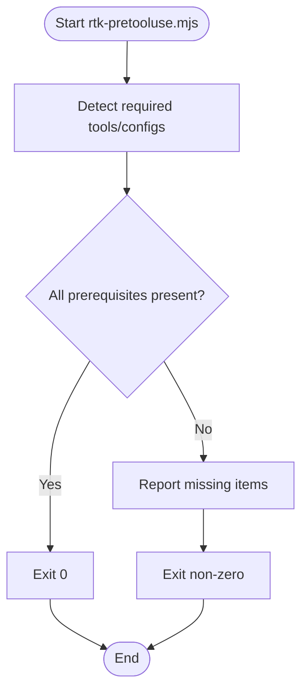
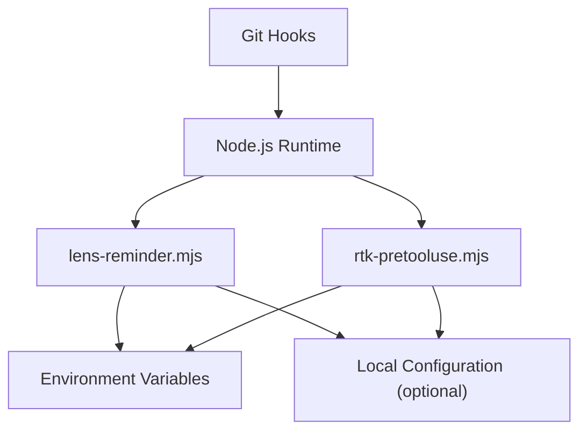

# Git Hooks Integration

<cite>
**Referenced Files in This Document**
- [hooks/README.md](file://hooks/README.md)
- [hooks/lens-reminder.mjs](file://hooks/lens-reminder.mjs)
- [hooks/rtk-pretooluse.mjs](file://hooks/rtk-pretooluse.mjs)
</cite>

## Table of Contents
1. [Introduction](#introduction)
2. [Project Structure](#project-structure)
3. [Core Components](#core-components)
4. [Architecture Overview](#architecture-overview)
5. [Detailed Component Analysis](#detailed-component-analysis)
6. [Dependency Analysis](#dependency-analysis)
7. [Performance Considerations](#performance-considerations)
8. [Troubleshooting Guide](#troubleshooting-guide)
9. [Conclusion](#conclusion)
10. [Appendices](#appendices)

## Introduction
This document explains how to integrate Pi Codex Kit with Git hooks to automate quality and productivity checks around commits. It covers:
- Installing and configuring pre-commit and post-commit hooks
- Using the built-in hooks lens-reminder.mjs and rtk-pretooluse.mjs
- Creating custom hooks using provided patterns
- Troubleshooting common issues (permissions, execution failures, performance)
- Real-world configuration examples for different workflows

The goal is to help teams enforce consistent practices at commit time without slowing down development.

## Project Structure
Pi Codex Kit provides ready-to-use hook scripts under the hooks directory. The repository includes:
- A README describing the hooks and usage
- Two built-in Node.js-based hooks:
  - lens-reminder.mjs
  - rtk-pretooluse.mjs

**Diagram sources**
- [hooks/README.md](file://hooks/README.md)
- [hooks/lens-reminder.mjs](file://hooks/lens-reminder.mjs)
- [hooks/rtk-pretooluse.mjs](file://hooks/rtk-pretooluse.mjs)

**Section sources**
- [hooks/README.md](file://hooks/README.md)

## Core Components
Pi Codex Kit ships two built-in hooks designed to improve developer experience and tooling readiness:

- lens-reminder.mjs
  - Purpose: Reminds developers to use Pi Codex Kit’s lens capabilities during code work or review.
  - Typical behavior: Runs on pre-commit to ensure awareness of lens-related guidance before changes are committed.
  - Parameters: Configurable via environment variables and/or local project settings as documented in the hook script and README.
  - Exit codes: Returns success when reminders are satisfied; fails the commit if configured rules are not met.

- rtk-pretooluse.mjs
  - Purpose: Ensures required pre-tooling steps are completed before committing (for example, validating that certain tools or configurations are present).
  - Typical behavior: Runs on pre-commit to gate commits until prerequisites are satisfied.
  - Parameters: Controlled by environment variables and/or local configuration files referenced by the hook.
  - Exit codes: Non-zero exit signals a failure to proceed with the commit.

These hooks are implemented as ES modules (.mjs), allowing modern JavaScript features and direct access to Node.js APIs.

**Section sources**
- [hooks/lens-reminder.mjs](file://hooks/lens-reminder.mjs)
- [hooks/rtk-pretooluse.mjs](file://hooks/rtk-pretooluse.mjs)
- [hooks/README.md](file://hooks/README.md)

## Architecture Overview
The integration pattern uses Git’s hook mechanism to execute Node.js scripts at specific lifecycle points. The typical flow:

[No sources needed since this diagram shows conceptual workflow, not actual code structure]

## Detailed Component Analysis

### Built-in Hook: lens-reminder.mjs
- Role: Pre-commit reminder to encourage use of lens-related workflows.
- Execution point: pre-commit
- Inputs:
  - Environment variables for toggling behavior and thresholds
  - Local project configuration files if applicable
- Outputs:
  - Console messages guiding next steps
  - Exit code indicating pass/fail
- Customization:
  - Adjust thresholds or message content via environment variables
  - Extend logic by wrapping or calling additional utilities

**Diagram sources**
- [hooks/lens-reminder.mjs](file://hooks/lens-reminder.mjs)

**Section sources**
- [hooks/lens-reminder.mjs](file://hooks/lens-reminder.mjs)

### Built-in Hook: rtk-pretooluse.mjs
- Role: Pre-commit gate ensuring required pre-tooling steps are complete.
- Execution point: pre-commit
- Inputs:
  - Environment variables specifying required tools/configs
  - Optional local configuration files
- Outputs:
  - Status messages about missing prerequisites
  - Exit code indicating pass/fail
- Customization:
  - Add new prerequisite checks by extending the script
  - Configure per-project requirements via environment or config files

**Diagram sources**
- [hooks/rtk-pretooluse.mjs](file://hooks/rtk-pretooluse.mjs)

**Section sources**
- [hooks/rtk-pretooluse.mjs](file://hooks/rtk-pretooluse.mjs)

### Creating Custom Hooks
To create a custom hook:
- Use the .mjs extension to leverage ES modules.
- Follow the same structure as the built-in hooks:
  - Read environment variables and local configuration
  - Perform checks or actions
  - Print clear status messages
  - Return appropriate exit codes (0 for success, non-zero for failure)
- Place your custom hook in the hooks directory and reference it from your Git hook configuration.

Patterns to follow:
- Keep each hook focused on a single responsibility
- Make behavior configurable via environment variables
- Provide actionable error messages to guide developers

**Section sources**
- [hooks/README.md](file://hooks/README.md)

## Dependency Analysis
The hooks rely on:
- Node.js runtime (ES module support)
- Git hook execution context
- Environment variables and optional local configuration files

**Diagram sources**
- [hooks/lens-reminder.mjs](file://hooks/lens-reminder.mjs)
- [hooks/rtk-pretooluse.mjs](file://hooks/rtk-pretooluse.mjs)

**Section sources**
- [hooks/lens-reminder.mjs](file://hooks/lens-reminder.mjs)
- [hooks/rtk-pretooluse.mjs](file://hooks/rtk-pretooluse.mjs)

## Performance Considerations
- Keep hooks fast: avoid heavy operations like full builds or network calls unless necessary.
- Cache results where possible to reduce repeated work.
- Use selective checks based on changed files to minimize overhead.
- Provide clear, concise output to avoid cluttering terminal logs.
- Consider parallelizing independent checks only if they do not introduce race conditions.

[No sources needed since this section provides general guidance]

## Troubleshooting Guide
Common issues and resolutions:
- Permission problems:
  - Ensure hook scripts are executable on Unix-like systems.
  - Verify file permissions allow execution by the user running Git.
- Hook not executing:
  - Confirm the hook path is correctly configured in Git.
  - Check that the script has the correct interpreter (Node.js) and shebang line if needed.
- Non-zero exit codes blocking commits:
  - Review console output for detailed reasons.
  - Adjust environment variables or local configuration to satisfy conditions.
- Slow hook execution:
  - Profile the hook to identify bottlenecks.
  - Reduce scope of checks or add caching.

**Section sources**
- [hooks/README.md](file://hooks/README.md)

## Conclusion
Integrating Pi Codex Kit with Git hooks enables automated reminders and prerequisite checks at commit time. By leveraging the built-in hooks and following the customization patterns, teams can enforce consistent practices while maintaining developer productivity. Use the troubleshooting guide to resolve common issues and optimize performance for smooth workflows.

[No sources needed since this section summarizes without analyzing specific files]

## Appendices

### Installation and Setup Steps
- Install Node.js if not already installed.
- Copy or symlink the desired hook scripts into your Git hooks directory:
  - For pre-commit: create or update .git/hooks/pre-commit to call the hook script(s)
  - For post-commit: create or update .git/hooks/post-commit similarly
- Set environment variables and local configuration as required by each hook.
- Test by performing a commit and verifying hook behavior.

**Section sources**
- [hooks/README.md](file://hooks/README.md)

### Configuration Options
- Environment variables:
  - Control feature toggles, thresholds, and paths used by hooks.
- Local configuration files:
  - Store project-specific defaults and overrides.
- Example patterns:
  - Define per-project requirements in a configuration file and read them within hooks.
  - Use environment variables to enable/disable hooks in CI vs. local development.

**Section sources**
- [hooks/lens-reminder.mjs](file://hooks/lens-reminder.mjs)
- [hooks/rtk-pretooluse.mjs](file://hooks/rtk-pretooluse.mjs)
- [hooks/README.md](file://hooks/README.md)

### Real-World Hook Configurations
- Solo developer workflow:
  - Enable lens-reminder.mjs to keep best practices top-of-mind.
  - Skip heavy checks locally; run them in CI.
- Team workflow:
  - Enforce rtk-pretooluse.mjs to ensure all team members have required tools.
  - Centralize configuration in a shared repository and reference it from hooks.
- CI pipeline:
  - Run stricter versions of hooks with additional validations.
  - Fail the build if critical prerequisites are missing.

[No sources needed since this section provides general guidance]