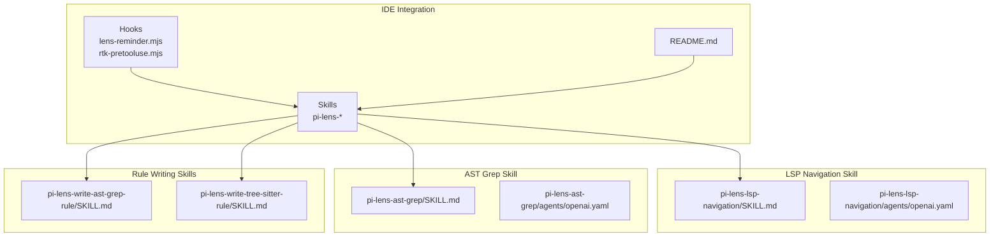
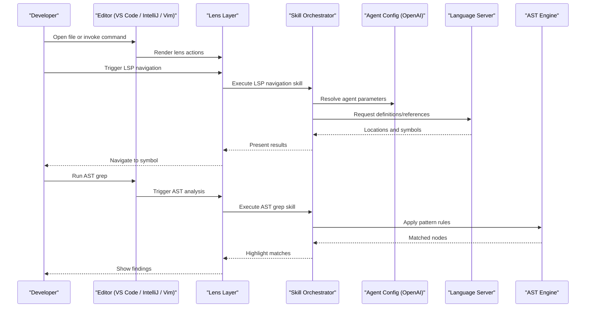
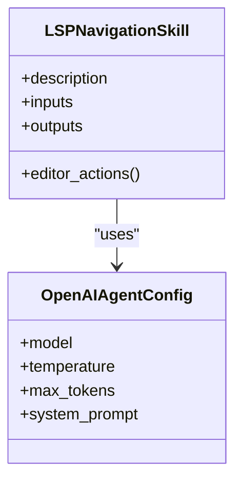
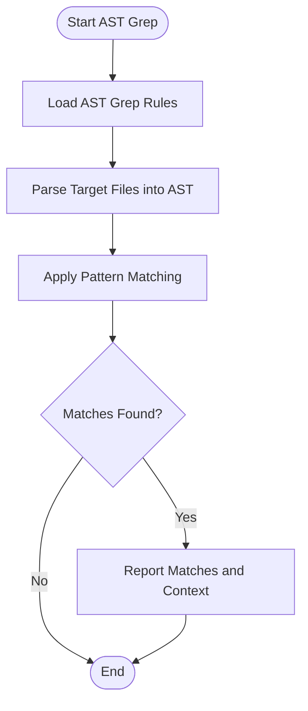
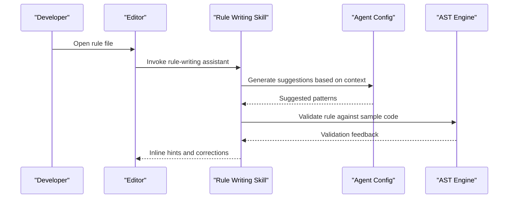
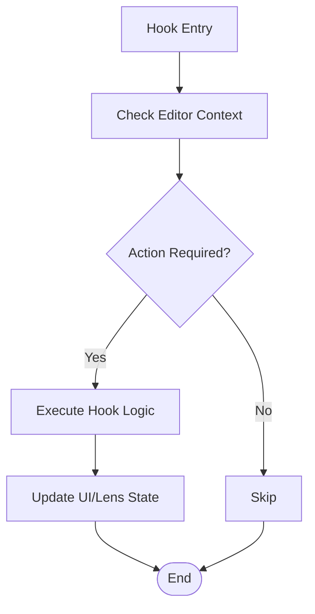
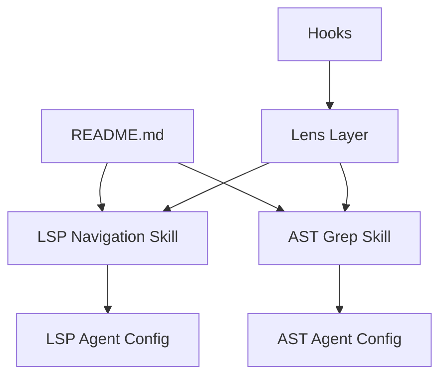

# IDE Integration

<cite>
**Referenced Files in This Document**
- [README.md](file://README.md)
- [lens-reminder.mjs](file://hooks/lens-reminder.mjs)
- [rtk-pretooluse.mjs](file://hooks/rtk-pretooluse.mjs)
- [SKILL.md](file://skills/pi-lens-lsp-navigation/SKILL.md)
- [openai.yaml](file://skills/pi-lens-lsp-navigation/agents/openai.yaml)
- [SKILL.md](file://skills/pi-lens-ast-grep/SKILL.md)
- [openai.yaml](file://skills/pi-lens-ast-grep/agents/openai.yaml)
- [SKILL.md](file://skills/pi-lens-write-ast-grep-rule/SKILL.md)
- [openai.yaml](file://skills/pi-lens-write-ast-grep-rule/agents/openai.yaml)
- [SKILL.md](file://skills/pi-lens-write-tree-sitter-rule/SKILL.md)
- [openai.yaml](file://skills/pi-lens-write-tree-sitter-rule/agents/openai.yaml)
</cite>

## Table of Contents
1. [Introduction](#introduction)
2. [Project Structure](#project-structure)
3. [Core Components](#core-components)
4. [Architecture Overview](#architecture-overview)
5. [Detailed Component Analysis](#detailed-component-analysis)
6. [Dependency Analysis](#dependency-analysis)
7. [Performance Considerations](#performance-considerations)
8. [Troubleshooting Guide](#troubleshooting-guide)
9. [Conclusion](#conclusion)
10. [Appendices](#appendices)

## Introduction
This document provides comprehensive guidance for integrating Pi Codex Kit with popular IDEs and editors, focusing on Language Server Protocol (LSP) integration patterns, VS Code extension setup, editor-specific configurations, lens functionality for code navigation and AST analysis, and interactive development assistance. It also covers key bindings, workflow optimizations, language support configuration, linting customization, toolchain integration, debugging techniques, performance tuning, and troubleshooting common issues.

## Project Structure
Pi Codex Kit organizes IDE-related capabilities primarily through:
- Skills that define workflows and agent configurations for LSP navigation and AST-based operations
- Hooks that provide runtime integrations such as reminders and pre-tool-use behaviors
- A top-level README that outlines project context and usage

**Diagram sources**
- [README.md](file://README.md)
- [SKILL.md](file://skills/pi-lens-lsp-navigation/SKILL.md)
- [openai.yaml](file://skills/pi-lens-lsp-navigation/agents/openai.yaml)
- [SKILL.md](file://skills/pi-lens-ast-grep/SKILL.md)
- [openai.yaml](file://skills/pi-lens-ast-grep/agents/openai.yaml)
- [SKILL.md](file://skills/pi-lens-write-ast-grep-rule/SKILL.md)
- [SKILL.md](file://skills/pi-lens-write-tree-sitter-rule/SKILL.md)

**Section sources**
- [README.md](file://README.md)
- [lens-reminder.mjs](file://hooks/lens-reminder.mjs)
- [rtk-pretooluse.mjs](file://hooks/rtk-pretooluse.mjs)
- [SKILL.md](file://skills/pi-lens-lsp-navigation/SKILL.md)
- [openai.yaml](file://skills/pi-lens-lsp-navigation/agents/openai.yaml)
- [SKILL.md](file://skills/pi-lens-ast-grep/SKILL.md)
- [openai.yaml](file://skills/pi-lens-ast-grep/agents/openai.yaml)
- [SKILL.md](file://skills/pi-lens-write-ast-grep-rule/SKILL.md)
- [SKILL.md](file://skills/pi-lens-write-tree-sitter-rule/SKILL.md)

## Core Components
- LSP Navigation Skill: Provides structured instructions and agent configuration to enable LSP-driven code navigation and contextual assistance within the IDE.
- AST Grep Skill: Enables AST-based search and analysis using pattern rules, supporting advanced code understanding and refactoring workflows.
- Rule Writing Skills: Offer guidance and agent-backed assistance for authoring AST grep and Tree-sitter rules tailored to your codebase.
- Hooks: Provide runtime behaviors such as lens reminders and pre-tool-use hooks to streamline interactions during development.

Key responsibilities:
- Define skill manifests and agent parameters for consistent behavior across environments
- Integrate with editor lenses to surface actionable insights and navigation commands
- Support rule authoring workflows for AST-based queries

**Section sources**
- [SKILL.md](file://skills/pi-lens-lsp-navigation/SKILL.md)
- [openai.yaml](file://skills/pi-lens-lsp-navigation/agents/openai.yaml)
- [SKILL.md](file://skills/pi-lens-ast-grep/SKILL.md)
- [openai.yaml](file://skills/pi-lens-ast-grep/agents/openai.yaml)
- [SKILL.md](file://skills/pi-lens-write-ast-grep-rule/SKILL.md)
- [SKILL.md](file://skills/pi-lens-write-tree-sitter-rule/SKILL.md)
- [lens-reminder.mjs](file://hooks/lens-reminder.mjs)
- [rtk-pretooluse.mjs](file://hooks/rtk-pretooluse.mjs)

## Architecture Overview
The IDE integration architecture centers around skills that encapsulate workflows and agent settings, hooks that augment runtime behavior, and editor interfaces that expose LSP and AST features via lenses and commands.

**Diagram sources**
- [SKILL.md](file://skills/pi-lens-lsp-navigation/SKILL.md)
- [openai.yaml](file://skills/pi-lens-lsp-navigation/agents/openai.yaml)
- [SKILL.md](file://skills/pi-lens-ast-grep/SKILL.md)
- [openai.yaml](file://skills/pi-lens-ast-grep/agents/openai.yaml)

## Detailed Component Analysis

### LSP Navigation Skill
Purpose:
- Standardize LSP-driven navigation flows (go-to definition, find references, hover info)
- Provide agent-backed prompts and context assembly for richer IDE experiences

Key elements:
- Skill manifest describing inputs, outputs, and editor interactions
- Agent configuration defining model parameters and invocation behavior

**Diagram sources**
- [SKILL.md](file://skills/pi-lens-lsp-navigation/SKILL.md)
- [openai.yaml](file://skills/pi-lens-lsp-navigation/agents/openai.yaml)

**Section sources**
- [SKILL.md](file://skills/pi-lens-lsp-navigation/SKILL.md)
- [openai.yaml](file://skills/pi-lens-lsp-navigation/agents/openai.yaml)

### AST Grep Skill
Purpose:
- Enable AST-based search and analysis using pattern rules
- Support refactoring, auditing, and variant analysis by matching structural patterns

**Diagram sources**
- [SKILL.md](file://skills/pi-lens-ast-grep/SKILL.md)
- [openai.yaml](file://skills/pi-lens-ast-grep/agents/openai.yaml)

**Section sources**
- [SKILL.md](file://skills/pi-lens-ast-grep/SKILL.md)
- [openai.yaml](file://skills/pi-lens-ast-grep/agents/openai.yaml)

### Rule Writing Skills (AST Grep and Tree-sitter)
Purpose:
- Assist developers in writing robust AST grep and Tree-sitter rules
- Provide templates, examples, and agent-guided iteration for rule refinement

**Diagram sources**
- [SKILL.md](file://skills/pi-lens-write-ast-grep-rule/SKILL.md)
- [SKILL.md](file://skills/pi-lens-write-tree-sitter-rule/SKILL.md)

**Section sources**
- [SKILL.md](file://skills/pi-lens-write-ast-grep-rule/SKILL.md)
- [SKILL.md](file://skills/pi-lens-write-tree-sitter-rule/SKILL.md)

### Hooks
Purpose:
- lens-reminder.mjs: Provide reminders or nudges related to lens usage and workflows
- rtk-pretooluse.mjs: Pre-process tool invocations before execution, enabling validation or augmentation

**Diagram sources**
- [lens-reminder.mjs](file://hooks/lens-reminder.mjs)
- [rtk-pretooluse.mjs](file://hooks/rtk-pretooluse.mjs)

**Section sources**
- [lens-reminder.mjs](file://hooks/lens-reminder.mjs)
- [rtk-pretooluse.mjs](file://hooks/rtk-pretooluse.mjs)

## Dependency Analysis
The IDE integration components are loosely coupled:
- Skills depend on agent configurations for model parameters and prompts
- Hooks operate independently but can influence lens behavior and tool use
- The README provides overarching context and links to skills and hooks

**Diagram sources**
- [README.md](file://README.md)
- [SKILL.md](file://skills/pi-lens-lsp-navigation/SKILL.md)
- [openai.yaml](file://skills/pi-lens-lsp-navigation/agents/openai.yaml)
- [SKILL.md](file://skills/pi-lens-ast-grep/SKILL.md)
- [openai.yaml](file://skills/pi-lens-ast-grep/agents/openai.yaml)
- [lens-reminder.mjs](file://hooks/lens-reminder.mjs)
- [rtk-pretooluse.mjs](file://hooks/rtk-pretooluse.mjs)

**Section sources**
- [README.md](file://README.md)
- [SKILL.md](file://skills/pi-lens-lsp-navigation/SKILL.md)
- [openai.yaml](file://skills/pi-lens-lsp-navigation/agents/openai.yaml)
- [SKILL.md](file://skills/pi-lens-ast-grep/SKILL.md)
- [openai.yaml](file://skills/pi-lens-ast-grep/agents/openai.yaml)
- [lens-reminder.mjs](file://hooks/lens-reminder.mjs)
- [rtk-pretooluse.mjs](file://hooks/rtk-pretooluse.mjs)

## Performance Considerations
- Prefer incremental AST parsing and targeted rule application to minimize overhead
- Cache frequently used AST results and rule indices when supported by the editor
- Tune agent parameters (e.g., temperature, max tokens) to balance responsiveness and quality
- Use lens debouncing to avoid excessive updates during rapid edits
- Limit scope of LSP requests to visible ranges where possible

[No sources needed since this section provides general guidance]

## Troubleshooting Guide
Common issues and resolutions:
- Lens not rendering: Verify hook registration and ensure editor supports lens APIs; check lens reminder hook logs for errors
- LSP navigation failures: Confirm language server is running and reachable; validate skill inputs and agent configuration
- AST grep returning no results: Review rule syntax and target file encoding; test rules against minimal samples
- Slow performance: Reduce rule complexity, limit file scope, and adjust agent parameters

Diagnostic steps:
- Inspect editor console logs for hook and skill execution traces
- Validate agent configuration files for required fields and correct values
- Test LSP endpoints directly outside the editor to isolate environment issues

**Section sources**
- [lens-reminder.mjs](file://hooks/lens-reminder.mjs)
- [rtk-pretooluse.mjs](file://hooks/rtk-pretooluse.mjs)
- [SKILL.md](file://skills/pi-lens-lsp-navigation/SKILL.md)
- [openai.yaml](file://skills/pi-lens-lsp-navigation/agents/openai.yaml)
- [SKILL.md](file://skills/pi-lens-ast-grep/SKILL.md)
- [openai.yaml](file://skills/pi-lens-ast-grep/agents/openai.yaml)

## Conclusion
Pi Codex Kit’s IDE integration leverages skills and hooks to deliver LSP-powered navigation, AST-based analysis, and rule-writing assistance. By configuring agents, customizing rules, and optimizing lens interactions, teams can achieve a cohesive and efficient development experience across VS Code, IntelliJ, and Vim/Neovim.

[No sources needed since this section summarizes without analyzing specific files]

## Appendices

### IDE Setup Instructions

#### VS Code
- Install the Pi Codex Kit extension if available in the marketplace
- Enable lenses and register hooks via extension settings
- Configure LSP providers and AST grep rules in workspace settings
- Set key bindings for quick access to navigation and analysis commands

[No sources needed since this section provides general guidance]

#### IntelliJ
- Install relevant plugins for LSP and AST analysis
- Map skills to editor actions and configure agent parameters
- Use project-wide settings to scope AST grep rules and LSP requests

[No sources needed since this section provides general guidance]

#### Vim/Neovim
- Integrate LSP client (e.g., nvim-lspconfig) and connect to Pi Codex Kit services
- Configure Telescope or similar tools for lens-like navigation
- Add keymaps for invoking AST grep and rule-writing assistants

[No sources needed since this section provides general guidance]

### Key Bindings and Workflow Optimizations
- Assign shortcuts for go-to-definition, find-references, and AST grep
- Create macros for common refactoring sequences using AST rules
- Use snippets to scaffold rule files and agent prompts

[No sources needed since this section provides general guidance]

### Language Support and Linting Customization
- Extend language support by adding new skills and agent configurations
- Customize linting rules by updating AST grep patterns and validating with samples
- Integrate existing linters by invoking them from hooks or skills

[No sources needed since this section provides general guidance]

### Debugging Techniques
- Enable verbose logging in hooks and skills
- Use editor debuggers to step through hook execution
- Isolate issues by testing LSP and AST engines independently

[No sources needed since this section provides general guidance]