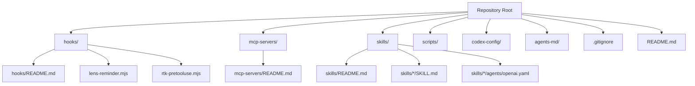
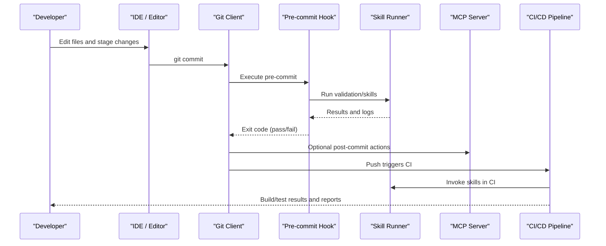
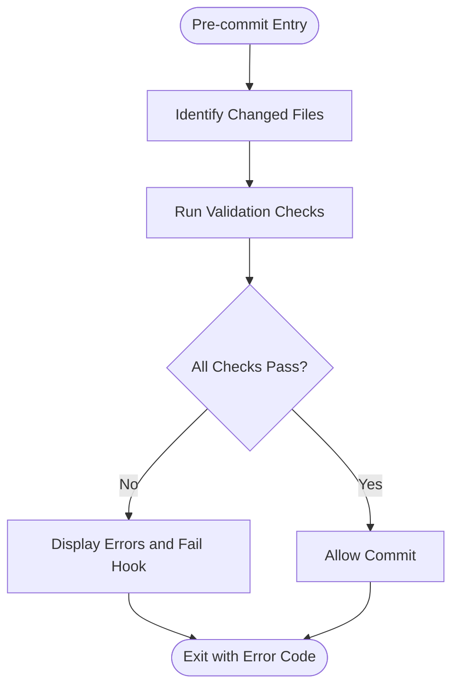
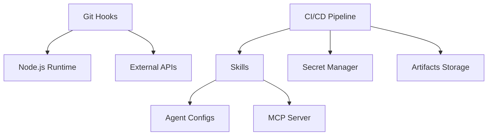

# Integration Guides

<cite>
**Referenced Files in This Document**
- [README.md](file://README.md)
- [hooks/README.md](file://hooks/README.md)
- [hooks/lens-reminder.mjs](file://hooks/lens-reminder.mjs)
- [hooks/rtk-pretooluse.mjs](file://hooks/rtk-pretooluse.mjs)
- [mcp-servers/README.md](file://mcp-servers/README.md)
- [skills/README.md](file://skills/README.md)
- [.gitignore](file://.gitignore)
</cite>

## Table of Contents
1. [Introduction](#introduction)
2. [Project Structure](#project-structure)
3. [Core Components](#core-components)
4. [Architecture Overview](#architecture-overview)
5. [Detailed Component Analysis](#detailed-component-analysis)
6. [Dependency Analysis](#dependency-analysis)
7. [Performance Considerations](#performance-considerations)
8. [Troubleshooting Guide](#troubleshooting-guide)
9. [Conclusion](#conclusion)
10. [Appendices](#appendices)

## Introduction
This document provides integration guidance for connecting the Pi Codex Kit with external systems and development workflows. It focuses on Git hooks automation, IDE integration patterns, CI/CD pipeline integration, and programmatic API usage. It also covers authentication methods, error handling strategies, rate limiting considerations, security best practices, monitoring approaches, troubleshooting techniques, and real-world deployment strategies. The goal is to help teams adopt the kit effectively across local development and automated environments while maintaining reliability and security.

## Project Structure
The repository organizes integrations and automation around several key areas:
- Hooks: Git hook scripts and documentation for pre-commit and post-commit automation
- MCP Servers: Documentation for Model Context Protocol server integration points
- Skills: Agent-driven skills that can be invoked programmatically or via tooling
- Configuration and Scripts: Supporting configuration and utility scripts
- Root-level documentation and ignore rules

**Diagram sources**
- [README.md](file://README.md)
- [hooks/README.md](file://hooks/README.md)
- [hooks/lens-reminder.mjs](file://hooks/lens-reminder.mjs)
- [hooks/rtk-pretooluse.mjs](file://hooks/rtk-pretooluse.mjs)
- [mcp-servers/README.md](file://mcp-servers/README.md)
- [skills/README.md](file://skills/README.md)
- [.gitignore](file://.gitignore)

**Section sources**
- [README.md](file://README.md)
- [hooks/README.md](file://hooks/README.md)
- [mcp-servers/README.md](file://mcp-servers/README.md)
- [skills/README.md](file://skills/README.md)
- [.gitignore](file://.gitignore)

## Core Components
- Git Hooks: Pre-commit and post-commit automation scripts under hooks/, including Node.js-based utilities and a README explaining setup and usage.
- MCP Servers: Documentation describing how to integrate with Model Context Protocol servers for enhanced tooling and agent interactions.
- Skills: Reusable agent capabilities defined by SKILL.md files and associated agent configurations (e.g., openai.yaml), enabling programmatic invocation and workflow automation.
- Configuration and Scripts: Centralized configuration and script directories supporting environment-specific settings and automation tasks.

These components collectively enable:
- Automated code quality checks and reminders before commits
- Programmatic access to AI-powered skills through MCP or direct invocation
- Consistent developer experience across IDEs and CI/CD pipelines

**Section sources**
- [hooks/README.md](file://hooks/README.md)
- [hooks/lens-reminder.mjs](file://hooks/lens-reminder.mjs)
- [hooks/rtk-pretooluse.mjs](file://hooks/rtk-pretooluse.mjs)
- [mcp-servers/README.md](file://mcp-servers/README.md)
- [skills/README.md](file://skills/README.md)

## Architecture Overview
The integration architecture connects local development tools (IDEs, Git hooks) with backend services (MCP servers, AI agents) and CI/CD systems. The flow typically involves:
- Developer triggers (commit, push, or IDE action)
- Hook execution (pre-commit/post-commit)
- Invocation of skills or MCP endpoints
- Feedback loops (status, logs, artifacts)

[No sources needed since this diagram shows conceptual workflow, not actual code structure]

## Detailed Component Analysis

### Git Hooks Setup and Automation
The hooks directory contains scripts and documentation for integrating Git hooks into your workflow. Key aspects include:
- Pre-commit automation: Validate code, run checks, and enforce standards before committing
- Post-commit automation: Trigger notifications, update dashboards, or invoke MCP endpoints
- Scripting model: Node.js-based hooks with clear entry points and modular logic

Recommended steps:
- Review the hooks README for installation and configuration instructions
- Configure your Git client to use the provided hook scripts
- Customize hook behavior by editing the relevant .mjs files
- Test locally to ensure hooks execute correctly in your environment

Security considerations:
- Avoid embedding secrets in hook scripts; use environment variables or secure secret managers
- Validate inputs and sanitize outputs to prevent injection risks
- Limit hook permissions to only what is necessary

Error handling:
- Ensure hooks return appropriate exit codes to signal success or failure
- Log detailed errors for debugging without exposing sensitive information
- Provide user-friendly messages when hooks fail

Rate limiting:
- If hooks call external APIs, implement retries with exponential backoff
- Cache responses where possible to reduce redundant calls
- Respect upstream service quotas and avoid blocking the commit process

Monitoring:
- Capture hook execution metrics (duration, success rate)
- Integrate with logging systems for centralized observability
- Alert on repeated failures or degraded performance

**Section sources**
- [hooks/README.md](file://hooks/README.md)
- [hooks/lens-reminder.mjs](file://hooks/lens-reminder.mjs)
- [hooks/rtk-pretooluse.mjs](file://hooks/rtk-pretooluse.mjs)

#### Pre-commit Hook Flow

**Diagram sources**
- [hooks/rtk-pretooluse.mjs](file://hooks/rtk-pretooluse.mjs)
- [hooks/lens-reminder.mjs](file://hooks/lens-reminder.mjs)

### IDE Integration Patterns
To integrate the Pi Codex Kit with IDEs:
- Configure task runners or extensions to invoke skills and MCP endpoints
- Use language server protocols where applicable for rich editor features
- Set up command palettes or shortcuts for common operations

Best practices:
- Keep IDE configurations version-controlled alongside project code
- Provide clear documentation for setting up the development environment
- Test integrations across multiple IDEs and platforms

Authentication:
- Use IDE-safe credential stores for API keys and tokens
- Prefer short-lived tokens and refresh mechanisms
- Avoid storing secrets in workspace settings unless encrypted

**Section sources**
- [mcp-servers/README.md](file://mcp-servers/README.md)
- [skills/README.md](file://skills/README.md)

### CI/CD Pipeline Integration
Integrating the kit into CI/CD involves:
- Running pre-commit-like checks in CI jobs
- Invoking skills and MCP endpoints during build/test stages
- Publishing artifacts and reports generated by skills

Pipeline design:
- Separate stages for linting, testing, and skill execution
- Parallelize independent tasks to reduce pipeline duration
- Use caching for dependencies and intermediate results

Security:
- Store secrets in CI/CD secret managers
- Rotate credentials regularly and audit access logs
- Restrict pipeline permissions to minimum required

Monitoring:
- Track pipeline metrics and skill execution times
- Integrate with alerting systems for failures
- Generate compliance reports from skill outputs

**Section sources**
- [skills/README.md](file://skills/README.md)
- [mcp-servers/README.md](file://mcp-servers/README.md)

### API Usage for Programmatic Access
Programmatic access to the Pi Codex Kit typically involves:
- Calling MCP endpoints for agent interactions
- Invoking skills via CLI or SDK interfaces
- Handling responses and errors consistently

API design principles:
- Use RESTful or RPC-style endpoints with clear contracts
- Implement consistent error formats and status codes
- Support pagination and filtering for large datasets

Authentication methods:
- API keys, OAuth 2.0, or JWT-based authentication
- Token rotation and revocation mechanisms
- Scope-based authorization for fine-grained access control

Rate limiting:
- Implement request throttling at API gateway level
- Return informative headers indicating remaining quota
- Provide retry-after guidance in error responses

**Section sources**
- [mcp-servers/README.md](file://mcp-servers/README.md)
- [skills/README.md](file://skills/README.md)

### Real-world Integration Scenarios
Common scenarios include:
- Automated code review using skills during pull requests
- Security scanning with variant analysis skills in CI
- Architecture deepening and refactoring suggestions via MCP
- Continuous learning loops where feedback improves skill accuracy

Deployment strategies:
- Blue-green deployments for MCP servers
- Feature flags for gradual rollout of new skills
- Canary releases for high-risk integrations

**Section sources**
- [skills/README.md](file://skills/README.md)
- [mcp-servers/README.md](file://mcp-servers/README.md)

## Dependency Analysis
The integration components have the following relationships:
- Git hooks depend on Node.js runtime and may call external APIs
- Skills rely on agent configurations and MCP server availability
- CI/CD pipelines orchestrate multiple components and manage secrets

**Diagram sources**
- [hooks/README.md](file://hooks/README.md)
- [skills/README.md](file://skills/README.md)
- [mcp-servers/README.md](file://mcp-servers/README.md)

**Section sources**
- [hooks/README.md](file://hooks/README.md)
- [skills/README.md](file://skills/README.md)
- [mcp-servers/README.md](file://mcp-servers/README.md)

## Performance Considerations
- Optimize hook execution time to avoid slowing down developer workflow
- Cache frequently accessed data and responses
- Use asynchronous processing for long-running tasks
- Monitor resource utilization and scale MCP servers horizontally
- Implement connection pooling for database and API calls

[No sources needed since this section provides general guidance]

## Troubleshooting Guide
Common issues and resolutions:
- Hook failures: Check exit codes and log output for detailed error messages
- Authentication errors: Verify credentials and token expiration
- Rate limit exceeded: Implement backoff strategies and monitor quotas
- MCP connectivity: Validate network access and server health endpoints
- Skill execution errors: Inspect agent configurations and input parameters

Debugging techniques:
- Enable verbose logging in development mode
- Use structured logging for better analysis
- Implement health checks and readiness probes
- Create diagnostic commands for system inspection

**Section sources**
- [hooks/README.md](file://hooks/README.md)
- [mcp-servers/README.md](file://mcp-servers/README.md)

## Conclusion
The Pi Codex Kit provides powerful integration capabilities through Git hooks, MCP servers, and programmable skills. By following the recommended setup procedures, security practices, and monitoring strategies, teams can effectively automate their development workflows while maintaining reliability and performance. The modular architecture allows for flexible customization and scaling to meet diverse organizational needs.

[No sources needed since this section summarizes without analyzing specific files]

## Appendices

### Security Best Practices
- Use least privilege principle for all integrations
- Encrypt sensitive data at rest and in transit
- Regularly audit and rotate credentials
- Implement input validation and sanitization
- Monitor for suspicious activities and anomalies

### Monitoring Approaches
- Track key metrics: latency, error rates, throughput
- Set up alerts for critical failures
- Use distributed tracing for complex workflows
- Maintain comprehensive audit logs
- Implement health checks and circuit breakers

### Deployment Strategies
- Containerize applications for consistent environments
- Use infrastructure as code for reproducibility
- Implement zero-downtime deployments
- Plan for rollback scenarios
- Test deployments in staging environments first

[No sources needed since this section provides general guidance]