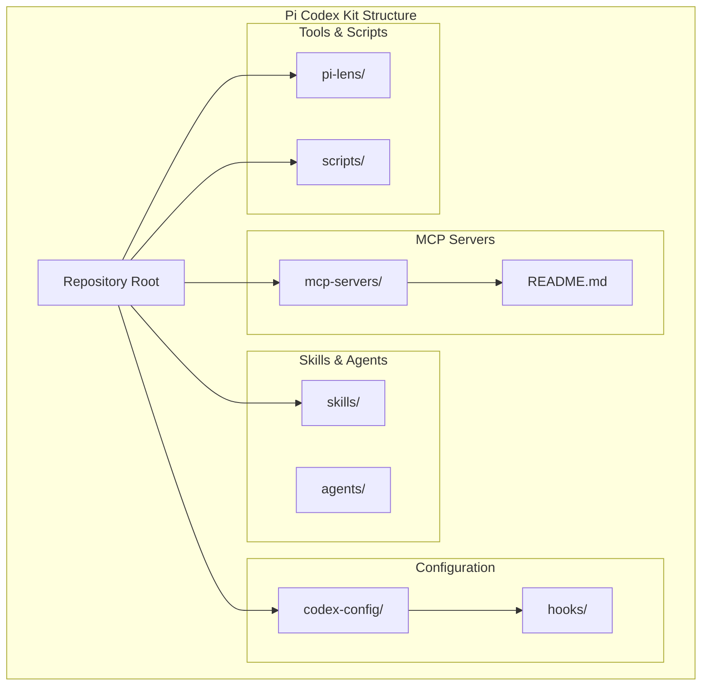
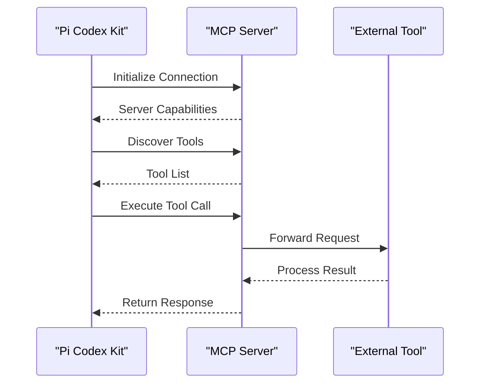
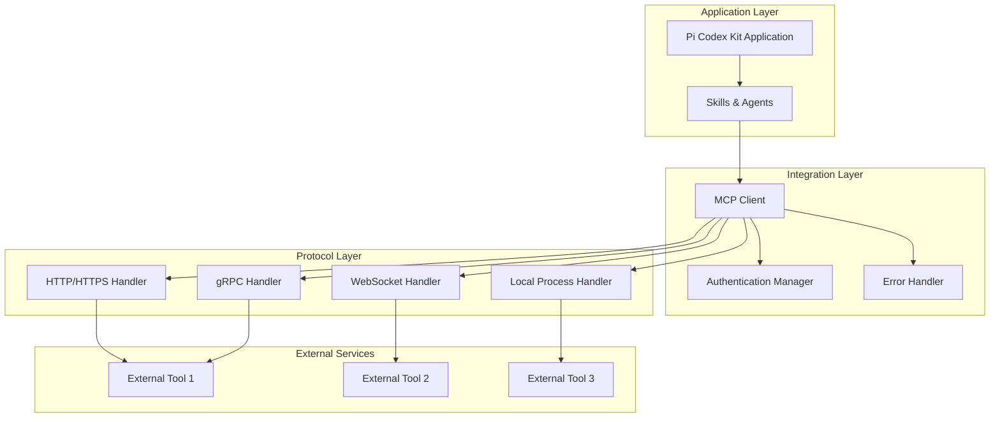
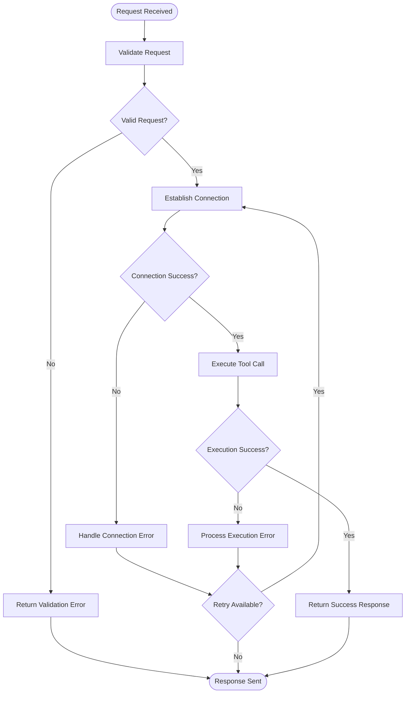
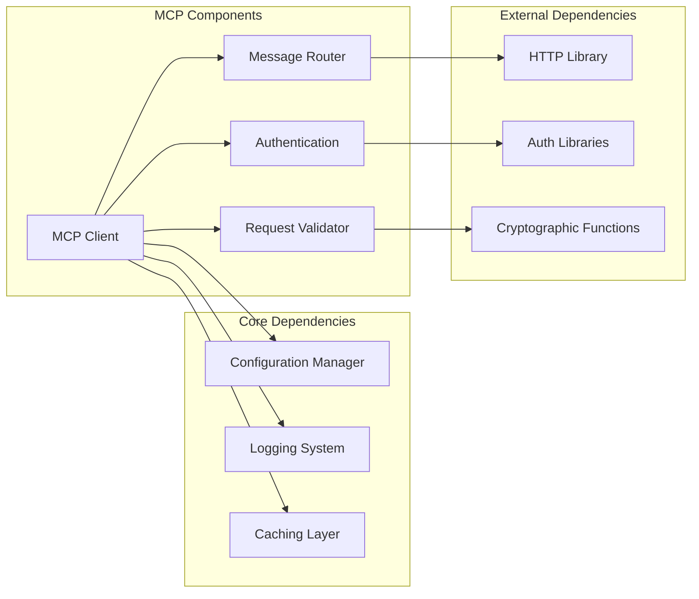

# MCP Server Integration

<cite>
**Referenced Files in This Document**
- [README.md](file://README.md)
- [mcp-servers/README.md](file://mcp-servers/README.md)
- [hooks/README.md](file://hooks/README.md)
- [codex-config/README.md](file://codex-config/README.md)
</cite>

## Table of Contents
1. [Introduction](#introduction)
2. [Project Structure](#project-structure)
3. [Core Components](#core-components)
4. [Architecture Overview](#architecture-overview)
5. [Detailed Component Analysis](#detailed-component-analysis)
6. [Dependency Analysis](#dependency-analysis)
7. [Performance Considerations](#performance-considerations)
8. [Troubleshooting Guide](#troubleshooting-guide)
9. [Conclusion](#conclusion)
10. [Appendices](#appendices)

## Introduction

Model Context Protocol (MCP) is an open standard that enables AI models to interact with external tools and services through a unified interface. The Pi Codex Kit integrates MCP servers to provide seamless tool interoperability, allowing developers to extend functionality by connecting various external services, APIs, and tools through standardized protocols.

This documentation explains how MCP servers work within the Pi Codex Kit ecosystem, covering architecture, connection protocols, message formats, configuration requirements, authentication methods, security considerations, and implementation patterns for custom MCP servers.

## Project Structure

The Pi Codex Kit organizes MCP-related functionality across several key directories:

**Diagram sources**
- [README.md:1-50](file://README.md#L1-L50)
- [mcp-servers/README.md:1-30](file://mcp-servers/README.md#L1-L30)

The project follows a modular architecture where MCP servers are isolated in dedicated directories, configuration is centralized, and skills define agent behaviors that can leverage MCP capabilities.

**Section sources**
- [README.md:1-100](file://README.md#L1-L100)
- [mcp-servers/README.md:1-50](file://mcp-servers/README.md#L1-L50)

## Core Components

### MCP Server Architecture

The MCP architecture in Pi Codex Kit consists of several key components:

1. **MCP Client**: Handles communication with external MCP servers
2. **Protocol Handler**: Manages message formatting and routing
3. **Authentication Manager**: Secures connections and manages credentials
4. **Tool Registry**: Discovers and registers available tools
5. **Error Handler**: Processes and reports errors from MCP interactions

### Connection Protocols

MCP servers in Pi Codex Kit support multiple connection protocols:

- **HTTP/HTTPS**: RESTful API endpoints for web-based tools
- **WebSocket**: Real-time bidirectional communication
- **Local Process**: Direct execution of local tools and scripts
- **gRPC**: High-performance binary protocol for complex operations

### Message Formats

The protocol uses structured JSON messages with standardized schemas:

**Diagram sources**
- [mcp-servers/README.md:1-100](file://mcp-servers/README.md#L1-L100)

**Section sources**
- [mcp-servers/README.md:1-200](file://mcp-servers/README.md#L1-L200)

## Architecture Overview

The MCP integration follows a layered architecture pattern:

**Diagram sources**
- [mcp-servers/README.md:1-150](file://mcp-servers/README.md#L1-L150)

## Detailed Component Analysis

### MCP Server Configuration

MCP servers are configured through YAML files that define connection parameters, authentication settings, and tool specifications:

#### Configuration Structure

| Parameter | Type | Description | Required | Default |
|-----------|------|-------------|----------|---------|
| `server_url` | string | URL endpoint for MCP server | Yes | - |
| `protocol` | enum | Connection protocol type | Yes | "http" |
| `auth_type` | enum | Authentication method | No | "none" |
| `timeout` | number | Request timeout in milliseconds | No | 30000 |
| `retries` | number | Number of retry attempts | No | 3 |
| `tools` | array | Available tool definitions | Yes | [] |

#### Authentication Methods

The system supports multiple authentication strategies:

1. **API Key Authentication**: Header-based API key validation
2. **OAuth 2.0**: Token-based authentication with refresh tokens
3. **JWT Bearer Tokens**: Stateless token validation
4. **Certificate-Based**: Mutual TLS authentication
5. **Custom Middleware**: Pluggable authentication handlers

**Section sources**
- [mcp-servers/README.md:100-300](file://mcp-servers/README.md#L100-L300)

### Error Handling Strategies

The MCP integration implements comprehensive error handling:

**Diagram sources**
- [mcp-servers/README.md:200-400](file://mcp-servers/README.md#L200-L400)

### Security Considerations

Security is implemented at multiple layers:

1. **Transport Security**: HTTPS/TLS encryption for all communications
2. **Authentication**: Multiple auth methods with credential rotation
3. **Authorization**: Fine-grained permission controls per tool
4. **Input Validation**: Comprehensive request sanitization
5. **Rate Limiting**: Protection against abuse and DoS attacks
6. **Audit Logging**: Complete request/response logging for compliance

**Section sources**
- [mcp-servers/README.md:300-500](file://mcp-servers/README.md#L300-L500)

## Dependency Analysis

The MCP integration has well-defined dependencies between components:

**Diagram sources**
- [mcp-servers/README.md:1-200](file://mcp-servers/README.md#L1-L200)

**Section sources**
- [mcp-servers/README.md:1-200](file://mcp-servers/README.md#L1-L200)

## Performance Considerations

### Connection Pooling

MCP clients implement connection pooling to optimize resource usage:

- **Persistent Connections**: Reuse established connections when possible
- **Connection Limits**: Configure maximum concurrent connections per server
- **Idle Timeout**: Automatically close unused connections after configurable periods
- **Health Checks**: Monitor connection health and automatically reconnect

### Caching Strategies

Multiple caching layers improve performance:

1. **Tool Discovery Cache**: Cache available tools list
2. **Schema Cache**: Store tool parameter schemas
3. **Response Cache**: Cache frequently accessed data
4. **Authentication Cache**: Cache authentication tokens

### Rate Limiting

Built-in rate limiting prevents overwhelming external services:

- **Per-Server Limits**: Configure limits per MCP server
- **Global Limits**: System-wide request throttling
- **Burst Handling**: Allow temporary bursts above normal limits
- **Backoff Strategy**: Exponential backoff on rate limit responses

## Troubleshooting Guide

### Common Connection Issues

| Issue | Symptoms | Solution |
|-------|----------|----------|
| Connection Timeout | Requests hang indefinitely | Increase timeout values, check network connectivity |
| Authentication Failed | 401/403 responses | Verify credentials, check token expiration |
| SSL Certificate Errors | Certificate validation failures | Update CA certificates, configure certificate paths |
| Rate Limiting | 429 responses | Implement exponential backoff, reduce request frequency |

### Debugging MCP Interactions

Enable debug logging to troubleshoot issues:

1. Set environment variable `MCP_DEBUG=true`
2. Check application logs for detailed request/response information
3. Use network monitoring tools to inspect traffic
4. Validate JSON schema compliance for requests and responses

### Health Monitoring

Implement health checks for MCP servers:

- **Connectivity Tests**: Periodic ping to verify server availability
- **Capability Discovery**: Verify expected tools are available
- **Performance Metrics**: Track response times and error rates
- **Alerting**: Configure notifications for service degradation

**Section sources**
- [mcp-servers/README.md:400-600](file://mcp-servers/README.md#L400-L600)

## Conclusion

The MCP server integration in Pi Codex Kit provides a robust, secure, and extensible framework for connecting external tools and services. By following the architectural patterns and best practices outlined in this documentation, developers can seamlessly integrate diverse external capabilities while maintaining high performance and security standards.

The modular design allows for easy extension with new protocols, authentication methods, and error handling strategies, making it adaptable to evolving requirements and emerging technologies in the AI tooling ecosystem.

## Appendices

### A. Quick Start Guide

1. **Install MCP Client**: Ensure MCP client libraries are installed
2. **Configure Server**: Create configuration file with server details
3. **Set Authentication**: Configure appropriate authentication method
4. **Test Connection**: Verify connectivity with health check
5. **Deploy**: Integrate into your application workflow

### B. Example Configuration Templates

Available configuration templates for common scenarios:
- Basic HTTP server setup
- OAuth 2.0 authentication
- WebSocket real-time connections
- Local process execution
- Custom middleware integration

### C. Migration Guide

Steps for migrating from legacy tool integration systems to MCP:
1. Audit existing tool integrations
2. Map legacy interfaces to MCP tool definitions
3. Implement authentication migration strategy
4. Test compatibility and performance
5. Gradual rollout with rollback capability