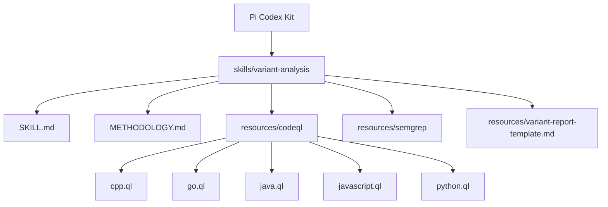
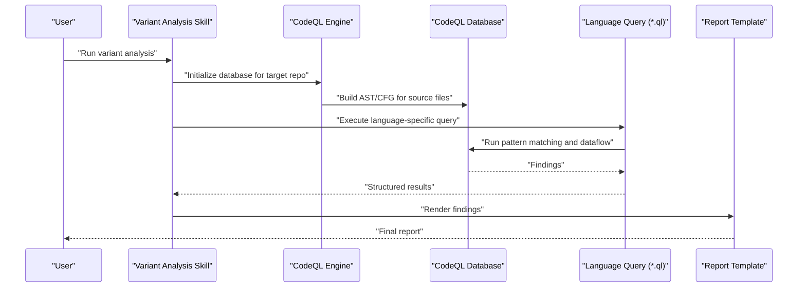
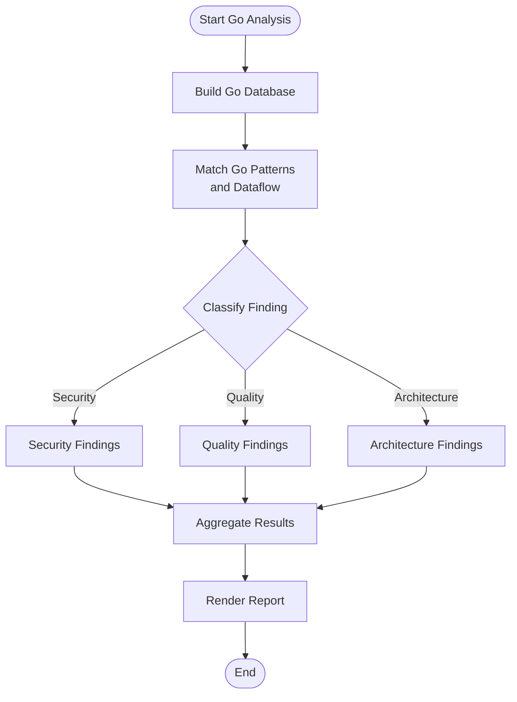
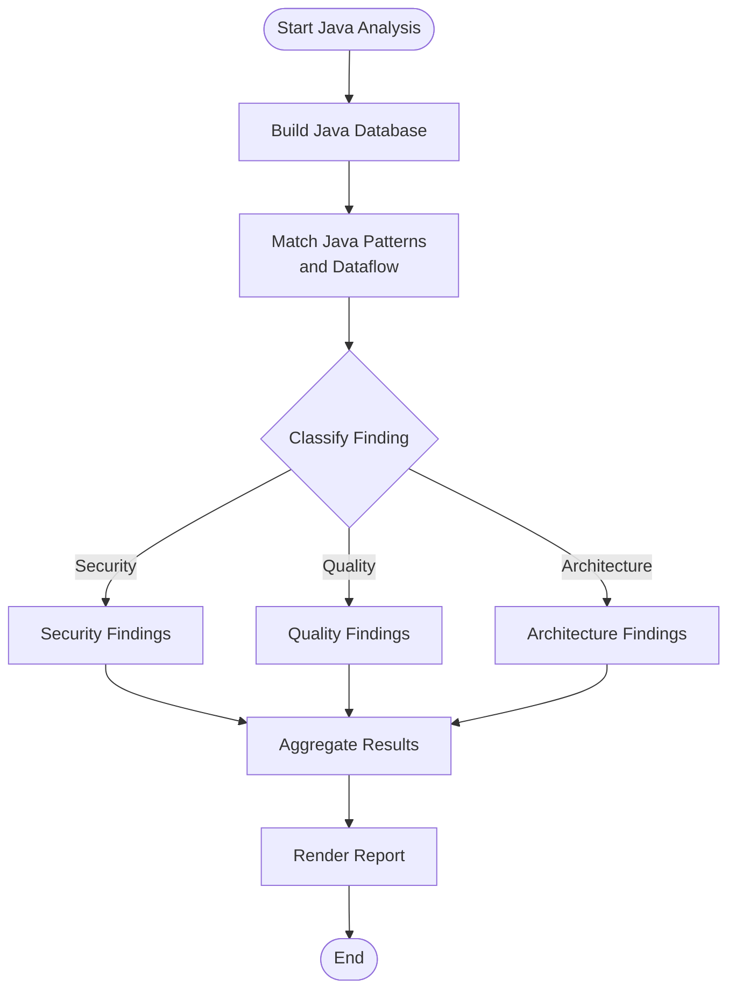
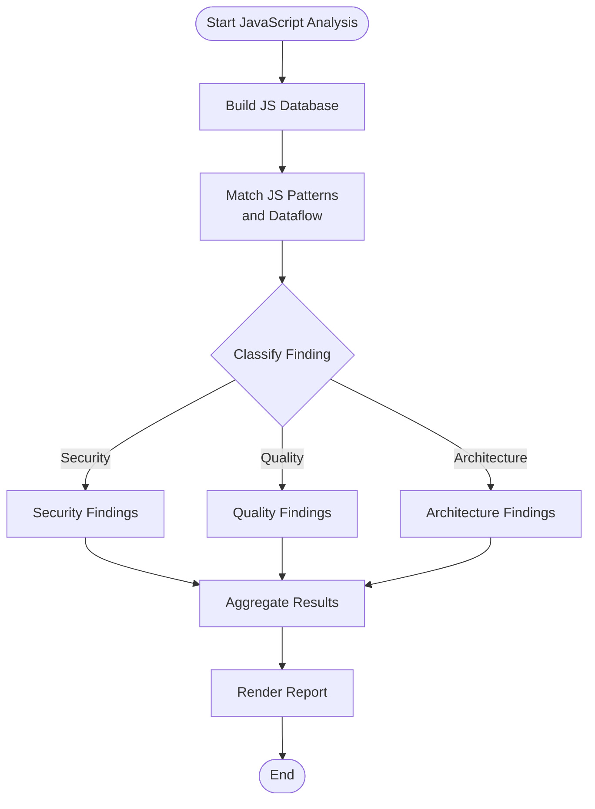
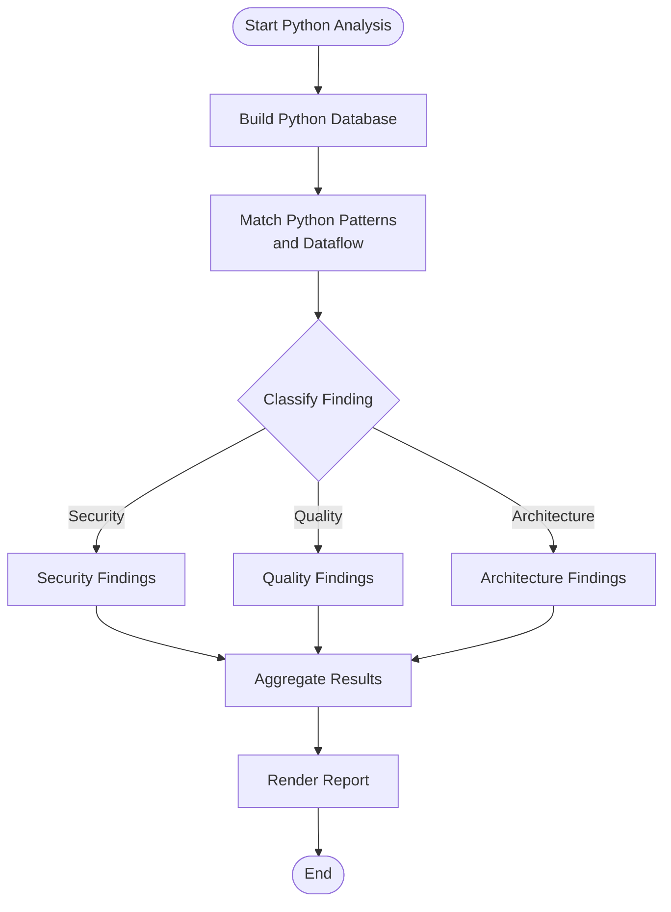
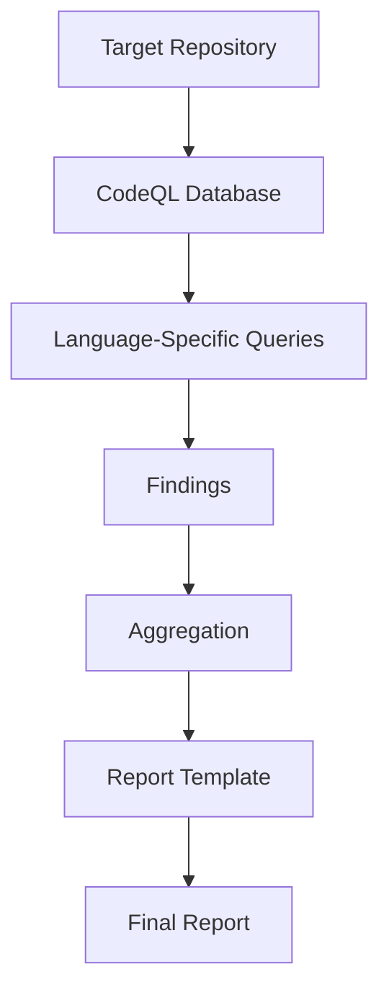
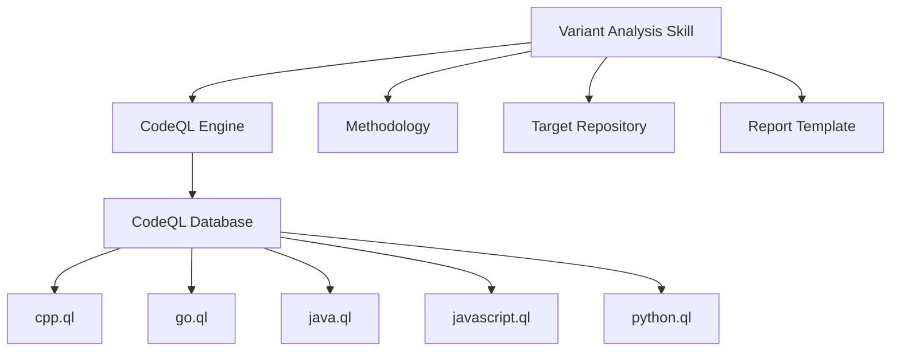

# CodeQL Integration

<cite>
**Referenced Files in This Document**
- [README.md](file://README.md)
- [SKILL.md](file://skills/variant-analysis/SKILL.md)
- [METHODOLOGY.md](file://skills/variant-analysis/METHODOLOGY.md)
- [cpp.ql](file://skills/variant-analysis/resources/codeql/cpp.ql)
- [go.ql](file://skills/variant-analysis/resources/codeql/go.ql)
- [java.ql](file://skills/variant-analysis/resources/codeql/java.ql)
- [javascript.ql](file://skills/variant-analysis/resources/codeql/javascript.ql)
- [python.ql](file://skills/variant-analysis/resources/codeql/python.ql)
</cite>

## Table of Contents
1. [Introduction](#introduction)
2. [Project Structure](#project-structure)
3. [Core Components](#core-components)
4. [Architecture Overview](#architecture-overview)
5. [Detailed Component Analysis](#detailed-component-analysis)
6. [Dependency Analysis](#dependency-analysis)
7. [Performance Considerations](#performance-considerations)
8. [Troubleshooting Guide](#troubleshooting-guide)
9. [Conclusion](#conclusion)
10. [Appendices](#appendices)

## Introduction
This document explains how CodeQL is integrated into the Pi Codex Kit for variant analysis across multiple languages. It focuses on the structure and implementation of CodeQL rules, query patterns, and analysis capabilities for C++, Go, Java, JavaScript, and Python. It also provides guidance for creating custom queries, extending existing rules, optimizing performance on large codebases, and debugging complex queries.

## Project Structure
The CodeQL integration is organized under a dedicated skill that centralizes methodology, language-specific queries, and reporting templates. The key locations are:
- skills/variant-analysis: Skill entry point and methodology
- skills/variant-analysis/resources/codeql: Language-specific CodeQL queries
- skills/variant-analysis/resources: Shared resources (e.g., report template)

**Diagram sources**
- [SKILL.md](file://skills/variant-analysis/SKILL.md)
- [METHODOLOGY.md](file://skills/variant-analysis/METHODOLOGY.md)
- [cpp.ql](file://skills/variant-analysis/resources/codeql/cpp.ql)
- [go.ql](file://skills/variant-analysis/resources/codeql/go.ql)
- [java.ql](file://skills/variant-analysis/resources/codeql/java.ql)
- [javascript.ql](file://skills/variant-analysis/resources/codeql/javascript.ql)
- [python.ql](file://skills/variant-analysis/resources/codeql/python.ql)

**Section sources**
- [README.md](file://README.md)
- [SKILL.md](file://skills/variant-analysis/SKILL.md)
- [METHODOLOGY.md](file://skills/variant-analysis/METHODOLOGY.md)

## Core Components
- Variant Analysis Skill: Orchestrates running CodeQL queries against repositories and producing reports.
- Language-Specific Queries: One CodeQL query per supported language to detect security vulnerabilities, code quality issues, and architectural patterns.
- Methodology and Reporting: Standardized process and output format for consistent results.

Key responsibilities:
- Define the workflow for building and analyzing codebases with CodeQL.
- Provide reusable, language-tuned queries for common vulnerability classes and quality checks.
- Ensure outputs are machine-readable and human-friendly via a shared report template.

**Section sources**
- [SKILL.md](file://skills/variant-analysis/SKILL.md)
- [METHODOLOGY.md](file://skills/variant-analysis/METHODOLOGY.md)

## Architecture Overview
At runtime, the variant analysis skill invokes CodeQL to build and analyze target repositories using language-specific queries. Results are aggregated and rendered using the shared report template.

**Diagram sources**
- [SKILL.md](file://skills/variant-analysis/SKILL.md)
- [METHODOLOGY.md](file://skills/variant-analysis/METHODOLOGY.md)
- [cpp.ql](file://skills/variant-analysis/resources/codeql/cpp.ql)
- [go.ql](file://skills/variant-analysis/resources/codeql/go.ql)
- [java.ql](file://skills/variant-analysis/resources/codeql/java.ql)
- [javascript.ql](file://skills/variant-analysis/resources/codeql/javascript.ql)
- [python.ql](file://skills/variant-analysis/resources/codeql/python.ql)

## Detailed Component Analysis

### C++ Query (cpp.ql)
Purpose: Detect C++-specific security vulnerabilities, unsafe API usage, and architectural anti-patterns. Typical areas include memory safety, resource management, and standard library misuse.

Analysis capabilities:
- Security: Buffer overflows, use-after-free, null dereferences, unchecked pointer arithmetic.
- Quality: Rule-of-five violations, missing RAII, improper exception handling.
- Architecture: Non-compliant module boundaries, forbidden APIs, incorrect const-correctness.

Implementation notes:
- Uses C++ libraries and predicates to match expressions, statements, and declarations.
- Employs dataflow where necessary to track tainted values across function calls.
- Produces structured results suitable for aggregation and reporting.

**Diagram sources**
- [cpp.ql](file://skills/variant-analysis/resources/codeql/cpp.ql)

**Section sources**
- [cpp.ql](file://skills/variant-analysis/resources/codeql/cpp.ql)

### Go Query (go.ql)
Purpose: Identify Go-specific security risks, concurrency pitfalls, and idiomatic deviations.

Analysis capabilities:
- Security: Insecure defaults, improper error handling leading to panics, weak crypto usage.
- Quality: Goroutine leaks, race conditions, unused imports, inefficient allocations.
- Architecture: Violations of package contracts, misuse of interfaces, non-compliant dependency usage.

Implementation notes:
- Leverages Go-specific AST nodes and type information.
- Uses dataflow to trace user input to sensitive sinks.
- Emits findings with precise file and location metadata.

**Diagram sources**
- [go.ql](file://skills/variant-analysis/resources/codeql/go.ql)

**Section sources**
- [go.ql](file://skills/variant-analysis/resources/codeql/go.ql)

### Java Query (java.ql)
Purpose: Detect Java security vulnerabilities, performance anti-patterns, and framework-specific issues.

Analysis capabilities:
- Security: Injection flaws, insecure deserialization, cryptographic misuses.
- Quality: Resource leaks, excessive object creation, poor exception handling.
- Architecture: Layering violations, misuse of design patterns, dependency rule breaches.

Implementation notes:
- Utilizes Java libraries and type system for precise matching.
- Applies dataflow to connect sources to sinks across method boundaries.
- Generates actionable results with stack traces and call paths when available.

**Diagram sources**
- [java.ql](file://skills/variant-analysis/resources/codeql/java.ql)

**Section sources**
- [java.ql](file://skills/variant-analysis/resources/codeql/java.ql)

### JavaScript Query (javascript.ql)
Purpose: Identify JavaScript security vulnerabilities, DOM misuse, and Node.js-specific risks.

Analysis capabilities:
- Security: XSS, prototype pollution, unsafe eval-like constructs, insecure dependencies.
- Quality: Memory leaks, unhandled promises, inefficient loops.
- Architecture: Module boundary violations, misuse of frameworks, inconsistent patterns.

Implementation notes:
- Matches ES syntax and framework-specific constructs.
- Tracks data flow through callbacks and async chains.
- Provides context-rich results for browser and Node environments.

**Diagram sources**
- [javascript.ql](file://skills/variant-analysis/resources/codeql/javascript.ql)

**Section sources**
- [javascript.ql](file://skills/variant-analysis/resources/codeql/javascript.ql)

### Python Query (python.ql)
Purpose: Detect Python security vulnerabilities, dynamic typing pitfalls, and common anti-patterns.

Analysis capabilities:
- Security: Command injection, unsafe deserialization, hardcoded secrets.
- Quality: Unbound variables, inefficient list operations, missing error handling.
- Architecture: Circular imports, violation of project conventions, misuse of third-party APIs.

Implementation notes:
- Uses Python-specific AST and type inference where possible.
- Employs dataflow to follow dynamic assignments and attribute access.
- Emits findings with clear line-level details.

**Diagram sources**
- [python.ql](file://skills/variant-analysis/resources/codeql/python.ql)

**Section sources**
- [python.ql](file://skills/variant-analysis/resources/codeql/python.ql)

### Conceptual Overview
The variant analysis workflow is consistent across languages:
- Initialize and build a CodeQL database for the target repository.
- Execute language-specific queries to find security, quality, and architecture issues.
- Aggregate and render results using a standardized report template.

[No sources needed since this diagram shows conceptual workflow, not actual code structure]

## Dependency Analysis
The variant analysis skill depends on:
- CodeQL engine and language packs for each supported language.
- Language-specific queries located under resources/codeql.
- Shared methodology and reporting artifacts.

**Diagram sources**
- [SKILL.md](file://skills/variant-analysis/SKILL.md)
- [METHODOLOGY.md](file://skills/variant-analysis/METHODOLOGY.md)
- [cpp.ql](file://skills/variant-analysis/resources/codeql/cpp.ql)
- [go.ql](file://skills/variant-analysis/resources/codeql/go.ql)
- [java.ql](file://skills/variant-analysis/resources/codeql/java.ql)
- [javascript.ql](file://skills/variant-analysis/resources/codeql/javascript.ql)
- [python.ql](file://skills/variant-analysis/resources/codeql/python.ql)

**Section sources**
- [SKILL.md](file://skills/variant-analysis/SKILL.md)
- [METHODOLOGY.md](file://skills/variant-analysis/METHODOLOGY.md)

## Performance Considerations
Optimizations for large codebases:
- Incremental builds: Reuse existing databases when only a subset of files changes.
- Query scoping: Limit analysis to relevant directories or modules to reduce scope.
- Predicate efficiency: Prefer precise matches and avoid overly broad patterns.
- Dataflow minimization: Use targeted taint tracking instead of global flows where possible.
- Parallelism: Run independent language analyses concurrently if resources allow.
- Result filtering: Apply early filters to reduce downstream processing overhead.

[No sources needed since this section provides general guidance]

## Troubleshooting Guide
Common issues and remedies:
- Build failures: Verify toolchain configuration and dependencies; ensure correct language pack versions.
- No findings: Check query scope, adjust thresholds, and confirm that relevant code paths are included in the database.
- Slow queries: Profile predicate performance, refine patterns, and limit dataflow scopes.
- False positives: Add exclusion predicates, refine contexts, and validate assumptions about API usage.
- Environment problems: Confirm CodeQL CLI availability and permissions; validate network access for remote packages.

**Section sources**
- [METHODOLOGY.md](file://skills/variant-analysis/METHODOLOGY.md)

## Conclusion
The Pi Codex Kit’s CodeQL integration provides a consistent, extensible framework for multi-language variant analysis. By leveraging language-specific queries and a unified methodology, teams can detect security vulnerabilities, enforce code quality, and validate architectural patterns at scale. Customization and optimization enable adaptation to diverse codebases while maintaining reliable and actionable results.

## Appendices

### Creating Custom CodeQL Queries
Steps:
- Identify the target language and its CodeQL library.
- Define the problem class (security, quality, architecture).
- Write predicates to match code patterns and data flows.
- Test against representative samples and edge cases.
- Integrate the new query into the variant analysis workflow.

Guidance:
- Start from existing queries as templates.
- Use precise types and contexts to reduce false positives.
- Validate with small subsets before scaling up.

[No sources needed since this section provides general guidance]

### Extending Existing Rules
Approach:
- Locate the relevant language query file.
- Add new predicates or refine existing ones.
- Include additional context (e.g., call sites, annotations).
- Update result formatting to maintain consistency.

Best practices:
- Keep changes minimal and focused.
- Document rationale and expected impact.
- Retest across different code styles and frameworks.

[No sources needed since this section provides general guidance]

### Debugging Complex Queries
Techniques:
- Isolate problematic predicates by commenting out sections.
- Narrow the search space to specific files or functions.
- Inspect intermediate results using CodeQL’s interactive features.
- Log contextual information in findings to aid triage.

[No sources needed since this section provides general guidance]