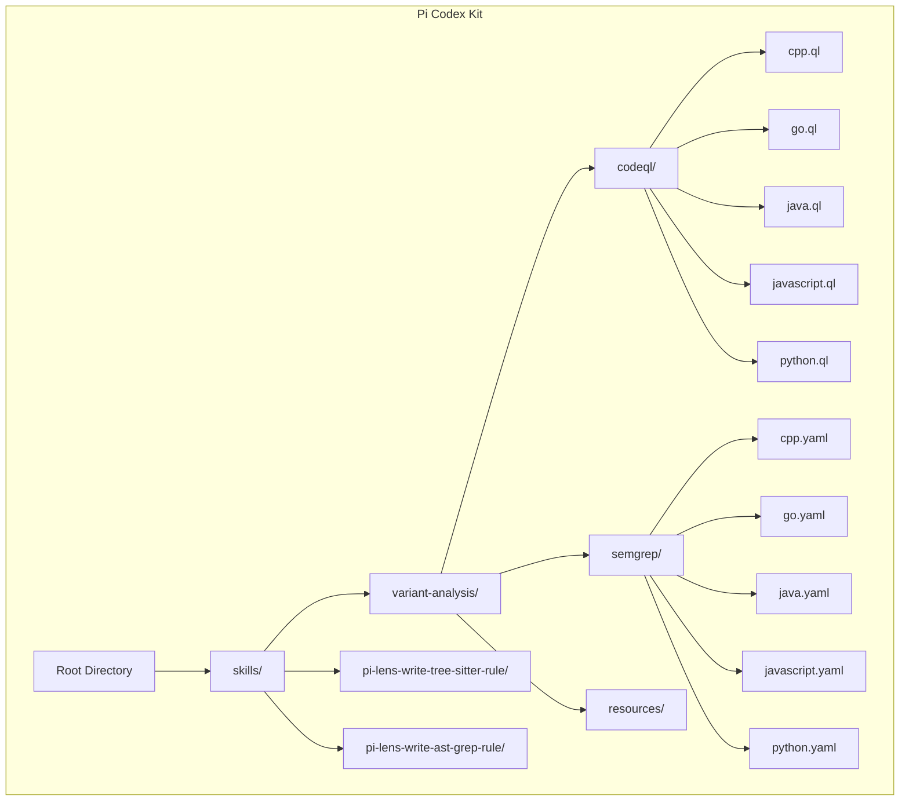
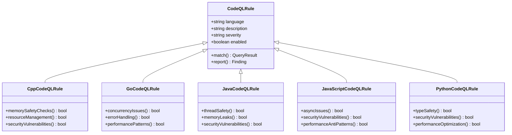
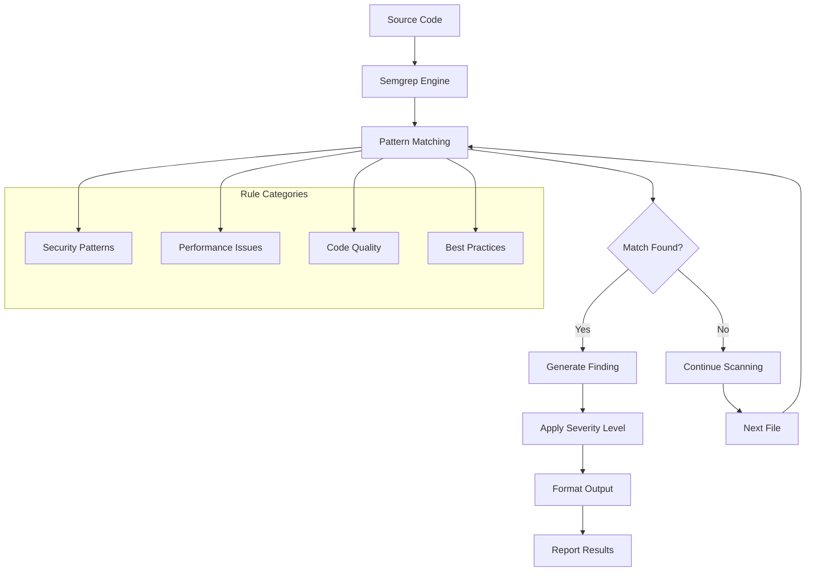
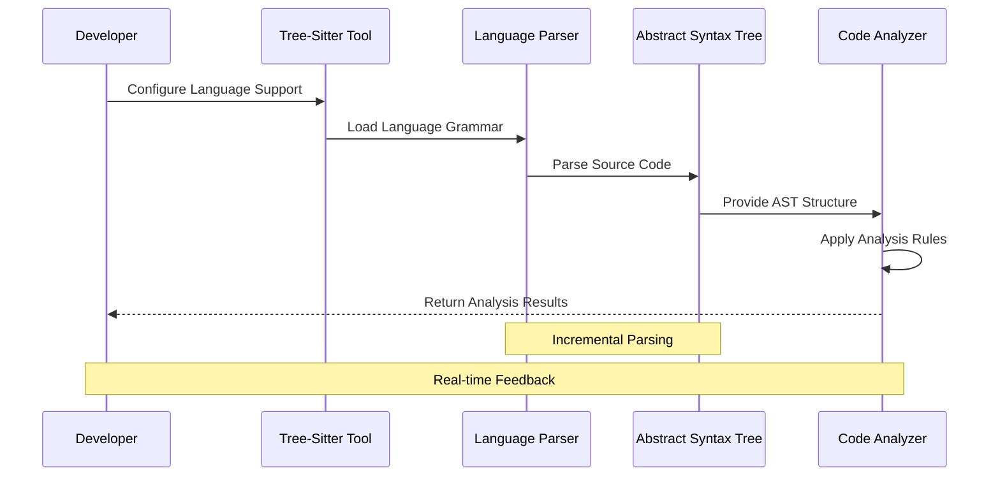
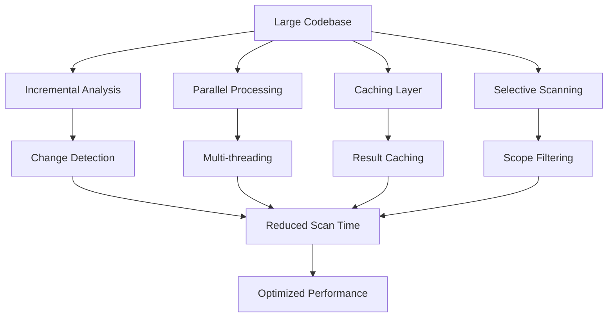
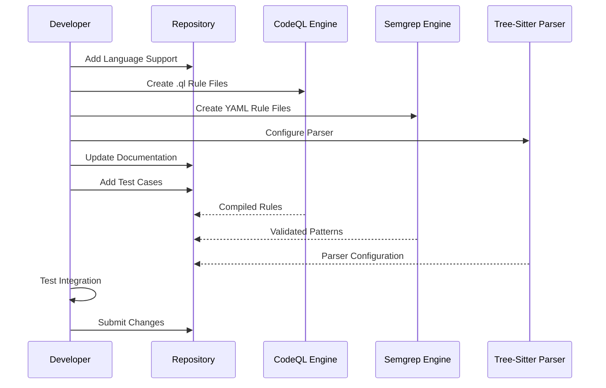

# Language Support

<cite>
**Referenced Files in This Document**
- [README.md](file://README.md)
- [SKILL.md](file://skills/variant-analysis/SKILL.md)
- [METHODOLOGY.md](file://skills/variant-analysis/METHODOLOGY.md)
- [cpp.ql](file://skills/variant-analysis/resources/codeql/cpp.ql)
- [go.ql](file://skills/variant-analysis/resources/codeql/go.ql)
- [java.ql](file://skills/variant-analysis/resources/codeql/java.ql)
- [javascript.ql](file://skills/variant-analysis/resources/codeql/javascript.ql)
- [python.ql](file://skills/variant-analysis/resources/codeql/python.ql)
- [cpp.yaml](file://skills/variant-analysis/resources/semgrep/cpp.yaml)
- [go.yaml](file://skills/variant-analysis/resources/semgrep/go.yaml)
- [java.yaml](file://skills/variant-analysis/resources/semgrep/java.yaml)
- [javascript.yaml](file://skills/variant-analysis/resources/semgrep/javascript.yaml)
- [python.yaml](file://skills/variant-analysis/resources/semgrep/python.yaml)
- [variant-report-template.md](file://skills/variant-analysis/resources/variant-report-template.md)
- [SKILL.md](file://skills/pi-lens-write-tree-sitter-rule/SKILL.md)
- [SKILL.md](file://skills/pi-lens-write-ast-grep-rule/SKILL.md)
</cite>

## Table of Contents
1. [Introduction](#introduction)
2. [Project Structure](#project-structure)
3. [Supported Programming Languages](#supported-programming-languages)
4. [CodeQL Rule Creation](#codeql-rule-creation)
5. [Semgrep Rule Generation](#semgrep-rule-generation)
6. [Tree-Sitter Parser Configuration](#tree-sitter-parser-configuration)
7. [Language-Specific Analysis Capabilities](#language-specific-analysis-capabilities)
8. [Performance Considerations](#performance-considerations)
9. [Adding New Language Support](#adding-new-language-support)
10. [Best Practices and Guidelines](#best-practices-and-guidelines)
11. [Troubleshooting Guide](#troubleshooting-guide)
12. [Conclusion](#conclusion)

## Introduction

The Pi Codex Kit provides comprehensive multi-language support for code analysis, security scanning, and variant analysis across multiple programming languages. This documentation explains how the system supports different programming languages through CodeQL rules, Semgrep patterns, and tree-sitter parsers, enabling developers to perform sophisticated code analysis and security assessments.

The system is designed to be extensible, allowing users to add support for new programming languages while maintaining consistent analysis capabilities across all supported languages. The architecture follows a modular approach where language-specific configurations are separated from core analysis logic, making it easy to maintain and extend language support.

## Project Structure

The Pi Codex Kit organizes language support through a well-structured directory hierarchy that separates concerns between different analysis tools and programming languages:

**Diagram sources**
- [SKILL.md](file://skills/variant-analysis/SKILL.md)
- [cpp.ql](file://skills/variant-analysis/resources/codeql/cpp.ql)
- [cpp.yaml](file://skills/variant-analysis/resources/semgrep/cpp.yaml)

The project structure demonstrates a clear separation between:
- **CodeQL rules**: Language-specific query files for static analysis
- **Semgrep patterns**: YAML-based pattern matching rules
- **Tree-sitter configuration**: Tools for writing custom parsing rules
- **AST grep integration**: Pattern matching using Abstract Syntax Trees

**Section sources**
- [SKILL.md](file://skills/variant-analysis/SKILL.md)
- [METHODOLOGY.md](file://skills/variant-analysis/METHODOLOGY.md)

## Supported Programming Languages

The Pi Codex Kit currently supports five major programming languages with comprehensive analysis capabilities:

### Primary Supported Languages

| Language | CodeQL Support | Semgrep Support | Tree-Sitter Support | Analysis Depth |
|----------|---------------|-----------------|-------------------|----------------|
| **C++** | ✅ Full | ✅ Full | ✅ Configured | High |
| **Go** | ✅ Full | ✅ Full | ✅ Configured | High |
| **Java** | ✅ Full | ✅ Full | ✅ Configured | High |
| **JavaScript** | ✅ Full | ✅ Full | ✅ Configured | Medium-High |
| **Python** | ✅ Full | ✅ Full | ✅ Configured | Medium-High |

### Language-Specific Features

Each supported language has tailored analysis capabilities:

#### C++ Analysis
- Memory safety violations
- Resource management issues
- Performance anti-patterns
- Security vulnerabilities specific to C/C++ ecosystem

#### Go Analysis
- Concurrency issues (race conditions, goroutine leaks)
- Error handling patterns
- Performance optimization opportunities
- Security best practices

#### Java Analysis
- Thread safety issues
- Memory leak detection
- Performance bottlenecks
- Security vulnerabilities (injection attacks, etc.)

#### JavaScript Analysis
- Asynchronous programming issues
- Memory management problems
- Security vulnerabilities (XSS, injection)
- Performance anti-patterns

#### Python Analysis
- Type safety issues
- Security vulnerabilities
- Performance optimization
- Best practice violations

**Section sources**
- [cpp.ql](file://skills/variant-analysis/resources/codeql/cpp.ql)
- [go.ql](file://skills/variant-analysis/resources/codeql/go.ql)
- [java.ql](file://skills/variant-analysis/resources/codeql/java.ql)
- [javascript.ql](file://skills/variant-analysis/resources/codeql/javascript.ql)
- [python.ql](file://skills/variant-analysis/resources/codeql/python.ql)
- [cpp.yaml](file://skills/variant-analysis/resources/semgrep/cpp.yaml)
- [go.yaml](file://skills/variant-analysis/resources/semgrep/go.yaml)
- [java.yaml](file://skills/variant-analysis/resources/semgrep/java.yaml)
- [javascript.yaml](file://skills/variant-analysis/resources/semgrep/javascript.yaml)
- [python.yaml](file://skills/variant-analysis/resources/semgrep/python.yaml)

## CodeQL Rule Creation

CodeQL is a semantic code analysis engine that enables sophisticated pattern matching and vulnerability detection across multiple programming languages. The Pi Codex Kit provides pre-configured CodeQL rules for each supported language.

### CodeQL Architecture

**Diagram sources**
- [cpp.ql](file://skills/variant-analysis/resources/codeql/cpp.ql)
- [go.ql](file://skills/variant-analysis/resources/codeql/go.ql)
- [java.ql](file://skills/variant-analysis/resources/codeql/java.ql)
- [javascript.ql](file://skills/variant-analysis/resources/codeql/javascript.ql)
- [python.ql](file://skills/variant-analysis/resources/codeql/python.ql)

### CodeQL Rule Structure

Each CodeQL rule follows a standardized structure:

1. **Metadata Definition**: Language, description, and severity classification
2. **Pattern Matching**: Semantic queries to identify code patterns
3. **Data Flow Analysis**: Tracking data flow for security vulnerabilities
4. **Reporting**: Structured output with location and explanation
5. **Remediation Guidance**: Suggested fixes and best practices

### Creating Custom CodeQL Rules

To create a new CodeQL rule:

1. **Define Rule Metadata**: Specify language, description, and severity
2. **Write Semantic Queries**: Use CodeQL's query language to match patterns
3. **Implement Data Flow Analysis**: Track sensitive data through program execution
4. **Add Reporting Logic**: Generate meaningful findings with context
5. **Test Against Sample Code**: Validate rule effectiveness and accuracy

**Section sources**
- [cpp.ql](file://skills/variant-analysis/resources/codeql/cpp.ql)
- [go.ql](file://skills/variant-analysis/resources/codeql/go.ql)
- [java.ql](file://skills/variant-analysis/resources/codeql/java.ql)
- [javascript.ql](file://skills/variant-analysis/resources/codeql/javascript.ql)
- [python.ql](file://skills/variant-analysis/resources/codeql/python.ql)

## Semgrep Rule Generation

Semgrep provides fast, lightweight static analysis using pattern matching. The Pi Codex Kit includes comprehensive Semgrep rules for all supported languages, focusing on security vulnerabilities and code quality issues.

### Semgrep Rule Architecture

**Diagram sources**
- [cpp.yaml](file://skills/variant-analysis/resources/semgrep/cpp.yaml)
- [go.yaml](file://skills/variant-analysis/resources/semgrep/go.yaml)
- [java.yaml](file://skills/variant-analysis/resources/semgrep/java.yaml)
- [javascript.yaml](file://skills/variant-analysis/resources/semgrep/javascript.yaml)
- [python.yaml](file://skills/variant-analysis/resources/semgrep/python.yaml)

### Semgrep Rule Structure

Semgrep rules follow a YAML-based format with the following components:

1. **Rule ID**: Unique identifier for the rule
2. **Pattern**: Code pattern to match using language-specific syntax
3. **Message**: Human-readable description of the issue
4. **Severity**: Risk level (ERROR, WARNING, INFO)
5. **Metadata**: Additional context and references
6. **Fix Suggestions**: Automated remediation when possible

### Language-Specific Semgrep Patterns

#### C++ Security Patterns
- Buffer overflow detection
- Memory safety violations
- Unsafe function usage
- Format string vulnerabilities

#### Go Concurrency Patterns
- Race condition detection
- Goroutine leak prevention
- Channel misuse identification
- Mutex lock/unlock patterns

#### Java Security Patterns
- SQL injection prevention
- Cross-site scripting (XSS) protection
- Insecure deserialization detection
- Path traversal vulnerabilities

#### JavaScript Security Patterns
- Prototype pollution detection
- Command injection prevention
- XSS vulnerability identification
- Insecure random number generation

#### Python Security Patterns
- SQL injection detection
- Command injection prevention
- Insecure file operations
- Weak cryptographic usage

**Section sources**
- [cpp.yaml](file://skills/variant-analysis/resources/semgrep/cpp.yaml)
- [go.yaml](file://skills/variant-analysis/resources/semgrep/go.yaml)
- [java.yaml](file://skills/variant-analysis/resources/semgrep/java.yaml)
- [javascript.yaml](file://skills/variant-analysis/resources/semgrep/javascript.yaml)
- [python.yaml](file://skills/variant-analysis/resources/semgrep/python.yaml)

## Tree-Sitter Parser Configuration

Tree-sitter provides incremental parsing capabilities that enable efficient code analysis. The Pi Codex Kit integrates tree-sitter parsers for enhanced code understanding and pattern matching.

### Tree-Sitter Integration Architecture

**Diagram sources**
- [SKILL.md](file://skills/pi-lens-write-tree-sitter-rule/SKILL.md)

### Tree-Sitter Parser Configuration

Each language requires specific tree-sitter parser configuration:

1. **Grammar Definition**: Define language syntax using tree-sitter grammar format
2. **Node Types**: Map language constructs to AST node types
3. **Query Patterns**: Write queries to extract relevant code elements
4. **Incremental Updates**: Configure change tracking for large codebases

### Extending Tree-Sitter for New Languages

To add support for a new programming language:

1. **Install Tree-Sitter Parser**: Ensure parser exists or create custom grammar
2. **Configure Language Mapping**: Map file extensions to language identifiers
3. **Define Analysis Patterns**: Create tree-sitter queries for analysis
4. **Integrate with Analysis Pipeline**: Connect parser to existing analysis tools
5. **Test with Sample Code**: Validate parsing accuracy and performance

**Section sources**
- [SKILL.md](file://skills/pi-lens-write-tree-sitter-rule/SKILL.md)

## Language-Specific Analysis Capabilities

The Pi Codex Kit provides specialized analysis capabilities for each supported language, leveraging both CodeQL and Semgrep engines to deliver comprehensive coverage.

### Analysis Capability Matrix

| Analysis Type | C++ | Go | Java | JavaScript | Python |
|--------------|-----|----|----|------------|--------|
| **Security Vulnerabilities** | ✅ Advanced | ✅ Advanced | ✅ Advanced | ✅ Advanced | ✅ Advanced |
| **Performance Issues** | ✅ Comprehensive | ✅ Good | ✅ Good | ✅ Good | ✅ Basic |
| **Memory Safety** | ✅ Critical | ✅ Good | ✅ Good | ✅ Limited | ✅ Basic |
| **Concurrency Issues** | ✅ Good | ✅ Critical | ✅ Advanced | ✅ Good | ✅ Basic |
| **Code Quality** | ✅ Good | ✅ Good | ✅ Good | ✅ Good | ✅ Good |
| **Best Practices** | ✅ Good | ✅ Good | ✅ Good | ✅ Good | ✅ Good |

### Language-Specific Optimization Strategies

#### C++ Performance Optimization
- Memory allocation pattern analysis
- Cache-friendly code detection
- Algorithm complexity assessment
- Compiler optimization hints

#### Go Concurrency Analysis
- Goroutine lifecycle monitoring
- Channel communication patterns
- Mutex usage validation
- Race condition detection

#### Java Enterprise Security
- Injection attack prevention
- Authentication bypass detection
- Session management security
- API security validation

#### JavaScript Modern Development
- Async/await pattern validation
- Promise error handling
- Module dependency analysis
- Browser compatibility checking

#### Python Data Science Safety
- Type safety enforcement
- Data validation patterns
- Library security auditing
- Performance bottleneck detection

**Section sources**
- [SKILL.md](file://skills/variant-analysis/SKILL.md)
- [METHODOLOGY.md](file://skills/variant-analysis/METHODOLOGY.md)

## Performance Considerations

Analyzing large codebases requires careful consideration of performance implications. The Pi Codex Kit implements several strategies to ensure efficient analysis across different scales.

### Performance Optimization Strategies

### Key Performance Considerations

#### 1. Incremental Analysis
- Analyze only changed files when possible
- Maintain parse cache between runs
- Track dependency changes efficiently

#### 2. Parallel Processing
- Distribute analysis across multiple CPU cores
- Process independent code sections concurrently
- Balance memory usage across workers

#### 3. Selective Scanning
- Focus on relevant directories and files
- Use ignore patterns to exclude generated code
- Prioritize high-risk areas first

#### 4. Memory Management
- Stream large files instead of loading entirely
- Implement garbage collection triggers
- Monitor memory usage per analysis task

### Language-Specific Optimizations

#### C++ Compilation Units
- Analyze by compilation unit boundaries
- Leverage precompiled headers when available
- Optimize template instantiation analysis

#### Go Package Boundaries
- Analyze package-level dependencies
- Utilize Go module cache effectively
- Optimize interface method resolution

#### Java Class Hierarchy
- Cache class loading results
- Optimize inheritance chain analysis
- Leverage bytecode analysis when beneficial

#### JavaScript Module Resolution
- Cache module resolution paths
- Optimize dynamic import analysis
- Handle circular dependencies efficiently

#### Python Import System
- Cache import resolution results
- Optimize virtual environment scanning
- Handle dynamic imports gracefully

**Section sources**
- [SKILL.md](file://skills/variant-analysis/SKILL.md)
- [METHODOLOGY.md](file://skills/variant-analysis/METHODOLOGY.md)

## Adding New Language Support

Extending the Pi Codex Kit to support new programming languages involves several coordinated steps across different analysis tools and configuration systems.

### Language Addition Workflow

### Step-by-Step Language Addition Process

#### 1. CodeQL Rule Development
- Create language-specific `.ql` files in `skills/variant-analysis/resources/codeql/`
- Define security and quality rules using CodeQL query language
- Test rules against sample vulnerable code
- Document rule purpose and remediation guidance

#### 2. Semgrep Pattern Creation
- Create language-specific YAML files in `skills/variant-analysis/resources/semgrep/`
- Write pattern matching rules for common vulnerabilities
- Include severity levels and fix suggestions
- Validate patterns with test cases

#### 3. Tree-Sitter Parser Configuration
- Ensure tree-sitter parser exists for target language
- Configure language mapping in system settings
- Create custom queries if needed for specific analysis needs
- Test parsing accuracy with real-world code samples

#### 4. Integration Testing
- Test analysis pipeline with sample projects
- Verify rule effectiveness and accuracy
- Check performance impact on large codebases
- Validate error handling and edge cases

#### 5. Documentation and Examples
- Update main documentation with new language support
- Provide example rules and patterns
- Document language-specific considerations
- Add troubleshooting guidance

### Language Support Checklist

- [ ] CodeQL rules created and tested
- [ ] Semgrep patterns defined and validated
- [ ] Tree-sitter parser configured
- [ ] Analysis pipeline integration complete
- [ ] Documentation updated
- [ ] Test cases added
- [ ] Performance benchmarks established
- [ ] Error handling implemented

**Section sources**
- [SKILL.md](file://skills/pi-lens-write-tree-sitter-rule/SKILL.md)
- [SKILL.md](file://skills/pi-lens-write-ast-grep-rule/SKILL.md)

## Best Practices and Guidelines

Following established best practices ensures consistent, effective multi-language support across the Pi Codex Kit.

### Rule Development Best Practices

#### CodeQL Rule Design
- Use semantic analysis over syntactic matching when possible
- Implement precise path queries for complex vulnerabilities
- Provide actionable remediation guidance
- Test against diverse code patterns and edge cases

#### Semgrep Pattern Writing
- Prefer semantic patterns over regex when available
- Use metavariables for flexible matching
- Include comprehensive metadata and descriptions
- Organize rules by category and severity

#### Tree-Sitter Query Optimization
- Minimize query complexity for better performance
- Use incremental parsing features effectively
- Cache frequently accessed AST nodes
- Profile queries against large codebases

### Performance Optimization Guidelines

#### Analysis Efficiency
- Implement selective scanning for large repositories
- Use caching mechanisms to avoid redundant work
- Parallelize independent analysis tasks
- Monitor and optimize memory usage

#### Rule Effectiveness
- Focus on high-impact security and quality issues
- Reduce false positives through precise patterns
- Provide clear explanations and remediation steps
- Regularly update rules based on new threat intelligence

### Maintenance and Evolution

#### Rule Lifecycle Management
- Establish regular review cycles for existing rules
- Archive deprecated rules with migration guidance
- Version control rule changes with detailed commit messages
- Maintain backward compatibility when possible

#### Community Engagement
- Document contribution guidelines for new rules
- Provide templates and examples for rule authors
- Establish testing standards and quality gates
- Create feedback channels for rule effectiveness

**Section sources**
- [SKILL.md](file://skills/variant-analysis/SKILL.md)
- [METHODOLOGY.md](file://skills/variant-analysis/METHODOLOGY.md)

## Troubleshooting Guide

Common issues and their solutions when working with multi-language support in the Pi Codex Kit.

### Installation and Setup Issues

#### Problem: Language Parser Not Found
**Symptoms**: Errors indicating missing language parsers or grammars
**Solution**: 
- Verify tree-sitter parser installation for target language
- Check language mapping configuration
- Reinstall parser if corrupted

#### Problem: CodeQL Database Build Failures
**Symptoms**: Database creation errors during analysis setup
**Solution**:
- Ensure proper compiler toolchain installation
- Verify build system compatibility
- Check memory limits for large projects

### Analysis Performance Issues

#### Problem: Slow Analysis on Large Codebases
**Symptoms**: Excessive analysis time or memory usage
**Solution**:
- Enable incremental analysis mode
- Configure selective scanning for relevant directories
- Increase system resources if necessary
- Review rule complexity and optimize patterns

#### Problem: High False Positive Rate
**Symptoms**: Many irrelevant findings reported
**Solution**:
- Refine rule patterns for better precision
- Add exclusions for known safe patterns
- Update rules based on project-specific context
- Review rule severity classifications

### Rule Development Issues

#### Problem: CodeQL Rule Not Triggering
**Symptoms**: Expected vulnerabilities not detected
**Solution**:
- Verify rule syntax and semantics
- Test against minimal reproducible example
- Check data flow analysis configuration
- Review predicate definitions and constraints

#### Problem: Semgrep Pattern Too Broad/Narrow
**Symptoms**: Missing detections or excessive false positives
**Solution**:
- Adjust pattern specificity
- Use more precise metavariables
- Add additional constraints
- Test against diverse code samples

### Integration Problems

#### Problem: Language-Specific Configuration Errors
**Symptoms**: Configuration validation failures
**Solution**:
- Verify YAML syntax and structure
- Check language-specific options
- Validate file path configurations
- Review permission settings

#### Problem: Cross-Language Dependency Issues
**Symptoms**: Analysis fails on multi-language projects
**Solution**:
- Ensure all required language parsers installed
- Configure cross-language dependency resolution
- Set appropriate analysis scope
- Verify build system integration

**Section sources**
- [SKILL.md](file://skills/variant-analysis/SKILL.md)
- [METHODOLOGY.md](file://skills/variant-analysis/METHODOLOGY.md)

## Conclusion

The Pi Codex Kit provides a robust, extensible framework for multi-language code analysis supporting C++, Go, Java, JavaScript, and Python. Through integrated CodeQL rules, Semgrep patterns, and tree-sitter parsers, the system delivers comprehensive security and quality analysis capabilities.

Key strengths include:
- **Comprehensive Language Coverage**: Five major programming languages with tailored analysis
- **Flexible Architecture**: Modular design enabling easy extension to new languages
- **Performance Optimization**: Efficient analysis strategies for large codebases
- **Actionable Insights**: Detailed findings with remediation guidance
- **Community Driven**: Open contribution model for rule development

The system's extensible design allows organizations to add support for additional programming languages while maintaining consistency in analysis quality and performance. By following the established patterns and best practices outlined in this documentation, teams can effectively leverage the Pi Codex Kit for comprehensive code analysis across diverse technology stacks.

Future enhancements may include additional language support, improved machine learning-based analysis, and enhanced integration with popular development workflows and CI/CD pipelines.