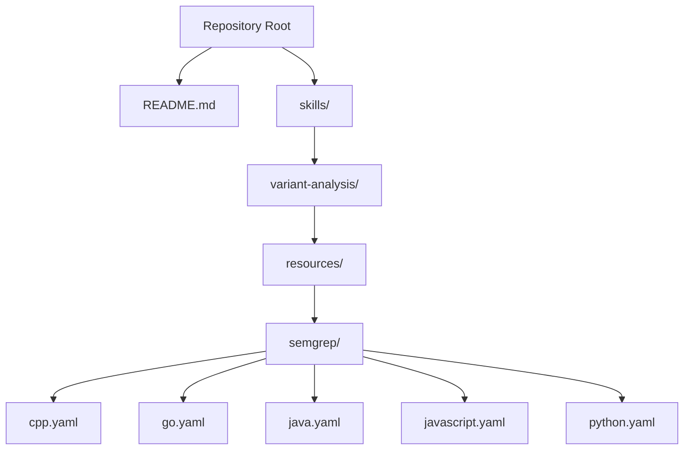
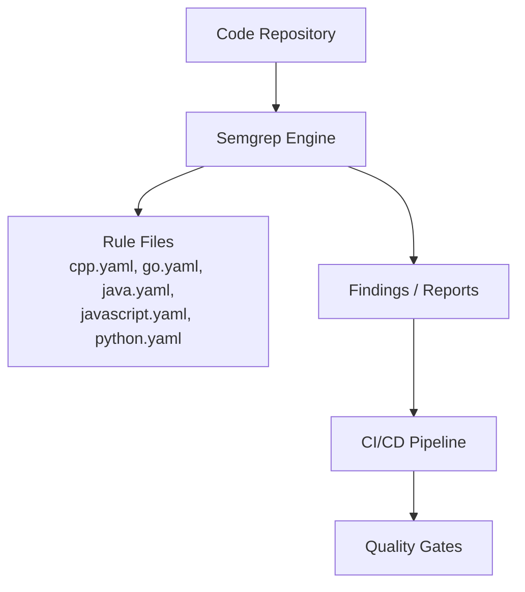
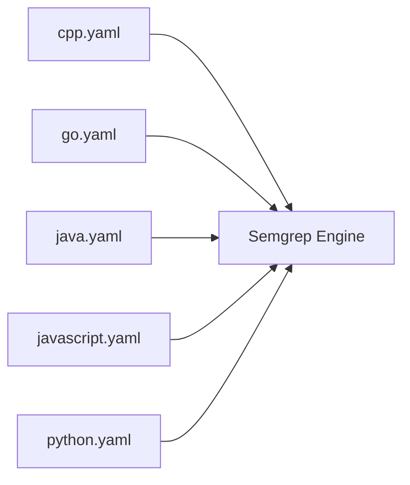

# Semgrep Rules

<cite>
**Referenced Files in This Document**
- [README.md](file://README.md)
- [cpp.yaml](file://skills/variant-analysis/resources/semgrep/cpp.yaml)
- [go.yaml](file://skills/variant-analysis/resources/semgrep/go.yaml)
- [java.yaml](file://skills/variant-analysis/resources/semgrep/java.yaml)
- [javascript.yaml](file://skills/variant-analysis/resources/semgrep/javascript.yaml)
- [python.yaml](file://skills/variant-analysis/resources/semgrep/python.yaml)
</cite>

## Table of Contents
1. [Introduction](#introduction)
2. [Project Structure](#project-structure)
3. [Core Components](#core-components)
4. [Architecture Overview](#architecture-overview)
5. [Detailed Component Analysis](#detailed-component-analysis)
6. [Dependency Analysis](#dependency-analysis)
7. [Performance Considerations](#performance-considerations)
8. [Troubleshooting Guide](#troubleshooting-guide)
9. [Conclusion](#conclusion)
10. [Appendices](#appendices)

## Introduction
This document explains how Semgrep rules are organized and used within the Pi Codex Kit, focusing on YAML-based rule structure, pattern matching syntax, and language-specific configurations for C++, Go, Java, JavaScript, and Python. It provides guidance for writing effective rules for security scanning, code quality enforcement, and anti-pattern detection, along with practical examples sourced from existing rule files. It also covers performance optimization, false positive reduction, and integration with CI/CD pipelines.

## Project Structure
Semgrep rules for multiple languages are located under a dedicated resources directory within a skill focused on variant analysis. The repository includes:
- A top-level README describing the project
- Language-specific Semgrep rule files for C++, Go, Java, JavaScript, and Python

**Diagram sources**
- [README.md](file://README.md)
- [cpp.yaml](file://skills/variant-analysis/resources/semgrep/cpp.yaml)
- [go.yaml](file://skills/variant-analysis/resources/semgrep/go.yaml)
- [java.yaml](file://skills/variant-analysis/resources/semgrep/java.yaml)
- [javascript.yaml](file://skills/variant-analysis/resources/semgrep/javascript.yaml)
- [python.yaml](file://skills/variant-analysis/resources/semgrep/python.yaml)

**Section sources**
- [README.md](file://README.md)
- [cpp.yaml](file://skills/variant-analysis/resources/semgrep/cpp.yaml)
- [go.yaml](file://skills/variant-analysis/resources/semgrep/go.yaml)
- [java.yaml](file://skills/variant-analysis/resources/semgrep/java.yaml)
- [javascript.yaml](file://skills/variant-analysis/resources/semgrep/javascript.yaml)
- [python.yaml](file://skills/variant-analysis/resources/semgrep/python.yaml)

## Core Components
The core components of Semgrep usage in this repository are the per-language rule files. Each file defines one or more rules that target specific patterns in source code. Typical elements include:
- Rule metadata (id, message, severity, languages)
- Pattern definitions using Semgrep’s YAML-based syntax
- Optional fix expressions and metadata tags

These rule files serve as building blocks for security checks, code quality policies, and anti-pattern detection across supported languages.

**Section sources**
- [cpp.yaml](file://skills/variant-analysis/resources/semgrep/cpp.yaml)
- [go.yaml](file://skills/variant-analysis/resources/semgrep/go.yaml)
- [java.yaml](file://skills/variant-analysis/resources/semgrep/java.yaml)
- [javascript.yaml](file://skills/variant-analysis/resources/semgrep/javascript.yaml)
- [python.yaml](file://skills/variant-analysis/resources/semgrep/python.yaml)

## Architecture Overview
At a high level, Semgrep scans repositories by loading rule files and applying them to the codebase. In the Pi Codex Kit, each language has its own rule file, enabling targeted pattern matching and consistent reporting.

[No sources needed since this diagram shows conceptual workflow, not actual code structure]

## Detailed Component Analysis

### Semgrep Rule Structure (YAML)
Each rule file is a YAML document containing one or more rule definitions. Common fields include:
- id: Unique identifier for the rule
- message: Human-readable description of what the rule detects
- severity: Severity level (e.g., error, warning, info)
- languages: List of target languages
- pattern*: One or more pattern expressions defining matches
- fix: Optional auto-fix expression
- metadata: Additional tags and references

Patterns use Semgrep’s expressive syntax to match code structures, including:
- Literal matches for identifiers, strings, and operators
- Ellipsis (...) to ignore irrelevant parts
- Variables ($X) to capture and reuse matched fragments
- Negation (!...) to exclude unwanted matches
- Metavariables and metavariable comparison for advanced constraints

For concrete examples and idioms, refer to the language-specific rule files below.

**Section sources**
- [cpp.yaml](file://skills/variant-analysis/resources/semgrep/cpp.yaml)
- [go.yaml](file://skills/variant-analysis/resources/semgrep/go.yaml)
- [java.yaml](file://skills/variant-analysis/resources/semgrep/java.yaml)
- [javascript.yaml](file://skills/variant-analysis/resources/semgrep/javascript.yaml)
- [python.yaml](file://skills/variant-analysis/resources/semgrep/python.yaml)

### C++ Rules
C++ rules focus on common pitfalls such as unsafe APIs, resource leaks, and anti-patterns. Use ellipsis and variables to constrain matches while ignoring boilerplate. Prefer precise metavariable comparisons to reduce false positives.

Practical example references:
- [cpp.yaml](file://skills/variant-analysis/resources/semgrep/cpp.yaml)

**Section sources**
- [cpp.yaml](file://skills/variant-analysis/resources/semgrep/cpp.yaml)

### Go Rules
Go rules often target concurrency issues, error handling gaps, and misuse of standard library functions. Combine patterns with negations to avoid noisy matches in generated or test code.

Practical example references:
- [go.yaml](file://skills/variant-analysis/resources/semgrep/go.yaml)

**Section sources**
- [go.yaml](file://skills/variant-analysis/resources/semgrep/go.yaml)

### Java Rules
Java rules can enforce safe API usage, null-safety practices, and logging standards. Use class and method name patterns to scope rules effectively.

Practical example references:
- [java.yaml](file://skills/variant-analysis/resources/semgrep/java.yaml)

**Section sources**
- [java.yaml](file://skills/variant-analysis/resources/semgrep/java.yaml)

### JavaScript Rules
JavaScript rules commonly detect insecure function calls, missing error handling, and deprecated APIs. Leverage string and identifier patterns to target vulnerable constructs.

Practical example references:
- [javascript.yaml](file://skills/variant-analysis/resources/semgrep/javascript.yaml)

**Section sources**
- [javascript.yaml](file://skills/variant-analysis/resources/semgrep/javascript.yaml)

### Python Rules
Python rules frequently catch unsafe deserialization, hardcoded secrets, and improper exception handling. Use metavariable comparisons to validate argument values and types.

Practical example references:
- [python.yaml](file://skills/variant-analysis/resources/semgrep/python.yaml)

**Section sources**
- [python.yaml](file://skills/variant-analysis/resources/semgrep/python.yaml)

### Writing Effective Semgrep Rules
Guidelines:
- Start broad, then narrow: begin with a simple pattern and add constraints to reduce noise.
- Use ellipsis strategically: omit irrelevant context but keep enough anchors to avoid over-matching.
- Prefer metavariables and comparisons: capture key fragments and assert their properties.
- Scope languages explicitly: list only the languages you intend to support.
- Add clear messages and severity: make findings actionable and triage-friendly.
- Include metadata: tag rules with categories and references for discoverability.
- Provide fixes when possible: improve developer experience with automated remediation.

Practical example references:
- [cpp.yaml](file://skills/variant-analysis/resources/semgrep/cpp.yaml)
- [go.yaml](file://skills/variant-analysis/resources/semgrep/go.yaml)
- [java.yaml](file://skills/variant-analysis/resources/semgrep/java.yaml)
- [javascript.yaml](file://skills/variant-analysis/resources/semgrep/javascript.yaml)
- [python.yaml](file://skills/variant-analysis/resources/semgrep/python.yaml)

**Section sources**
- [cpp.yaml](file://skills/variant-analysis/resources/semgrep/cpp.yaml)
- [go.yaml](file://skills/variant-analysis/resources/semgrep/go.yaml)
- [java.yaml](file://skills/variant-analysis/resources/semgrep/java.yaml)
- [javascript.yaml](file://skills/variant-analysis/resources/semgrep/javascript.yaml)
- [python.yaml](file://skills/variant-analysis/resources/semgrep/python.yaml)

## Dependency Analysis
The Semgrep rules are independent of each other; each file targets a specific language. There are no cross-file imports between rule files. The dependency graph reflects this isolation.

**Diagram sources**
- [cpp.yaml](file://skills/variant-analysis/resources/semgrep/cpp.yaml)
- [go.yaml](file://skills/variant-analysis/resources/semgrep/go.yaml)
- [java.yaml](file://skills/variant-analysis/resources/semgrep/java.yaml)
- [javascript.yaml](file://skills/variant-analysis/resources/semgrep/javascript.yaml)
- [python.yaml](file://skills/variant-analysis/resources/semgrep/python.yaml)

**Section sources**
- [cpp.yaml](file://skills/variant-analysis/resources/semgrep/cpp.yaml)
- [go.yaml](file://skills/variant-analysis/resources/semgrep/go.yaml)
- [java.yaml](file://skills/variant-analysis/resources/semgrep/java.yaml)
- [javascript.yaml](file://skills/variant-analysis/resources/semgrep/javascript.yaml)
- [python.yaml](file://skills/variant-analysis/resources/semgrep/python.yaml)

## Performance Considerations
To optimize Semgrep rule performance:
- Narrow patterns early: anchor on specific identifiers or call sites to minimize AST traversal.
- Avoid overly broad ellipsis: limit wildcard spans to reduce combinatorial explosion.
- Use language scoping: specify exact languages to prevent unnecessary parsing.
- Prefer metavariable comparisons: constrain matches without heavy regex where possible.
- Batch runs: group related rules into a single run to leverage shared parsing overhead.
- Exclude noisy directories: configure path filters to skip tests, vendored code, or generated sources.

[No sources needed since this section provides general guidance]

## Troubleshooting Guide
Common issues and resolutions:
- False positives: refine patterns with additional anchors and metavariable comparisons; add negations to exclude known safe contexts.
- Missed detections: broaden patterns incrementally; verify language support and file extensions; ensure correct metavariable names.
- Slow scans: profile rule complexity; split large rule sets; exclude non-target paths; prefer simpler patterns.
- Integration failures: validate YAML syntax; confirm Semgrep version compatibility; check environment variables and configuration flags.

Practical example references:
- [cpp.yaml](file://skills/variant-analysis/resources/semgrep/cpp.yaml)
- [go.yaml](file://skills/variant-analysis/resources/semgrep/go.yaml)
- [java.yaml](file://skills/variant-analysis/resources/semgrep/java.yaml)
- [javascript.yaml](file://skills/variant-analysis/resources/semgrep/javascript.yaml)
- [python.yaml](file://skills/variant-analysis/resources/semgrep/python.yaml)

**Section sources**
- [cpp.yaml](file://skills/variant-analysis/resources/semgrep/cpp.yaml)
- [go.yaml](file://skills/variant-analysis/resources/semgrep/go.yaml)
- [java.yaml](file://skills/variant-analysis/resources/semgrep/java.yaml)
- [javascript.yaml](file://skills/variant-analysis/resources/semgrep/javascript.yaml)
- [python.yaml](file://skills/variant-analysis/resources/semgrep/python.yaml)

## Conclusion
The Pi Codex Kit organizes Semgrep rules by language, providing a clear foundation for security scanning, code quality enforcement, and anti-pattern detection. By following the guidelines above—writing precise patterns, leveraging metavariables, and optimizing for performance—you can create robust rules that integrate smoothly into development workflows and CI/CD pipelines.

[No sources needed since this section summarizes without analyzing specific files]

## Appendices

### Practical Examples Index
Use these files as reference implementations for each language:
- C++: [cpp.yaml](file://skills/variant-analysis/resources/semgrep/cpp.yaml)
- Go: [go.yaml](file://skills/variant-analysis/resources/semgrep/go.yaml)
- Java: [java.yaml](file://skills/variant-analysis/resources/semgrep/java.yaml)
- JavaScript: [javascript.yaml](file://skills/variant-analysis/resources/semgrep/javascript.yaml)
- Python: [python.yaml](file://skills/variant-analysis/resources/semgrep/python.yaml)

**Section sources**
- [cpp.yaml](file://skills/variant-analysis/resources/semgrep/cpp.yaml)
- [go.yaml](file://skills/variant-analysis/resources/semgrep/go.yaml)
- [java.yaml](file://skills/variant-analysis/resources/semgrep/java.yaml)
- [javascript.yaml](file://skills/variant-analysis/resources/semgrep/javascript.yaml)
- [python.yaml](file://skills/variant-analysis/resources/semgrep/python.yaml)