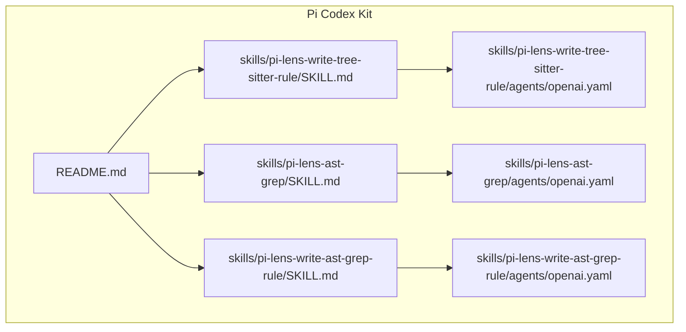
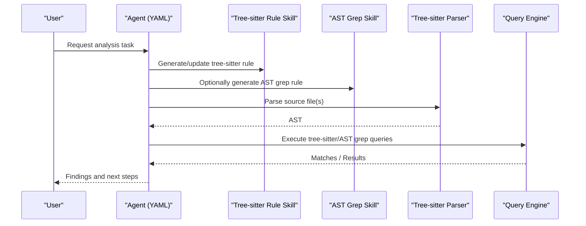
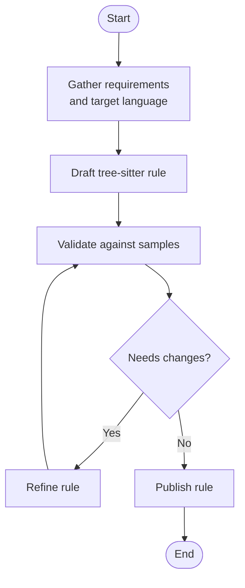
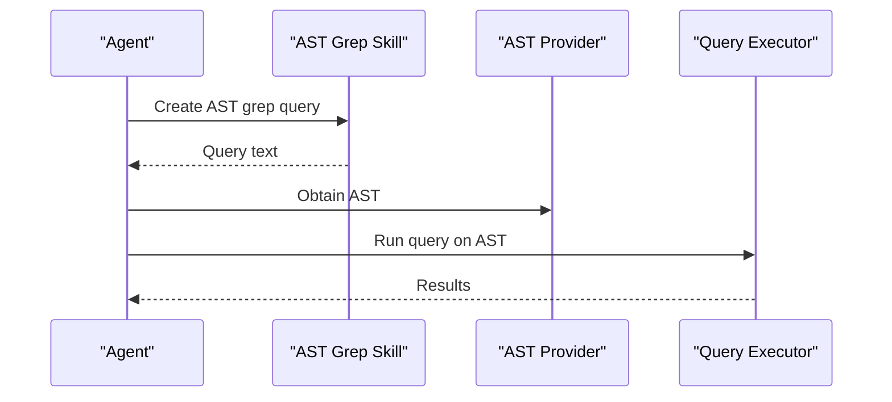
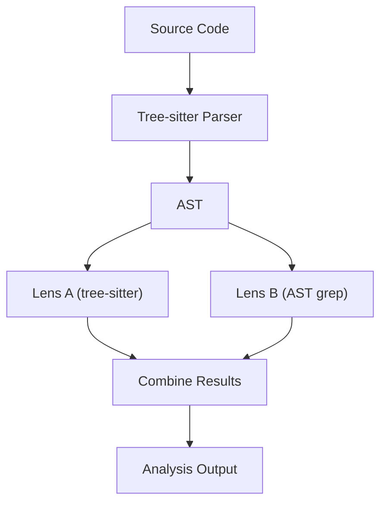
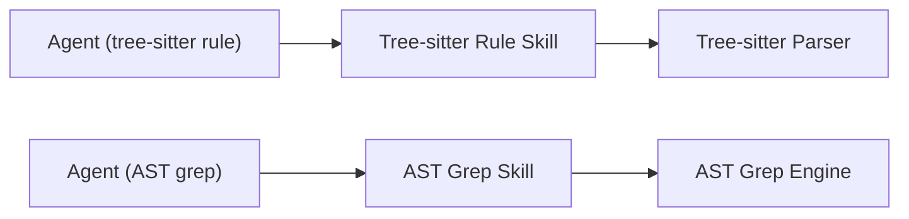

# Tree-sitter Parser Configuration

<cite>
**Referenced Files in This Document**
- [README.md](file://README.md)
- [SKILL.md](file://skills/pi-lens-write-tree-sitter-rule/SKILL.md)
- [openai.yaml](file://skills/pi-lens-write-tree-sitter-rule/agents/openai.yaml)
- [SKILL.md](file://skills/pi-lens-ast-grep/SKILL.md)
- [openai.yaml](file://skills/pi-lens-ast-grep/agents/openai.yaml)
- [SKILL.md](file://skills/pi-lens-write-ast-grep-rule/SKILL.md)
- [openai.yaml](file://skills/pi-lens-write-ast-grep-rule/agents/openai.yaml)
</cite>

## Table of Contents
1. [Introduction](#introduction)
2. [Project Structure](#project-structure)
3. [Core Components](#core-components)
4. [Architecture Overview](#architecture-overview)
5. [Detailed Component Analysis](#detailed-component-analysis)
6. [Dependency Analysis](#dependency-analysis)
7. [Performance Considerations](#performance-considerations)
8. [Troubleshooting Guide](#troubleshooting-guide)
9. [Conclusion](#conclusion)
10. [Appendices](#appendices)

## Introduction
This document explains how tree-sitter parsers are integrated and extended within the Pi Codex Kit to power AST parsing and code analysis across multiple programming languages. It focuses on the lens system architecture, parser registration patterns, custom parser development workflows, language-specific configuration examples, AST manipulation techniques, performance considerations for large codebases, caching strategies, and troubleshooting guidance. The content is grounded in the repository’s skills and agent configurations that reference tree-sitter and AST-based tooling.

## Project Structure
The repository organizes capabilities as “skills” with associated agents and documentation. Relevant areas for tree-sitter and AST work include:
- Skills for writing and using tree-sitter rules
- Skills for AST grep-based queries
- Agent definitions that orchestrate these capabilities

**Diagram sources**
- [README.md](file://README.md)
- [SKILL.md](file://skills/pi-lens-write-tree-sitter-rule/SKILL.md)
- [openai.yaml](file://skills/pi-lens-write-tree-sitter-rule/agents/openai.yaml)
- [SKILL.md](file://skills/pi-lens-ast-grep/SKILL.md)
- [openai.yaml](file://skills/pi-lens-ast-grep/agents/openai.yaml)
- [SKILL.md](file://skills/pi-lens-write-ast-grep-rule/SKILL.md)
- [openai.yaml](file://skills/pi-lens-write-ast-grep-rule/agents/openai.yaml)

**Section sources**
- [README.md](file://README.md)
- [SKILL.md](file://skills/pi-lens-write-tree-sitter-rule/SKILL.md)
- [openai.yaml](file://skills/pi-lens-write-tree-sitter-rule/agents/openai.yaml)
- [SKILL.md](file://skills/pi-lens-ast-grep/SKILL.md)
- [openai.yaml](file://skills/pi-lens-ast-grep/agents/openai.yaml)
- [SKILL.md](file://skills/pi-lens-write-ast-grep-rule/SKILL.md)
- [openai.yaml](file://skills/pi-lens-write-ast-grep-rule/agents/openai.yaml)

## Core Components
- Tree-sitter rule authoring skill: Provides guidance and agent support for creating and maintaining tree-sitter query rules tailored to specific languages.
- AST grep skill: Enables pattern matching over ASTs using AST grep, complementing tree-sitter for certain use cases.
- AST grep rule authoring skill: Supports writing and refining AST grep rules.
- Agent orchestrators: YAML files that define how agents invoke these skills and tools during analysis workflows.

These components collectively enable:
- Language-aware parsing via tree-sitter
- Query-driven analysis through tree-sitter and AST grep
- Automated generation and maintenance of rules via agent-assisted workflows

**Section sources**
- [SKILL.md](file://skills/pi-lens-write-tree-sitter-rule/SKILL.md)
- [openai.yaml](file://skills/pi-lens-write-tree-sitter-rule/agents/openai.yaml)
- [SKILL.md](file://skills/pi-lens-ast-grep/SKILL.md)
- [openai.yaml](file://skills/pi-lens-ast-grep/agents/openai.yaml)
- [SKILL.md](file://skills/pi-lens-write-ast-grep-rule/SKILL.md)
- [openai.yaml](file://skills/pi-lens-write-ast-grep-rule/agents/openai.yaml)

## Architecture Overview
At a high level, the Pi Codex Kit integrates tree-sitter through skills and agents:
- Users or automated flows request analysis (e.g., find all function calls).
- Agents coordinate between skills to generate or execute tree-sitter/AST grep rules.
- Parsed ASTs are produced by tree-sitter for the target language.
- Rules match nodes in the AST to produce findings or transformations.

[No sources needed since this diagram shows conceptual workflow, not actual code structure]

## Detailed Component Analysis

### Tree-sitter Rule Authoring Skill
Purpose:
- Guides creation and refinement of tree-sitter query rules for supported languages.
- Encourages best practices for node selection, capture naming, and performance.

Key responsibilities:
- Define rule scope per language and project context.
- Maintain rule versions alongside code changes.
- Provide templates and examples for common patterns.

Operational flow:
- Agent invokes the skill to draft or update rules based on requirements.
- Rules are validated against sample inputs before deployment.

[No sources needed since this diagram shows conceptual workflow, not actual code structure]

**Section sources**
- [SKILL.md](file://skills/pi-lens-write-tree-sitter-rule/SKILL.md)
- [openai.yaml](file://skills/pi-lens-write-tree-sitter-rule/agents/openai.yaml)

### AST Grep Skill
Purpose:
- Provides AST-level pattern matching using AST grep, suitable for quick searches and cross-language scenarios where tree-sitter coverage may be limited.

Key responsibilities:
- Translate natural language requests into AST grep queries.
- Optimize queries for performance and accuracy.

Operational flow:
- Agent uses the skill to generate queries.
- Queries run against parsed ASTs to return matches.

[No sources needed since this diagram shows conceptual workflow, not actual code structure]

**Section sources**
- [SKILL.md](file://skills/pi-lens-ast-grep/SKILL.md)
- [openai.yaml](file://skills/pi-lens-ast-grep/agents/openai.yaml)

### AST Grep Rule Authoring Skill
Purpose:
- Helps write and maintain AST grep rules with consistent style and performance characteristics.

Key responsibilities:
- Standardize rule structure and naming.
- Provide test scaffolding and validation tips.

**Section sources**
- [SKILL.md](file://skills/pi-lens-write-ast-grep-rule/SKILL.md)
- [openai.yaml](file://skills/pi-lens-write-ast-grep-rule/agents/openai.yaml)

### Lens System Integration
Conceptual overview:
- The “lens” concept refers to views over the AST produced by tree-sitter.
- Each lens corresponds to a set of rules (tree-sitter or AST grep) that extract or transform information.
- Lenses can be composed to build complex analyses.

[No sources needed since this diagram shows conceptual workflow, not actual code structure]

## Dependency Analysis
Skills depend on:
- Agent definitions (YAML) to orchestrate execution.
- External tools/libraries for tree-sitter parsing and AST grep querying.

[No sources needed since this diagram shows conceptual dependencies, not exact code mappings]

**Section sources**
- [openai.yaml](file://skills/pi-lens-write-tree-sitter-rule/agents/openai.yaml)
- [openai.yaml](file://skills/pi-lens-ast-grep/agents/openai.yaml)
- [openai.yaml](file://skills/pi-lens-write-ast-grep-rule/agents/openai.yaml)

## Performance Considerations
- Prefer targeted tree-sitter queries over broad scans; limit captures to necessary nodes.
- Cache parsed ASTs keyed by file path and modification time to avoid re-parsing unchanged files.
- Batch operations across files when possible to amortize parser initialization costs.
- Use incremental updates if available in your environment to minimize rework after edits.
- Profile rule performance with representative codebases; refactor slow patterns (e.g., excessive alternations or deep traversals).
- For large repositories, consider workspace-scoped indexing and lazy loading of lenses.

[No sources needed since this section provides general guidance]

## Troubleshooting Guide
Common issues and resolutions:
- Parser mismatch: Ensure the tree-sitter grammar version aligns with the expected AST shape. Update grammar or adjust rules accordingly.
- Slow queries: Narrow node types, reduce captures, and avoid unnecessary predicates.
- Missing symbols: Verify language support and grammar coverage; fall back to AST grep for unsupported constructs.
- Rule drift: Keep rules close to usage sites and add tests to detect regressions early.
- Agent misconfiguration: Review agent YAML to confirm correct skill invocation and parameters.

**Section sources**
- [SKILL.md](file://skills/pi-lens-write-tree-sitter-rule/SKILL.md)
- [openai.yaml](file://skills/pi-lens-write-tree-sitter-rule/agents/openai.yaml)
- [SKILL.md](file://skills/pi-lens-ast-grep/SKILL.md)
- [openai.yaml](file://skills/pi-lens-ast-grep/agents/openai.yaml)

## Conclusion
The Pi Codex Kit leverages skills and agents to integrate tree-sitter and AST grep for robust, language-aware code analysis. By authoring focused rules, caching parsed ASTs, and composing lenses, teams can scale analysis across large codebases while maintaining performance and accuracy. The provided skills streamline rule development and maintenance, enabling rapid addition of new language support and continuous improvement of analysis quality.

[No sources needed since this section summarizes without analyzing specific files]

## Appendices

### Adding Support for a New Programming Language
Steps:
- Identify or obtain a tree-sitter grammar for the language.
- Use the tree-sitter rule skill to draft initial queries for key constructs.
- Validate rules against representative samples and refine iteratively.
- Optionally supplement with AST grep rules for constructs not covered by tree-sitter.
- Integrate rules into relevant lenses and ensure caching and batching are configured.
- Document language-specific caveats and performance tips.

[No sources needed since this section provides general guidance]