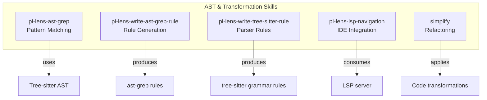
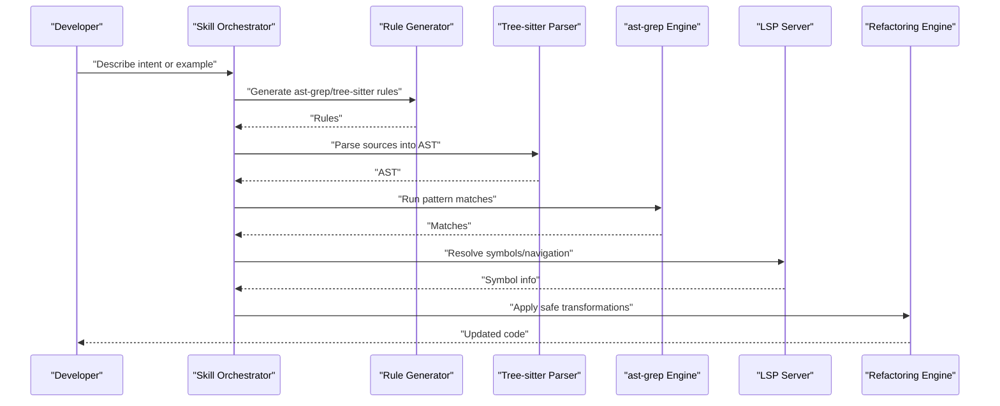
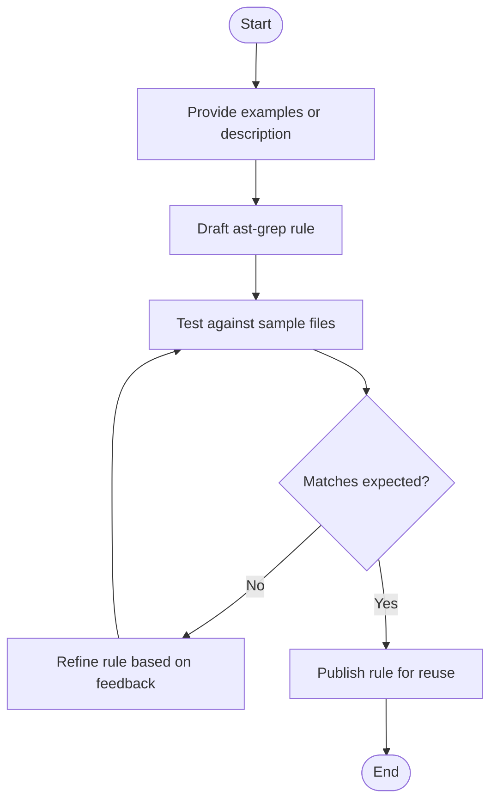
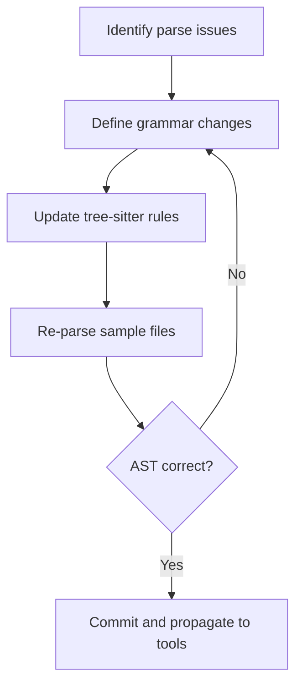
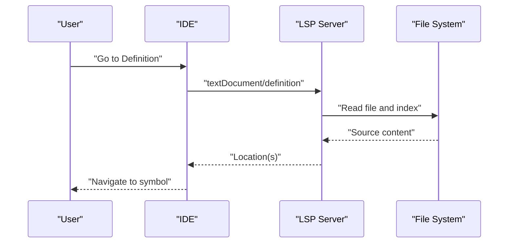
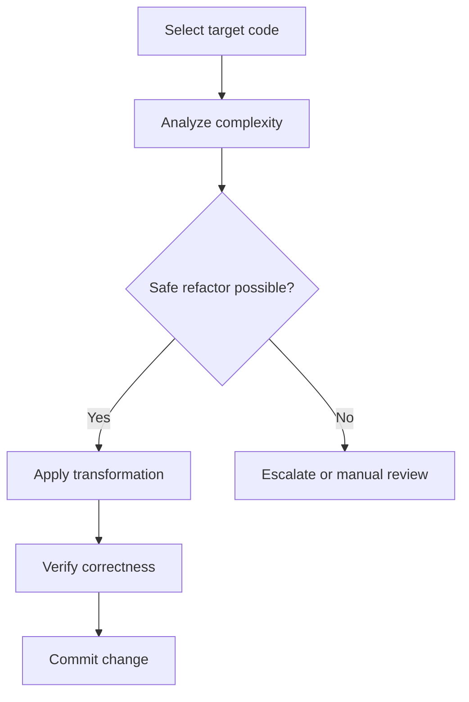
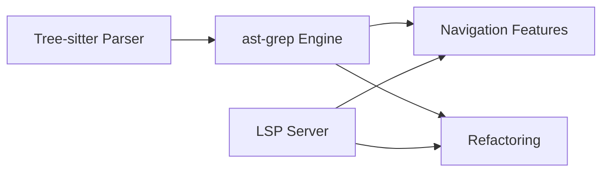

# AST & Code Transformation Skills

<cite>
**Referenced Files in This Document**
- [SKILL.md](file://skills/pi-lens-ast-grep/SKILL.md)
- [openai.yaml](file://skills/pi-lens-ast-grep/agents/openai.yaml)
- [SKILL.md](file://skills/pi-lens-write-ast-grep-rule/SKILL.md)
- [openai.yaml](file://skills/pi-lens-write-ast-grep-rule/agents/openai.yaml)
- [SKILL.md](file://skills/pi-lens-write-tree-sitter-rule/SKILL.md)
- [openai.yaml](file://skills/pi-lens-write-tree-sitter-rule/agents/openai.yaml)
- [SKILL.md](file://skills/pi-lens-lsp-navigation/SKILL.md)
- [openai.yaml](file://skills/pi-lens-lsp-navigation/agents/openai.yaml)
- [SKILL.md](file://skills/simplify/SKILL.md)
- [simplify-context.mjs](file://skills/simplify/scripts/simplify-context.mjs)
</cite>

## Table of Contents
1. [Introduction](#introduction)
2. [Project Structure](#project-structure)
3. [Core Components](#core-components)
4. [Architecture Overview](#architecture-overview)
5. [Detailed Component Analysis](#detailed-component-analysis)
6. [Dependency Analysis](#dependency-analysis)
7. [Performance Considerations](#performance-considerations)
8. [Troubleshooting Guide](#troubleshooting-guide)
9. [Conclusion](#conclusion)

## Introduction
This document explains how to use and extend AST-based skills in the Pi Codex Kit for code analysis, transformation, and IDE navigation. It focuses on:
- Pattern matching with pi-lens-ast-grep
- Rule generation with pi-lens-write-ast-grep-rule
- Parser rule authoring with pi-lens-write-tree-sitter-rule
- IDE integration via pi-lens-lsp-navigation
- Refactoring workflows with simplify

It also introduces AST concepts, tree-sitter usage, rule syntax, and practical examples of transformations and navigation patterns.

## Project Structure
The relevant skills are organized under the skills directory. Each skill includes a SKILL.md describing its purpose and usage, an agents configuration, and optional scripts or resources.

[No sources needed since this diagram shows conceptual workflow, not actual code structure]

## Core Components
- pi-lens-ast-grep: Executes pattern matching over source files using ast-grep against the parsed AST. Typical uses include finding APIs, enforcing conventions, and preparing inputs for refactors.
- pi-lens-write-ast-grep-rule: Generates ast-grep rules from natural language or examples, enabling consistent and reusable pattern definitions.
- pi-lens-write-tree-sitter-rule: Author and refine tree-sitter grammar rules to improve parsing accuracy for specific languages or constructs.
- pi-lens-lsp-navigation: Integrates with Language Server Protocol (LSP) to provide go-to-definition, find-references, hover, and symbol search within the IDE.
- simplify: Applies structured refactoring steps to reduce complexity, remove dead code, and improve readability while preserving behavior.

**Section sources**
- [SKILL.md](file://skills/pi-lens-ast-grep/SKILL.md)
- [SKILL.md](file://skills/pi-lens-write-ast-grep-rule/SKILL.md)
- [SKILL.md](file://skills/pi-lens-write-tree-sitter-rule/SKILL.md)
- [SKILL.md](file://skills/pi-lens-lsp-navigation/SKILL.md)
- [SKILL.md](file://skills/simplify/SKILL.md)

## Architecture Overview
The skills form a pipeline that moves from high-level intent to concrete changes:
- Intent and examples drive rule generation (ast-grep and tree-sitter).
- Generated rules power precise AST queries and navigation features.
- Transformations are applied safely through guided refactoring.

[No sources needed since this diagram shows conceptual workflow, not actual code structure]

## Detailed Component Analysis

### pi-lens-ast-grep: Pattern Matching
Purpose:
- Match code patterns across a project by querying the AST.
- Support multi-language searches via tree-sitter-backed parsers.
- Provide structured results for downstream processing.

Key capabilities:
- Define patterns using ast-grep rule syntax.
- Scope searches to directories, file types, or specific nodes.
- Export match summaries for review or automation.

Practical examples:
- Find all calls to a deprecated API and list their locations.
- Detect missing error handling around async operations.
- Identify inconsistent naming conventions across modules.

Best practices:
- Start with broad patterns and narrow scope progressively.
- Use named captures to extract context for reporting.
- Validate rules against representative samples before bulk runs.

**Section sources**
- [SKILL.md](file://skills/pi-lens-ast-grep/SKILL.md)
- [openai.yaml](file://skills/pi-lens-ast-grep/agents/openai.yaml)

#### AST Concepts and Tree-sitter Usage
- AST nodes represent syntactic elements (e.g., function declarations, expressions).
- tree-sitter provides fast, incremental parsing and robust cross-language support.
- Patterns traverse node types, labels, and relationships to locate constructs.

[No sources needed since this section explains general concepts]

### pi-lens-write-ast-grep-rule: Rule Generation
Purpose:
- Convert natural language descriptions or example snippets into ast-grep rules.
- Maintain consistency and shareability of pattern definitions.

Workflow:
- Provide examples or a description of the target pattern.
- Generate a rule file that can be executed by ast-grep.
- Iterate by refining examples until matches align with expectations.

Rule syntax highlights:
- Node selectors and constraints.
- Named captures for extracting identifiers or literals.
- Contextual constraints (parents, siblings, children).

Validation tips:
- Test rules against positive and negative examples.
- Ensure performance by avoiding overly broad patterns.

**Section sources**
- [SKILL.md](file://skills/pi-lens-write-ast-grep-rule/SKILL.md)
- [openai.yaml](file://skills/pi-lens-write-ast-grep-rule/agents/openai.yaml)

#### Rule Generation Flow

[No sources needed since this diagram shows conceptual workflow, not actual code structure]

### pi-lens-write-tree-sitter-rule: Parser Rules
Purpose:
- Author or adjust tree-sitter grammar rules to improve parsing accuracy for custom constructs or language variants.

When to use:
- The default parser misses or misparses domain-specific syntax.
- You need finer-grained AST nodes for better pattern matching.

Process:
- Identify problematic constructs and desired AST shape.
- Write or update grammar rules targeting the appropriate language module.
- Validate by re-parsing representative files and inspecting the resulting AST.

Integration points:
- Updated rules feed back into ast-grep queries and navigation features.

**Section sources**
- [SKILL.md](file://skills/pi-lens-write-tree-sitter-rule/SKILL.md)
- [openai.yaml](file://skills/pi-lens-write-tree-sitter-rule/agents/openai.yaml)

#### Grammar Authoring Flow

[No sources needed since this diagram shows conceptual workflow, not actual code structure]

### pi-lens-lsp-navigation: IDE Integration
Purpose:
- Leverage LSP to navigate codebases efficiently: go-to-definition, find references, rename, hover, and symbol search.

Capabilities:
- Resolve symbols across files and modules.
- Provide contextual information for selected symbols.
- Enable quick navigation flows during analysis and refactoring.

Usage patterns:
- Navigate from a call site to its definition.
- List all references to understand impact before changes.
- Inspect type or documentation hints via hover.

**Section sources**
- [SKILL.md](file://skills/pi-lens-lsp-navigation/SKILL.md)
- [openai.yaml](file://skills/pi-lens-lsp-navigation/agents/openai.yaml)

#### Navigation Sequence

[No sources needed since this diagram shows conceptual workflow, not actual code structure]

### simplify: Code Refactoring
Purpose:
- Apply systematic improvements to reduce complexity and enhance readability without changing external behavior.

Typical transformations:
- Extract helper functions from long blocks.
- Replace nested conditionals with early returns or guard clauses.
- Remove unused variables and dead branches.
- Normalize formatting and naming for consistency.

Safety considerations:
- Prefer small, reversible changes.
- Validate with tests or static checks after each step.
- Use version control to track and compare diffs.

Supporting script:
- simplify-context.mjs provides utilities to gather context for refactoring decisions.

**Section sources**
- [SKILL.md](file://skills/simplify/SKILL.md)
- [simplify-context.mjs](file://skills/simplify/scripts/simplify-context.mjs)

#### Refactoring Flow

[No sources needed since this diagram shows conceptual workflow, not actual code structure]

## Dependency Analysis
The skills interact through shared artifacts:
- Generated ast-grep rules depend on accurate tree-sitter parsing.
- LSP navigation depends on language servers and indexes.
- Refactoring relies on reliable pattern matches and symbol resolution.

[No sources needed since this diagram shows conceptual workflow, not actual code structure]

## Performance Considerations
- Keep ast-grep patterns specific to avoid scanning large subtrees unnecessarily.
- Cache parsed ASTs when running multiple queries over the same files.
- Limit LSP requests by batching operations where possible.
- Stage refactors incrementally to keep diffs small and reviews efficient.

[No sources needed since this section provides general guidance]

## Troubleshooting Guide
Common issues and remedies:
- No matches found:
  - Verify language mode and parser selection.
  - Narrow or broaden patterns; check file filters.
- Incorrect AST nodes:
  - Update tree-sitter rules for the affected constructs.
  - Re-parse samples and validate node shapes.
- Slow queries:
  - Reduce scope (files, directories).
  - Optimize patterns to avoid expensive traversals.
- Navigation failures:
  - Ensure LSP server is running and indexed.
  - Refresh indexes if symbols are missing.

**Section sources**
- [SKILL.md](file://skills/pi-lens-ast-grep/SKILL.md)
- [SKILL.md](file://skills/pi-lens-write-tree-sitter-rule/SKILL.md)
- [SKILL.md](file://skills/pi-lens-lsp-navigation/SKILL.md)

## Conclusion
By combining rule generation, precise AST queries, robust parsing, and IDE navigation, the Pi Codex Kit enables powerful, repeatable code analysis and refactoring workflows. Start with clear examples, iterate on rules, validate with tests, and apply changes incrementally for safe and effective transformations.