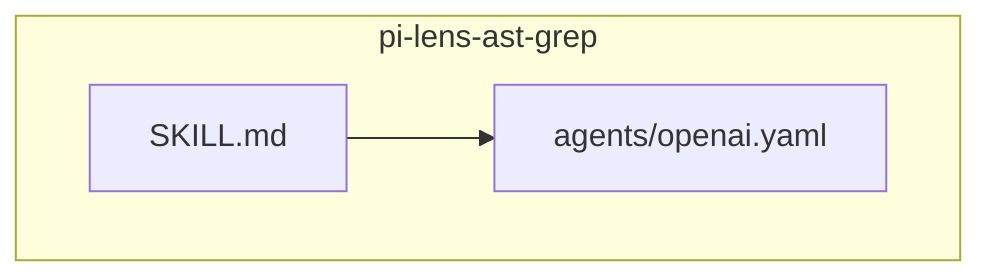
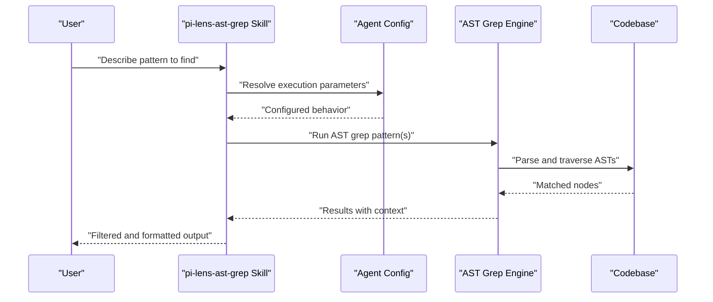
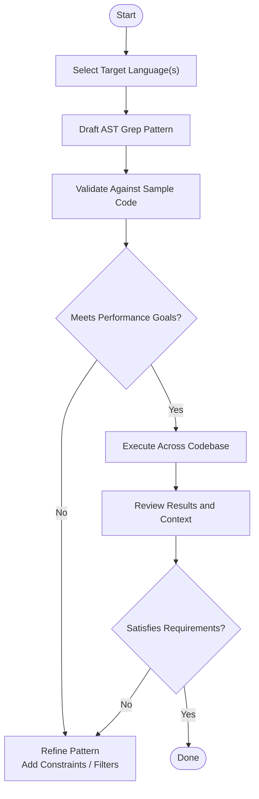
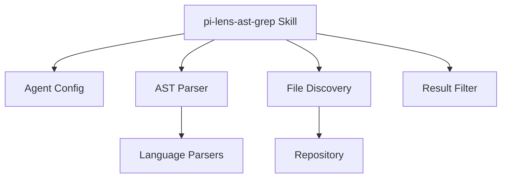

# AST Grep Pattern Matching

<cite>
**Referenced Files in This Document**
- [SKILL.md](file://skills/pi-lens-ast-grep/SKILL.md)
- [openai.yaml](file://skills/pi-lens-ast-grep/agents/openai.yaml)
</cite>

## Table of Contents
1. [Introduction](#introduction)
2. [Project Structure](#project-structure)
3. [Core Components](#core-components)
4. [Architecture Overview](#architecture-overview)
5. [Detailed Component Analysis](#detailed-component-analysis)
6. [Dependency Analysis](#dependency-analysis)
7. [Performance Considerations](#performance-considerations)
8. [Troubleshooting Guide](#troubleshooting-guide)
9. [Conclusion](#conclusion)
10. [Appendices](#appendices)

## Introduction
This document explains how to use the pi-lens-ast-grep skill for AST-based pattern matching across programming languages. It covers:
- How AST grep patterns search and match code structures
- Pattern syntax overview, supported node types, and matching strategies
- Practical examples for common searches
- Performance optimization tips
- Integration with development workflows
- Advanced techniques such as contextual matching and result filtering

The goal is to help you write precise, fast, and maintainable AST queries that work consistently across multiple languages.

## Project Structure
The pi-lens-ast-grep skill is defined by a concise skill manifest and an agent configuration. The structure is intentionally minimal to keep the skill focused on AST pattern matching.

**Diagram sources**
- [SKILL.md](file://skills/pi-lens-ast-grep/SKILL.md)
- [openai.yaml](file://skills/pi-lens-ast-grep/agents/openai.yaml)

**Section sources**
- [SKILL.md](file://skills/pi-lens-ast-grep/SKILL.md)
- [openai.yaml](file://skills/pi-lens-ast-grep/agents/openai.yaml)

## Core Components
- Skill definition (SKILL.md): Declares the purpose, capabilities, and usage guidance for AST grep pattern matching.
- Agent configuration (agents/openai.yaml): Provides runtime parameters and behavior settings used by the agent when executing AST grep tasks.

Key responsibilities:
- Define what AST grep can do within this skill
- Provide instructions or templates for writing effective patterns
- Configure agent behavior for consistent execution

**Section sources**
- [SKILL.md](file://skills/pi-lens-ast-grep/SKILL.md)
- [openai.yaml](file://skills/pi-lens-ast-grep/agents/openai.yaml)

## Architecture Overview
At a high level, the skill integrates with an agent to perform AST-based searches. The flow typically involves:
- Receiving a user request describing a code pattern
- Translating the request into one or more AST grep patterns
- Executing the patterns against target files or repositories
- Returning structured results with context and optional filters

[No sources needed since this diagram shows conceptual workflow, not actual code structure]

## Detailed Component Analysis

### Skill Definition (SKILL.md)
Purpose:
- Describes the scope of AST grep pattern matching
- Provides guidance on writing patterns and interpreting results
- May include references to language-specific node types and best practices

What to look for:
- Pattern syntax overview and examples
- Supported languages and node types
- Guidance on performance and filtering
- Links to additional resources or related skills

How it fits:
- Acts as the primary reference for users and agents when constructing AST grep queries
- Ensures consistent terminology and approach across projects

**Section sources**
- [SKILL.md](file://skills/pi-lens-ast-grep/SKILL.md)

### Agent Configuration (agents/openai.yaml)
Purpose:
- Defines runtime behavior for the agent when using the skill
- May include model parameters, tool usage, or prompt templates

What to look for:
- Parameters controlling parsing depth, concurrency, or output format
- References to external tools or scripts invoked during AST grep runs
- Constraints or safety checks applied before running patterns

How it fits:
- Bridges the skill’s intent with concrete execution settings
- Enables reproducible and optimized runs across environments

**Section sources**
- [openai.yaml](file://skills/pi-lens-ast-grep/agents/openai.yaml)

### Conceptual Overview
This section summarizes general concepts without referencing specific files.

- Pattern syntax basics:
  - Use node type selectors to target specific constructs (e.g., function declarations, imports)
  - Combine constraints to narrow matches (e.g., name equality, presence of children)
  - Leverage wildcards and placeholders for flexible matching
- Supported node types:
  - Language-specific AST nodes are determined by the underlying parser
  - Refer to the skill documentation for recommended node names per language
- Matching strategies:
  - Exact vs. approximate matches
  - Contextual matching using parent-child relationships
  - Filtering results by file path, line range, or metadata

[No sources needed since this diagram shows conceptual workflow, not actual code structure]

## Dependency Analysis
Conceptually, the skill depends on:
- An AST parsing engine capable of traversing language trees
- File discovery mechanisms to scope searches
- Optional post-processing for filtering and formatting results

[No sources needed since this diagram shows conceptual dependencies, not actual code structure]

## Performance Considerations
General guidance for efficient AST grep usage:
- Scope your search:
  - Limit file paths or directories to reduce parse overhead
  - Exclude generated or irrelevant files
- Prefer precise patterns:
  - Anchor on specific node types and names to avoid broad scans
  - Add constraints early to prune large subtrees
- Batch and parallelize:
  - Run independent patterns concurrently where supported
  - Avoid overly deep recursion unless necessary
- Cache and reuse:
  - Persist parsed ASTs if repeatedly querying the same codebase
  - Reuse validated patterns across runs
- Monitor and profile:
  - Track time spent per language and per directory
  - Identify hotspots and refine patterns accordingly

[No sources needed since this section provides general guidance]

## Troubleshooting Guide
Common issues and resolutions:
- No matches found:
  - Verify the target language and parser support
  - Confirm node type names and constraints align with the language grammar
  - Check file scoping and exclusions
- Too many matches:
  - Add more specific constraints (names, parents, siblings)
  - Narrow file paths or exclude noisy directories
- Slow performance:
  - Reduce pattern breadth; add early-exit conditions
  - Increase specificity; avoid unnecessary wildcards
  - Parallelize independent queries and limit concurrency appropriately
- Inconsistent results across environments:
  - Ensure identical parser versions and language definitions
  - Normalize file encodings and line endings

[No sources needed since this section provides general guidance]

## Conclusion
The pi-lens-ast-grep skill enables powerful, cross-language AST pattern matching through concise patterns and robust execution. By combining precise syntax, thoughtful constraints, and performance-aware strategies, you can reliably locate and analyze code structures at scale. Use the skill definition and agent configuration as anchors for consistent behavior, and apply the advanced techniques outlined here to maximize accuracy and speed.

[No sources needed since this section summarizes without analyzing specific files]

## Appendices

### Practical Examples Index
Use these categories to build real-world patterns. Replace placeholders with your project’s specifics.

- Find all function declarations with a given name prefix
- Locate import statements from a specific module
- Detect calls to deprecated APIs
- Identify unused variables or functions
- Match error handling patterns (try/catch, error returns)
- Enforce naming conventions for classes or methods
- Find TODO/FIXME markers with associated comments
- Detect unsafe operations or anti-patterns

For each example, consider:
- Node type selection
- Name or attribute constraints
- Parent-child relationships for context
- Output fields (file, line, snippet)
- Filters (path, language, size)

[No sources needed since this section provides general guidance]