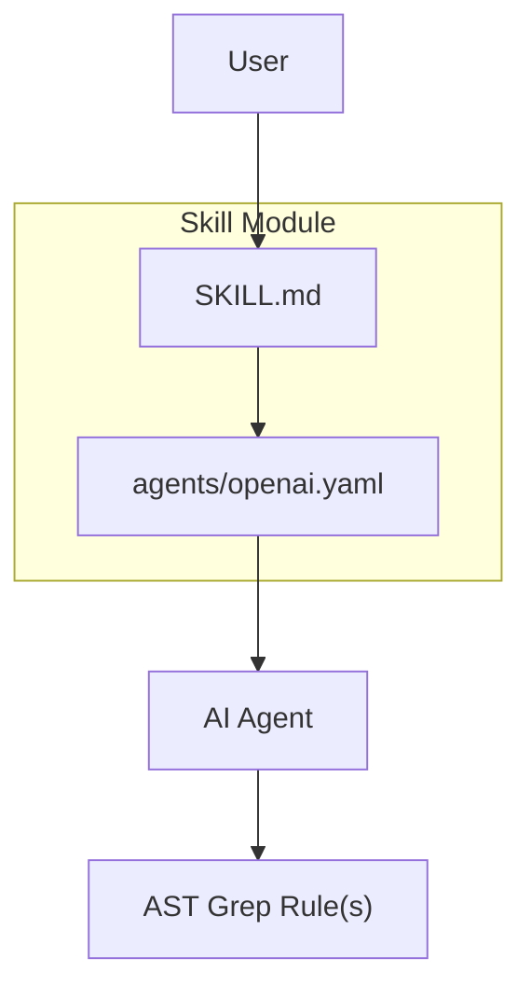
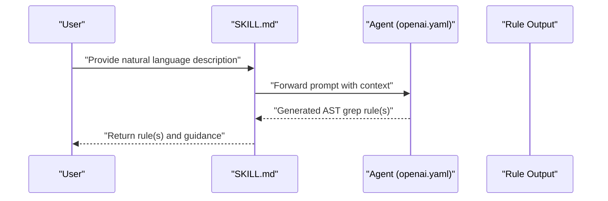
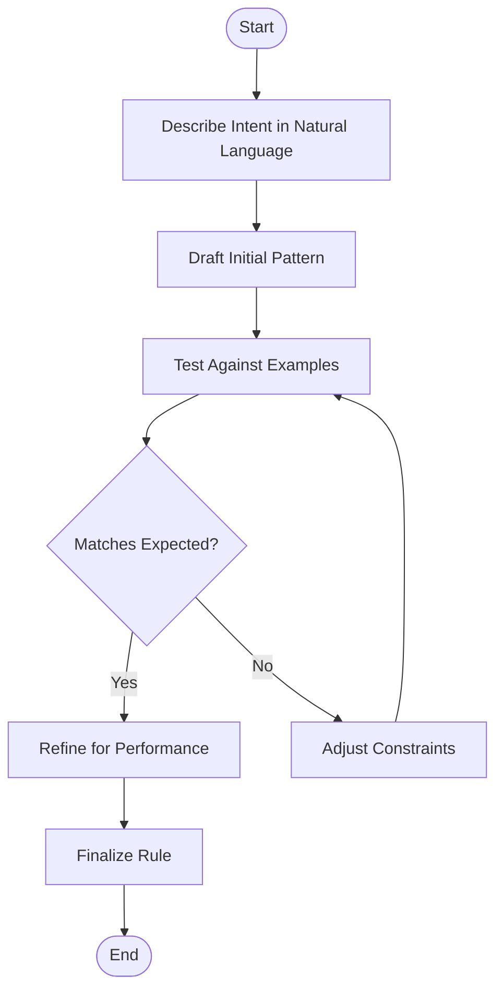
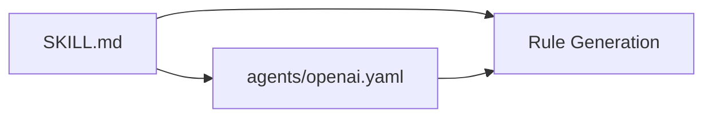

# AST Grep Rule Generation

<cite>
**Referenced Files in This Document**
- [SKILL.md](file://skills/pi-lens-write-ast-grep-rule/SKILL.md)
- [openai.yaml](file://skills/pi-lens-write-ast-grep-rule/agents/openai.yaml)
</cite>

## Table of Contents
1. [Introduction](#introduction)
2. [Project Structure](#project-structure)
3. [Core Components](#core-components)
4. [Architecture Overview](#architecture-overview)
5. [Detailed Component Analysis](#detailed-component-analysis)
6. [Dependency Analysis](#dependency-analysis)
7. [Performance Considerations](#performance-considerations)
8. [Troubleshooting Guide](#troubleshooting-guide)
9. [Conclusion](#conclusion)
10. [Appendices](#appendices)

## Introduction
This document explains how to use the pi-lens-write-ast-grep-rule skill to automate the creation of AST grep rules. It covers the rule generation workflow, best practices for designing effective patterns, validation techniques, and strategies for handling complex code structures. The goal is to help you transform natural language descriptions into precise AST grep patterns that are both accurate and performant.

## Project Structure
The skill is implemented as a standalone module under skills with an agent configuration and a skill definition:
- skills/pi-lens-write-ast-grep-rule/SKILL.md: Defines the skill’s purpose, inputs, outputs, and usage guidance.
- skills/pi-lens-write-ast-grep-rule/agents/openai.yaml: Configures the AI agent used by the skill.

**Diagram sources**
- [SKILL.md](file://skills/pi-lens-write-ast-grep-rule/SKILL.md)
- [openai.yaml](file://skills/pi-lens-write-ast-grep-rule/agents/openai.yaml)

**Section sources**
- [SKILL.md](file://skills/pi-lens-write-ast-grep-rule/SKILL.md)
- [openai.yaml](file://skills/pi-lens-write-ast-grep-rule/agents/openai.yaml)

## Core Components
- Skill Definition (SKILL.md): Describes what the skill does, expected inputs (e.g., natural language description, target language, scope), and outputs (AST grep rule definitions). It also provides instructions on how to interact with the skill and interpret results.
- Agent Configuration (agents/openai.yaml): Specifies the model and parameters used by the skill to generate rules from user prompts.

Key responsibilities:
- Translate natural language intent into structured AST grep queries.
- Provide guidance on pattern specificity, node types, and constraints.
- Suggest validation steps and iteration strategies.

**Section sources**
- [SKILL.md](file://skills/pi-lens-write-ast-grep-rule/SKILL.md)
- [openai.yaml](file://skills/pi-lens-write-ast-grep-rule/agents/openai.yaml)

## Architecture Overview
The skill follows a simple prompt-to-rule pipeline:
- Input: Natural language description of the desired match.
- Processing: The AI agent interprets the description and constructs AST grep patterns aligned with the target language’s AST.
- Output: One or more AST grep rules ready for execution and validation.

**Diagram sources**
- [SKILL.md](file://skills/pi-lens-write-ast-grep-rule/SKILL.md)
- [openai.yaml](file://skills/pi-lens-write-ast-grep-rule/agents/openai.yaml)

## Detailed Component Analysis

### Rule Generation Process
The skill converts high-level intent into concrete AST grep patterns through iterative refinement:
- Clarify intent: Identify the exact code construct to match (e.g., function call, import statement, class declaration).
- Select nodes and fields: Choose appropriate AST node types and filter by properties such as names, literals, or structural relationships.
- Compose constraints: Add conditions to reduce false positives (e.g., exclude specific identifiers, require surrounding context).
- Validate and iterate: Test against representative samples and refine the rule based on matches and misses.

Best practices:
- Start broad, then narrow down using additional constraints.
- Prefer explicit node types over generic wildcards when possible.
- Use contextual anchors (parent-child relationships) to avoid ambiguous matches.
- Keep rules focused on a single concern to improve readability and performance.

Validation techniques:
- Run the generated rule against a curated set of positive and negative examples.
- Inspect matched nodes to ensure they align with expectations.
- Adjust specificity if there are too many false positives or missed cases.

Handling complex structures:
- Decompose multi-line or nested constructs into smaller, composable patterns.
- Leverage sibling and ancestor/descendant relationships to capture surrounding context.
- When necessary, split one large rule into multiple focused rules and combine results at a higher level.

Optimizing performance:
- Minimize wildcard usage; prefer named nodes and exact identifiers where feasible.
- Avoid overly deep traversal unless required.
- Use targeted file/language filters to limit search scope.

Common pitfalls:
- Overly permissive patterns causing false positives.
- Missing contextual constraints leading to incorrect matches.
- Excessive nesting increasing runtime cost.

Debugging strategies:
- Narrow the rule incrementally until only the intended matches remain.
- Temporarily remove constraints to isolate problematic parts.
- Compare against known-good examples to verify behavior.

[No sources needed since this section provides general guidance]

### Example Transformations
Below are conceptual examples illustrating how to translate natural language descriptions into AST grep patterns. Replace placeholders with your actual codebase specifics.

- From “Find all calls to a logging function”:
  - Identify the logging function name and its call site node type.
  - Add constraints to match only direct calls and ignore comments or strings.
  - Optionally include parent context to ensure it occurs in executable code.

- From “Detect unsafe string concatenation in error messages”:
  - Match string literal concatenation nodes near error-related identifiers.
  - Exclude safe formatting functions if present.
  - Anchor to relevant scopes (e.g., catch blocks or error handlers).

- From “Locate deprecated API usages across modules”:
  - Target imports or references to deprecated symbols.
  - Include deprecation annotations or metadata if available in the AST.
  - Filter by language-specific import patterns.

[No sources needed since this section provides general guidance]

### Conceptual Workflow

[No sources needed since this diagram shows conceptual workflow, not actual code structure]

## Dependency Analysis
The skill depends on:
- SKILL.md: Provides the operational contract and user-facing instructions.
- agents/openai.yaml: Supplies the AI model configuration used during rule generation.

**Diagram sources**
- [SKILL.md](file://skills/pi-lens-write-ast-grep-rule/SKILL.md)
- [openai.yaml](file://skills/pi-lens-write-ast-grep-rule/agents/openai.yaml)

**Section sources**
- [SKILL.md](file://skills/pi-lens-write-ast-grep-rule/SKILL.md)
- [openai.yaml](file://skills/pi-lens-write-ast-grep-rule/agents/openai.yaml)

## Performance Considerations
- Prefer precise node types and identifiers to reduce search space.
- Limit recursion depth and avoid unnecessary wildcards.
- Scope searches to relevant files or directories.
- Split complex rules into smaller, reusable components when beneficial.
- Profile rule execution against realistic datasets to identify bottlenecks.

[No sources needed since this section provides general guidance]

## Troubleshooting Guide
When generated rules do not behave as expected:
- Revisit the natural language description for ambiguity and clarify constraints.
- Reduce pattern complexity step-by-step to isolate issues.
- Verify that the selected AST node types exist in the target language version.
- Check for false positives caused by comments, strings, or non-executable contexts.
- Use targeted test files to validate edge cases and corner scenarios.

[No sources needed since this section provides general guidance]

## Conclusion
The pi-lens-write-ast-grep-rule skill streamlines the creation of AST grep rules by translating natural language requirements into precise, validated patterns. By following best practices for specificity, context anchoring, and performance optimization—and by employing systematic validation and debugging—you can produce reliable rules that scale across large codebases.

[No sources needed since this section summarizes without analyzing specific files]

## Appendices
- For detailed usage instructions and examples, refer to the skill definition and agent configuration files listed above.

[No sources needed since this section provides general guidance]