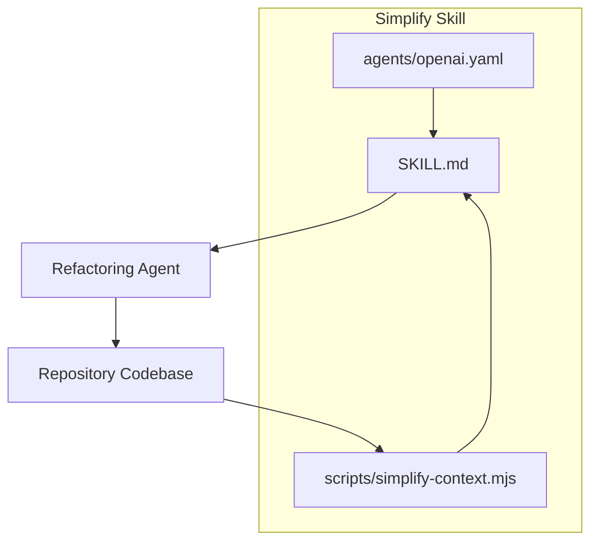
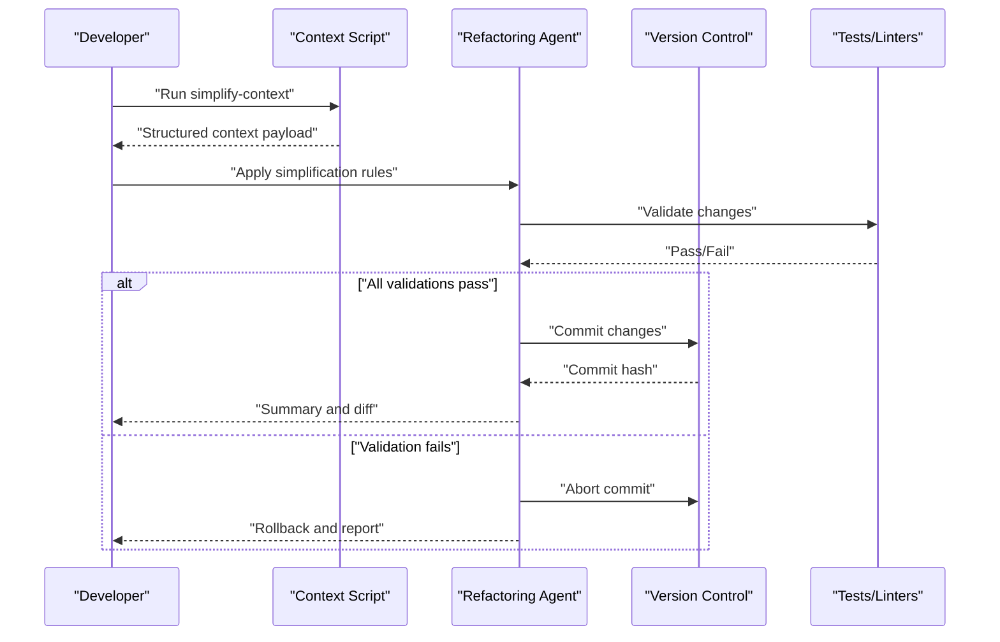
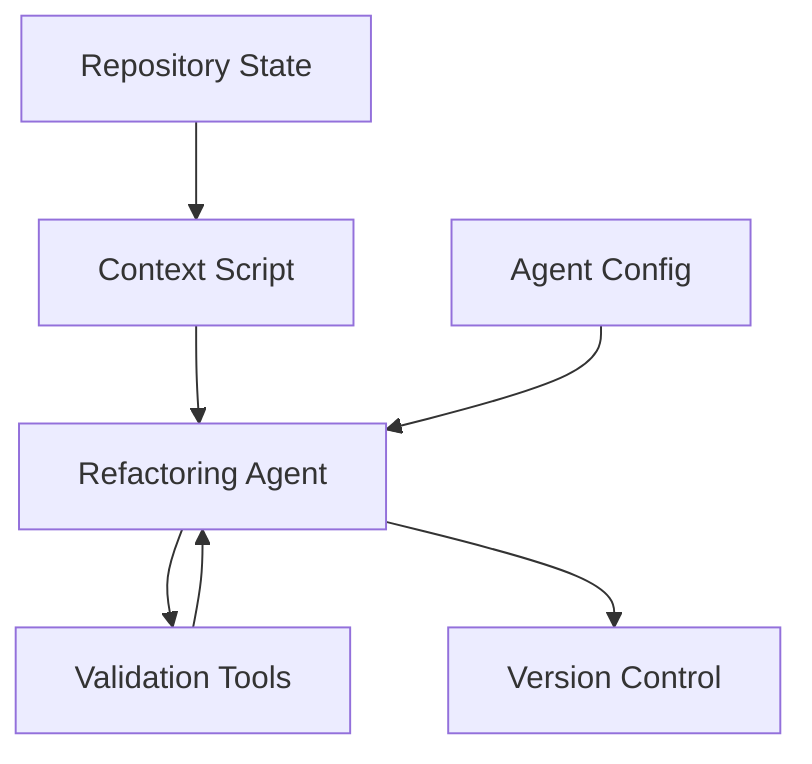

# Code Simplification & Refactoring

<cite>
**Referenced Files in This Document**
- [SKILL.md](file://skills/simplify/SKILL.md)
- [simplify-context.mjs](file://skills/simplify/scripts/simplify-context.mjs)
- [openai.yaml](file://skills/simplify/agents/openai.yaml)
</cite>

## Table of Contents
1. [Introduction](#introduction)
2. [Project Structure](#project-structure)
3. [Core Components](#core-components)
4. [Architecture Overview](#architecture-overview)
5. [Detailed Component Analysis](#detailed-component-analysis)
6. [Dependency Analysis](#dependency-analysis)
7. [Performance Considerations](#performance-considerations)
8. [Troubleshooting Guide](#troubleshooting-guide)
9. [Conclusion](#conclusion)
10. [Appendices](#appendices)

## Introduction
This document explains the simplify skill, which performs intelligent code simplification and refactoring. It covers the refactoring algorithms and transformation strategies, safety guarantees, configuration of simplification rules, handling complex transformations, maintaining code quality during refactoring, common refactoring patterns, batch processing capabilities, integration with version control systems, usage of the simplify-context script, performance considerations, and rollback mechanisms for failed transformations.

The goal is to provide both a high-level understanding and practical guidance for safely applying automated refactors at scale while preserving correctness and readability.

## Project Structure
The simplify skill is organized as a modular package with three primary artifacts:
- A skill definition that describes goals, constraints, and workflows
- An agent configuration that defines model behavior and tooling
- A context preparation script that gathers repository state and produces structured inputs for the agent

**Diagram sources**
- [SKILL.md](file://skills/simplify/SKILL.md)
- [openai.yaml](file://skills/simplify/agents/openai.yaml)
- [simplify-context.mjs](file://skills/simplify/scripts/simplify-context.mjs)

**Section sources**
- [SKILL.md](file://skills/simplify/SKILL.md)
- [openai.yaml](file://skills/simplify/agents/openai.yaml)
- [simplify-context.mjs](file://skills/simplify/scripts/simplify-context.mjs)

## Core Components
- Skill Definition (SKILL.md): Describes objectives, scope, constraints, and step-by-step workflows for safe refactoring. It also outlines how to configure rules, validate changes, and integrate with version control.
- Agent Configuration (agents/openai.yaml): Specifies model parameters, tool access, and behavioral constraints used by the refactoring agent.
- Context Script (scripts/simplify-context.mjs): Prepares a deterministic snapshot of relevant files, symbols, and metadata to guide the agent’s decisions and reduce hallucination risk.

Key responsibilities:
- Rule-driven transformations guided by explicit policies
- Safety checks before and after applying changes
- Batch orchestration across multiple files or directories
- Version control integration for atomic commits and rollbacks

**Section sources**
- [SKILL.md](file://skills/simplify/SKILL.md)
- [openai.yaml](file://skills/simplify/agents/openai.yaml)
- [simplify-context.mjs](file://skills/simplify/scripts/simplify-context.mjs)

## Architecture Overview
The simplify workflow orchestrates three layers:
- Context Preparation: The script collects repository state and emits a structured context payload.
- Agent Execution: The configured agent applies rule-based transformations with guardrails.
- Validation and Commit: Changes are validated against tests and style rules, then committed atomically with optional rollback on failure.

[No diagram sources needed since this diagram shows conceptual workflow, not actual code structure]

## Detailed Component Analysis

### Skill Definition (SKILL.md)
Purpose:
- Defines the scope and boundaries of simplification tasks
- Enumerates allowed transformation strategies and prohibited patterns
- Provides guidelines for incremental refactoring and review
- Outlines integration points with CI and VCS

Highlights:
- Transformation strategies include dead code removal, duplication elimination, extraction of helpers, normalization of conditionals, and consistent formatting
- Safety guarantees require preservation of external behavior, test coverage retention, and no breaking API changes unless explicitly permitted
- Quality gates include static analysis, linting, and minimal test execution before committing

Configuration:
- Rules can be enabled/disabled per language or directory
- Thresholds for complexity reduction and duplication thresholds are configurable
- Exclusions allow skipping generated or third-party code

Integration:
- Suggests creating feature branches and small PRs
- Encourages pre-commit hooks to enforce consistency

**Section sources**
- [SKILL.md](file://skills/simplify/SKILL.md)

### Agent Configuration (agents/openai.yaml)
Purpose:
- Configures the model’s behavior for refactoring tasks
- Sets constraints to prevent unsafe modifications
- Enables tool use for reading, writing, and executing validation commands

Highlights:
- Model parameters tuned for precision over creativity
- Tool permissions limited to necessary operations
- Guardrails to avoid destructive actions without confirmation

Usage:
- Adjust temperature and max tokens to balance thoroughness and speed
- Enable/disable specific tools based on environment security policy

**Section sources**
- [openai.yaml](file://skills/simplify/agents/openai.yaml)

### Context Script (scripts/simplify-context.mjs)
Purpose:
- Gathers repository state deterministically
- Produces a structured context payload for the agent
- Supports filtering by file types, paths, and symbol scopes

Capabilities:
- Scans for relevant files and symbols
- Computes dependency hints and call sites
- Generates summaries to reduce token usage
- Supports batch mode for multi-file refactors

Safety:
- Ignores binary and large files by default
- Respects ignore patterns and excludes sensitive paths
- Outputs only non-sensitive metadata

Usage:
- Run prior to invoking the agent to ensure accurate context
- Use filters to target specific modules or subsystems

**Section sources**
- [simplify-context.mjs](file://skills/simplify/scripts/simplify-context.mjs)

### Refactoring Algorithms and Strategies
Common strategies implemented or supported:
- Dead code removal: Identify unused functions, variables, and imports; remove if safe
- Duplication elimination: Detect duplicated logic and extract shared helpers
- Conditional normalization: Simplify nested conditionals and boolean expressions
- Helper extraction: Split long functions into focused units
- Naming and formatting: Apply consistent naming conventions and formatting rules

Transformation pipeline:
- Analyze context and identify candidates
- Propose changes with rationale
- Validate via tests and linters
- Commit if all checks pass; otherwise, rollback and report

Safety guarantees:
- Preserve public APIs and observable behavior
- Maintain or improve test coverage
- Avoid introducing new dependencies unless required
- Provide diffs and explanations for each change

Complexity handling:
- Multi-file refactorings are staged incrementally
- Large changes are split into smaller, reviewable commits
- Rollback is automatic on validation failures

**Section sources**
- [SKILL.md](file://skills/simplify/SKILL.md)
- [simplify-context.mjs](file://skills/simplify/scripts/simplify-context.mjs)

### Common Refactoring Patterns
- Remove unused imports and variables
- Extract repeated blocks into reusable functions
- Replace verbose conditionals with concise constructs
- Normalize naming and formatting across modules
- Consolidate similar error handling paths

Batch processing:
- Target entire directories or file globs
- Prioritize high-impact areas first
- Generate change summaries per batch

Version control integration:
- Create feature branches for each batch
- Commit with descriptive messages
- Open pull requests for peer review

**Section sources**
- [SKILL.md](file://skills/simplify/SKILL.md)

### simplify-context Script Usage
Workflow:
- Prepare context for a subset of the codebase
- Filter by language, path, or symbol
- Output structured data for the agent
- Integrate with CI to precompute contexts

Best practices:
- Keep context size manageable
- Exclude generated or vendor code
- Cache outputs when possible to improve performance

**Section sources**
- [simplify-context.mjs](file://skills/simplify/scripts/simplify-context.mjs)

## Dependency Analysis
The simplify skill depends on:
- Repository state (files, symbols, tests)
- Agent runtime configured via YAML
- External tools for validation (linters, test runners)

Relationships:
- The context script reads repository state and feeds it to the agent
- The agent uses the configuration to constrain its behavior
- Validation tools enforce correctness and style

[No diagram sources needed since this diagram shows conceptual relationships, not actual code structure]

## Performance Considerations
- Limit context size by filtering files and symbols
- Use incremental refactors to reduce memory and time overhead
- Parallelize independent batches where safe
- Cache context outputs and test results
- Prefer targeted transformations over global rewrites
- Monitor token usage and adjust model parameters accordingly

[No sources needed since this section provides general guidance]

## Troubleshooting Guide
Common issues and resolutions:
- Missing context: Ensure the context script runs successfully and includes required files
- Validation failures: Review diffs and fix failing tests or lint errors
- Slow performance: Narrow scope, enable caching, and reduce model parameters
- Unsafe changes: Revisit rules and tighten constraints in the agent configuration
- Rollback needed: Abort commit on failure and inspect logs for root cause

Operational tips:
- Use small, frequent commits
- Keep PRs focused and reviewable
- Log detailed summaries for auditability

**Section sources**
- [SKILL.md](file://skills/simplify/SKILL.md)
- [openai.yaml](file://skills/simplify/agents/openai.yaml)
- [simplify-context.mjs](file://skills/simplify/scripts/simplify-context.mjs)

## Conclusion
The simplify skill provides a structured, safe approach to code simplification and refactoring. By combining rule-driven transformations, robust context preparation, and strict validation, it enables teams to maintain high code quality at scale. With careful configuration, incremental batching, and strong rollback mechanisms, it supports continuous improvement without compromising stability.

[No sources needed since this section summarizes without analyzing specific files]

## Appendices

### Configuration Checklist
- Define allowed transformations and exclusions
- Set thresholds for complexity and duplication
- Configure agent parameters for precision
- Enable pre-commit hooks for validation
- Establish branch and PR conventions for refactors

### Integration Examples
- Pre-commit hook to run context preparation and validation
- CI job to apply simplifications on staging branches
- Post-commit summary generation for audit trails

[No sources needed since this section provides general guidance]