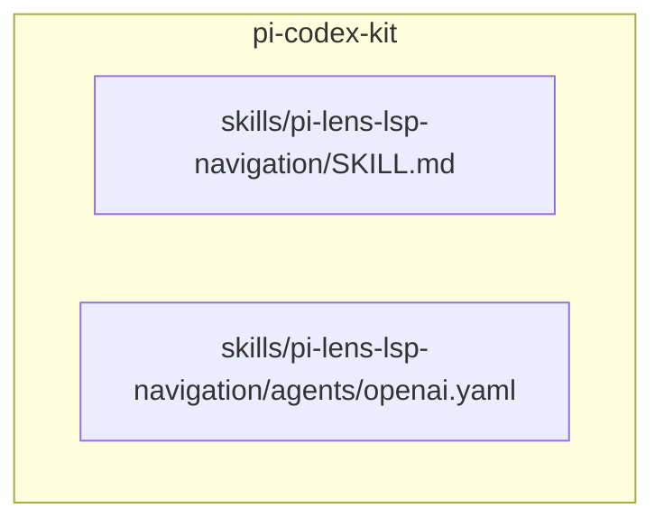
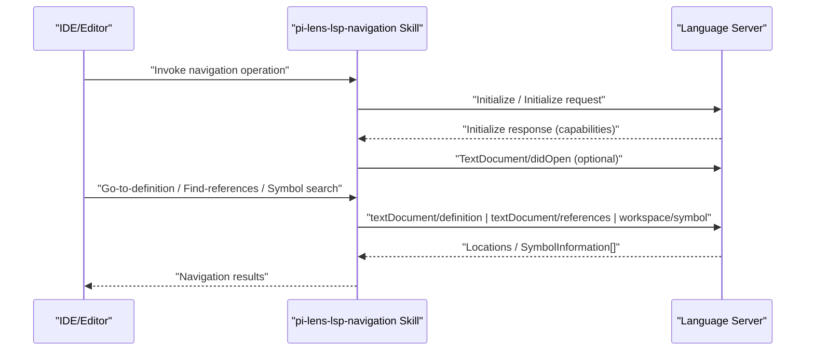
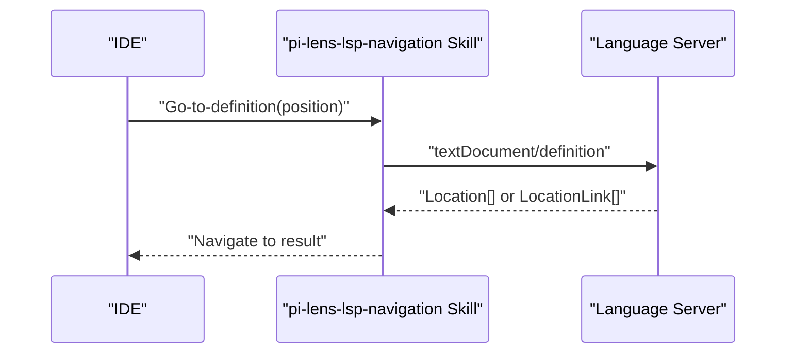
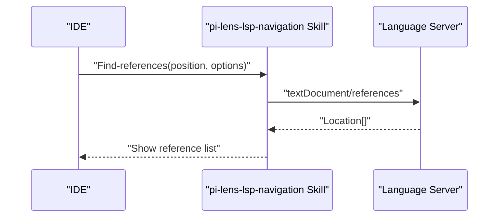
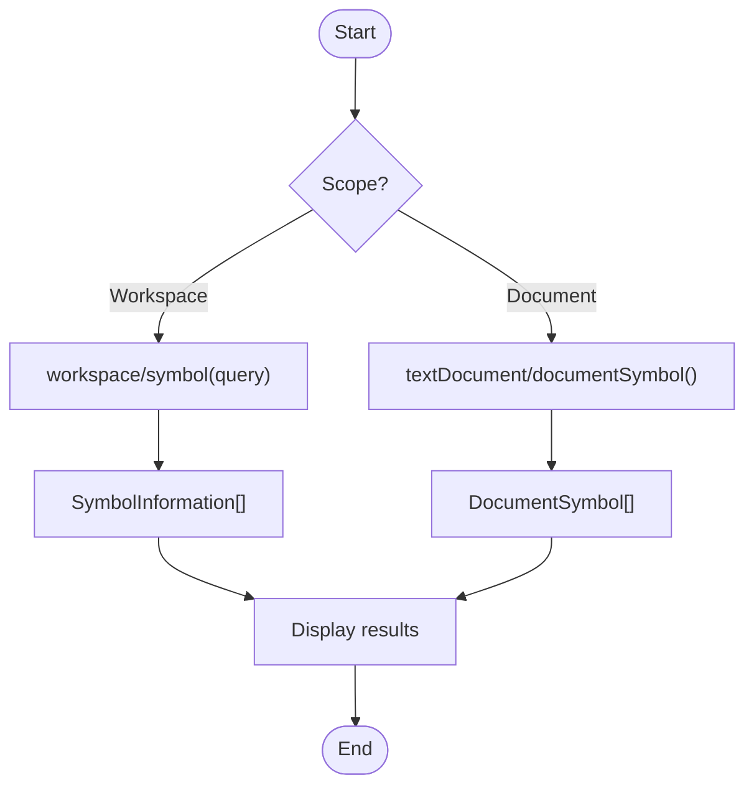
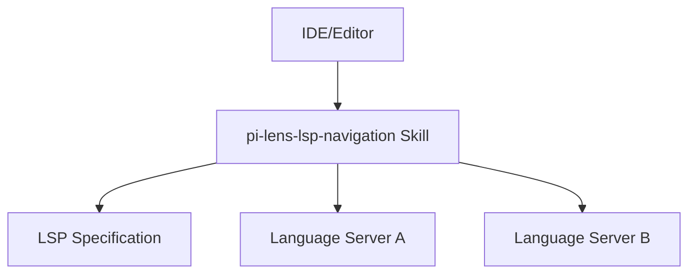
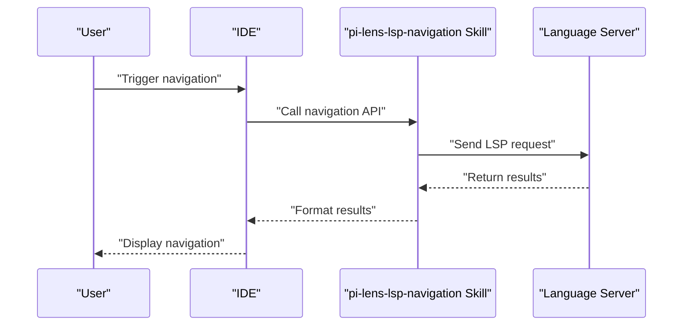

# LSP Navigation Integration

<cite>
**Referenced Files in This Document**
- [SKILL.md](file://skills/pi-lens-lsp-navigation/SKILL.md)
- [openai.yaml](file://skills/pi-lens-lsp-navigation/agents/openai.yaml)
</cite>

## Table of Contents
1. [Introduction](#introduction)
2. [Project Structure](#project-structure)
3. [Core Components](#core-components)
4. [Architecture Overview](#architecture-overview)
5. [Detailed Component Analysis](#detailed-component-analysis)
6. [Dependency Analysis](#dependency-analysis)
7. [Performance Considerations](#performance-considerations)
8. [Troubleshooting Guide](#troubleshooting-guide)
9. [Conclusion](#conclusion)
10. [Appendices](#appendices)

## Introduction
This document explains how the pi-lens-lsp-navigation skill provides IDE navigation capabilities through the Language Server Protocol (LSP). It covers LSP concepts, connection management, and navigation operations such as go-to-definition, find-references, and symbol search. It also includes guidance on integrating with popular IDEs, handling different language servers, optimizing performance, and addressing error handling, timeouts, and debugging communication issues.

## Project Structure
The pi-lens-lsp-navigation skill is organized under the skills directory and contains:
- A skill definition file that describes capabilities and usage patterns
- An agent configuration for invoking the skill within the platform

**Diagram sources**
- [SKILL.md](file://skills/pi-lens-lsp-navigation/SKILL.md)
- [openai.yaml](file://skills/pi-lens-lsp-navigation/agents/openai.yaml)

**Section sources**
- [SKILL.md](file://skills/pi-lens-lsp-navigation/SKILL.md)
- [openai.yaml](file://skills/pi-lens-lsp-navigation/agents/openai.yaml)

## Core Components
- Skill definition: Describes the purpose, supported LSP features, and integration points for navigation operations.
- Agent configuration: Specifies runtime parameters and invocation settings used by the platform to execute the skill.

Key responsibilities:
- Define which LSP methods are exposed for navigation (e.g., definition, references, symbols).
- Provide instructions for connecting to a language server and managing sessions.
- Outline best practices for performance, error handling, and debugging.

**Section sources**
- [SKILL.md](file://skills/pi-lens-lsp-navigation/SKILL.md)
- [openai.yaml](file://skills/pi-lens-lsp-navigation/agents/openai.yaml)

## Architecture Overview
At a high level, the skill orchestrates interactions between an IDE or editor and one or more language servers via LSP. The flow typically involves:
- Establishing a transport channel (stdio or TCP) to the language server
- Initializing the session and negotiating capabilities
- Sending LSP requests for navigation operations
- Receiving responses and presenting results in the IDE

[No sources needed since this diagram shows conceptual workflow, not actual code structure]

## Detailed Component Analysis

### LSP Concepts and Capabilities
- Transport: stdio or TCP connections to language servers
- Lifecycle: initialize, initialized, shutdown, exit
- Text synchronization: didOpen, didChange, didClose, willSave, didSave
- Navigation methods:
  - textDocument/definition
  - textDocument/references
  - textDocument/declaration
  - textDocument/typeDefinition
  - textDocument/implementation
  - workspace/symbol
  - textDocument/documentSymbol
- Workspace features:
  - workspace/workspaceFolders
  - workspace/configuration
  - workspace/didChangeConfiguration

These capabilities determine what navigation features are available for a given language server.

**Section sources**
- [SKILL.md](file://skills/pi-lens-lsp-navigation/SKILL.md)

### Connection Management
- Discovery: Locate the appropriate language server executable or command based on project context and language.
- Initialization: Send initialize request with client capabilities; handle server capabilities to enable only supported features.
- Session lifecycle: Maintain per-project or per-root sessions; reuse connections when possible; gracefully shut down on exit.
- Configuration: Pass workspace folders and optional settings to the server during initialization.

Best practices:
- Cache server processes per workspace root
- Detect server capability changes and adapt feature availability
- Avoid redundant initialization calls

**Section sources**
- [SKILL.md](file://skills/pi-lens-lsp-navigation/SKILL.md)

### Navigation Operations

#### Go-to Definition
- Request: textDocument/definition
- Input: textDocument identifier and position
- Output: Location(s) or LocationLink(s)
- UX: Open target file at line/column; support multiple locations

**Diagram sources**
- [SKILL.md](file://skills/pi-lens-lsp-navigation/SKILL.md)

**Section sources**
- [SKILL.md](file://skills/pi-lens-lsp-navigation/SKILL.md)

#### Find References
- Request: textDocument/references
- Input: textDocument identifier, position, and options (includeDeclaration, context)
- Output: Location[]
- UX: Present list of locations; allow filtering and quick open

**Diagram sources**
- [SKILL.md](file://skills/pi-lens-lsp-navigation/SKILL.md)

**Section sources**
- [SKILL.md](file://skills/pi-lens-lsp-navigation/SKILL.md)

#### Symbol Search
- Requests:
  - workspace/symbol: search across workspace
  - textDocument/documentSymbol: search within current document
- Input: query string and filters
- Output: SymbolInformation[] or DocumentSymbol[]
- UX: Provide fuzzy matching, type filtering, and hierarchical view for document symbols

**Diagram sources**
- [SKILL.md](file://skills/pi-lens-lsp-navigation/SKILL.md)

**Section sources**
- [SKILL.md](file://skills/pi-lens-lsp-navigation/SKILL.md)

### Integrating With Popular IDEs
- VS Code: Use the built-in LSP client; configure language server commands and workspace settings.
- JetBrains IDEs: Configure external tools or plugins that bridge LSP to the IDE’s navigation UI.
- Neovim/Vim: Employ LSP clients (e.g., native lsp or third-party) and map keybindings to LSP methods.
- Emacs: Leverage eglot or lsp-mode for LSP integration.

Integration tips:
- Map IDE actions to LSP methods consistently
- Respect server capabilities to avoid unsupported calls
- Provide user feedback during long-running operations

**Section sources**
- [SKILL.md](file://skills/pi-lens-lsp-navigation/SKILL.md)

### Handling Different Language Servers
- Capability negotiation: Adapt to server-provided capabilities after initialize
- Fallback strategies: If a server lacks a feature, provide a best-effort alternative or disable the action
- Multi-language workspaces: Route requests to the correct server based on URI and languageId

**Section sources**
- [SKILL.md](file://skills/pi-lens-lsp-navigation/SKILL.md)

### Optimizing Navigation Performance
- Connection reuse: Keep long-lived server processes per workspace root
- Caching: Cache symbol indexes and recent results where safe
- Throttling: Debounce rapid symbol queries
- Incremental updates: Use didChange notifications to keep server state fresh without full re-indexes
- Selective requests: Limit scope (document vs workspace) based on user intent

**Section sources**
- [SKILL.md](file://skills/pi-lens-lsp-navigation/SKILL.md)

## Dependency Analysis
The skill depends on:
- LSP specification and method contracts
- One or more language servers providing navigation capabilities
- IDE/editor integrations that invoke the skill’s navigation actions

[No sources needed since this diagram shows conceptual relationships, not actual code structure]

## Performance Considerations
- Prefer workspace/symbol over full-text scans
- Use textDocument/documentSymbol for in-file searches
- Avoid unnecessary didOpen/didChange churn
- Set reasonable timeouts for long-running requests
- Monitor memory usage of long-lived server processes

[No sources needed since this section provides general guidance]

## Troubleshooting Guide
Common issues and remedies:
- Connection failures: Verify server executable path and arguments; check stdout/stderr logs
- Timeouts: Increase request timeout; ensure server is responsive; reduce workload scope
- Missing features: Check server capabilities; disable unsupported actions in the UI
- Incorrect positions: Ensure zero-based indexing and proper encoding (UTF-8)
- Debugging LSP traffic: Enable verbose logging on both client and server sides

Operational checks:
- Validate initialize handshake and capability exchange
- Confirm workspace folders are correctly passed
- Inspect error codes and messages from server responses

**Section sources**
- [SKILL.md](file://skills/pi-lens-lsp-navigation/SKILL.md)

## Conclusion
The pi-lens-lsp-navigation skill enables robust IDE navigation by leveraging LSP. By understanding LSP concepts, managing connections effectively, and implementing core navigation operations, teams can deliver fast and reliable code exploration experiences across diverse languages and editors. Adhering to performance and troubleshooting best practices ensures a smooth developer workflow.

[No sources needed since this section summarizes without analyzing specific files]

## Appendices

### Appendix A: Example Invocation Flow
A typical sequence for a navigation action:
- User triggers action in IDE
- IDE sends request to the skill
- Skill constructs LSP request and invokes the language server
- Server returns navigation data
- Skill formats and presents results to the user

[No sources needed since this diagram shows conceptual workflow, not actual code structure]